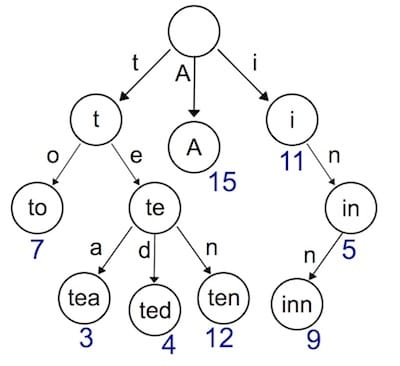
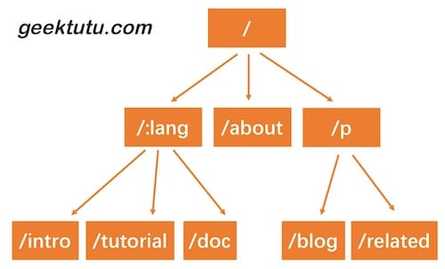
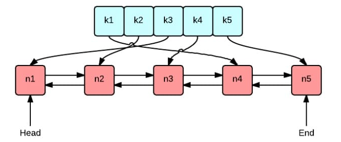
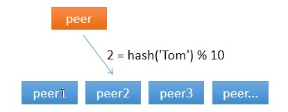
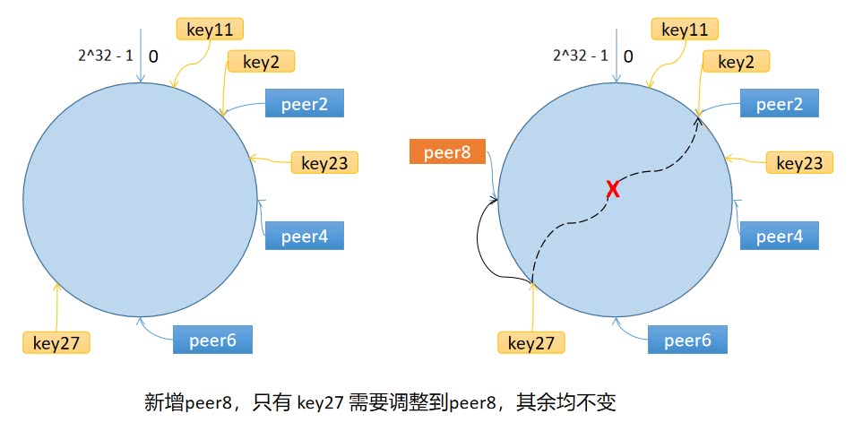
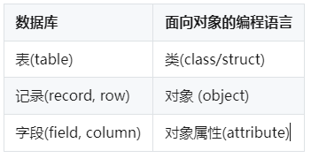
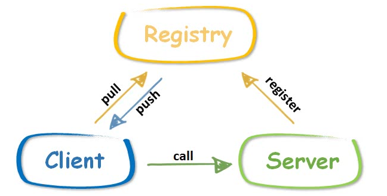

- [https://geektutu.com/post/gee.html](https://geektutu.com/post/gee.html)
- # 1.  Go Web框架
- 我们需要实现一个 Web 应用，第一反应是应该使用哪个框架。不同的框架设计理念和提供的功能有很大的差别。比如 Python 语言的 django和flask，前者大而全，后者小而美。Go语言/golang 也是如此，新框架层出不穷，比如Beego，Gin，Iris等。那为什么不直接使用标准库，而必须使用框架呢？在设计一个框架之前，我们需要回答框架核心为我们解决了什么问题。只有理解了这一点，才能想明白我们需要在框架中实现什么功能。
- ## 1.1.  HTTP基础
- Go语言内置了 net/http库，封装了HTTP网络编程的基础的接口，我们实现的Gee Web 框架便是基于net/http的。我们接下来通过一个例子，简单介绍下这个库的使用。
  
  ```
  package main
  
  import (
    "fmt"
    "log"
    "net/http"
  )
  
  func main() {
    http.HandleFunc("/", indexHandler)
    http.HandleFunc("/hello", helloHandler)
    log.Fatal(http.ListenAndServe(":9999", nil))
  }
  
  // handler echoes r.URL.Path
  func indexHandler(w http.ResponseWriter, req *http.Request) {
    fmt.Fprintf(w, "URL.Path = %q\n", req.URL.Path)
  }
  
  // handler echoes r.URL.Header
  func helloHandler(w http.ResponseWriter, req *http.Request) {
    for k, v := range req.Header {
        fmt.Fprintf(w, "Header[%q] = %q\n", k, v)
    }
  }
  ```
- 我们设置了2个路由，/和/hello，分别绑定 indexHandler 和 helloHandler ， 根据不同的HTTP请求会调用不同的处理函数。访问/，响应是URL.Path = /，而/hello的响应则是请求头(header)中的键值对信息。
- 用 curl 这个工具测试一下，将会得到如下的结果。
  
  ```
  $ curl http://localhost:9999/
  URL.Path = "/"
  $ curl http://localhost:9999/hello
  Header["Accept"] = ["*/*"]
  Header["User-Agent"] = ["curl/7.54.0"]
  ```
- main 函数的最后一行，是用来启动 Web 服务的，第一个参数是地址，:9999表示在 9999 端口监听。而第二个参数则代表处理所有的HTTP请求的实例，nil 代表使用标准库中的实例处理。第二个参数，则是我们基于net/http标准库实现Web框架的入口。
- 实现http.Handler接口
  
  ```
  package http
  
  type Handler interface {
    ServeHTTP(w ResponseWriter, r *Request)
  }
  
  func ListenAndServe(address string, h Handler) error
  ```
- 第二个参数的类型是什么呢？通过查看net/http的源码可以发现，Handler是一个接口，需要实现方法 ServeHTTP ，也就是说，只要传入任何实现了 ServerHTTP 接口的实例，所有的HTTP请求，就都交给了该实例处理了。马上来试一试吧。
  
  ```
  package main
  
  import (
  "fmt"
  "log"
  "net/http"
  )
  
  // Engine is the uni handler for all requests
  type Engine struct{}
  
  func (engine *Engine) ServeHTTP(w http.ResponseWriter, req *http.Request) {
  switch req.URL.Path {
  case "/":
  fmt.Fprintf(w, "URL.Path = %q\n", req.URL.Path)
  case "/hello":
  for k, v := range req.Header {
  	fmt.Fprintf(w, "Header[%q] = %q\n", k, v)
  }
  default:
  fmt.Fprintf(w, "404 NOT FOUND: %s\n", req.URL)
  }
  }
  
  func main() {
  engine := new(Engine)
  log.Fatal(http.ListenAndServe(":9999", engine))
  }
  ```
- 我们定义了一个空的结构体Engine，实现了方法ServeHTTP。这个方法有2个参数，第二个参数是 Request ，该对象包含了该HTTP请求的所有的信息，比如请求地址、Header和Body等信息；第一个参数是 ResponseWriter ，利用 ResponseWriter 可以构造针对该请求的响应。
- 在 main 函数中，我们给 ListenAndServe 方法的第二个参数传入了刚才创建的engine实例。至此，我们走出了实现Web框架的第一步，即，将所有的HTTP请求转向了我们自己的处理逻辑。还记得吗，在实现Engine之前，我们调用 http.HandleFunc 实现了路由和Handler的映射，也就是只能针对具体的路由写处理逻辑。比如/hello。但是在实现Engine之后，我们拦截了所有的HTTP请求，拥有了统一的控制入口。在这里我们可以自由定义路由映射的规则，也可以统一添加一些处理逻辑，例如日志、异常处理等。
- 代码的运行结果与之前的是一致的。
- ## 1.2.  框架雏形
- 代码目录结构是这样的
  
  ```
  gee/
  |--gee.go
  |--go.mod
  main.go
  go.mod
  ```
- 在 go.mod 中使用 replace 将 gee 指向 ./gee
  
  从 go 1.11 版本开始，引用相对路径的 package 需要使用上述方式。
  
  ```
  module example
  
  go 1.13
  
  require gee v0.0.0
  
  replace gee => ./gee
  ```
  
  ```
  package main
  
  import (
  "fmt"
  "net/http"
  
  "gee"
  )
  
  func main() {
  r := gee.New()
  r.GET("/", func(w http.ResponseWriter, req *http.Request) {
  fmt.Fprintf(w, "URL.Path = %q\n", req.URL.Path)
  })
  
  r.GET("/hello", func(w http.ResponseWriter, req *http.Request) {
  for k, v := range req.Header {
  	fmt.Fprintf(w, "Header[%q] = %q\n", k, v)
  }
  })
  
  r.Run(":9999")
  }
  ```
- 看到这里，如果你使用过gin框架的话，肯定会觉得无比的亲切。gee框架的设计以及API均参考了gin。使用New()创建 gee 的实例，使用 GET()方法添加路由，最后使用Run()启动Web服务。这里的路由，只是静态路由，不支持/hello/:name这样的动态路由，动态路由我们将在下一次实现。
  
  ```
  package gee
  
  import (
  "fmt"
  "net/http"
  )
  
  // HandlerFunc defines the request handler used by gee
  type HandlerFunc func(http.ResponseWriter, *http.Request)
  
  // Engine implement the interface of ServeHTTP
  type Engine struct {
  router map[string]HandlerFunc
  }
  
  // New is the constructor of gee.Engine
  func New() *Engine {
  return &Engine{router: make(map[string]HandlerFunc)}
  }
  
  func (engine *Engine) addRoute(method string, pattern string, handler HandlerFunc) {
  key := method + "-" + pattern
  engine.router[key] = handler
  }
  
  // GET defines the method to add GET request
  func (engine *Engine) GET(pattern string, handler HandlerFunc) {
  engine.addRoute("GET", pattern, handler)
  }
  
  // POST defines the method to add POST request
  func (engine *Engine) POST(pattern string, handler HandlerFunc) {
  engine.addRoute("POST", pattern, handler)
  }
  
  // Run defines the method to start a http server
  func (engine *Engine) Run(addr string) (err error) {
  return http.ListenAndServe(addr, engine)
  }
  
  func (engine *Engine) ServeHTTP(w http.ResponseWriter, req *http.Request) {
  key := req.Method + "-" + req.URL.Path
  if handler, ok := engine.router[key]; ok {
  handler(w, req)
  } else {
  fmt.Fprintf(w, "404 NOT FOUND: %s\n", req.URL)
  }
  }
  ```
- 那么gee.go就是重头戏了。我们重点介绍一下这部分的实现。
	- 首先定义了类型HandlerFunc，这是提供给框架用户的，用来定义路由映射的处理方法。我们在Engine中，添加了一张路由映射表router，key 由请求方法和静态路由地址构成，例如GET-/、GET-/hello、POST-/hello，这样针对相同的路由，如果请求方法不同,可以映射不同的处理方法(Handler)，value 是用户映射的处理方法。
	- 当用户调用(*Engine).GET()方法时，会将路由和处理方法注册到映射表 *router* 中，(*Engine).Run()方法，是 *ListenAndServe* 的包装。
	- Engine实现的 *ServeHTTP* 方法的作用就是，解析请求的路径，查找路由映射表，如果查到，就执行注册的处理方法。如果查不到，就返回 *404 NOT FOUND* 。
- 执行go run main.go，再用 *curl* 工具访问，结果与最开始的一致。
  
  ```
  $ curl http://localhost:9999/
  URL.Path = "/"
  $ curl http://localhost:9999/hello
  Header["Accept"] = ["*/*"]
  Header["User-Agent"] = ["curl/7.54.0"]
  curl http://localhost:9999/world
  404 NOT FOUND: /world
  ```
- 至此，整个Gee框架的原型已经出来了。实现了路由映射表，提供了用户注册静态路由的方法，包装了启动服务的函数。
- 示例
  
  ```
  func main() {
  r := gee.New()
  r.GET("/", func(c *gee.Context) {
  c.HTML(http.StatusOK, "<h1>Hello Gee</h1>")
  })
  r.GET("/hello", func(c *gee.Context) {
  // expect /hello?name=geektutu
  c.String(http.StatusOK, "hello %s, you're at %s\n", c.Query("name"), c.Path)
  })
  
  r.POST("/login", func(c *gee.Context) {
  c.JSON(http.StatusOK, gee.H{
  	"username": c.PostForm("username"),
  	"password": c.PostForm("password"),
  })
  })
  
  r.Run(":9999")
  }
  ```
- Handler的参数变成成了gee.Context，提供了查询Query/PostForm参数的功能。
- gee.Context封装了HTML/String/JSON函数，能够快速构造HTTP响应。
- ## 1.3.  设计Context
- 1. 对Web服务来说，无非是根据请求*http.Request，构造响应http.ResponseWriter。但是这两个对象提供的接口粒度太细，比如我们要构造一个完整的响应，需要考虑消息头(Header)和消息体(Body)，而 Header 包含了状态码(StatusCode)，消息类型(ContentType)等几乎每次请求都需要设置的信息。因此，如果不进行有效的封装，那么框架的用户将需要写大量重复，繁杂的代码，而且容易出错。针对常用场景，能够高效地构造出 HTTP 响应是一个好的框架必须考虑的点。
- 用返回 JSON 数据作比较，感受下封装前后的差距。
  
  ```
  obj = map[string]interface{}{
    "name": "geektutu",
    "password": "1234",
  }
  w.Header().Set("Content-Type", "application/json")
  w.WriteHeader(http.StatusOK)
  encoder := json.NewEncoder(w)
  if err := encoder.Encode(obj); err != nil {
    http.Error(w, err.Error(), 500)
  }
  ```
  
  ```
  c.JSON(http.StatusOK, gee.H{
    "username": c.PostForm("username"),
    "password": c.PostForm("password"),
  })
  ```
- 2. 针对使用场景，封装*http.Request和http.ResponseWriter的方法，简化相关接口的调用，只是设计 Context 的原因之一。对于框架来说，还需要支撑额外的功能。例如，将来解析动态路由/hello/:name，参数:name的值放在哪呢？再比如，框架需要支持中间件，那中间件产生的信息放在哪呢？Context 随着每一个请求的出现而产生，请求的结束而销毁，和当前请求强相关的信息都应由 Context 承载。因此，设计 Context 结构，扩展性和复杂性留在了内部，而对外简化了接口。路由的处理函数，以及将要实现的中间件，参数都统一使用 Context 实例， Context 就像一次会话的百宝箱，可以找到任何东西。
- 具体实现
  
  ```
  type H map[string]interface{}
  
  type Context struct {
  // origin objects
  Writer http.ResponseWriter
  Req    *http.Request
  // request info
  Path   string
  Method string
  // response info
  StatusCode int
  }
  
  func newContext(w http.ResponseWriter, req *http.Request) *Context {
  return &Context{
  Writer: w,
  Req:    req,
  Path:   req.URL.Path,
  Method: req.Method,
  }
  }
  
  func (c *Context) PostForm(key string) string {
  return c.Req.FormValue(key)
  }
  
  func (c *Context) Query(key string) string {
  return c.Req.URL.Query().Get(key)
  }
  
  func (c *Context) Status(code int) {
  c.StatusCode = code
  c.Writer.WriteHeader(code)
  }
  
  func (c *Context) SetHeader(key string, value string) {
  c.Writer.Header().Set(key, value)
  }
  
  func (c *Context) String(code int, format string, values ...interface{}) {
  c.SetHeader("Content-Type", "text/plain")
  c.Status(code)
  c.Writer.Write([]byte(fmt.Sprintf(format, values...)))
  }
  
  func (c *Context) JSON(code int, obj interface{}) {
  c.SetHeader("Content-Type", "application/json")
  c.Status(code)
  encoder := json.NewEncoder(c.Writer)
  if err := encoder.Encode(obj); err != nil {
  http.Error(c.Writer, err.Error(), 500)
  }
  }
  
  func (c *Context) Data(code int, data []byte) {
  c.Status(code)
  c.Writer.Write(data)
  }
  
  func (c *Context) HTML(code int, html string) {
  c.SetHeader("Content-Type", "text/html")
  c.Status(code)
  c.Writer.Write([]byte(html))
  }
  ```
- 代码最开头，给map[string]interface{}起了一个别名gee.H，构建JSON数据时，显得更简洁。
- Context目前只包含了http.ResponseWriter和*http.Request，另外提供了对 Method 和 Path 这两个常用属性的直接访问。
- 提供了访问Query和PostForm参数的方法。
- 提供了快速构造String/Data/JSON/HTML响应的方法。
- ## 1.4.  设计路由（Router）
- 我们将和路由相关的方法和结构提取了出来，放到了一个新的文件中router.go，方便我们下一次对 router 的功能进行增强，例如提供动态路由的支持。 router 的 handle 方法作了一个细微的调整，即 handler 的参数，变成了 Context。
  
  ```
  type router struct {
  handlers map[string]HandlerFunc
  }
  
  func newRouter() *router {
  return &router{handlers: make(map[string]HandlerFunc)}
  }
  
  func (r *router) addRoute(method string, pattern string, handler HandlerFunc) {
  log.Printf("Route %4s - %s", method, pattern)
  key := method + "-" + pattern
  r.handlers[key] = handler
  }
  
  func (r *router) handle(c *Context) {
  key := c.Method + "-" + c.Path
  if handler, ok := r.handlers[key]; ok {
  handler(c)
  } else {
  c.String(http.StatusNotFound, "404 NOT FOUND: %s\n", c.Path)
  }
  }
  ```
- 框架入口
  
  ```
  // HandlerFunc defines the request handler used by gee
  type HandlerFunc func(*Context)
  
  // Engine implement the interface of ServeHTTP
  type Engine struct {
  router *router
  }
  
  // New is the constructor of gee.Engine
  func New() *Engine {
  return &Engine{router: newRouter()}
  }
  
  func (engine *Engine) addRoute(method string, pattern string, handler HandlerFunc) {
  engine.router.addRoute(method, pattern, handler)
  }
  
  // GET defines the method to add GET request
  func (engine *Engine) GET(pattern string, handler HandlerFunc) {
  engine.addRoute("GET", pattern, handler)
  }
  
  // POST defines the method to add POST request
  func (engine *Engine) POST(pattern string, handler HandlerFunc) {
  engine.addRoute("POST", pattern, handler)
  }
  
  // Run defines the method to start a http server
  func (engine *Engine) Run(addr string) (err error) {
  return http.ListenAndServe(addr, engine)
  }
  
  func (engine *Engine) ServeHTTP(w http.ResponseWriter, req *http.Request) {
  c := newContext(w, req)
  engine.router.handle(c)
  }
  ```
- 将router相关的代码独立后，gee.go简单了不少。最重要的还是通过实现了 ServeHTTP 接口，接管了所有的 HTTP 请求。相比第一天的代码，这个方法也有细微的调整，在调用 router.handle 之前，构造了一个 Context 对象。这个对象目前还非常简单，仅仅是包装了原来的两个参数，之后我们会慢慢地给Context插上翅膀。
- ### 1.4.1.  Trim树
- 使用 Trie 树实现动态路由(dynamic route)解析。
- 之前，我们用了一个非常简单的map结构存储了路由表，使用map存储键值对，索引非常高效，但是有一个弊端，键值对的存储的方式，只能用来索引静态路由。那如果我们想支持类似于/hello/:name这样的动态路由怎么办呢？所谓动态路由，即一条路由规则可以匹配某一类型而非某一条固定的路由。例如/hello/:name，可以匹配/hello/geektutu、hello/jack等。
- 动态路由有很多种实现方式，支持的规则、性能等有很大的差异。例如开源的路由实现gorouter支持在路由规则中嵌入正则表达式，例如/p/[0-9A-Za-z]+，即路径中的参数仅匹配数字和字母；另一个开源实现httprouter就不支持正则表达式。著名的Web开源框架gin 在早期的版本，并没有实现自己的路由，而是直接使用了httprouter，后来不知道什么原因，放弃了httprouter，自己实现了一个版本。
  
  
- 实现动态路由最常用的数据结构，被称为前缀树(Trie树)。看到名字你大概也能知道前缀树长啥样了：每一个节点的所有的子节点都拥有相同的前缀。这种结构非常适用于路由匹配，比如我们定义了如下路由规则：
	- /:lang/doc
	- /:lang/tutorial
	- /:lang/intro
	- /about
	- /p/blog
	- /p/related
- 我们用前缀树来表示，是这样的。
  
  
- HTTP请求的路径恰好是由/分隔的多段构成的，因此，每一段可以作为前缀树的一个节点。我们通过树结构查询，如果中间某一层的节点都不满足条件，那么就说明没有匹配到的路由，查询结束。
- 接下来我们实现的动态路由具备以下两个功能。
	- 参数匹配:。例如 /p/:lang/doc，可以匹配 /p/c/doc 和 /p/go/doc。
	- 通配*。例如 /static/*filepath，可以匹配/static/fav.ico，也可以匹配/static/js/jQuery.js，这种模式常用于静态服务器，能够递归地匹配子路径。
- 实现
  
  ```
  type node struct {
  pattern  string // 待匹配路由，例如 /p/:lang
  part     string // 路由中的一部分，例如 :lang
  children []*node // 子节点，例如 [doc, tutorial, intro]
  isWild   bool // 是否精确匹配，part 含有 : 或 * 时为true
  }
  ```
- 与普通的树不同，为了实现动态路由匹配，加上了isWild这个参数。即当我们匹配 /p/go/doc/这个路由时，第一层节点，p精准匹配到了p，第二层节点，go模糊匹配到:lang，那么将会把lang这个参数赋值为go，继续下一层匹配。我们将匹配的逻辑，包装为一个辅助函数。
  
  ```
  // 第一个匹配成功的节点，用于插入
  func (n *node) matchChild(part string) *node {
  for _, child := range n.children {
  if child.part == part || child.isWild {
  	return child
  }
  }
  return nil
  }
  // 所有匹配成功的节点，用于查找
  func (n *node) matchChildren(part string) []*node {
  nodes := make([]*node, 0)
  for _, child := range n.children {
  if child.part == part || child.isWild {
  	nodes = append(nodes, child)
  }
  }
  return nodes
  }
  ```
- 对于路由来说，最重要的当然是注册与匹配了。开发服务时，注册路由规则，映射handler；访问时，匹配路由规则，查找到对应的handler。因此，Trie 树需要支持节点的插入与查询。插入功能很简单，递归查找每一层的节点，如果没有匹配到当前part的节点，则新建一个，有一点需要注意，/p/:lang/doc只有在第三层节点，即doc节点，pattern才会设置为/p/:lang/doc。p和:lang节点的pattern属性皆为空。因此，当匹配结束时，我们可以使用n.pattern == ""来判断路由规则是否匹配成功。例如，/p/python虽能成功匹配到:lang，但:lang的pattern值为空，因此匹配失败。查询功能，同样也是递归查询每一层的节点，退出规则是，匹配到了*，匹配失败，或者匹配到了第len(parts)层节点。
  
  ```
  func (n *node) insert(pattern string, parts []string, height int) {
  if len(parts) == height {
  n.pattern = pattern
  return
  }
  
  part := parts[height]
  child := n.matchChild(part)
  if child == nil {
  child = &node{part: part, isWild: part[0] == ':' || part[0] == '*'}
  n.children = append(n.children, child)
  }
  child.insert(pattern, parts, height+1)
  }
  
  func (n *node) search(parts []string, height int) *node {
  if len(parts) == height || strings.HasPrefix(n.part, "*") {
  if n.pattern == "" {
  	return nil
  }
  return n
  }
  
  part := parts[height]
  children := n.matchChildren(part)
  
  for _, child := range children {
  result := child.search(parts, height+1)
  if result != nil {
  	return result
  }
  }
  
  return nil
  }
  ```
- ### 1.4.2.  Router
- Trie 树的插入与查找都成功实现了，接下来我们将 Trie 树应用到路由中去吧。我们使用 roots 来存储每种请求方式的Trie 树根节点。使用 handlers 存储每种请求方式的 HandlerFunc 。getRoute 函数中，还解析了:和*两种匹配符的参数，返回一个 map 。例如/p/go/doc匹配到/p/:lang/doc，解析结果为：{lang: "go"}，/static/css/geektutu.css匹配到/static/*filepath，解析结果为{filepath: "css/geektutu.css"}。
  
  ```
  type router struct {
  roots    map[string]*node
  handlers map[string]HandlerFunc
  }
  
  // roots key eg, roots['GET'] roots['POST']
  // handlers key eg, handlers['GET-/p/:lang/doc'], handlers['POST-/p/book']
    
  func newRouter() *router {
  return &router{
  roots:    make(map[string]*node),
  handlers: make(map[string]HandlerFunc),
  }
  }
  
  // Only one * is allowed
  func parsePattern(pattern string) []string {
  vs := strings.Split(pattern, "/")
  
  parts := make([]string, 0)
  for _, item := range vs {
  if item != "" {
  	parts = append(parts, item)
  	if item[0] == '*' {
  		break
  	}
  }
  }
  return parts
  }
  
  func (r *router) addRoute(method string, pattern string, handler HandlerFunc) {
  parts := parsePattern(pattern)
  
  key := method + "-" + pattern
  _, ok := r.roots[method]
  if !ok {
  r.roots[method] = &node{}
  }
  r.roots[method].insert(pattern, parts, 0)
  r.handlers[key] = handler
  }
  
  func (r *router) getRoute(method string, path string) (*node, map[string]string) {
  searchParts := parsePattern(path)
  params := make(map[string]string)
  root, ok := r.roots[method]
  
  if !ok {
  return nil, nil
  }
  
  n := root.search(searchParts, 0)
  
  if n != nil {
  parts := parsePattern(n.pattern)
  for index, part := range parts {
  	if part[0] == ':' {
  		params[part[1:]] = searchParts[index]
  	}
  	if part[0] == '*' && len(part) > 1 {
  		params[part[1:]] = strings.Join(searchParts[index:], "/")
  		break
  	}
  }
  return n, params
  }
  
  return nil, nil
  }
  ```
- Context和Handle的变化
- 在 HandlerFunc 中，希望能够访问到解析的参数，因此，需要对 Context 对象增加一个属性和方法，来提供对路由参数的访问。我们将解析后的参数存储到Params中，通过c.Param("lang")的方式获取到对应的值。
  
  ```
  type Context struct {
  // origin objects
  Writer http.ResponseWriter
  Req    *http.Request
  // request info
  Path   string
  Method string
  Params map[string]string
  // response info
  StatusCode int
  }
  
  func (c *Context) Param(key string) string {
  value, _ := c.Params[key]
  return value
  }
  ```
  
  ```
  func (r *router) handle(c *Context) {
  n, params := r.getRoute(c.Method, c.Path)
  if n != nil {
  c.Params = params
  key := c.Method + "-" + n.pattern
  r.handlers[key](c)
  } else {
  c.String(http.StatusNotFound, "404 NOT FOUND: %s\n", c.Path)
  }
  }
  ```
- router.go的变化比较小，比较重要的一点是，在调用匹配到的handler前，将解析出来的路由参数赋值给了c.Params。这样就能够在handler中，通过Context对象访问到具体的值了。
- ## 1.5.  分组控制
- 分组控制(Group Control)是 Web 框架应提供的基础功能之一。所谓分组，是指路由的分组。如果没有路由分组，我们需要针对每一个路由进行控制。但是真实的业务场景中，往往某一组路由需要相似的处理。例如：
	- 以/post开头的路由匿名可访问。
	- 以/admin开头的路由需要鉴权。
	- 以/api开头的路由是 RESTful 接口，可以对接第三方平台，需要三方平台鉴权。
- 大部分情况下的路由分组，是以相同的前缀来区分的。因此，我们今天实现的分组控制也是以前缀来区分，并且支持分组的嵌套。例如/post是一个分组，/post/a和/post/b可以是该分组下的子分组。作用在/post分组上的中间件(middleware)，也都会作用在子分组，子分组还可以应用自己特有的中间件。
- 中间件可以给框架提供无限的扩展能力，应用在分组上，可以使得分组控制的收益更为明显，而不是共享相同的路由前缀这么简单。例如/admin的分组，可以应用鉴权中间件；/分组应用日志中间件，/是默认的最顶层的分组，也就意味着给所有的路由，即整个框架增加了记录日志的能力。
- ### 1.5.1.  分组嵌套
- 一个 Group 对象需要具备前缀(prefix)，比如/，或者/api；要支持分组嵌套，那么需要知道当前分组的父亲(parent)是谁；当然了，按照我们一开始的分析，中间件是应用在分组上的，那还需要存储应用在该分组上的中间件(middlewares)。还记得，我们之前调用函数(*Engine).addRoute()来映射所有的路由规则和 Handler 。如果Group对象需要直接映射路由规则的话，比如我们想在使用框架时，这么调用：
  
  ```
  r := gee.New()
  v1 := r.Group("/v1")
  v1.GET("/", func(c *gee.Context) {
  c.HTML(http.StatusOK, "<h1>Hello Gee</h1>")
  })
  ```
- 那么Group对象，还需要有访问Router的能力，为了方便，我们可以在Group中，保存一个指针，指向Engine，整个框架的所有资源都是由Engine统一协调的，那么就可以通过Engine间接地访问各种接口了。
- 所以，最后的 Group 的定义是这样的：
  
  ```
  RouterGroup struct {
  prefix      string
  middlewares []HandlerFunc // support middleware
  parent      *RouterGroup  // support nesting
  engine      *Engine       // all groups share a Engine instance
  }
  ```
- 我们还可以进一步地抽象，将Engine作为最顶层的分组，也就是说Engine拥有RouterGroup所有的能力。
  
  ```
  Engine struct {
  *RouterGroup
  router *router
  groups []*RouterGroup // store all groups
  }
  ```
- 那我们就可以将和路由有关的函数，都交给RouterGroup实现了。
  
  ```
  // New is the constructor of gee.Engine
  func New() *Engine {
  engine := &Engine{router: newRouter()}
  engine.RouterGroup = &RouterGroup{engine: engine}
  engine.groups = []*RouterGroup{engine.RouterGroup}
  return engine
  }
  
  // Group is defined to create a new RouterGroup
  // remember all groups share the same Engine instance
  func (group *RouterGroup) Group(prefix string) *RouterGroup {
  engine := group.engine
  newGroup := &RouterGroup{
  prefix: group.prefix + prefix,
  parent: group,
  engine: engine,
  }
  engine.groups = append(engine.groups, newGroup)
  return newGroup
  }
  
  func (group *RouterGroup) addRoute(method string, comp string, handler HandlerFunc) {
  pattern := group.prefix + comp
  log.Printf("Route %4s - %s", method, pattern)
  group.engine.router.addRoute(method, pattern, handler)
  }
  
  // GET defines the method to add GET request
  func (group *RouterGroup) GET(pattern string, handler HandlerFunc) {
  group.addRoute("GET", pattern, handler)
  }
  
  // POST defines the method to add POST request
  func (group *RouterGroup) POST(pattern string, handler HandlerFunc) {
  group.addRoute("POST", pattern, handler)
  }
  ```
- 可以仔细观察下addRoute函数，调用了group.engine.router.addRoute来实现了路由的映射。由于Engine从某种意义上继承了RouterGroup的所有属性和方法，因为 (*Engine).engine 是指向自己的。这样实现，我们既可以像原来一样添加路由，也可以通过分组添加路由。
- 示例代码
  
  ```
  func main() {
  r := gee.New()
  r.GET("/index", func(c *gee.Context) {
  c.HTML(http.StatusOK, "<h1>Index Page</h1>")
  })
  v1 := r.Group("/v1")
  {
  v1.GET("/", func(c *gee.Context) {
  	c.HTML(http.StatusOK, "<h1>Hello Gee</h1>")
  })
  
  v1.GET("/hello", func(c *gee.Context) {
  	// expect /hello?name=geektutu
  	c.String(http.StatusOK, "hello %s, you're at %s\n", c.Query("name"), c.Path)
  })
  }
  v2 := r.Group("/v2")
  {
  v2.GET("/hello/:name", func(c *gee.Context) {
  	// expect /hello/geektutu
  	c.String(http.StatusOK, "hello %s, you're at %s\n", c.Param("name"), c.Path)
  })
  v2.POST("/login", func(c *gee.Context) {
  	c.JSON(http.StatusOK, gee.H{
  		"username": c.PostForm("username"),
  		"password": c.PostForm("password"),
  	})
  })
  
  }
  
  r.Run(":9999")
  }
  ```
- ## 1.6.  中间件
- 中间件(middlewares)，简单说，就是非业务的技术类组件。Web 框架本身不可能去理解所有的业务，因而不可能实现所有的功能。因此，框架需要有一个插口，允许用户自己定义功能，嵌入到框架中，仿佛这个功能是框架原生支持的一样。因此，对中间件而言，需要考虑2个比较关键的点：
	- 插入点在哪？使用框架的人并不关心底层逻辑的具体实现，如果插入点太底层，中间件逻辑就会非常复杂。如果插入点离用户太近，那和用户直接定义一组函数，每次在 Handler 中手工调用没有多大的优势了。
	- 中间件的输入是什么？中间件的输入，决定了扩展能力。暴露的参数太少，用户发挥空间有限。
- 那对于一个 Web 框架而言，中间件应该设计成什么样呢？接下来的实现，基本参考了 Gin 框架。
- ### 1.6.1.  中间件设计
- Gee 的中间件的定义与路由映射的 Handler 一致，处理的输入是Context对象。插入点是框架接收到请求初始化Context对象后，允许用户使用自己定义的中间件做一些额外的处理，例如记录日志等，以及对Context进行二次加工。另外通过调用(*Context).Next()函数，中间件可等待用户自己定义的 Handler处理结束后，再做一些额外的操作，例如计算本次处理所用时间等。即 Gee 的中间件支持用户在请求被处理的前后，做一些额外的操作。举个例子，我们希望最终能够支持如下定义的中间件，c.Next()表示等待执行其他的中间件或用户的Handler：
  
  ```
  func Logger() HandlerFunc {
  return func(c *Context) {
  // Start timer
  t := time.Now()
  // Process request
  c.Next()
  // Calculate resolution time
  log.Printf("[%d] %s in %v", c.StatusCode, c.Req.RequestURI, time.Since(t))
  }
  }
  ```
- 另外，支持设置多个中间件，依次进行调用。
- 中间件是应用在RouterGroup上的，应用在最顶层的 Group，相当于作用于全局，所有的请求都会被中间件处理。那为什么不作用在每一条路由规则上呢？作用在某条路由规则，那还不如用户直接在 Handler 中调用直观。只作用在某条路由规则的功能通用性太差，不适合定义为中间件。
- 我们之前的框架设计是这样的，当接收到请求后，匹配路由，该请求的所有信息都保存在Context中。中间件也不例外，接收到请求后，应查找所有应作用于该路由的中间件，保存在Context中，依次进行调用。为什么依次调用后，还需要在Context中保存呢？因为在设计中，中间件不仅作用在处理流程前，也可以作用在处理流程后，即在用户定义的 Handler 处理完毕后，还可以执行剩下的操作。
- 为此，我们给Context添加了2个参数，定义了Next方法：
  
  ```
  type Context struct {
  // origin objects
  Writer http.ResponseWriter
  Req    *http.Request
  // request info
  Path   string
  Method string
  Params map[string]string
  // response info
  StatusCode int
  // middleware
  handlers []HandlerFunc
  index    int
  }
  
  func newContext(w http.ResponseWriter, req *http.Request) *Context {
  return &Context{
  Path:   req.URL.Path,
  Method: req.Method,
  Req:    req,
  Writer: w,
  index:  -1,
  }
  }
  
  func (c *Context) Next() {
  c.index++
  s := len(c.handlers)
  for ; c.index < s; c.index++ {
  c.handlers[c.index](c)
  }
  }
  ```
- index是记录当前执行到第几个中间件，当在中间件中调用Next方法时，控制权交给了下一个中间件，直到调用到最后一个中间件，然后再从后往前，调用每个中间件在Next方法之后定义的部分。如果我们将用户在映射路由时定义的Handler添加到c.handlers列表中，结果会怎么样呢？想必你已经猜到了。
  
  ```
  func A(c *Context) {
    part1
    c.Next()
    part2
  }
  func B(c *Context) {
    part3
    c.Next()
    part4
  }
  ```
- 假设我们应用了中间件 A 和 B，和路由映射的 Handler。c.handlers是这样的[A, B, Handler]，c.index初始化为-1。调用c.Next()，接下来的流程是这样的：
	- c.index++，c.index 变为 0
	- 0 < 3，调用 c.handlers[0]，即 A
	- 执行 part1，调用 c.Next()
	- c.index++，c.index 变为 1
	- 1 < 3，调用 c.handlers[1]，即 B
	- 执行 part3，调用 c.Next()
	- c.index++，c.index 变为 2
	- 2 < 3，调用 c.handlers[2]，即Handler
	- Handler 调用完毕，返回到 B 中的 part4，执行 part4
	- part4 执行完毕，返回到 A 中的 part2，执行 part2
	- part2 执行完毕，结束。
- 一句话说清楚重点，最终的顺序是part1 -> part3 -> Handler -> part 4 -> part2。恰恰满足了我们对中间件的要求，接下来看调用部分的代码，就能全部串起来了。
- ### 1.6.2.  代码实现
- 定义Use函数，将中间件应用到某个 Group 。
  
  ```
  // Use is defined to add middleware to the group
  func (group *RouterGroup) Use(middlewares ...HandlerFunc) {
  group.middlewares = append(group.middlewares, middlewares...)
  }
  
  func (engine *Engine) ServeHTTP(w http.ResponseWriter, req *http.Request) {
  var middlewares []HandlerFunc
  for _, group := range engine.groups {
  if strings.HasPrefix(req.URL.Path, group.prefix) {
  	middlewares = append(middlewares, group.middlewares...)
  }
  }
  c := newContext(w, req)
  c.handlers = middlewares
  engine.router.handle(c)
  }
  ```
- ServeHTTP 函数也有变化，当我们接收到一个具体请求时，要判断该请求适用于哪些中间件，在这里我们简单通过 URL 的前缀来判断。得到中间件列表后，赋值给 c.handlers。
- handle 函数中，将从路由匹配得到的 Handler 添加到 c.handlers列表中，执行c.Next()。
  
  ```
  func (r *router) handle(c *Context) {
  n, params := r.getRoute(c.Method, c.Path)
  
  if n != nil {
  key := c.Method + "-" + n.pattern
  c.Params = params
  c.handlers = append(c.handlers, r.handlers[key])
  } else {
  c.handlers = append(c.handlers, func(c *Context) {
  	c.String(http.StatusNotFound, "404 NOT FOUND: %s\n", c.Path)
  })
  }
  c.Next()
  }
  ```
- ### 1.6.3.  使用Demo
  
  ```
  func onlyForV2() gee.HandlerFunc {
  return func(c *gee.Context) {
  // Start timer
  t := time.Now()
  // if a server error occurred
  c.Fail(500, "Internal Server Error")
  // Calculate resolution time
  log.Printf("[%d] %s in %v for group v2", c.StatusCode, c.Req.RequestURI, time.Since(t))
  }
  }
  
  func main() {
  r := gee.New()
  r.Use(gee.Logger()) // global midlleware
  r.GET("/", func(c *gee.Context) {
  c.HTML(http.StatusOK, "<h1>Hello Gee</h1>")
  })
  
  v2 := r.Group("/v2")
  v2.Use(onlyForV2()) // v2 group middleware
  {
  v2.GET("/hello/:name", func(c *gee.Context) {
  	// expect /hello/geektutu
  	c.String(http.StatusOK, "hello %s, you're at %s\n", c.Param("name"), c.Path)
  })
  }
  
  r.Run(":9999")
  }
  ```
- gee.Logger()即我们一开始就介绍的中间件，我们将这个中间件和框架代码放在了一起，作为框架默认提供的中间件。在这个例子中，我们将gee.Logger()应用在了全局，所有的路由都会应用该中间件。onlyForV2()是用来测试功能的，仅在v2对应的 Group 中应用了。
- ## 1.7.  模版Template
- 现在越来越流行前后端分离的开发模式，即 Web 后端提供 RESTful 接口，返回结构化的数据(通常为 JSON 或者 XML)。前端使用 AJAX 技术请求到所需的数据，利用 JavaScript 进行渲染。Vue/React 等前端框架持续火热，这种开发模式前后端解耦，优势非常突出。后端童鞋专心解决资源利用，并发，数据库等问题，只需要考虑数据如何生成；前端童鞋专注于界面设计实现，只需要考虑拿到数据后如何渲染即可。使用 JSP 写过网站的童鞋，应该能感受到前后端耦合的痛苦。JSP 的表现力肯定是远不如 Vue/React 等专业做前端渲染的框架的。而且前后端分离在当前还有另外一个不可忽视的优势。因为后端只关注于数据，接口返回值是结构化的，与前端解耦。同一套后端服务能够同时支撑小程序、移动APP、PC端 Web 页面，以及对外提供的接口。随着前端工程化的不断地发展，Webpack，gulp 等工具层出不穷，前端技术越来越自成体系了。
- 但前后分离的一大问题在于，页面是在客户端渲染的，比如浏览器，这对于爬虫并不友好。Google 爬虫已经能够爬取渲染后的网页，但是短期内爬取服务端直接渲染的 HTML 页面仍是主流。
- ### 1.7.1.  静态文件（Serve Static Files）
- 网页的三剑客，JavaScript、CSS 和 HTML。要做到服务端渲染，第一步便是要支持 JS、CSS 等静态文件。还记得我们之前设计动态路由的时候，支持通配符*匹配多级子路径。比如路由规则/assets/*filepath，可以匹配/assets/开头的所有的地址。例如/assets/js/geektutu.js，匹配后，参数filepath就赋值为js/geektutu.js。
- 那如果我么将所有的静态文件放在/usr/web目录下，那么filepath的值即是该目录下文件的相对地址。映射到真实的文件后，将文件返回，静态服务器就实现了。
- 找到文件后，如何返回这一步，net/http库已经实现了。因此，gee 框架要做的，仅仅是解析请求的地址，映射到服务器上文件的真实地址，交给http.FileServer处理就好了。
  
  ```
  // create static handler
  func (group *RouterGroup) createStaticHandler(relativePath string, fs http.FileSystem) HandlerFunc {
  absolutePath := path.Join(group.prefix, relativePath)
  fileServer := http.StripPrefix(absolutePath, http.FileServer(fs))
  return func(c *Context) {
  file := c.Param("filepath")
  // Check if file exists and/or if we have permission to access it
  if _, err := fs.Open(file); err != nil {
  	c.Status(http.StatusNotFound)
  	return
  }
  
  fileServer.ServeHTTP(c.Writer, c.Req)
  }
  }
  
  // serve static files
  func (group *RouterGroup) Static(relativePath string, root string) {
  handler := group.createStaticHandler(relativePath, http.Dir(root))
  urlPattern := path.Join(relativePath, "/*filepath")
  // Register GET handlers
  group.GET(urlPattern, handler)
  }
  ```
- 我们给RouterGroup添加了2个方法，Static这个方法是暴露给用户的。用户可以将磁盘上的某个文件夹root映射到路由relativePath。例如：
  
  ```
  r := gee.New()
  r.Static("/assets", "/usr/geektutu/blog/static")
  // 或相对路径 r.Static("/assets", "./static")
  r.Run(":9999")
  ```
- 用户访问localhost:9999/assets/js/geektutu.js，最终返回/usr/geektutu/blog/static/js/geektutu.js。
- ### 1.7.2.  HTML模板渲染
- Go语言内置了text/template和html/template2个模板标准库，其中html/template为 HTML 提供了较为完整的支持。包括普通变量渲染、列表渲染、对象渲染等。gee 框架的模板渲染直接使用了html/template提供的能力。
  
  ```
  Engine struct {
  *RouterGroup
  router        *router
  groups        []*RouterGroup     // store all groups
  htmlTemplates *template.Template // for html render
  funcMap       template.FuncMap   // for html render
  }
  
  func (engine *Engine) SetFuncMap(funcMap template.FuncMap) {
  engine.funcMap = funcMap
  }
  
  func (engine *Engine) LoadHTMLGlob(pattern string) {
  engine.htmlTemplates = template.Must(template.New("").Funcs(engine.funcMap).ParseGlob(pattern))
  }
  ```
- 首先为 Engine 示例添加了 *template.Template 和 template.FuncMap对象，前者将所有的模板加载进内存，后者是所有的自定义模板渲染函数。
- 另外，给用户分别提供了设置自定义渲染函数funcMap和加载模板的方法。
- 接下来，对原来的 (*Context).HTML()方法做了些小修改，使之支持根据模板文件名选择模板进行渲染。
  
  ```
  type Context struct {
    // ...
  // engine pointer
  engine *Engine
  }
  
  func (c *Context) HTML(code int, name string, data interface{}) {
  c.SetHeader("Content-Type", "text/html")
  c.Status(code)
  if err := c.engine.htmlTemplates.ExecuteTemplate(c.Writer, name, data); err != nil {
  c.Fail(500, err.Error())
  }
  }
  ```
- 我们在 Context 中添加了成员变量 engine *Engine，这样就能够通过 Context 访问 Engine 中的 HTML 模板。实例化 Context 时，还需要给 c.engine 赋值。
  
  ```
  func (engine *Engine) ServeHTTP(w http.ResponseWriter, req *http.Request) {
  // ...
  c := newContext(w, req)
  c.handlers = middlewares
  c.engine = engine
  engine.router.handle(c)
  }
  ```
- ### 1.7.3.  使用示例
- 最终的目录结构
  
  ```
  ---gee/
  ---static/
   |---css/
        |---geektutu.css
   |---file1.txt
  ---templates/
   |---arr.tmpl
   |---css.tmpl
   |---custom_func.tmpl
  ---main.go
  ```
  
  ```
  <!-- day6-template/templates/css.tmpl -->
  <html>
    <link rel="stylesheet" href="/assets/css/geektutu.css">
    <p>geektutu.css is loaded</p>
  </html>
  ```
- template/main.go
  
  ```
  type student struct {
  Name string
  Age  int8
  }
  
  func FormatAsDate(t time.Time) string {
  year, month, day := t.Date()
  return fmt.Sprintf("%d-%02d-%02d", year, month, day)
  }
  
  func main() {
  r := gee.New()
  r.Use(gee.Logger())
  r.SetFuncMap(template.FuncMap{
  "FormatAsDate": FormatAsDate,
  })
  r.LoadHTMLGlob("templates/*")
  r.Static("/assets", "./static")
  
  stu1 := &student{Name: "Geektutu", Age: 20}
  stu2 := &student{Name: "Jack", Age: 22}
  r.GET("/", func(c *gee.Context) {
  c.HTML(http.StatusOK, "css.tmpl", nil)
  })
  r.GET("/students", func(c *gee.Context) {
  c.HTML(http.StatusOK, "arr.tmpl", gee.H{
  	"title":  "gee",
  	"stuArr": [2]*student{stu1, stu2},
  })
  })
  
  r.GET("/date", func(c *gee.Context) {
  c.HTML(http.StatusOK, "custom_func.tmpl", gee.H{
  	"title": "gee",
  	"now":   time.Date(2019, 8, 17, 0, 0, 0, 0, time.UTC),
  })
  })
  
  r.Run(":9999")
  }
  ```
- ## 1.8.  错误恢复
- ### 1.8.1.  错误等级
- panic
- Go 语言中，比较常见的错误处理方法是返回 error，由调用者决定后续如何处理。但是如果是无法恢复的错误，可以手动触发 panic，当然如果在程序运行过程中出现了类似于数组越界的错误，panic 也会被触发。panic 会中止当前执行的程序，退出。
  
  ```
  // hello.go
  func main() {
  fmt.Println("before panic")
  panic("crash")
  fmt.Println("after panic")
  }
  ```
- defer
- panic 会导致程序被中止，但是在退出前，会先处理完当前协程上已经defer 的任务，执行完成后再退出。效果类似于 java 语言的 try...catch。
  
  ```
  // hello.go
  func main() {
  defer func() {
  fmt.Println("defer func")
  }()
  
  arr := []int{1, 2, 3}
  fmt.Println(arr[4])
  }
  ```
- 可以 defer 多个任务，在同一个函数中 defer 多个任务，会逆序执行。即先执行最后 defer 的任务。
- 在这里，defer 的任务执行完成之后，panic 还会继续被抛出，导致程序非正常结束。
- recover
- Go 语言还提供了 recover 函数，可以避免因为 panic 发生而导致整个程序终止，recover 函数只在 defer 中生效。
  
  ```
  // hello.go
  func test_recover() {
  defer func() {
  fmt.Println("defer func")
  if err := recover(); err != nil {
  	fmt.Println("recover success")
  }
  }()
  
  arr := []int{1, 2, 3}
  fmt.Println(arr[4])
  fmt.Println("after panic")
  }
  
  func main() {
  test_recover()
  fmt.Println("after recover")
  }
  ```
- 我们可以看到，recover 捕获了 panic，程序正常结束。*test_recover()* 中的 *after panic* 没有打印，这是正确的，当 panic 被触发时，控制权就被交给了 defer 。就像在 java 中，try代码块中发生了异常，控制权交给了 catch，接下来执行 catch 代码块中的代码。而在 *main()* 中打印了 *after recover*，说明程序已经恢复正常，继续往下执行直到结束。
- ### 1.8.2.  错误处理机制
- 对一个 Web 框架而言，错误处理机制是非常必要的。可能是框架本身没有完备的测试，导致在某些情况下出现空指针异常等情况。也有可能用户不正确的参数，触发了某些异常，例如数组越界，空指针等。如果因为这些原因导致系统宕机，必然是不可接受的。
- 例如下面的代码：
  
  ```
  func main() {
  r := gee.New()
  r.GET("/panic", func(c *gee.Context) {
  names := []string{"geektutu"}
  c.String(http.StatusOK, names[100])
  })
  r.Run(":9999")
  }
  ```
- 在上面的代码中，我们为 gee 注册了路由 /panic，而这个路由的处理函数内部存在数组越界 names[100]，如果访问 *localhost:9999/panic*，Web 服务就会宕掉。
- 我们将在 gee 中添加一个非常简单的错误处理机制，即在此类错误发生时，向用户返回 *Internal Server Error*，并且在日志中打印必要的错误信息，方便进行错误定位。
- 我们之前实现了中间件机制，错误处理也可以作为一个中间件，增强 gee 框架的能力。
- 新增文件 **gee/recovery.go**，在这个文件中实现中间件 Recovery。
  
  ```
  func Recovery() HandlerFunc {
  return func(c *Context) {
  defer func() {
  	if err := recover(); err != nil {
  		message := fmt.Sprintf("%s", err)
  		log.Printf("%s\n\n", trace(message))
  		c.Fail(http.StatusInternalServerError, "Internal Server Error")
  	}
  }()
  
  c.Next()
  }
  }
  ```
- Recovery 的实现非常简单，使用 defer 挂载上错误恢复的函数，在这个函数中调用 *recover()*，捕获 panic，并且将堆栈信息打印在日志中，向用户返回 *Internal Server Error*。
- 你可能注意到，这里有一个 *trace()* 函数，这个函数是用来获取触发 panic 的堆栈信息，完整代码如下：
  
  ```
  package gee
  
  import (
  "fmt"
  "log"
  "net/http"
  "runtime"
  "strings"
  )
  
  // print stack trace for debug
  func trace(message string) string {
  var pcs [32]uintptr
  n := runtime.Callers(3, pcs[:]) // skip first 3 caller
  
  var str strings.Builder
  str.WriteString(message + "\nTraceback:")
  for _, pc := range pcs[:n] {
  fn := runtime.FuncForPC(pc)
  file, line := fn.FileLine(pc)
  str.WriteString(fmt.Sprintf("\n\t%s:%d", file, line))
  }
  return str.String()
  }
  
  func Recovery() HandlerFunc {
  return func(c *Context) {
  defer func() {
  	if err := recover(); err != nil {
  		message := fmt.Sprintf("%s", err)
  		log.Printf("%s\n\n", trace(message))
  		c.Fail(http.StatusInternalServerError, "Internal Server Error")
  	}
  }()
  
  c.Next()
  }
  }
  ```
- 在 *trace()* 中，调用了 runtime.Callers(3, pcs[:])，Callers 用来返回调用栈的程序计数器, 第 0 个 Caller 是 Callers 本身，第 1 个是上一层 trace，第 2 个是再上一层的 defer func。因此，为了日志简洁一点，我们跳过了前 3 个 Caller。
- 接下来，通过 runtime.FuncForPC(pc) 获取对应的函数，在通过 fn.FileLine(pc) 获取到调用该函数的文件名和行号，打印在日志中。
- 至此，gee 框架的错误处理机制就完成了。
- ### 1.8.3.  使用示例
  
  ```
  package main
  
  import (
  "net/http"
  
  "gee"
  )
  
  func main() {
  r := gee.Default()
  r.GET("/", func(c *gee.Context) {
  c.String(http.StatusOK, "Hello Geektutu\n")
  })
  // index out of range for testing Recovery()
  r.GET("/panic", func(c *gee.Context) {
  names := []string{"geektutu"}
  c.String(http.StatusOK, names[100])
  })
  
  r.Run(":9999")
  }
  ```
- 接下来进行测试，先访问主页，访问一个有BUG的 /panic，服务正常返回。接下来我们再一次成功访问了主页，说明服务完全运转正常。
  
  ```
  $ curl "http://localhost:9999"
  Hello Geektutu
  $ curl "http://localhost:9999/panic"
  {"message":"Internal Server Error"}
  $ curl "http://localhost:9999"
  Hello Geektutu
  ```
- 我们可以在后台日志中看到如下内容，引发错误的原因和堆栈信息都被打印了出来，通过日志，我们可以很容易地知道，在*day7-panic-recover/main.go:47* 的地方出现了 index out of range 错误。
  
  ```
  2020/01/09 01:00:10 Route  GET - /
  2020/01/09 01:00:10 Route  GET - /panic
  2020/01/09 01:00:22 [200] / in 25.364µs
  2020/01/09 01:00:32 runtime error: index out of range
  Traceback:
        /usr/local/Cellar/go/1.12.5/libexec/src/runtime/panic.go:523
        /usr/local/Cellar/go/1.12.5/libexec/src/runtime/panic.go:44
        /tmp/7days-golang/day7-panic-recover/main.go:47
        /tmp/7days-golang/day7-panic-recover/gee/context.go:41
        /tmp/7days-golang/day7-panic-recover/gee/recovery.go:37
        /tmp/7days-golang/day7-panic-recover/gee/context.go:41
        /tmp/7days-golang/day7-panic-recover/gee/logger.go:15
        /tmp/7days-golang/day7-panic-recover/gee/context.go:41
        /tmp/7days-golang/day7-panic-recover/gee/router.go:99
        /tmp/7days-golang/day7-panic-recover/gee/gee.go:130
        /usr/local/Cellar/go/1.12.5/libexec/src/net/http/server.go:2775
        /usr/local/Cellar/go/1.12.5/libexec/src/net/http/server.go:1879
        /usr/local/Cellar/go/1.12.5/libexec/src/runtime/asm_amd64.s:1338
  
  2020/01/09 01:00:32 [500] /panic in 395.846µs
  2020/01/09 01:00:38 [200] / in 6.985µs
  ```
- # 2.  GoCache-分布式缓存
- 设计一个分布式缓存系统，需要考虑资源控制、淘汰策略、并发、分布式节点通信等各个方面的问题。而且，针对不同的应用场景，还需要在不同的特性之间权衡，例如，是否需要支持缓存更新？还是假定缓存在淘汰之前是不允许改变的。不同的权衡对应着不同的实现。
- groupcache 是 Go 语言版的 memcached，目的是在某些特定场合替代 memcached。groupcache 的作者也是 memcached 的作者。无论是了解单机缓存还是分布式缓存，深入学习这个库的实现都是非常有意义的。
- GeeCache 基本上模仿了 groupcache 的实现，为了将代码量限制在 500 行左右（groupcache 约 3000 行），裁剪了部分功能。但总体实现上，还是与 groupcache 非常接近的。支持特性有：
	- 单机缓存和基于 HTTP 的分布式缓存
	- 最近最少访问(Least Recently Used, LRU) 缓存策略
	- 使用 Go 锁机制防止缓存击穿
	- 使用一致性哈希选择节点，实现负载均衡
	- 使用 protobuf 优化节点间二进制通信
- ## 2.1.  LRU缓存淘汰策略
- GeeCache 的缓存全部存储在内存中，内存是有限的，因此不可能无限制地添加数据。假定我们设置缓存能够使用的内存大小为 N，那么在某一个时间点，添加了某一条缓存记录之后，占用内存超过了 N，这个时候就需要从缓存中移除一条或多条数据了。那移除谁呢？我们肯定希望尽可能移除“没用”的数据，那如何判定数据“有用”还是“没用”呢？
- ### 2.1.1.  FIFO(First In First Out)
- 先进先出，也就是淘汰缓存中最老(最早添加)的记录。FIFO 认为，最早添加的记录，其不再被使用的可能性比刚添加的可能性大。这种算法的实现也非常简单，创建一个队列，新增记录添加到队尾，每次内存不够时，淘汰队首。但是很多场景下，部分记录虽然是最早添加但也最常被访问，而不得不因为呆的时间太长而被淘汰。这类数据会被频繁地添加进缓存，又被淘汰出去，导致缓存命中率降低。
- ### 2.1.2.  LFU(Least Frequently Used)
- 最少使用，也就是淘汰缓存中访问频率最低的记录。LFU 认为，如果数据过去被访问多次，那么将来被访问的频率也更高。LFU 的实现需要维护一个按照访问次数排序的队列，每次访问，访问次数加1，队列重新排序，淘汰时选择访问次数最少的即可。LFU 算法的命中率是比较高的，但缺点也非常明显，维护每个记录的访问次数，对内存的消耗是很高的；另外，如果数据的访问模式发生变化，LFU 需要较长的时间去适应，也就是说 LFU 算法受历史数据的影响比较大。例如某个数据历史上访问次数奇高，但在某个时间点之后几乎不再被访问，但因为历史访问次数过高，而迟迟不能被淘汰。
- ### 2.1.3.  LRU(Least Recently Used)
- 最近最少使用，相对于仅考虑时间因素的 FIFO 和仅考虑访问频率的 LFU，LRU 算法可以认为是相对平衡的一种淘汰算法。LRU 认为，如果数据最近被访问过，那么将来被访问的概率也会更高。LRU 算法的实现非常简单，维护一个队列，如果某条记录被访问了，则移动到队尾，那么队首则是最近最少访问的数据，淘汰该条记录即可。
- ## 2.2.  LRU算法实现
- ### 2.2.1.  数据结构
  
  
- 这张图很好地表示了 LRU 算法最核心的 2 个数据结构
	- 绿色的是字典(map)，存储键和值的映射关系。这样根据某个键(key)查找对应的值(value)的复杂是O(1)，在字典中插入一条记录的复杂度也是O(1)。
	- 红色的是双向链表(double linked list)实现的队列。将所有的值放到双向链表中，这样，当访问到某个值时，将其移动到队尾的复杂度是O(1)，在队尾新增一条记录以及删除一条记录的复杂度均为O(1)。
- 接下来我们创建一个包含字典和双向链表的结构体类型 Cache，方便实现后续的增删查改操作。
  
  ```
  package lru
  
  import "container/list"
  
  // Cache is a LRU cache. It is not safe for concurrent access.
  type Cache struct {
  maxBytes int64
  nbytes   int64
  ll       *list.List
  cache    map[string]*list.Element
  // optional and executed when an entry is purged.
  OnEvicted func(key string, value Value)
  }
  
  type entry struct {
  key   string
  value Value
  }
  
  // Value use Len to count how many bytes it takes
  type Value interface {
  Len() int
  }
  ```
	- 在这里我们直接使用 Go 语言标准库实现的双向链表list.List。
	- 字典的定义是 map[string]*list.Element，键是字符串，值是双向链表中对应节点的指针。
	- maxBytes 是允许使用的最大内存，nbytes 是当前已使用的内存，OnEvicted 是某条记录被移除时的回调函数，可以为 nil。
	- 键值对 entry 是双向链表节点的数据类型，在链表中仍保存每个值对应的 key 的好处在于，淘汰队首节点时，需要用 key 从字典中删除对应的映射。
	- 为了通用性，我们允许值是实现了 Value 接口的任意类型，该接口只包含了一个方法 Len() int，用于返回值所占用的内存大小。
- 方便实例化 Cache，实现 New() 函数：
  
  ```
  // New is the Constructor of Cache
  func New(maxBytes int64, onEvicted func(string, Value)) *Cache {
  return &Cache{
  maxBytes:  maxBytes,
  ll:        list.New(),
  cache:     make(map[string]*list.Element),
  OnEvicted: onEvicted,
  }
  }
  ```
- ### 2.2.2.  查找功能
- 查找主要有 2 个步骤，第一步是从字典中找到对应的双向链表的节点，第二步，将该节点移动到队尾。
  
  ```
  // Get look ups a key's value
  func (c *Cache) Get(key string) (value Value, ok bool) {
  if ele, ok := c.cache[key]; ok {
  c.ll.MoveToFront(ele)
  kv := ele.Value.(*entry)
  return kv.value, true
  }
  return
  }
  ```
- 如果键对应的链表节点存在，则将对应节点移动到队尾，并返回查找到的值。
- c.ll.MoveToFront(ele)，即将链表中的节点 ele 移动到队尾（双向链表作为队列，队首队尾是相对的，在这里约定 front 为队尾）
- ### 2.2.3.  删除功能
- 这里的删除，实际上是缓存淘汰。即移除最近最少访问的节点（队首）
  
  ```
  // RemoveOldest removes the oldest item
  func (c *Cache) RemoveOldest() {
  ele := c.ll.Back()
  if ele != nil {
  c.ll.Remove(ele)
  kv := ele.Value.(*entry)
  delete(c.cache, kv.key)
  c.nbytes -= int64(len(kv.key)) + int64(kv.value.Len())
  if c.OnEvicted != nil {
  	c.OnEvicted(kv.key, kv.value)
  }
  }
  }
  ```
- c.ll.Back() 取到队首节点，从链表中删除。
- delete(c.cache, kv.key)，从字典中 c.cache 删除该节点的映射关系。
- 更新当前所用的内存 c.nbytes。
- 如果回调函数 OnEvicted 不为 nil，则调用回调函数。
- ### 2.2.4.  新增/修改
  
  ```
  // Add adds a value to the cache.
  func (c *Cache) Add(key string, value Value) {
  if ele, ok := c.cache[key]; ok {
  c.ll.MoveToFront(ele)
  kv := ele.Value.(*entry)
  c.nbytes += int64(value.Len()) - int64(kv.value.Len())
  kv.value = value
  } else {
  ele := c.ll.PushFront(&entry{key, value})
  c.cache[key] = ele
  c.nbytes += int64(len(key)) + int64(value.Len())
  }
  for c.maxBytes != 0 && c.maxBytes < c.nbytes {
  c.RemoveOldest()
  }
  }
  ```
- 如果键存在，则更新对应节点的值，并将该节点移到队尾。
- 不存在则是新增场景，首先队尾添加新节点 &entry{key, value}, 并字典中添加 key 和节点的映射关系。
- 更新 c.nbytes，如果超过了设定的最大值 c.maxBytes，则移除最少访问的节点。
- 最后，为了方便测试，我们实现 Len() 用来获取添加了多少条数据。
  
  ```
  // Len the number of cache entries
  func (c *Cache) Len() int {
  return c.ll.Len()
  }
  ```
- ### 2.2.5.  测试用例
- 我们可以尝试添加几条数据，测试 Get 方法
  
  ```
  type String string
  
  func (d String) Len() int {
  return len(d)
  }
  
  func TestGet(t *testing.T) {
  lru := New(int64(0), nil)
  lru.Add("key1", String("1234"))
  if v, ok := lru.Get("key1"); !ok || string(v.(String)) != "1234" {
  t.Fatalf("cache hit key1=1234 failed")
  }
  if _, ok := lru.Get("key2"); ok {
  t.Fatalf("cache miss key2 failed")
  }
  }
  ```
- 测试，当使用内存超过了设定值时，是否会触发“无用”节点的移除：
  
  ```
  func TestRemoveoldest(t *testing.T) {
  k1, k2, k3 := "key1", "key2", "k3"
  v1, v2, v3 := "value1", "value2", "v3"
  cap := len(k1 + k2 + v1 + v2)
  lru := New(int64(cap), nil)
  lru.Add(k1, String(v1))
  lru.Add(k2, String(v2))
  lru.Add(k3, String(v3))
  
  if _, ok := lru.Get("key1"); ok || lru.Len() != 2 {
  t.Fatalf("Removeoldest key1 failed")
  }
  }
  ```
- 测试回调函数能否被调用：
  
  ```
  func TestOnEvicted(t *testing.T) {
  keys := make([]string, 0)
  callback := func(key string, value Value) {
  keys = append(keys, key)
  }
  lru := New(int64(10), callback)
  lru.Add("key1", String("123456"))
  lru.Add("k2", String("k2"))
  lru.Add("k3", String("k3"))
  lru.Add("k4", String("k4"))
  
  expect := []string{"key1", "k2"}
  
  if !reflect.DeepEqual(expect, keys) {
  t.Fatalf("Call OnEvicted failed, expect keys equals to %s", expect)
  }
  }
  ```
- ## 2.3.  单机并发缓存
- ### 2.3.1.  sync.Mutex
- 多个协程(goroutine)同时读写同一个变量，在并发度较高的情况下，会发生冲突。确保一次只有一个协程(goroutine)可以访问该变量以避免冲突，这称之为互斥，互斥锁可以解决这个问题。
  
  sync.Mutex 是一个互斥锁，可以由不同的协程加锁和解锁。
- sync.Mutex 是 Go 语言标准库提供的一个互斥锁，当一个协程(goroutine)获得了这个锁的拥有权后，其它请求锁的协程(goroutine) 就会阻塞在 Lock() 方法的调用上，直到调用 Unlock() 锁被释放。
- 接下来举一个简单的例子，假设有10个并发的协程打印了同一个数字100，为了避免重复打印，实现了printOnce(num int) 函数，使用集合 set 记录已打印过的数字，如果数字已打印过，则不再打印。
  
  ```
  var set = make(map[int]bool, 0)
  
  func printOnce(num int) {
  if _, exist := set[num]; !exist {
  fmt.Println(num)
  }
  set[num] = true
  }
  
  func main() {
  for i := 0; i < 10; i++ {
  go printOnce(100)
  }
  time.Sleep(time.Second)
  }
  ```
- 运行 go run . 会发生什么情况呢？
  
  ```
  $ go run .
  100
  100
  ```
- 有时候打印 2 次，有时候打印 4 次，有时候还会触发 panic，因为对同一个数据结构set的访问冲突了。接下来用互斥锁的Lock()和Unlock() 方法将冲突的部分包裹起来：
  
  ```
  var m sync.Mutex
  var set = make(map[int]bool, 0)
  
  func printOnce(num int) {
  m.Lock()
  if _, exist := set[num]; !exist {
  fmt.Println(num)
  }
  set[num] = true
  m.Unlock()
  }
  
  func main() {
  for i := 0; i < 10; i++ {
  go printOnce(100)
  }
  time.Sleep(time.Second)
  }
  ```
  
  ```
  $ go run .
  100
  ```
- 相同的数字只会被打印一次。当一个协程调用了 Lock() 方法时，其他协程被阻塞了，直到Unlock()调用将锁释放。因此被包裹部分的代码就能够避免冲突，实现互斥。
- Unlock()释放锁还有另外一种写法：
  
  ```
  func printOnce(num int) {
  m.Lock()
  defer m.Unlock()
  if _, exist := set[num]; !exist {
  fmt.Println(num)
  }
  set[num] = true
  }
  ```
- ### 2.3.2.  支持并发读写
- 接下来我们使用 sync.Mutex 封装 LRU 的几个方法，使之支持并发的读写。在这之前，我们抽象了一个只读数据结构 ByteView 用来表示缓存值，是 GeeCache 主要的数据结构之一。
  
  ```
  package geecache
  
  // A ByteView holds an immutable view of bytes.
  type ByteView struct {
  b []byte
  }
  
  // Len returns the view's length
  func (v ByteView) Len() int {
  return len(v.b)
  }
  
  // ByteSlice returns a copy of the data as a byte slice.
  func (v ByteView) ByteSlice() []byte {
  return cloneBytes(v.b)
  }
  
  // String returns the data as a string, making a copy if necessary.
  func (v ByteView) String() string {
  return string(v.b)
  }
  
  func cloneBytes(b []byte) []byte {
  c := make([]byte, len(b))
  copy(c, b)
  return c
  }
  ```
- ByteView 只有一个数据成员，b []byte，b 将会存储真实的缓存值。选择 byte 类型是为了能够支持任意的数据类型的存储，例如字符串、图片等。
- 实现 Len() int 方法，我们在 lru.Cache 的实现中，要求被缓存对象必须实现 Value 接口，即 Len() int 方法，返回其所占的内存大小。
- b 是只读的，使用 ByteSlice() 方法返回一个拷贝，防止缓存值被外部程序修改。
- 接下来就可以为 lru.Cache 添加并发特性了。
  
  ```
  package geecache
  
  import (
  "geecache/lru"
  "sync"
  )
  
  type cache struct {
  mu         sync.Mutex
  lru        *lru.Cache
  cacheBytes int64
  }
  
  func (c *cache) add(key string, value ByteView) {
  c.mu.Lock()
  defer c.mu.Unlock()
  if c.lru == nil {
  c.lru = lru.New(c.cacheBytes, nil)
  }
  c.lru.Add(key, value)
  }
  
  func (c *cache) get(key string) (value ByteView, ok bool) {
  c.mu.Lock()
  defer c.mu.Unlock()
  if c.lru == nil {
  return
  }
  
  if v, ok := c.lru.Get(key); ok {
  return v.(ByteView), ok
  }
  
  return
  }
  ```
- cache.go 的实现非常简单，实例化 lru，封装 get 和 add 方法，并添加互斥锁 mu。
- 在 add 方法中，判断了 c.lru 是否为 nil，如果等于 nil 再创建实例。这种方法称之为延迟初始化(Lazy Initialization)，一个对象的延迟初始化意味着该对象的创建将会延迟至第一次使用该对象时。主要用于提高性能，并减少程序内存要求。
- ### 2.3.3.  主体结构Group
- Group 是 GeeCache 最核心的数据结构，负责与用户的交互，并且控制缓存值存储和获取的流程。
  
  ```
  是
  接收 key --> 检查是否被缓存 -----> 返回缓存值 ⑴
                |  否                         是
                |-----> 是否应当从远程节点获取 -----> 与远程节点交互 --> 返回缓存值 ⑵
                            |  否
                            |-----> 调用`回调函数`，获取值并添加到缓存 --> 返回缓存值 ⑶
  ```
- 我们将在 geecache.go 中实现主体结构 Group，那么 GeeCache 的代码结构的雏形已经形成了。
  
  ```
  geecache/
    |--lru/
        |--lru.go  // lru 缓存淘汰策略
    |--byteview.go // 缓存值的抽象与封装
    |--cache.go    // 并发控制
    |--geecache.go // 负责与外部交互，控制缓存存储和获取的主流程
  ```
- 回调Getter
	- 如果缓存不存在，应从数据源（文件，数据库等）获取数据并添加到缓存中。GeeCache 是否应该支持多种数据源的配置呢？不应该，一是数据源的种类太多，没办法一一实现；二是扩展性不好。如何从源头获取数据，应该是用户决定的事情，我们就把这件事交给用户好了。因此，我们设计了一个回调函数(callback)，在缓存不存在时，调用这个函数，得到源数据。
	  
	  ```
	  // A Getter loads data for a key.
	  type Getter interface {
	  Get(key string) ([]byte, error)
	  }
	  
	  // A GetterFunc implements Getter with a function.
	  type GetterFunc func(key string) ([]byte, error)
	  
	  // Get implements Getter interface function
	  func (f GetterFunc) Get(key string) ([]byte, error) {
	  return f(key)
	  }
	  ```
	- 定义接口 Getter 和 回调函数 Get(key string)([]byte, error)，参数是 key，返回值是 []byte。
	- 定义函数类型 GetterFunc，并实现 Getter 接口的 Get 方法。
	- 函数类型实现某一个接口，称之为接口型函数，方便使用者在调用时既能够传入函数作为参数，也能够传入实现了该接口的结构体作为参数。
	- 我们可以写一个测试用例来保证回调函数能够正常工作。
	  
	  ```
	  func TestGetter(t *testing.T) {
	  var f Getter = GetterFunc(func(key string) ([]byte, error) {
	  return []byte(key), nil
	  })
	  
	  expect := []byte("key")
	  if v, _ := f.Get("key"); !reflect.DeepEqual(v, expect) {
	  t.Errorf("callback failed")
	  }
	  }
	  ```
	- 在这个测试用例中，我们借助 GetterFunc 的类型转换，将一个匿名回调函数转换成了接口 f Getter。
	- 调用该接口的方法 f.Get(key string)，实际上就是在调用匿名回调函数。
	  
	  定义一个函数类型 F，并且实现接口 A 的方法，然后在这个方法中调用自己。这是 Go 语言中将其他函数（参数返回值定义与 F 一致）转换为接口 A 的常用技巧。
- Group的定义
	- 接下来是最核心数据结构 Group 的定义：
	  
	  ```
	  // A Group is a cache namespace and associated data loaded spread over
	  type Group struct {
	  name      string
	  getter    Getter
	  mainCache cache
	  }
	  
	  var (
	  mu     sync.RWMutex
	  groups = make(map[string]*Group)
	  )
	  
	  // NewGroup create a new instance of Group
	  func NewGroup(name string, cacheBytes int64, getter Getter) *Group {
	  if getter == nil {
	  panic("nil Getter")
	  }
	  mu.Lock()
	  defer mu.Unlock()
	  g := &Group{
	  name:      name,
	  getter:    getter,
	  mainCache: cache{cacheBytes: cacheBytes},
	  }
	  groups[name] = g
	  return g
	  }
	  
	  // GetGroup returns the named group previously created with NewGroup, or
	  // nil if there's no such group.
	  func GetGroup(name string) *Group {
	  mu.RLock()
	  g := groups[name]
	  mu.RUnlock()
	  return g
	  }
	  ```
	- 一个 Group 可以认为是一个缓存的命名空间，每个 Group 拥有一个唯一的名称 name。比如可以创建三个 Group，缓存学生的成绩命名为 scores，缓存学生信息的命名为 info，缓存学生课程的命名为 courses。
	- 第二个属性是 getter Getter，即缓存未命中时获取源数据的回调(callback)。
	- 第三个属性是 mainCache cache，即一开始实现的并发缓存。
	- 构建函数 NewGroup 用来实例化 Group，并且将 group 存储在全局变量 groups 中。
	- GetGroup 用来特定名称的 Group，这里使用了只读锁 RLock()，因为不涉及任何冲突变量的写操作。
- Group的Get方法
	- 接下来是 GeeCache 最为核心的方法 Get：
	  
	  ```
	  // Get value for a key from cache
	  func (g *Group) Get(key string) (ByteView, error) {
	  if key == "" {
	  return ByteView{}, fmt.Errorf("key is required")
	  }
	  
	  if v, ok := g.mainCache.get(key); ok {
	  log.Println("[GeeCache] hit")
	  return v, nil
	  }
	  
	  return g.load(key)
	  }
	  
	  func (g *Group) load(key string) (value ByteView, err error) {
	  return g.getLocally(key)
	  }
	  
	  func (g *Group) getLocally(key string) (ByteView, error) {
	  bytes, err := g.getter.Get(key)
	  if err != nil {
	  return ByteView{}, err
	  
	  }
	  value := ByteView{b: cloneBytes(bytes)}
	  g.populateCache(key, value)
	  return value, nil
	  }
	  
	  func (g *Group) populateCache(key string, value ByteView) {
	  g.mainCache.add(key, value)
	  }
	  ```
	- Get 方法实现了上述所说的流程 ⑴ 和 ⑶。
	- 流程 ⑴ ：从 mainCache 中查找缓存，如果存在则返回缓存值。
	- 流程 ⑶ ：缓存不存在，则调用 load 方法，load 调用 getLocally（分布式场景下会调用 getFromPeer 从其他节点获取），getLocally 调用用户回调函数 g.getter.Get() 获取源数据，并且将源数据添加到缓存 mainCache 中（通过 populateCache 方法）
- ## 2.4.  HTTP服务端
- ### 2.4.1.  HTTP标准库
- Go 语言提供了 http 标准库，可以非常方便地搭建 HTTP 服务端和客户端。比如我们可以实现一个服务端，无论接收到什么请求，都返回字符串 “Hello World!”
  
  ```
  package main
  
  import (
  "log"
  "net/http"
  )
  
  type server int
  
  func (h *server) ServeHTTP(w http.ResponseWriter, r *http.Request) {
  log.Println(r.URL.Path)
  w.Write([]byte("Hello World!"))
  }
  
  func main() {
  var s server
  http.ListenAndServe("localhost:9999", &s)
  }
  ```
	- 创建任意类型 server，并实现 ServeHTTP 方法。
	- 调用 http.ListenAndServe 在 9999 端口启动 http 服务，处理请求的对象为 s server。
- 接下来我们执行 go run . 启动服务，借助 curl 来测试效果：
  
  ```
  $ curl http://localhost:9999  
  Hello World!
  $ curl http://localhost:9999/abc
  Hello World!
  ```
- Go 程序日志输出
  
  ```
  2020/02/11 22:56:32 /
  2020/02/11 22:56:34 /abc
  ```
  
  http.ListenAndServe 接收 2 个参数，第一个参数是服务启动的地址，第二个参数是 Handler，任何实现了 ServeHTTP 方法的对象都可以作为 HTTP 的 Handler。
- 在标准库中，http.Handler 接口的定义如下：
  
  ```
  package http
  
  type Handler interface {
    ServeHTTP(w ResponseWriter, r *Request)
  }
  ```
- ### 2.4.2.  GeeCache HTTP 服务端
- 分布式缓存需要实现节点间通信，建立基于 HTTP 的通信机制是比较常见和简单的做法。如果一个节点启动了 HTTP 服务，那么这个节点就可以被其他节点访问。今天我们就为单机节点搭建 HTTP Server。
- 不与其他部分耦合，我们将这部分代码放在新的 http.go 文件中，当前的代码结构如下：
  
  ```
  geecache/
    |--lru/
        |--lru.go  // lru 缓存淘汰策略
    |--byteview.go // 缓存值的抽象与封装
    |--cache.go    // 并发控制
    |--geecache.go // 负责与外部交互，控制缓存存储和获取的主流程
  |--http.go     // 提供被其他节点访问的能力(基于http)
  ```
- 首先创建一个结构体HTTPPool，作为承载节点间 HTTP 通信的核心数据结构（包括服务端和客户端，今天只实现服务端）。
  
  ```
  package geecache
  
  import (
  "fmt"
  "log"
  "net/http"
  "strings"
  )
  
  const defaultBasePath = "/_geecache/"
  
  // HTTPPool implements PeerPicker for a pool of HTTP peers.
  type HTTPPool struct {
  // this peer's base URL, e.g. "https://example.net:8000"
  self     string
  basePath string
  }
  
  // NewHTTPPool initializes an HTTP pool of peers.
  func NewHTTPPool(self string) *HTTPPool {
  return &HTTPPool{
  self:     self,
  basePath: defaultBasePath,
  }
  }
  ```
- HTTPPool 只有 2 个参数，一个是 self，用来记录自己的地址，包括主机名/IP 和端口。
- 另一个是 basePath，作为节点间通讯地址的前缀，默认是 /_geecache/，那么 http://example.com/_geecache/ 开头的请求，就用于节点间的访问。因为一个主机上还可能承载其他的服务，加一段 Path 是一个好习惯。比如，大部分网站的 API 接口，一般以 /api 作为前缀。
- 接下来，实现最为核心的 ServeHTTP 方法。
  
  ```
  // Log info with server name
  func (p *HTTPPool) Log(format string, v ...interface{}) {
  log.Printf("[Server %s] %s", p.self, fmt.Sprintf(format, v...))
  }
  
  // ServeHTTP handle all http requests
  func (p *HTTPPool) ServeHTTP(w http.ResponseWriter, r *http.Request) {
  if !strings.HasPrefix(r.URL.Path, p.basePath) {
  panic("HTTPPool serving unexpected path: " + r.URL.Path)
  }
  p.Log("%s %s", r.Method, r.URL.Path)
  // /<basepath>/<groupname>/<key> required
  parts := strings.SplitN(r.URL.Path[len(p.basePath):], "/", 2)
  if len(parts) != 2 {
  http.Error(w, "bad request", http.StatusBadRequest)
  return
  }
  
  groupName := parts[0]
  key := parts[1]
  
  group := GetGroup(groupName)
  if group == nil {
  http.Error(w, "no such group: "+groupName, http.StatusNotFound)
  return
  }
  
  view, err := group.Get(key)
  if err != nil {
  http.Error(w, err.Error(), http.StatusInternalServerError)
  return
  }
  
  w.Header().Set("Content-Type", "application/octet-stream")
  w.Write(view.ByteSlice())
  }
  ```
- ServeHTTP 的实现逻辑是比较简单的，首先判断访问路径的前缀是否是 basePath，不是返回错误。
- 我们约定访问路径格式为 /<basepath>/<groupname>/<key>，通过 groupname 得到 group 实例，再使用 group.Get(key) 获取缓存数据。
- 最终使用 w.Write() 将缓存值作为 httpResponse 的 body 返回。
- 到这里，HTTP 服务端已经完整地实现了。接下来，我们将在单机上启动 HTTP 服务，使用 curl 进行测试。
- ### 2.4.3.  测试
- 实现 main 函数，实例化 group，并启动 HTTP 服务。
  
  ```
  package main
  
  import (
  "fmt"
  "geecache"
  "log"
  "net/http"
  )
  
  var db = map[string]string{
  "Tom":  "630",
  "Jack": "589",
  "Sam":  "567",
  }
  
  func main() {
  geecache.NewGroup("scores", 2<<10, geecache.GetterFunc(
  func(key string) ([]byte, error) {
  	log.Println("[SlowDB] search key", key)
  	if v, ok := db[key]; ok {
  		return []byte(v), nil
  	}
  	return nil, fmt.Errorf("%s not exist", key)
  }))
  
  addr := "localhost:9999"
  peers := geecache.NewHTTPPool(addr)
  log.Println("geecache is running at", addr)
  log.Fatal(http.ListenAndServe(addr, peers))
  }
  ```
- 同样地，我们使用 map 模拟了数据源 db。
- 创建一个名为 scores 的 Group，若缓存为空，回调函数会从 db 中获取数据并返回。
- 使用 http.ListenAndServe 在 9999 端口启动了 HTTP 服务。
  
  需要注意的点：
  
  main.go 和 geecache/ 在同级目录，但 go modules 不再支持 import <相对路径>，相对路径需要在 go.mod 中声明：
  
  require geecache v0.0.0
  
  replace geecache => ./geecache
- ## 2.5.  一致性哈希
- 一致性哈希算法是 GeeCache 从单节点走向分布式节点的一个重要的环节。
- 对于分布式缓存来说，当一个节点接收到请求，如果该节点并没有存储缓存值，那么它面临的难题是，从谁那获取数据？自己，还是节点1, 2, 3, 4… 。假设包括自己在内一共有 10 个节点，当一个节点接收到请求时，随机选择一个节点，由该节点从数据源获取数据。
- 假设第一次随机选取了节点 1 ，节点 1 从数据源获取到数据的同时缓存该数据；那第二次，只有 1/10 的可能性再次选择节点 1, 有 9/10 的概率选择了其他节点，如果选择了其他节点，就意味着需要再一次从数据源获取数据，一般来说，这个操作是很耗时的。这样做，一是缓存效率低，二是各个节点上存储着相同的数据，浪费了大量的存储空间。
- 那有什么办法，对于给定的 key，每一次都选择同一个节点呢？使用 hash 算法也能够做到这一点。那把 key 的每一个字符的 ASCII 码加起来，再除以 10 取余数可以吗？当然可以，这可以认为是自定义的 hash 算法。
  
  
- 从上面的图可以看到，任意一个节点任意时刻请求查找键 Tom 对应的值，都会分配给节点 2，有效地解决了上述的问题。
- 简单求取 Hash 值解决了缓存性能的问题，但是没有考虑节点数量变化的场景。假设，移除了其中一台节点，只剩下 9 个，那么之前 hash(key) % 10 变成了 hash(key) % 9，也就意味着几乎缓存值对应的节点都发生了改变。即几乎所有的缓存值都失效了。节点在接收到对应的请求时，均需要重新去数据源获取数据，容易引起 缓存雪崩。
  
  缓存雪崩：缓存在同一时刻全部失效，造成瞬时DB请求量大、压力骤增，引起雪崩。常因为缓存服务器宕机，或缓存设置了相同的过期时间引起。
- 那如何解决这个问题呢？一致性哈希算法可以。
- ### 2.5.1.  算法原理
- 一致性哈希算法将 key 映射到 2^32 的空间中，将这个数字首尾相连，形成一个环。
	- 计算节点/机器(通常使用节点的名称、编号和 IP 地址)的哈希值，放置在环上。
	- 计算 key 的哈希值，放置在环上，顺时针寻找到的第一个节点，就是应选取的节点/机器。
	  
	  
- 环上有 peer2，peer4，peer6 三个节点，key11，key2，key27 均映射到 peer2，key23 映射到 peer4。此时，如果新增节点/机器 peer8，假设它新增位置如图所示，那么只有 key27 从 peer2 调整到 peer8，其余的映射均没有发生改变。
- 也就是说，一致性哈希算法，在新增/删除节点时，只需要重新定位该节点附近的一小部分数据，而不需要重新定位所有的节点，这就解决了上述的问题。
- 关于数据倾斜的问题
- 如果服务器的节点过少，容易引起 key 的倾斜。例如上面例子中的 peer2，peer4，peer6 分布在环的上半部分，下半部分是空的。那么映射到环下半部分的 key 都会被分配给 peer2，key 过度向 peer2 倾斜，缓存节点间负载不均。
- 为了解决这个问题，引入了虚拟节点的概念，一个真实节点对应多个虚拟节点。
- 假设 1 个真实节点对应 3 个虚拟节点，那么 peer1 对应的虚拟节点是 peer1-1、 peer1-2、 peer1-3（通常以添加编号的方式实现），其余节点也以相同的方式操作。
	- 第一步，计算虚拟节点的 Hash 值，放置在环上。
	- 第二步，计算 key 的 Hash 值，在环上顺时针寻找到应选取的虚拟节点，例如是 peer2-1，那么就对应真实节点 peer2。
- 虚拟节点扩充了节点的数量，解决了节点较少的情况下数据容易倾斜的问题。而且代价非常小，只需要增加一个字典(map)维护真实节点与虚拟节点的映射关系即可。
- ### 2.5.2.  Go语言实现
- 在 geecache 目录下新建 package consistenthash，用来实现一致性哈希算法。
  
  ```
  package consistenthash
  
  import (
  "hash/crc32"
  "sort"
  "strconv"
  )
  
  // Hash maps bytes to uint32
  type Hash func(data []byte) uint32
  
  // Map constains all hashed keys
  type Map struct {
  hash     Hash
  replicas int
  keys     []int // Sorted
  hashMap  map[int]string
  }
  
  // New creates a Map instance
  func New(replicas int, fn Hash) *Map {
  m := &Map{
  replicas: replicas,
  hash:     fn,
  hashMap:  make(map[int]string),
  }
  if m.hash == nil {
  m.hash = crc32.ChecksumIEEE
  }
  return m
  }
  ```
- 定义了函数类型 Hash，采取依赖注入的方式，允许用于替换成自定义的 Hash 函数，也方便测试时替换，默认为 crc32.ChecksumIEEE 算法。
- Map 是一致性哈希算法的主数据结构，包含 4 个成员变量：Hash 函数 hash；虚拟节点倍数 replicas；哈希环 keys；虚拟节点与真实节点的映射表 hashMap，键是虚拟节点的哈希值，值是真实节点的名称。
- 构造函数 New() 允许自定义虚拟节点倍数和 Hash 函数。
- 接下来，实现添加真实节点/机器的 Add() 方法。
  
  ```
  // Add adds some keys to the hash.
  func (m *Map) Add(keys ...string) {
  for _, key := range keys {
  for i := 0; i < m.replicas; i++ {
  	hash := int(m.hash([]byte(strconv.Itoa(i) + key)))
  	m.keys = append(m.keys, hash)
  	m.hashMap[hash] = key
  }
  }
  sort.Ints(m.keys)
  }
  ```
- Add 函数允许传入 0 或 多个真实节点的名称。
- 对每一个真实节点 key，对应创建 m.replicas 个虚拟节点，虚拟节点的名称是：strconv.Itoa(i) + key，即通过添加编号的方式区分不同虚拟节点。
- 使用 m.hash() 计算虚拟节点的哈希值，使用 append(m.keys, hash) 添加到环上。
- 在 hashMap 中增加虚拟节点和真实节点的映射关系。
- 最后一步，环上的哈希值排序。
- 最后一步，实现选择节点的 Get() 方法。
  
  ```
  // Get gets the closest item in the hash to the provided key.
  func (m *Map) Get(key string) string {
  if len(m.keys) == 0 {
  return ""
  }
  
  hash := int(m.hash([]byte(key)))
  // Binary search for appropriate replica.
  idx := sort.Search(len(m.keys), func(i int) bool {
  return m.keys[i] >= hash
  })
  
  return m.hashMap[m.keys[idx%len(m.keys)]]
  }
  ```
- 选择节点就非常简单了，第一步，计算 key 的哈希值。
- 第二步，顺时针找到第一个匹配的虚拟节点的下标 idx，从 m.keys 中获取到对应的哈希值。如果 idx == len(m.keys)，说明应选择 m.keys[0]，因为 m.keys 是一个环状结构，所以用取余数的方式来处理这种情况。
- 第三步，通过 hashMap 映射得到真实的节点。
- 至此，整个一致性哈希算法就实现完成了。
- ## 2.6.  分布式节点
- ### 2.6.1.  抽象PeerPicker
  
  ```
  package geecache
  
  // PeerPicker is the interface that must be implemented to locate
  // the peer that owns a specific key.
  type PeerPicker interface {
  PickPeer(key string) (peer PeerGetter, ok bool)
  }
  
  // PeerGetter is the interface that must be implemented by a peer.
  type PeerGetter interface {
  Get(group string, key string) ([]byte, error)
  }
  ```
- 在这里，抽象出 2 个接口，PeerPicker 的 PickPeer() 方法用于根据传入的 key 选择相应节点 PeerGetter。
- 接口 PeerGetter 的 Get() 方法用于从对应 group 查找缓存值。PeerGetter 就对应于上述流程中的 HTTP 客户端。
- ### 2.6.2.  节点选择与HTTP客户端
- 我们为 HTTPPool 实现了服务端功能，通信不仅需要服务端还需要客户端，因此，我们接下来要为 HTTPPool 实现客户端的功能。
- 首先创建具体的 HTTP 客户端类 httpGetter，实现 PeerGetter 接口。
  
  ```
  type httpGetter struct {
  baseURL string
  }
  
  func (h *httpGetter) Get(group string, key string) ([]byte, error) {
  u := fmt.Sprintf(
  "%v%v/%v",
  h.baseURL,
  url.QueryEscape(group),
  url.QueryEscape(key),
  )
  res, err := http.Get(u)
  if err != nil {
  return nil, err
  }
  defer res.Body.Close()
  
  if res.StatusCode != http.StatusOK {
  return nil, fmt.Errorf("server returned: %v", res.Status)
  }
  
  bytes, err := ioutil.ReadAll(res.Body)
  if err != nil {
  return nil, fmt.Errorf("reading response body: %v", err)
  }
  
  return bytes, nil
  }
  
  var _ PeerGetter = (*httpGetter)(nil)
  ```
- baseURL 表示将要访问的远程节点的地址，例如 http://example.com/_geecache/。
- 使用 http.Get() 方式获取返回值，并转换为 []bytes 类型。
- 第二步，为 HTTPPool 添加节点选择的功能。
  
  ```
  const (
  defaultBasePath = "/_geecache/"
  defaultReplicas = 50
  )
  // HTTPPool implements PeerPicker for a pool of HTTP peers.
  type HTTPPool struct {
  // this peer's base URL, e.g. "https://example.net:8000"
  self        string
  basePath    string
  mu          sync.Mutex // guards peers and httpGetters
  peers       *consistenthash.Map
  httpGetters map[string]*httpGetter // keyed by e.g. "http://10.0.0.2:8008"
  }
  ```
- 新增成员变量 peers，类型是一致性哈希算法的 Map，用来根据具体的 key 选择节点。
- 新增成员变量 httpGetters，映射远程节点与对应的 httpGetter。每一个远程节点对应一个 httpGetter，因为 httpGetter 与远程节点的地址 baseURL 有关。
- 第三步，实现 PeerPicker 接口。
  
  ```
  // Set updates the pool's list of peers.
  func (p *HTTPPool) Set(peers ...string) {
  p.mu.Lock()
  defer p.mu.Unlock()
  p.peers = consistenthash.New(defaultReplicas, nil)
  p.peers.Add(peers...)
  p.httpGetters = make(map[string]*httpGetter, len(peers))
  for _, peer := range peers {
  p.httpGetters[peer] = &httpGetter{baseURL: peer + p.basePath}
  }
  }
  
  // PickPeer picks a peer according to key
  func (p *HTTPPool) PickPeer(key string) (PeerGetter, bool) {
  p.mu.Lock()
  defer p.mu.Unlock()
  if peer := p.peers.Get(key); peer != "" && peer != p.self {
  p.Log("Pick peer %s", peer)
  return p.httpGetters[peer], true
  }
  return nil, false
  }
  
  var _ PeerPicker = (*HTTPPool)(nil)
  ```
- Set() 方法实例化了一致性哈希算法，并且添加了传入的节点。
- 并为每一个节点创建了一个 HTTP 客户端 httpGetter。
- PickerPeer() 包装了一致性哈希算法的 Get() 方法，根据具体的 key，选择节点，返回节点对应的 HTTP 客户端。
- 至此，HTTPPool 既具备了提供 HTTP 服务的能力，也具备了根据具体的 key，创建 HTTP 客户端从远程节点获取缓存值的能力。
- ### 2.6.3.  实现主流程
- 需要将上述新增的功能集成在主流程(geecache.go)中。
  
  ```
  // A Group is a cache namespace and associated data loaded spread over
  type Group struct {
  name      string
  getter    Getter
  mainCache cache
  peers     PeerPicker
  }
  
  // RegisterPeers registers a PeerPicker for choosing remote peer
  func (g *Group) RegisterPeers(peers PeerPicker) {
  if g.peers != nil {
  panic("RegisterPeerPicker called more than once")
  }
  g.peers = peers
  }
  
  func (g *Group) load(key string) (value ByteView, err error) {
  if g.peers != nil {
  if peer, ok := g.peers.PickPeer(key); ok {
  	if value, err = g.getFromPeer(peer, key); err == nil {
  		return value, nil
  	}
  	log.Println("[GeeCache] Failed to get from peer", err)
  }
  }
  
  return g.getLocally(key)
  }
  
  func (g *Group) getFromPeer(peer PeerGetter, key string) (ByteView, error) {
  bytes, err := peer.Get(g.name, key)
  if err != nil {
  return ByteView{}, err
  }
  return ByteView{b: bytes}, nil
  }
  ```
- 新增 RegisterPeers() 方法，将 实现了 PeerPicker 接口的 HTTPPool 注入到 Group 中。
- 新增 getFromPeer() 方法，使用实现了 PeerGetter 接口的 httpGetter 从访问远程节点，获取缓存值。
- 修改 load 方法，使用 PickPeer() 方法选择节点，若非本机节点，则调用 getFromPeer() 从远程获取。若是本机节点或失败，则回退到 getLocally()。
- ### 2.6.4.  测试
  
  ```
  var db = map[string]string{
  "Tom":  "630",
  "Jack": "589",
  "Sam":  "567",
  }
  
  func createGroup() *geecache.Group {
  return geecache.NewGroup("scores", 2<<10, geecache.GetterFunc(
  func(key string) ([]byte, error) {
  	log.Println("[SlowDB] search key", key)
  	if v, ok := db[key]; ok {
  		return []byte(v), nil
  	}
  	return nil, fmt.Errorf("%s not exist", key)
  }))
  }
  
  func startCacheServer(addr string, addrs []string, gee *geecache.Group) {
  peers := geecache.NewHTTPPool(addr)
  peers.Set(addrs...)
  gee.RegisterPeers(peers)
  log.Println("geecache is running at", addr)
  log.Fatal(http.ListenAndServe(addr[7:], peers))
  }
  
  func startAPIServer(apiAddr string, gee *geecache.Group) {
  http.Handle("/api", http.HandlerFunc(
  func(w http.ResponseWriter, r *http.Request) {
  	key := r.URL.Query().Get("key")
  	view, err := gee.Get(key)
  	if err != nil {
  		http.Error(w, err.Error(), http.StatusInternalServerError)
  		return
  	}
  	w.Header().Set("Content-Type", "application/octet-stream")
  	w.Write(view.ByteSlice())
  
  }))
  log.Println("fontend server is running at", apiAddr)
  log.Fatal(http.ListenAndServe(apiAddr[7:], nil))
  
  }
  
  func main() {
  var port int
  var api bool
  flag.IntVar(&port, "port", 8001, "Geecache server port")
  flag.BoolVar(&api, "api", false, "Start a api server?")
  flag.Parse()
  
  apiAddr := "http://localhost:9999"
  addrMap := map[int]string{
  8001: "http://localhost:8001",
  8002: "http://localhost:8002",
  8003: "http://localhost:8003",
  }
  
  var addrs []string
  for _, v := range addrMap {
  addrs = append(addrs, v)
  }
  
  gee := createGroup()
  if api {
  go startAPIServer(apiAddr, gee)
  }
  startCacheServer(addrMap[port], []string(addrs), gee)
  }
  ```
- main 函数的代码比较多，但是逻辑是非常简单的。
- startCacheServer() 用来启动缓存服务器：创建 HTTPPool，添加节点信息，注册到 gee 中，启动 HTTP 服务（共3个端口，8001/8002/8003），用户不感知。
- startAPIServer() 用来启动一个 API 服务（端口 9999），与用户进行交互，用户感知。
- main() 函数需要命令行传入 port 和 api 2 个参数，用来在指定端口启动 HTTP 服务。
- 为了方便，我们将启动的命令封装为一个 shell 脚本：
  
  ```
  #!/bin/bash
  trap "rm server;kill 0" EXIT
  
  go build -o server
  ./server -port=8001 &
  ./server -port=8002 &
  ./server -port=8003 -api=1 &
  
  sleep 2
  echo ">>> start test"
  curl "http://localhost:9999/api?key=Tom" &
  curl "http://localhost:9999/api?key=Tom" &
  curl "http://localhost:9999/api?key=Tom" &
  
  wait
  ```
- 测试的时候，我们并发了 3 个请求 ?key=Tom，从日志中可以看到，三次均选择了节点 8001，这是一致性哈希算法的功劳。但是有一个问题在于，同时向 8001 发起了 3 次请求。试想，假如有 10 万个在并发请求该数据呢？那就会向 8001 同时发起 10 万次请求，如果 8001 又同时向数据库发起 10 万次查询请求，很容易导致缓存被击穿。
- ## 2.7.  防止缓存击穿
  
  缓存雪崩：缓存在同一时刻全部失效，造成瞬时DB请求量大、压力骤增，引起雪崩。缓存雪崩通常因为缓存服务器宕机、缓存的 key 设置了相同的过期时间等引起。
  
  缓存击穿：一个存在的key，在缓存过期的一刻，同时有大量的请求，这些请求都会击穿到 DB ，造成瞬时DB请求量大、压力骤增。
  
  缓存穿透：查询一个不存在的数据，因为不存在则不会写到缓存中，所以每次都会去请求 DB，如果瞬间流量过大，穿透到 DB，导致宕机。
- ### 2.7.1.  singleflight的实现和使用
- 我们并发了 N 个请求 ?key=Tom，8003 节点向 8001 同时发起了 N 次请求。假设对数据库的访问没有做任何限制的，很可能向数据库也发起 N 次请求，容易导致缓存击穿和穿透。即使对数据库做了防护，HTTP 请求是非常耗费资源的操作，针对相同的 key，8003 节点向 8001 发起三次请求也是没有必要的。那这种情况下，我们如何做到只向远端节点发起一次请求呢？
- geecache 实现了一个名为 singleflight 的 package 来解决这个问题。
  
  ```
  package singleflight
  
  import "sync"
  
  type call struct {
  wg  sync.WaitGroup
  val interface{}
  err error
  }
  
  type Group struct {
  mu sync.Mutex       // protects m
  m  map[string]*call
  }
  ```
- call 代表正在进行中，或已经结束的请求。使用 sync.WaitGroup 锁避免重入。
- Group 是 singleflight 的主数据结构，管理不同 key 的请求(call)。
- 实现 Do 方法
  
  ```
  func (g *Group) Do(key string, fn func() (interface{}, error)) (interface{}, error) {
  g.mu.Lock()
  if g.m == nil {
  g.m = make(map[string]*call)
  }
  if c, ok := g.m[key]; ok {
  g.mu.Unlock()
  c.wg.Wait()
  return c.val, c.err
  }
  c := new(call)
  c.wg.Add(1)
  g.m[key] = c
  g.mu.Unlock()
  
  c.val, c.err = fn()
  c.wg.Done()
  
  g.mu.Lock()
  delete(g.m, key)
  g.mu.Unlock()
  
  return c.val, c.err
  }
  ```
- Do 方法，接收 2 个参数，第一个参数是 key，第二个参数是一个函数 fn。Do 的作用就是，针对相同的 key，无论 Do 被调用多少次，函数 fn 都只会被调用一次，等待 fn 调用结束了，返回返回值或错误。
- g.mu 是保护 Group 的成员变量 m 不被并发读写而加上的锁。为了便于理解 Do 函数，我们将 g.mu 暂时去掉。并且把 g.m 延迟初始化的部分去掉，延迟初始化的目的很简单，提高内存使用效率。
- 剩下的逻辑就很清晰了：
  
  ```
  func (g *Group) Do(key string, fn func() (interface{}, error)) (interface{}, error) {
  if c, ok := g.m[key]; ok {
  c.wg.Wait()   // 如果请求正在进行中，则等待
  return c.val, c.err  // 请求结束，返回结果
  }
  c := new(call)
  c.wg.Add(1)       // 发起请求前加锁
  g.m[key] = c      // 添加到 g.m，表明 key 已经有对应的请求在处理
  
  c.val, c.err = fn() // 调用 fn，发起请求
  c.wg.Done()         // 请求结束
  
    delete(g.m, key)    // 更新 g.m
    
  return c.val, c.err // 返回结果
  }
  ```
- 并发协程之间不需要消息传递，非常适合 sync.WaitGroup。
	- wg.Add(1) 锁加1。
	- wg.Wait() 阻塞，直到锁被释放。
	- wg.Done() 锁减1。
	  
	  ```
	  type Group struct {
	  name      string
	  getter    Getter
	  mainCache cache
	  peers     PeerPicker
	  // use singleflight.Group to make sure that
	  // each key is only fetched once
	  loader *singleflight.Group
	  }
	  
	  func NewGroup(name string, cacheBytes int64, getter Getter) *Group {
	   // ...
	  g := &Group{
	       // ...
	  loader:    &singleflight.Group{},
	  }
	  return g
	  }
	  
	  func (g *Group) load(key string) (value ByteView, err error) {
	  // each key is only fetched once (either locally or remotely)
	  // regardless of the number of concurrent callers.
	  viewi, err := g.loader.Do(key, func() (interface{}, error) {
	  if g.peers != nil {
	  if peer, ok := g.peers.PickPeer(key); ok {
	  	if value, err = g.getFromPeer(peer, key); err == nil {
	  		return value, nil
	  	}
	  	log.Println("[GeeCache] Failed to get from peer", err)
	  }
	  }
	  
	  return g.getLocally(key)
	  })
	  
	  if err == nil {
	  return viewi.(ByteView), nil
	  }
	  return
	  }
	  ```
- 修改 geecache.go 中的 Group，添加成员变量 loader，并更新构建函数 NewGroup。
- 修改 load 函数，将原来的 load 的逻辑，使用 g.loader.Do 包裹起来即可，这样确保了并发场景下针对相同的 key，load 过程只会调用一次。
- ## 2.8.  protobuf
  
  protobuf 即 Protocol Buffers，Google 开发的一种数据描述语言，是一种轻便高效的结构化数据存储格式，与语言、平台无关，可扩展可序列化。protobuf 以二进制方式存储，占用空间小。
- protobuf 的安装和使用教程请移步 [Go Protobuf 简明教程](https://geektutu.com/post/quick-go-protobuf.html)，这篇文章就不再赘述了。protobuf 广泛地应用于远程过程调用(RPC) 的二进制传输，使用 protobuf 的目的非常简单，为了获得更高的性能。传输前使用 protobuf 编码，接收方再进行解码，可以显著地降低二进制传输的大小。另外一方面，protobuf 可非常适合传输结构化数据，便于通信字段的扩展。
- 使用 protobuf 一般分为以下 2 步：
	- 按照 protobuf 的语法，在 .proto 文件中定义数据结构，并使用 protoc 生成 Go 代码（.proto 文件是跨平台的，还可以生成 C、Java 等其他源码文件）。
	- 在项目代码中引用生成的 Go 代码。
- ### 2.8.1.  使用protobuf通信
- 新建 package geecachepb，定义 geecachepb.proto
  
  ```
  syntax = "proto3";
  
  package geecachepb;
  
  message Request {
  string group = 1;
  string key = 2;
  }
  
  message Response {
  bytes value = 1;
  }
  
  service GroupCache {
  rpc Get(Request) returns (Response);
  }
  ```
- Request 包含 2 个字段， group 和 cache，这与我们之前定义的接口 /_geecache/<group>/<name> 所需的参数吻合。
- Response 包含 1 个字段，bytes，类型为 byte 数组，与之前吻合。
- 生成 geecache.pb.go
  
  ```
  $ protoc --go_out=. *.proto
  $ ls
  geecachepb.pb.go  geecachepb.proto
  ```
- 可以看到 geecachepb.pb.go 中有如下数据类型：
  
  ```
  type Request struct {
  Group string   `protobuf:"bytes,1,opt,name=group,proto3" json:"group,omitempty"`
    Key   string   `protobuf:"bytes,2,opt,name=key,proto3" json:"key,omitempty"`
    ...
  }
  type Response struct {
  Value []byte   `protobuf:"bytes,1,opt,name=value,proto3" json:"value,omitempty"`
  }
  ```
- 接下来，修改 peers.go 中的 PeerGetter 接口，参数使用 geecachepb.pb.go 中的数据类型。
  
  ```
  import pb "geecache/geecachepb"
  
  type PeerGetter interface {
  Get(in *pb.Request, out *pb.Response) error
  }
  ```
- 最后，修改 geecache.go 和 http.go 中使用了 PeerGetter 接口的地方。
  
  ```
  import (
    // ...
    pb "geecache/geecachepb"
  )
  
  func (g *Group) getFromPeer(peer PeerGetter, key string) (ByteView, error) {
  req := &pb.Request{
  Group: g.name,
  Key:   key,
  }
  res := &pb.Response{}
  err := peer.Get(req, res)
  if err != nil {
  return ByteView{}, err
  }
  return ByteView{b: res.Value}, nil
  }
  ```
  
  ```
  import (
    // ...
  pb "geecache/geecachepb"
  "github.com/golang/protobuf/proto"
  )
  
  func (p *HTTPPool) ServeHTTP(w http.ResponseWriter, r *http.Request) {
    // ...
  // Write the value to the response body as a proto message.
  body, err := proto.Marshal(&pb.Response{Value: view.ByteSlice()})
  if err != nil {
  http.Error(w, err.Error(), http.StatusInternalServerError)
  return
  }
  w.Header().Set("Content-Type", "application/octet-stream")
  w.Write(body)
  }
  
  func (h *httpGetter) Get(in *pb.Request, out *pb.Response) error {
  u := fmt.Sprintf(
  "%v%v/%v",
  h.baseURL,
  url.QueryEscape(in.GetGroup()),
  url.QueryEscape(in.GetKey()),
  )
    res, err := http.Get(u)
  // ...
  if err = proto.Unmarshal(bytes, out); err != nil {
  return fmt.Errorf("decoding response body: %v", err)
  }
  
  return nil
  }
  ```
- ServeHTTP() 中使用 proto.Marshal() 编码 HTTP 响应。
- Get() 中使用 proto.Unmarshal() 解码 HTTP 响应。
- 至此，我们已经将 HTTP 通信的中间载体替换成了 protobuf。运行 run.sh 即可以测试 GeeCache 能否正常工作。
- # 3.  ORM框架
  
  对象关系映射（Object Relational Mapping，简称ORM）是通过使用描述对象和数据库之间映射的元数据，将面向对象语言程序中的对象自动持久化到关系数据库中。
- 对象和数据库是如何映射的呢？
  
  
- 示例
  
  ```
  CREATE TABLE `User` (`Name` text, `Age` integer);
  INSERT INTO `User` (`Name`, `Age`) VALUES ("Tom", 18);
  SELECT * FROM `User`;
  ```
	- 第一条 SQL 语句，在数据库中创建了表 User，并且定义了 2 个字段 Name 和 Age；第二条 SQL 语句往表中添加了一条记录；最后一条语句返回表中的所有记录。
	- 假如我们使用了 ORM 框架，可以这么写：
	  
	  ```
	  type User struct {
	   Name string
	   Age  int
	  }
	  
	  orm.CreateTable(&User{})
	  orm.Save(&User{"Tom", 18})
	  var users []User
	  orm.Find(&users)
	  ```
- ORM 框架相当于对象和数据库中间的一个桥梁，借助 ORM 可以避免写繁琐的 SQL 语言，仅仅通过操作具体的对象，就能够完成对关系型数据库的操作。
- 那如何实现一个 ORM 框架呢？
	- CreateTable 方法需要从参数 &User{} 得到对应的结构体的名称 User 作为表名，成员变量 Name, Age 作为列名，同时还需要知道成员变量对应的类型。
	- Save 方法则需要知道每个成员变量的值。
	- Find 方法仅从传入的空切片 &[]User，得到对应的结构体名也就是表名 User，并从数据库中取到所有的记录，将其转换成 User 对象，添加到切片中。
- 如果这些方法只接受 User 类型的参数，那是很容易实现的。但是 ORM 框架是通用的，也就是说可以将任意合法的对象转换成数据库中的表和记录。例如：
  
  ```
  type Account struct {
    Username string
    Password string
  }
  
  orm.CreateTable(&Account{})
  ```
- 这就面临了一个很重要的问题：如何根据任意类型的指针，得到其对应的结构体的信息。这涉及到了 Go 语言的反射机制(reflect)，通过反射，可以获取到对象对应的结构体名称，成员变量、方法等信息，例如：
  
  ```
  typ := reflect.Indirect(reflect.ValueOf(&Account{})).Type()
  fmt.Println(typ.Name()) // Account
  
  for i := 0; i < typ.NumField(); i++ {
    field := typ.Field(i)
    fmt.Println(field.Name) // Username Password
  }
  ```
	- reflect.ValueOf() 获取指针对应的反射值。
	- reflect.Indirect() 获取指针指向的对象的反射值。
	- (reflect.Type).Name() 返回类名(字符串)。
	- (reflect.Type).Field(i) 获取第 i 个成员变量。
- 除了对象和表结构/记录的映射以外，设计 ORM 框架还需要关注什么问题呢？
	- 1）MySQL，PostgreSQL，SQLite 等数据库的 SQL 语句是有区别的，ORM 框架如何在开发者不感知的情况下适配多种数据库？
	- 2）如何对象的字段发生改变，数据库表结构能够自动更新，即是否支持数据库自动迁移(migrate)？
	- 3）数据库支持的功能很多，例如事务(transaction)，ORM 框架能实现哪些？
	- 4）…
- ## 3.1.  关于ORM框架
- 数据库的特性非常多，简单的增删查改使用 ORM 替代 SQL 语句是没有问题的，但是也有很多特性难以用 ORM 替代，比如复杂的多表关联查询，ORM 也可能支持，但是基于性能的考虑，开发者自己写 SQL 语句很可能更高效。
- 因此，设计实现一个 ORM 框架，就需要给功能特性排优先级了。
- Go 语言中使用比较广泛 ORM 框架是 [gorm](https://github.com/jinzhu/gorm) 和 [xorm](https://github.com/go-xorm/xorm)。除了基础的功能，比如表的操作，记录的增删查改，gorm 还实现了关联关系(一对一、一对多等)，回调插件等；xorm 实现了读写分离(支持配置多个数据库)，数据同步，导入导出等。
- gorm 正在彻底重构 v1 版本，短期内看不到发布 v2 的可能。相比于 gorm-v1，xorm 在设计上更清晰。GeeORM 的设计主要参考了 xorm，一些细节上的实现参考了 gorm。GeeORM 的目的主要是了解 ORM 框架设计的原理，具体实现上鲁棒性做得不够，一些复杂的特性，例如 gorm 的关联关系，xorm 的读写分离没有实现。目前支持的特性有：
	- 表的创建、删除、迁移。
	- 记录的增删查改，查询条件的链式操作。
	- 单一主键的设置(primary key)。
	- 钩子(在创建/更新/删除/查找之前或之后)
	- 事务(transaction)。
	- …
- GeeORM 分7天实现，每天完成的部分都是可以独立运行和测试的，就像搭积木一样，一个个独立的特性组合在一起就是最终的 ORM 框架。每天的代码在 100 行左右，同时配有较为完备的单元测试用例。
- ## 3.2.  database/sql基础
- ### 3.2.1.  初识SQLite
- SQLite 是一款轻量级的，遵守 ACID 事务原则的关系型数据库。SQLite 可以直接嵌入到代码中，不需要像 MySQL、PostgreSQL 需要启动独立的服务才能使用。SQLite 将数据存储在单一的磁盘文件中，使用起来非常方便。也非常适合初学者用来学习关系型数据的使用。GeeORM 的所有的开发和测试均基于 SQLite。
- 在 Ubuntu 上，安装 SQLite 只需要一行命令，无需配置即可使用。
  
  ```
  apt-get install sqlite3
  ```
- 接下来，连接数据库(gee.db)，如若 gee.db 不存在，则会新建。如果连接成功，就进入到了 SQLite 的命令行模式，执行 .help 可以看到所有的帮助命令。
  
  ```
  > sqlite3 gee.db
  SQLite version 3.22.0 2018-01-22 18:45:57
  Enter ".help" for usage hints.
  sqlite>
  ```
- ### 3.2.2.  database/sql标准库
- Go 语言提供了标准库 database/sql 用于和数据库的交互，接下来我们写一个 Demo，看一看这个库的用法。
  
  ```
  package main
  
  import (
  "database/sql"
  "log"
  
  _ "github.com/mattn/go-sqlite3"
  )
  
  func main() {
  db, _ := sql.Open("sqlite3", "gee.db")
  defer func() { _ = db.Close() }()
  _, _ = db.Exec("DROP TABLE IF EXISTS User;")
  _, _ = db.Exec("CREATE TABLE User(Name text);")
  result, err := db.Exec("INSERT INTO User(`Name`) values (?), (?)", "Tom", "Sam")
  if err == nil {
  affected, _ := result.RowsAffected()
  log.Println(affected)
  }
  row := db.QueryRow("SELECT Name FROM User LIMIT 1")
  var name string
  if err := row.Scan(&name); err == nil {
  log.Println(name)
  }
  }
  ```
  
  go-sqlite3 依赖于 gcc，如果这份代码在 Windows 上运行的话，需要安装 mingw 或其他包含有 gcc 编译器的工具包。
- 执行 go run .，输出如下。
  
  ```
  > go run .
  2020/03/07 20:28:37 2
  2020/03/07 20:28:37 Tom
  ```
- 使用 sql.Open() 连接数据库，第一个参数是驱动名称，import 语句 _ "github.com/mattn/go-sqlite3" 包导入时会注册 sqlite3 的驱动，第二个参数是数据库的名称，对于 SQLite 来说，也就是文件名，不存在会新建。返回一个 sql.DB 实例的指针。
- Exec() 用于执行 SQL 语句，如果是查询语句，不会返回相关的记录。所以查询语句通常使用 Query() 和 QueryRow()，前者可以返回多条记录，后者只返回一条记录。
- Exec()、Query()、QueryRow() 接受1或多个入参，第一个入参是 SQL 语句，后面的入参是 SQL 语句中的占位符 ? 对应的值，占位符一般用来防 SQL 注入。
- QueryRow() 的返回值类型是 *sql.Row，row.Scan() 接受1或多个指针作为参数，可以获取对应列(column)的值，在这个示例中，只有 Name 一列，因此传入字符串指针 &name 即可获取到查询的结果。
- 掌握了基础的 SQL 语句和 Go 标准库 database/sql 的使用，可以开始实现 ORM 框架的雏形了。
- ### 3.2.3.  实现一个简单的log库
- 开发一个框架/库并不容易，详细的日志能够帮助我们快速地定位问题。因此，在写核心代码之前，我们先用几十行代码实现一个简单的 log 库。
  
  为什么不直接使用原生的 log 库呢？log 标准库没有日志分级，不打印文件和行号，这就意味着我们很难快速知道是哪个地方发生了错误。
- 这个简易的 log 库具备以下特性：
	- 支持日志分级（Info、Error、Disabled 三级）。
	- 不同层级日志显示时使用不同的颜色区分。
	- 显示打印日志代码对应的文件名和行号。
	  
	  ```
	  go mod init geeorm
	  ```
- 首先创建一个名为 geeorm 的 module，并新建文件 log/log.go，用于放置和日志相关的代码。GeeORM 现在长这个样子：
  
  ```
  day1-database-sql/
    |--log/
        |--log.go
    |--go.mod
  ```
- 第一步，创建 2 个日志实例分别用于打印 Info 和 Error 日志。
  
  ```
  package log
  
  import (
  "io/ioutil"
  "log"
  "os"
  "sync"
  )
  
  var (
  errorLog = log.New(os.Stdout, "\033[31m[error]\033[0m ", log.LstdFlags|log.Lshortfile)
  infoLog  = log.New(os.Stdout, "\033[34m[info ]\033[0m ", log.LstdFlags|log.Lshortfile)
  loggers  = []*log.Logger{errorLog, infoLog}
  mu       sync.Mutex
  )
  
  // log methods
  var (
  Error  = errorLog.Println
  Errorf = errorLog.Printf
  Info   = infoLog.Println
  Infof  = infoLog.Printf
  )
  ```
	- [info ] 颜色为蓝色，[error] 为红色。
	- 使用 log.Lshortfile 支持显示文件名和代码行号。
	- 暴露 Error，Errorf，Info，Infof 4个方法。
- 第二步呢，支持设置日志的层级(InfoLevel, ErrorLevel, Disabled)。
  
  ```
  // log levels
  const (
  InfoLevel = iota
  ErrorLevel
  Disabled
  )
  
  // SetLevel controls log level
  func SetLevel(level int) {
  mu.Lock()
  defer mu.Unlock()
  
  for _, logger := range loggers {
  logger.SetOutput(os.Stdout)
  }
  
  if ErrorLevel < level {
  errorLog.SetOutput(ioutil.Discard)
  }
  if InfoLevel < level {
  infoLog.SetOutput(ioutil.Discard)
  }
  }
  ```
	- 这一部分的实现非常简单，三个层级声明为三个常量，通过控制 Output，来控制日志是否打印。
	- 如果设置为 ErrorLevel，infoLog 的输出会被定向到 ioutil.Discard，即不打印该日志。
- 至此呢，一个简单的支持分级的 log 库就实现完成了。
- ### 3.2.4.  核心结构Session
- 我们在根目录下新建一个文件夹 session，用于实现与数据库的交互。今天我们只实现直接调用 SQL 语句进行原生交互的部分，这部分代码实现在 session/raw.go 中。
  
  ```
  package session
  
  import (
  "database/sql"
  "geeorm/log"
  "strings"
  )
  
  type Session struct {
  db      *sql.DB
  sql     strings.Builder
  sqlVars []interface{}
  }
  
  func New(db *sql.DB) *Session {
  return &Session{db: db}
  }
  
  func (s *Session) Clear() {
  s.sql.Reset()
  s.sqlVars = nil
  }
  
  func (s *Session) DB() *sql.DB {
  return s.db
  }
  
  func (s *Session) Raw(sql string, values ...interface{}) *Session {
  s.sql.WriteString(sql)
  s.sql.WriteString(" ")
  s.sqlVars = append(s.sqlVars, values...)
  return s
  }
  ```
	- Session 结构体目前只包含三个成员变量，第一个是 db *sql.DB，即使用 sql.Open() 方法连接数据库成功之后返回的指针。
	- 第二个和第三个成员变量用来拼接 SQL 语句和 SQL 语句中占位符的对应值。用户调用 Raw() 方法即可改变这两个变量的值。
- 接下来呢，封装 Exec()、Query() 和 QueryRow() 三个原生方法。
  
  ```
  // Exec raw sql with sqlVars
  func (s *Session) Exec() (result sql.Result, err error) {
  defer s.Clear()
  log.Info(s.sql.String(), s.sqlVars)
  if result, err = s.DB().Exec(s.sql.String(), s.sqlVars...); err != nil {
  log.Error(err)
  }
  return
  }
  
  // QueryRow gets a record from db
  func (s *Session) QueryRow() *sql.Row {
  defer s.Clear()
  log.Info(s.sql.String(), s.sqlVars)
  return s.DB().QueryRow(s.sql.String(), s.sqlVars...)
  }
  
  // QueryRows gets a list of records from db
  func (s *Session) QueryRows() (rows *sql.Rows, err error) {
  defer s.Clear()
  log.Info(s.sql.String(), s.sqlVars)
  if rows, err = s.DB().Query(s.sql.String(), s.sqlVars...); err != nil {
  log.Error(err)
  }
  return
  }
  ```
- 封装有 2 个目的，一是统一打印日志（包括 执行的SQL 语句和错误日志）。
- 二是执行完成后，清空 (s *Session).sql 和 (s *Session).sqlVars 两个变量。这样 Session 可以复用，开启一次会话，可以执行多次 SQL。
- ### 3.2.5.  核心结构Engine
- Session 负责与数据库的交互，那交互前的准备工作（比如连接/测试数据库），交互后的收尾工作（关闭连接）等就交给 Engine 来负责了。Engine 是 GeeORM 与用户交互的入口。代码位于根目录的 geeorm.go。
  
  ```
  package geeorm
  
  import (
  "database/sql"
  
  "geeorm/log"
  "geeorm/session"
  )
  
  type Engine struct {
  db *sql.DB
  }
  
  func NewEngine(driver, source string) (e *Engine, err error) {
  db, err := sql.Open(driver, source)
  if err != nil {
  log.Error(err)
  return
  }
  // Send a ping to make sure the database connection is alive.
  if err = db.Ping(); err != nil {
  log.Error(err)
  return
  }
  e = &Engine{db: db}
  log.Info("Connect database success")
  return
  }
  
  func (engine *Engine) Close() {
  if err := engine.db.Close(); err != nil {
  log.Error("Failed to close database")
  }
  log.Info("Close database success")
  }
  
  func (engine *Engine) NewSession() *session.Session {
  return session.New(engine.db)
  }
  ```
- Engine 的逻辑非常简单，最重要的方法是 NewEngine，NewEngine 主要做了两件事。
	- 连接数据库，返回 *sql.DB。
	- 调用 db.Ping()，检查数据库是否能够正常连接。
- 另外呢，提供了 Engine 提供了 NewSession() 方法，这样可以通过 Engine 实例创建会话，进而与数据库进行交互了。到这一步，整个 GeeORM 的框架雏形已经出来了。
  
  ```
  day1-database-sql/
    |--log/          # 日志
        |--log.go
    |--session/      # 数据库交互
        |--raw.go
    |--geeorm.go     # 用户交互
    |--go.mod
  ```
- ## 3.3.  对象表结构映射
- ### 3.3.1.  Dialect
- SQL 语句中的类型和 Go 语言中的类型是不同的，例如Go 语言中的 int、int8、int16 等类型均对应 SQLite 中的 integer 类型。因此实现 ORM 映射的第一步，需要思考如何将 Go 语言的类型映射为数据库中的类型。
- 同时，不同数据库支持的数据类型也是有差异的，即使功能相同，在 SQL 语句的表达上也可能有差异。ORM 框架往往需要兼容多种数据库，因此我们需要将差异的这一部分提取出来，每一种数据库分别实现，实现最大程度的复用和解耦。这部分代码称之为 dialect。
- 在根目录下新建文件夹 dialect，并在 dialect 文件夹下新建文件 dialect.go，抽象出各个数据库差异的部分。
  
  ```
  package dialect
  
  import "reflect"
  
  var dialectsMap = map[string]Dialect{}
  
  type Dialect interface {
  DataTypeOf(typ reflect.Value) string
  TableExistSQL(tableName string) (string, []interface{})
  }
  
  func RegisterDialect(name string, dialect Dialect) {
  dialectsMap[name] = dialect
  }
  
  func GetDialect(name string) (dialect Dialect, ok bool) {
  dialect, ok = dialectsMap[name]
  return
  }
  ```
- Dialect 接口包含 2 个方法：
	- DataTypeOf 用于将 Go 语言的类型转换为该数据库的数据类型。
	- TableExistSQL 返回某个表是否存在的 SQL 语句，参数是表名(table)。
- 当然，不同数据库之间的差异远远不止这两个地方，随着 ORM 框架功能的增多，dialect 的实现也会逐渐丰富起来，同时框架的其他部分不会受到影响。
- 同时，声明了 RegisterDialect 和 GetDialect 两个方法用于注册和获取 dialect 实例。如果新增加对某个数据库的支持，那么调用 RegisterDialect 即可注册到全局。
- 接下来，在dialect 目录下新建文件 sqlite3.go 增加对 SQLite 的支持。
  
  ```
  package dialect
  
  import (
  "fmt"
  "reflect"
  "time"
  )
  
  type sqlite3 struct{}
  
  var _ Dialect = (*sqlite3)(nil)
  
  func init() {
  RegisterDialect("sqlite3", &sqlite3{})
  }
  
  func (s *sqlite3) DataTypeOf(typ reflect.Value) string {
  switch typ.Kind() {
  case reflect.Bool:
  return "bool"
  case reflect.Int, reflect.Int8, reflect.Int16, reflect.Int32,
  reflect.Uint, reflect.Uint8, reflect.Uint16, reflect.Uint32, reflect.Uintptr:
  return "integer"
  case reflect.Int64, reflect.Uint64:
  return "bigint"
  case reflect.Float32, reflect.Float64:
  return "real"
  case reflect.String:
  return "text"
  case reflect.Array, reflect.Slice:
  return "blob"
  case reflect.Struct:
  if _, ok := typ.Interface().(time.Time); ok {
  	return "datetime"
  }
  }
  panic(fmt.Sprintf("invalid sql type %s (%s)", typ.Type().Name(), typ.Kind()))
  }
  
  func (s *sqlite3) TableExistSQL(tableName string) (string, []interface{}) {
  args := []interface{}{tableName}
  return "SELECT name FROM sqlite_master WHERE type='table' and name = ?", args
  }
  ```
- sqlite3.go 的实现虽然比较繁琐，但是整体逻辑还是非常清晰的。DataTypeOf 将 Go 语言的类型映射为 SQLite 的数据类型。TableExistSQL 返回了在 SQLite 中判断表 tableName 是否存在的 SQL 语句。
- 实现了 init() 函数，包在第一次加载时，会将 sqlite3 的 dialect 自动注册到全局。
- ### 3.3.2.  Schema
- Dialect 实现了一些特定的 SQL 语句的转换，接下来我们将要实现 ORM 框架中最为核心的转换——对象(object)和表(table)的转换。给定一个任意的对象，转换为关系型数据库中的表结构。
- 在数据库中创建一张表需要哪些要素呢？
	- 表名(table name) —— 结构体名(struct name)
	- 字段名和字段类型 —— 成员变量和类型。
	- 额外的约束条件(例如非空、主键等) —— 成员变量的Tag（Go 语言通过 Tag 实现，Java、Python 等语言通过注解实现）
- 举一个实际的例子：
  
  ```
  type User struct {
    Name string `geeorm:"PRIMARY KEY"`
    Age  int
  }
  ```
- 期望对应的 schema 语句：
  
  ```
  CREATE TABLE `User` (`Name` text PRIMARY KEY, `Age` integer);
  ```
- 这部分代码的实现放置在一个子包 schema/schema.go 中。
  
  ```
  package schema
  
  import (
  "geeorm/dialect"
  "go/ast"
  "reflect"
  )
  
  // Field represents a column of database
  type Field struct {
  Name string
  Type string
  Tag  string
  }
  
  // Schema represents a table of database
  type Schema struct {
  Model      interface{}
  Name       string
  Fields     []*Field
  FieldNames []string
  fieldMap   map[string]*Field
  }
  
  func (schema *Schema) GetField(name string) *Field {
  return schema.fieldMap[name]
  }
  ```
- Field 包含 3 个成员变量，字段名 Name、类型 Type、和约束条件 Tag
- Schema 主要包含被映射的对象 Model、表名 Name 和字段 Fields。
- FieldNames 包含所有的字段名(列名)，fieldMap 记录字段名和 Field 的映射关系，方便之后直接使用，无需遍历 Fields。
- 接下来实现 Parse 函数，将任意的对象解析为 Schema 实例。
  
  ```
  func Parse(dest interface{}, d dialect.Dialect) *Schema {
  modelType := reflect.Indirect(reflect.ValueOf(dest)).Type()
  schema := &Schema{
  Model:    dest,
  Name:     modelType.Name(),
  fieldMap: make(map[string]*Field),
  }
  
  for i := 0; i < modelType.NumField(); i++ {
  p := modelType.Field(i)
  if !p.Anonymous && ast.IsExported(p.Name) {
  	field := &Field{
  		Name: p.Name,
  		Type: d.DataTypeOf(reflect.Indirect(reflect.New(p.Type))),
  	}
  	if v, ok := p.Tag.Lookup("geeorm"); ok {
  		field.Tag = v
  	}
  	schema.Fields = append(schema.Fields, field)
  	schema.FieldNames = append(schema.FieldNames, p.Name)
  	schema.fieldMap[p.Name] = field
  }
  }
  return schema
  }
  ```
- TypeOf() 和 ValueOf() 是 reflect 包最为基本也是最重要的 2 个方法，分别用来返回入参的类型和值。因为设计的入参是一个对象的指针，因此需要 reflect.Indirect() 获取指针指向的实例。
- modelType.Name() 获取到结构体的名称作为表名。
- NumField() 获取实例的字段的个数，然后通过下标获取到特定字段 p := modelType.Field(i)。
- p.Name 即字段名，p.Type 即字段类型，通过 (Dialect).DataTypeOf() 转换为数据库的字段类型，p.Tag 即额外的约束条件。
- 写一个测试用例来验证 Parse 函数。
  
  ```
  // schema_test.go
  type User struct {
  Name string `geeorm:"PRIMARY KEY"`
  Age  int
  }
  
  var TestDial, _ = dialect.GetDialect("sqlite3")
  
  func TestParse(t *testing.T) {
  schema := Parse(&User{}, TestDial)
  if schema.Name != "User" || len(schema.Fields) != 2 {
  t.Fatal("failed to parse User struct")
  }
  if schema.GetField("Name").Tag != "PRIMARY KEY" {
  t.Fatal("failed to parse primary key")
  }
  }
  ```
- ### 3.3.3.  Session
- Session 的核心功能是与数据库进行交互。因此，我们将数据库表的增/删操作实现在子包 session 中。在此之前，Session 的结构需要做一些调整。
  
  ```
  type Session struct {
  db       *sql.DB
  dialect  dialect.Dialect
  refTable *schema.Schema
  sql      strings.Builder
  sqlVars  []interface{}
  }
  
  func New(db *sql.DB, dialect dialect.Dialect) *Session {
  return &Session{
  db:      db,
  dialect: dialect,
  }
  }
  ```
- Session 成员变量新增 dialect 和 refTable
- 构造函数 New 的参数改为 2 个，db 和 dialect。
- 在文件夹 session 下新建 table.go 用于放置操作数据库表相关的代码。
  
  ```
  func (s *Session) Model(value interface{}) *Session {
  // nil or different model, update refTable
  if s.refTable == nil || reflect.TypeOf(value) != reflect.TypeOf(s.refTable.Model) {
  s.refTable = schema.Parse(value, s.dialect)
  }
  return s
  }
  
  func (s *Session) RefTable() *schema.Schema {
  if s.refTable == nil {
  log.Error("Model is not set")
  }
  return s.refTable
  }
  ```
- Model() 方法用于给 refTable 赋值。解析操作是比较耗时的，因此将解析的结果保存在成员变量 refTable 中，即使 Model() 被调用多次，如果传入的结构体名称不发生变化，则不会更新 refTable 的值。
- RefTable() 方法返回 refTable 的值，如果 refTable 未被赋值，则打印错误日志。
- 接下来实现数据库表的创建、删除和判断是否存在的功能。三个方法的实现逻辑是相似的，利用 RefTable() 返回的数据库表和字段的信息，拼接出 SQL 语句，调用原生 SQL 接口执行。
  
  ```
  func (s *Session) CreateTable() error {
  table := s.RefTable()
  var columns []string
  for _, field := range table.Fields {
  columns = append(columns, fmt.Sprintf("%s %s %s", field.Name, field.Type, field.Tag))
  }
  desc := strings.Join(columns, ",")
  _, err := s.Raw(fmt.Sprintf("CREATE TABLE %s (%s);", table.Name, desc)).Exec()
  return err
  }
  
  func (s *Session) DropTable() error {
  _, err := s.Raw(fmt.Sprintf("DROP TABLE IF EXISTS %s", s.RefTable().Name)).Exec()
  return err
  }
  
  func (s *Session) HasTable() bool {
  sql, values := s.dialect.TableExistSQL(s.RefTable().Name)
  row := s.Raw(sql, values...).QueryRow()
  var tmp string
  _ = row.Scan(&tmp)
  return tmp == s.RefTable().Name
  }
  ```
- 在 table_test.go 中实现对应的测试用例：
  
  ```
  type User struct {
  Name string `geeorm:"PRIMARY KEY"`
  Age  int
  }
  
  func TestSession_CreateTable(t *testing.T) {
  s := NewSession().Model(&User{})
  _ = s.DropTable()
  _ = s.CreateTable()
  if !s.HasTable() {
  t.Fatal("Failed to create table User")
  }
  }
  ```
- ### 3.3.4.  Engine
- 因为 Session 构造函数增加了对 dialect 的依赖，Engine 需要作一些细微的调整。
  
  ```
  type Engine struct {
  db      *sql.DB
  dialect dialect.Dialect
  }
  
  func NewEngine(driver, source string) (e *Engine, err error) {
  db, err := sql.Open(driver, source)
  if err != nil {
  log.Error(err)
  return
  }
  // Send a ping to make sure the database connection is alive.
  if err = db.Ping(); err != nil {
  log.Error(err)
  return
  }
  // make sure the specific dialect exists
  dial, ok := dialect.GetDialect(driver)
  if !ok {
  log.Errorf("dialect %s Not Found", driver)
  return
  }
  e = &Engine{db: db, dialect: dial}
  log.Info("Connect database success")
  return
  }
  
  func (engine *Engine) NewSession() *session.Session {
  return session.New(engine.db, engine.dialect)
  }
  ```
- NewEngine 创建 Engine 实例时，获取 driver 对应的 dialect。
- NewSession 创建 Session 实例时，传递 dialect 给构造函数 New。
- ## 3.4.  记录新增和查询
- ### 3.4.1.  Clause构造SQL语句
- 查询语句一般由很多个子句(clause) 构成。SELECT 语句的构成通常是这样的：
  
  ```
  SELECT col1, col2, ...
    FROM table_name
    WHERE [ conditions ]
    GROUP BY col1
    HAVING [ conditions ]
  ```
- 也就是说，如果想一次构造出完整的 SQL 语句是比较困难的，因此我们将构造 SQL 语句这一部分独立出来，放在子package clause 中实现。
- 首先在 clause/generator.go 中实现各个子句的生成规则。
  
  ```
  package clause
  
  import (
  "fmt"
  "strings"
  )
  
  type generator func(values ...interface{}) (string, []interface{})
  
  var generators map[Type]generator
  
  func init() {
  generators = make(map[Type]generator)
  generators[INSERT] = _insert
  generators[VALUES] = _values
  generators[SELECT] = _select
  generators[LIMIT] = _limit
  generators[WHERE] = _where
  generators[ORDERBY] = _orderBy
  }
  
  func genBindVars(num int) string {
  var vars []string
  for i := 0; i < num; i++ {
  vars = append(vars, "?")
  }
  return strings.Join(vars, ", ")
  }
  
  func _insert(values ...interface{}) (string, []interface{}) {
  // INSERT INTO $tableName ($fields)
  tableName := values[0]
  fields := strings.Join(values[1].([]string), ",")
  return fmt.Sprintf("INSERT INTO %s (%v)", tableName, fields), []interface{}{}
  }
  
  func _values(values ...interface{}) (string, []interface{}) {
  // VALUES ($v1), ($v2), ...
  var bindStr string
  var sql strings.Builder
  var vars []interface{}
  sql.WriteString("VALUES ")
  for i, value := range values {
  v := value.([]interface{})
  if bindStr == "" {
  	bindStr = genBindVars(len(v))
  }
  sql.WriteString(fmt.Sprintf("(%v)", bindStr))
  if i+1 != len(values) {
  	sql.WriteString(", ")
  }
  vars = append(vars, v...)
  }
  return sql.String(), vars
  
  }
  
  func _select(values ...interface{}) (string, []interface{}) {
  // SELECT $fields FROM $tableName
  tableName := values[0]
  fields := strings.Join(values[1].([]string), ",")
  return fmt.Sprintf("SELECT %v FROM %s", fields, tableName), []interface{}{}
  }
  
  func _limit(values ...interface{}) (string, []interface{}) {
  // LIMIT $num
  return "LIMIT ?", values
  }
  
  func _where(values ...interface{}) (string, []interface{}) {
  // WHERE $desc
  desc, vars := values[0], values[1:]
  return fmt.Sprintf("WHERE %s", desc), vars
  }
  
  func _orderBy(values ...interface{}) (string, []interface{}) {
  return fmt.Sprintf("ORDER BY %s", values[0]), []interface{}{}
  }
  ```
- 然后在 clause/clause.go 中实现结构体 Clause 拼接各个独立的子句。
  
  ```
  package clause
  
  import "strings"
  
  type Clause struct {
  sql     map[Type]string
  sqlVars map[Type][]interface{}
  }
  
  type Type int
  const (
  INSERT Type = iota
  VALUES
  SELECT
  LIMIT
  WHERE
  ORDERBY
  )
  
  func (c *Clause) Set(name Type, vars ...interface{}) {
  if c.sql == nil {
  c.sql = make(map[Type]string)
  c.sqlVars = make(map[Type][]interface{})
  }
  sql, vars := generators[name](vars...)
  c.sql[name] = sql
  c.sqlVars[name] = vars
  }
  
  func (c *Clause) Build(orders ...Type) (string, []interface{}) {
  var sqls []string
  var vars []interface{}
  for _, order := range orders {
  if sql, ok := c.sql[order]; ok {
  	sqls = append(sqls, sql)
  	vars = append(vars, c.sqlVars[order]...)
  }
  }
  return strings.Join(sqls, " "), vars
  }
  ```
- Set 方法根据 Type 调用对应的 generator，生成该子句对应的 SQL 语句。
- Build 方法根据传入的 Type 的顺序，构造出最终的 SQL 语句。
- 在 clause_test.go 实现对应的测试用例：
  
  ```
  func testSelect(t *testing.T) {
  var clause Clause
  clause.Set(LIMIT, 3)
  clause.Set(SELECT, "User", []string{"*"})
  clause.Set(WHERE, "Name = ?", "Tom")
  clause.Set(ORDERBY, "Age ASC")
  sql, vars := clause.Build(SELECT, WHERE, ORDERBY, LIMIT)
  t.Log(sql, vars)
  if sql != "SELECT * FROM User WHERE Name = ? ORDER BY Age ASC LIMIT ?" {
  t.Fatal("failed to build SQL")
  }
  if !reflect.DeepEqual(vars, []interface{}{"Tom", 3}) {
  t.Fatal("failed to build SQLVars")
  }
  }
  
  func TestClause_Build(t *testing.T) {
  t.Run("select", func(t *testing.T) {
  testSelect(t)
  })
  }
  ```
- ### 3.4.2.  实现Insert功能
- 为 Session 添加成员变量 clause
  
  ```
  // session/raw.go
  type Session struct {
  db       *sql.DB
  dialect  dialect.Dialect
  refTable *schema.Schema
  clause   clause.Clause
  sql      strings.Builder
  sqlVars  []interface{}
  }
  
  func (s *Session) Clear() {
  s.sql.Reset()
  s.sqlVars = nil
  s.clause = clause.Clause{}
  }
  ```
- clause 已经支持生成简单的插入(INSERT) 和 查询(SELECT) 的 SQL 语句，那么紧接着我们就可以在 session 中实现对应的功能了。
- INSERT 对应的 SQL 语句一般是这样的：
  
  ```
  INSERT INTO table_name(col1, col2, col3, ...) VALUES
    (A1, A2, A3, ...),
    (B1, B2, B3, ...),
    ...
  ```
- 在 ORM 框架中期望 Insert 的调用方式如下：
  
  ```
  s := geeorm.NewEngine("sqlite3", "gee.db").NewSession()
  u1 := &User{Name: "Tom", Age: 18}
  u2 := &User{Name: "Sam", Age: 25}
  s.Insert(u1, u2, ...)
  ```
- 也就是说，我们还需要一个步骤，根据数据库中列的顺序，从对象中找到对应的值，按顺序平铺。即 u1、u2 转换为 ("Tom", 18), ("Same", 25) 这样的格式。
- 因此在实现 Insert 功能之前，还需要给 Schema 新增一个函数 RecordValues 完成上述的转换。
  
  ```
  func (schema *Schema) RecordValues(dest interface{}) []interface{} {
  destValue := reflect.Indirect(reflect.ValueOf(dest))
  var fieldValues []interface{}
  for _, field := range schema.Fields {
  fieldValues = append(fieldValues, destValue.FieldByName(field.Name).Interface())
  }
  return fieldValues
  }
  ```
- 在 session 文件夹下新建 record.go，用于实现记录增删查改相关的代码。
  
  ```
  package session
  
  import (
  "geeorm/clause"
  "reflect"
  )
  
  func (s *Session) Insert(values ...interface{}) (int64, error) {
  recordValues := make([]interface{}, 0)
  for _, value := range values {
  table := s.Model(value).RefTable()
  s.clause.Set(clause.INSERT, table.Name, table.FieldNames)
  recordValues = append(recordValues, table.RecordValues(value))
  }
  
  s.clause.Set(clause.VALUES, recordValues...)
  sql, vars := s.clause.Build(clause.INSERT, clause.VALUES)
  result, err := s.Raw(sql, vars...).Exec()
  if err != nil {
  return 0, err
  }
  
  return result.RowsAffected()
  }
  ```
- 后续所有构造 SQL 语句的方式都将与 Insert 中构造 SQL 语句的方式一致。分两步：
	- 1）多次调用 clause.Set() 构造好每一个子句。
	- 2）调用一次 clause.Build() 按照传入的顺序构造出最终的 SQL 语句。
- 构造完成后，调用 Raw().Exec() 方法执行。
- ### 3.4.3.  实现Find功能
- 期望的调用方式是这样的：传入一个切片指针，查询的结果保存在切片中。
  
  ```
  s := geeorm.NewEngine("sqlite3", "gee.db").NewSession()
  var users []User
  s.Find(&users);
  ```
- Find 功能的难点和 Insert 恰好反了过来。Insert 需要将已经存在的对象的每一个字段的值平铺开来，而 Find 则是需要根据平铺开的字段的值构造出对象。同样，也需要用到反射(reflect)。
  
  ```
  func (s *Session) Find(values interface{}) error {
  destSlice := reflect.Indirect(reflect.ValueOf(values))
  destType := destSlice.Type().Elem()
  table := s.Model(reflect.New(destType).Elem().Interface()).RefTable()
  
  s.clause.Set(clause.SELECT, table.Name, table.FieldNames)
  sql, vars := s.clause.Build(clause.SELECT, clause.WHERE, clause.ORDERBY, clause.LIMIT)
  rows, err := s.Raw(sql, vars...).QueryRows()
  if err != nil {
  return err
  }
  
  for rows.Next() {
  dest := reflect.New(destType).Elem()
  var values []interface{}
  for _, name := range table.FieldNames {
  	values = append(values, dest.FieldByName(name).Addr().Interface())
  }
  if err := rows.Scan(values...); err != nil {
  	return err
  }
  destSlice.Set(reflect.Append(destSlice, dest))
  }
  return rows.Close()
  }
  ```
- Find 的代码实现比较复杂，主要分为以下几步：
- 1）destSlice.Type().Elem() 获取切片的单个元素的类型 destType，使用 reflect.New() 方法创建一个 destType 的实例，作为 Model() 的入参，映射出表结构 RefTable()。
- 2）根据表结构，使用 clause 构造出 SELECT 语句，查询到所有符合条件的记录 rows。
- 3）遍历每一行记录，利用反射创建 destType 的实例 dest，将 dest 的所有字段平铺开，构造切片 values。
- 4）调用 rows.Scan() 将该行记录每一列的值依次赋值给 values 中的每一个字段。
- 5）将 dest 添加到切片 destSlice 中。循环直到所有的记录都添加到切片 destSlice 中。
- ## 3.5.  链式操作与更新删除
- ### 3.5.1.  支持 Update、Delete 和 Count
- clause 负责构造 SQL 语句，如果需要增加对更新(update)、删除(delete)和统计(count)功能的支持，第一步自然是在 clause 中实现 update、delete 和 count 子句的生成器。
- 第一步：在原来的基础上，新增 UPDATE、DELETE、COUNT 三个 Type 类型的枚举值。
  
  ```
  // Support types for Clause
  const (
  INSERT Type = iota
  VALUES
  SELECT
  LIMIT
  WHERE
  ORDERBY
  UPDATE
  DELETE
  COUNT
  )
  ```
- 第二步：实现对应字句的 generator，并注册到全局变量 generators 中
  
  ```
  func init() {
  generators = make(map[Type]generator)
  generators[INSERT] = _insert
  generators[VALUES] = _values
  generators[SELECT] = _select
  generators[LIMIT] = _limit
  generators[WHERE] = _where
  generators[ORDERBY] = _orderBy
  generators[UPDATE] = _update
  generators[DELETE] = _delete
  generators[COUNT] = _count
  }
  
  func _update(values ...interface{}) (string, []interface{}) {
  tableName := values[0]
  m := values[1].(map[string]interface{})
  var keys []string
  var vars []interface{}
  for k, v := range m {
  keys = append(keys, k+" = ?")
  vars = append(vars, v)
  }
  return fmt.Sprintf("UPDATE %s SET %s", tableName, strings.Join(keys, ", ")), vars
  }
  
  func _delete(values ...interface{}) (string, []interface{}) {
  return fmt.Sprintf("DELETE FROM %s", values[0]), []interface{}{}
  }
  
  func _count(values ...interface{}) (string, []interface{}) {
  return _select(values[0], []string{"count(*)"})
  }
  ```
- _update 设计入参是2个，第一个参数是表名(table)，第二个参数是 map 类型，表示待更新的键值对。
- _delete 只有一个入参，即表名。
- _count 只有一个入参，即表名，并复用了 _select 生成器。
- 子句的 generator 已经准备好了，接下来和 Insert、Find 等方法一样，在 session/record.go 中按照一定顺序拼接 SQL 语句并调用就可以了。
  
  ```
  // support map[string]interface{}
  // also support kv list: "Name", "Tom", "Age", 18, ....
  func (s *Session) Update(kv ...interface{}) (int64, error) {
  m, ok := kv[0].(map[string]interface{})
  if !ok {
  m = make(map[string]interface{})
  for i := 0; i < len(kv); i += 2 {
  	m[kv[i].(string)] = kv[i+1]
  }
  }
  s.clause.Set(clause.UPDATE, s.RefTable().Name, m)
  sql, vars := s.clause.Build(clause.UPDATE, clause.WHERE)
  result, err := s.Raw(sql, vars...).Exec()
  if err != nil {
  return 0, err
  }
  return result.RowsAffected()
  }
  ```
- Update 方法比较特别的一点在于，Update 接受 2 种入参，平铺开来的键值对和 map 类型的键值对。因为 generator 接受的参数是 map 类型的键值对，因此 Update 方法会动态地判断传入参数的类型，如果是不是 map 类型，则会自动转换。
- Delete方法
  
  ```
  // Delete records with where clause
  func (s *Session) Delete() (int64, error) {
  s.clause.Set(clause.DELETE, s.RefTable().Name)
  sql, vars := s.clause.Build(clause.DELETE, clause.WHERE)
  result, err := s.Raw(sql, vars...).Exec()
  if err != nil {
  return 0, err
  }
  return result.RowsAffected()
  }
  ```
- Count方法
  
  ```
  // Count records with where clause
  func (s *Session) Count() (int64, error) {
  s.clause.Set(clause.COUNT, s.RefTable().Name)
  sql, vars := s.clause.Build(clause.COUNT, clause.WHERE)
  row := s.Raw(sql, vars...).QueryRow()
  var tmp int64
  if err := row.Scan(&tmp); err != nil {
  return 0, err
  }
  return tmp, nil
  }
  ```
- ### 3.5.2.  链式调用
- 链式调用是一种简化代码的编程方式，能够使代码更简洁、易读。链式调用的原理也非常简单，某个对象调用某个方法后，将该对象的引用/指针返回，即可以继续调用该对象的其他方法。通常来说，当某个对象需要一次调用多个方法来设置其属性时，就非常适合改造为链式调用了。
- SQL 语句的构造过程就非常符合这个条件。SQL 语句由多个子句构成，典型的例如 SELECT 语句，往往需要设置查询条件（WHERE）、限制返回行数（LIMIT）等。理想的调用方式应该是这样的：
  
  ```
  s := geeorm.NewEngine("sqlite3", "gee.db").NewSession()
  var users []User
  s.Where("Age > 18").Limit(3).Find(&users)
  ```
- 从上面的示例中，可以看出，WHERE、LIMIT、ORDER BY 等查询条件语句非常适合链式调用。这几个子句的 generator 在之前就已经实现了，那我们接下来在 session/record.go 中添加对应的方法即可。
  
  ```
  // Limit adds limit condition to clause
  func (s *Session) Limit(num int) *Session {
  s.clause.Set(clause.LIMIT, num)
  return s
  }
  
  // Where adds limit condition to clause
  func (s *Session) Where(desc string, args ...interface{}) *Session {
  var vars []interface{}
  s.clause.Set(clause.WHERE, append(append(vars, desc), args...)...)
  return s
  }
  
  // OrderBy adds order by condition to clause
  func (s *Session) OrderBy(desc string) *Session {
  s.clause.Set(clause.ORDERBY, desc)
  return s
  }
  ```
- ### 3.5.3.  First只返回一条记录
- 很多时候，我们期望 SQL 语句只返回一条记录，比如根据某个童鞋的学号查询他的信息，返回结果有且只有一条。结合链式调用，我们可以非常容易地实现 First 方法。
  
  ```
  func (s *Session) First(value interface{}) error {
  dest := reflect.Indirect(reflect.ValueOf(value))
  destSlice := reflect.New(reflect.SliceOf(dest.Type())).Elem()
  if err := s.Limit(1).Find(destSlice.Addr().Interface()); err != nil {
  return err
  }
  if destSlice.Len() == 0 {
  return errors.New("NOT FOUND")
  }
  dest.Set(destSlice.Index(0))
  return nil
  }
  ```
- First 方法可以这么使用：
  
  ```
  u := &User{}
  _ = s.OrderBy("Age DESC").First(u)
  ```
  
  实现原理：根据传入的类型，利用反射构造切片，调用 Limit(1) 限制返回的行数，调用 Find 方法获取到查询结果。
- ## 3.6.  实现钩子
- Hook，翻译为钩子，其主要思想是提前在可能增加功能的地方埋好(预设)一个钩子，当我们需要重新修改或者增加这个地方的逻辑的时候，把扩展的类或者方法挂载到这个点即可。钩子的应用非常广泛，例如 Github 支持的 travis 持续集成服务，当有 git push 事件发生时，会触发 travis 拉取新的代码进行构建。IDE 中钩子也非常常见，比如，当按下 Ctrl + s 后，自动格式化代码。再比如前端常用的 hot reload 机制，前端代码发生变更时，自动编译打包，通知浏览器自动刷新页面，实现所写即所得。
- 钩子机制设计的好坏，取决于扩展点选择的是否合适。例如对于持续集成来说，代码如果不发生变更，反复构建是没有意义的，因此钩子应设计在代码可能发生变更的地方，比如 MR、PR 合并前后。
- 那对于 ORM 框架来说，合适的扩展点在哪里呢？很显然，记录的增删查改前后都是非常合适的。
- 比如，我们设计一个 Account 类，Account 包含有一个隐私字段 Password，那么每次查询后都需要做脱敏处理，才能继续使用。如果提供了 AfterQuery 的钩子，查询后，自动地将 Password 字段的值脱敏，是不是能省去很多冗余的代码呢？
- ### 3.6.1.  实现钩子
- GeeORM 的钩子与结构体绑定，即每个结构体需要实现各自的钩子。hook 相关的代码实现在 session/hooks.go 中。
  
  ```
  package session
  
  import (
  "geeorm/log"
  "reflect"
  )
  
  // Hooks constants
  const (
  BeforeQuery  = "BeforeQuery"
  AfterQuery   = "AfterQuery"
  BeforeUpdate = "BeforeUpdate"
  AfterUpdate  = "AfterUpdate"
  BeforeDelete = "BeforeDelete"
  AfterDelete  = "AfterDelete"
  BeforeInsert = "BeforeInsert"
  AfterInsert  = "AfterInsert"
  )
  
  // CallMethod calls the registered hooks
  func (s *Session) CallMethod(method string, value interface{}) {
  fm := reflect.ValueOf(s.RefTable().Model).MethodByName(method)
  if value != nil {
  fm = reflect.ValueOf(value).MethodByName(method)
  }
  param := []reflect.Value{reflect.ValueOf(s)}
  if fm.IsValid() {
  if v := fm.Call(param); len(v) > 0 {
  	if err, ok := v[0].Interface().(error); ok {
  		log.Error(err)
  	}
  }
  }
  return
  }
  ```
	- 钩子机制同样是通过反射来实现的，s.RefTable().Model 或 value 即当前会话正在操作的对象，使用 MethodByName 方法反射得到该对象的方法。
	- 将 s *Session 作为入参调用。每一个钩子的入参类型均是 *Session。
- 接下来，将 CallMethod() 方法在 Find、Insert、Update、Delete 方法内部调用即可。例如，Find 方法修改为：
  
  ```
  // Find gets all eligible records
  func (s *Session) Find(values interface{}) error {
  s.CallMethod(BeforeQuery, nil)
    // ...
    for rows.Next() {
        dest := reflect.New(destType).Elem()
        // ...
        s.CallMethod(AfterQuery, dest.Addr().Interface())
        // ...
  }
  return rows.Close()
  }
  ```
- AfterQuery 钩子可以操作每一行记录。
- ## 3.7.  支持事务
- ### 3.7.1.  事务的ACID属性
  
  数据库事务(transaction)是访问并可能操作各种数据项的一个数据库操作序列，这些操作要么全部执行,要么全部不执行，是一个不可分割的工作单位。事务由事务开始与事务结束之间执行的全部数据库操作组成。
- 举一个简单的例子，转账。A 转账给 B 一万元，那么数据库至少需要执行 2 个操作：
	- 1）A 的账户减掉一万元。
	- 2）B 的账户增加一万元。
- 这两个操作要么全部执行，代表转账成功。任意一个操作失败了，之前的操作都必须回退，代表转账失败。一个操作完成，另一个操作失败，这种结果是不能够接受的。这种场景就非常适合利用数据库事务的特性来解决。
- 如果一个数据库支持事务，那么必须具备 ACID 四个属性。
	- 1）原子性(Atomicity)：事务中的全部操作在数据库中是不可分割的，要么全部完成，要么全部不执行。
	- 2）一致性(Consistency): 几个并行执行的事务，其执行结果必须与按某一顺序 串行执行的结果相一致。
	- 3）隔离性(Isolation)：事务的执行不受其他事务的干扰，事务执行的中间结果对其他事务必须是透明的。
	- 4）持久性(Durability)：对于任意已提交事务，系统必须保证该事务对数据库的改变不被丢失，即使数据库出现故障。
- ### 3.7.2.  SQLite 和 Go 标准库中的事务
- SQLite 中创建一个事务的原生 SQL 长什么样子呢？
  
  ```
  sqlite> BEGIN;
  sqlite> DELETE FROM User WHERE Age > 25;
  sqlite> INSERT INTO User VALUES ("Tom", 25), ("Jack", 18);
  sqlite> COMMIT;
  ```
- BEGIN 开启事务，COMMIT 提交事务，ROLLBACK 回滚事务。任何一个事务，均以 BEGIN 开始，COMMIT 或 ROLLBACK 结束。
- Go 语言标准库 database/sql 提供了支持事务的接口。用一个简单的例子，看一看 Go 语言标准是如何支持事务的。
  
  ```
  package main
  
  import (
  "database/sql"
  _ "github.com/mattn/go-sqlite3"
  "log"
  )
  
  func main() {
  db, _ := sql.Open("sqlite3", "gee.db")
  defer func() { _ = db.Close() }()
  _, _ = db.Exec("CREATE TABLE IF NOT EXISTS User(`Name` text);")
  
  tx, _ := db.Begin()
  _, err1 := tx.Exec("INSERT INTO User(`Name`) VALUES (?)", "Tom")
  _, err2 := tx.Exec("INSERT INTO User(`Name`) VALUES (?)", "Jack")
  if err1 != nil || err2 != nil {
  _ = tx.Rollback()
  log.Println("Rollback", err1, err2)
  } else {
  _ = tx.Commit()
  log.Println("Commit")
  }
  }
  ```
- Go 语言中实现事务和 SQL 原生语句其实是非常接近的。调用 db.Begin() 得到 *sql.Tx 对象，使用 tx.Exec() 执行一系列操作，如果发生错误，通过 tx.Rollback() 回滚，如果没有发生错误，则通过 tx.Commit() 提交。
- ### 3.7.3.  GeeORM 支持事务
- GeeORM 之前的操作均是执行完即自动提交的，每个操作是相互独立的。之前直接使用 sql.DB 对象执行 SQL 语句，如果要支持事务，需要更改为 sql.Tx 执行。在 Session 结构体中新增成员变量 tx *sql.Tx，当 tx 不为空时，则使用 tx 执行 SQL 语句，否则使用 db 执行 SQL 语句。这样既兼容了原有的执行方式，又提供了对事务的支持。
  
  ```
  type Session struct {
  db       *sql.DB
  dialect  dialect.Dialect
  tx       *sql.Tx
  refTable *schema.Schema
  clause   clause.Clause
  sql      strings.Builder
  sqlVars  []interface{}
  }
  
  // CommonDB is a minimal function set of db
  type CommonDB interface {
  Query(query string, args ...interface{}) (*sql.Rows, error)
  QueryRow(query string, args ...interface{}) *sql.Row
  Exec(query string, args ...interface{}) (sql.Result, error)
  }
  
  var _ CommonDB = (*sql.DB)(nil)
  var _ CommonDB = (*sql.Tx)(nil)
  
  // DB returns tx if a tx begins. otherwise return *sql.DB
  func (s *Session) DB() CommonDB {
  if s.tx != nil {
  return s.tx
  }
  return s.db
  }
  ```
- 新建文件 session/transaction.go 封装事务的 Begin、Commit 和 Rollback 三个接口。
  
  ```
  package session
  
  import "geeorm/log"
  
  func (s *Session) Begin() (err error) {
    log.Info("transaction begin")
    if s.tx, err = s.db.Begin(); err != nil {
        log.Error(err)
        return
    }
    return
  }
  
  func (s *Session) Commit() (err error) {
    log.Info("transaction commit")
    if err = s.tx.Commit(); err != nil {
        log.Error(err)
    }
    return
  }
  
  func (s *Session) Rollback() (err error) {
    log.Info("transaction rollback")
    if err = s.tx.Rollback(); err != nil {
        log.Error(err)
    }
    return
  }
  ```
- 调用 s.db.Begin() 得到 *sql.Tx 对象，赋值给 s.tx。
- 封装的另一个目的是统一打印日志，方便定位问题。
- 最后一步，在 geeorm.go 中为用户提供傻瓜式/一键式使用的接口。
  
  ```
  type TxFunc func(*session.Session) (interface{}, error)
  
  func (engine *Engine) Transaction(f TxFunc) (result interface{}, err error) {
  s := engine.NewSession()
  if err := s.Begin(); err != nil {
  return nil, err
  }
  defer func() {
  if p := recover(); p != nil {
  	_ = s.Rollback()
  	panic(p) // re-throw panic after Rollback
  } else if err != nil {
  	_ = s.Rollback() // err is non-nil; don't change it
  } else {
  	err = s.Commit() // err is nil; if Commit returns error update err
  }
  }()
  
  return f(s)
  }
  ```
  
  Transaction 的实现参考了 [stackoverflow](https://stackoverflow.com/questions/16184238/database-sql-tx-detecting-commit-or-rollback)
- 用户只需要将所有的操作放到一个回调函数中，作为入参传递给 engine.Transaction()，发生任何错误，自动回滚，如果没有错误发生，则提交。
- ## 3.8.  数据库迁移
- ### 3.8.1.  使用SQL语句迁移
- 数据库 Migrate 一直是数据库运维人员最为头痛的问题，如果仅仅是一张表增删字段还比较容易，那如果涉及到外键等复杂的关联关系，数据库的迁移就会变得非常困难。
- GeeORM 的 Migrate 操作仅针对最为简单的场景，即支持字段的新增与删除，不支持字段类型变更。
- 在实现 Migrate 之前，我们先看看如何使用原生的 SQL 语句增删字段。
- 新增字段
  
  ```
  ALTER TABLE table_name ADD COLUMN col_name, col_type;
  ```
- 大部分数据支持使用 ALTER 关键字新增字段，或者重命名字段。
- 删除字段
	- 对于 SQLite 来说，删除字段并不像新增字段那么容易，一个比较可行的方法需要执行下列几个步骤：
	  
	  ```
	  CREATE TABLE new_table AS SELECT col1, col2, ... from old_table
	  DROP TABLE old_table
	  ALTER TABLE new_table RENAME TO old_table;
	  ```
	- 第一步：从 old_table 中挑选需要保留的字段到 new_table 中。
	- 第二步：删除 old_table。
	- 第三步：重命名 new_table 为 old_table。
- ### 3.8.2.  GeeORM 实现 Migrate
- 按照原生的 SQL 命令，利用之前实现的事务，在 geeorm.go 中实现 Migrate 方法。
  
  ```
  // difference returns a - b
  func difference(a []string, b []string) (diff []string) {
  mapB := make(map[string]bool)
  for _, v := range b {
  mapB[v] = true
  }
  for _, v := range a {
  if _, ok := mapB[v]; !ok {
  	diff = append(diff, v)
  }
  }
  return
  }
  
  // Migrate table
  func (engine *Engine) Migrate(value interface{}) error {
  _, err := engine.Transaction(func(s *session.Session) (result interface{}, err error) {
  if !s.Model(value).HasTable() {
  	log.Infof("table %s doesn't exist", s.RefTable().Name)
  	return nil, s.CreateTable()
  }
  table := s.RefTable()
  rows, _ := s.Raw(fmt.Sprintf("SELECT * FROM %s LIMIT 1", table.Name)).QueryRows()
  columns, _ := rows.Columns()
  addCols := difference(table.FieldNames, columns)
  delCols := difference(columns, table.FieldNames)
  log.Infof("added cols %v, deleted cols %v", addCols, delCols)
  
  for _, col := range addCols {
  	f := table.GetField(col)
  	sqlStr := fmt.Sprintf("ALTER TABLE %s ADD COLUMN %s %s;", table.Name, f.Name, f.Type)
  	if _, err = s.Raw(sqlStr).Exec(); err != nil {
  		return
  	}
  }
  
  if len(delCols) == 0 {
  	return
  }
  tmp := "tmp_" + table.Name
  fieldStr := strings.Join(table.FieldNames, ", ")
  s.Raw(fmt.Sprintf("CREATE TABLE %s AS SELECT %s from %s;", tmp, fieldStr, table.Name))
  s.Raw(fmt.Sprintf("DROP TABLE %s;", table.Name))
  s.Raw(fmt.Sprintf("ALTER TABLE %s RENAME TO %s;", tmp, table.Name))
  _, err = s.Exec()
  return
  })
  return err
  }
  ```
- difference 用来计算前后两个字段切片的差集。新表 - 旧表 = 新增字段，旧表 - 新表 = 删除字段。
- 使用 ALTER 语句新增字段。
- 使用创建新表并重命名的方式删除字段。
- # 4.  RPC框架
- ## 4.1.  序言
- RPC(Remote Procedure Call，远程过程调用)是一种计算机通信协议，允许调用不同进程空间的程序。RPC 的客户端和服务器可以在一台机器上，也可以在不同的机器上。程序员使用时，就像调用本地程序一样，无需关注内部的实现细节。
- 不同的应用程序之间的通信方式有很多，比如浏览器和服务器之间广泛使用的基于 HTTP 协议的 Restful API。与 RPC 相比，Restful API 有相对统一的标准，因而更通用，兼容性更好，支持不同的语言。HTTP 协议是基于文本的，一般具备更好的可读性。但是缺点也很明显：
	- Restful 接口需要额外的定义，无论是客户端还是服务端，都需要额外的代码来处理，而 RPC 调用则更接近于直接调用。
	- 基于 HTTP 协议的 Restful 报文冗余，承载了过多的无效信息，而 RPC 通常使用自定义的协议格式，减少冗余报文。
	- RPC 可以采用更高效的序列化协议，将文本转为二进制传输，获得更高的性能。
	- 因为 RPC 的灵活性，所以更容易扩展和集成诸如注册中心、负载均衡等功能。
- RPC 框架需要解决什么问题？或者我们换一个问题，为什么需要 RPC 框架？
	- 我们可以想象下两台机器上，两个应用程序之间需要通信，那么首先，需要确定采用的传输协议是什么？如果这个两个应用程序位于不同的机器，那么一般会选择 TCP 协议或者 HTTP 协议；那如果两个应用程序位于相同的机器，也可以选择 Unix Socket 协议。传输协议确定之后，还需要确定报文的编码格式，比如采用最常用的 JSON 或者 XML，那如果报文比较大，还可能会选择 protobuf 等其他的编码方式，甚至编码之后，再进行压缩。接收端获取报文则需要相反的过程，先解压再解码。
- 解决了传输协议和报文编码的问题，接下来还需要解决一系列的可用性问题，例如，连接超时了怎么办？是否支持异步请求和并发？
	- 如果服务端的实例很多，客户端并不关心这些实例的地址和部署位置，只关心自己能否获取到期待的结果，那就引出了注册中心(registry)和负载均衡(load balance)的问题。简单地说，即客户端和服务端互相不感知对方的存在，服务端启动时将自己注册到注册中心，客户端调用时，从注册中心获取到所有可用的实例，选择一个来调用。这样服务端和客户端只需要感知注册中心的存在就够了。注册中心通常还需要实现服务动态添加、删除，使用心跳确保服务处于可用状态等功能。
	- 再进一步，假设服务端是不同的团队提供的，如果没有统一的 RPC 框架，各个团队的服务提供方就需要各自实现一套消息编解码、连接池、收发线程、超时处理等“业务之外”的重复技术劳动，造成整体的低效。因此，“业务之外”的这部分公共的能力，即是 RPC 框架所需要具备的能力。
- Go 语言广泛地应用于云计算和微服务，成熟的 RPC 框架和微服务框架汗牛充栋。grpc、rpcx、go-micro 等都是非常成熟的框架。一般而言，RPC 是微服务框架的一个子集，微服务框架可以自己实现 RPC 部分，当然，也可以选择不同的 RPC 框架作为通信基座。
- 考虑性能和功能，上述成熟的框架代码量都比较庞大，而且通常和第三方库，例如 protobuf、etcd、zookeeper 等有比较深的耦合，难以直观地窥视框架的本质。GeeRPC 的目的是以最少的代码，实现 RPC 框架中最为重要的部分，帮助大家理解 RPC 框架在设计时需要考虑什么。代码简洁是第一位的，功能是第二位的。
- 因此，GeeRPC 选择从零实现 Go 语言官方的标准库 net/rpc，并在此基础上，新增了协议交换(protocol exchange)、注册中心(registry)、服务发现(service discovery)、负载均衡(load balance)、超时处理(timeout processing)等特性。
- ## 4.2.  服务端与消息编码
- ### 4.2.1.  消息的序列化和反序列化
- 一个典型的 RPC 调用如下：
  
  ```
  err = client.Call("Arith.Multiply", args, &reply)
  ```
- 客户端发送的请求包括服务名 Arith，方法名 Multiply，参数 args 三个，服务端的响应包括错误 error，返回值 reply 2 个。我们将请求和响应中的参数和返回值抽象为 body，剩余的信息放在 header 中，那么就可以抽象出数据结构 Header：
  
  ```
  package codec
  
  import "io"
  
  type Header struct {
  ServiceMethod string // format "Service.Method"
  Seq           uint64 // sequence number chosen by client
  Error         string
  }
  ```
	- ServiceMethod 是服务名和方法名，通常与 Go 语言中的结构体和方法相映射。
	- Seq 是请求的序号，也可以认为是某个请求的 ID，用来区分不同的请求。
	- Error 是错误信息，客户端置为空，服务端如果如果发生错误，将错误信息置于 Error 中。
- 我们将和消息编解码相关的代码都放到 codec 子目录中，在此之前，还需要在根目录下使用 go mod init geerpc 初始化项目，方便后续子 package 之间的引用。
- 进一步，抽象出对消息体进行编解码的接口 Codec，抽象出接口是为了实现不同的 Codec 实例：
  
  ```
  type Codec interface {
  io.Closer
  ReadHeader(*Header) error
  ReadBody(interface{}) error
  Write(*Header, interface{}) error
  }
  ```
- 紧接着，抽象出 Codec 的构造函数，客户端和服务端可以通过 Codec 的 Type 得到构造函数，从而创建 Codec 实例。这部分代码和工厂模式类似，与工厂模式不同的是，返回的是构造函数，而非实例。
  
  ```
  type NewCodecFunc func(io.ReadWriteCloser) Codec
  
  type Type string
  
  const (
  GobType  Type = "application/gob"
  JsonType Type = "application/json" // not implemented
  )
  
  var NewCodecFuncMap map[Type]NewCodecFunc
  
  func init() {
  NewCodecFuncMap = make(map[Type]NewCodecFunc)
  NewCodecFuncMap[GobType] = NewGobCodec
  }
  ```
- 我们定义了 2 种 Codec，Gob 和 Json，但是实际代码中只实现了 Gob 一种，事实上，2 者的实现非常接近，甚至只需要把 gob 换成 json 即可。
- 首先定义 GobCodec 结构体，这个结构体由四部分构成，conn 是由构建函数传入，通常是通过 TCP 或者 Unix 建立 socket 时得到的链接实例，dec 和 enc 对应 gob 的 Decoder 和 Encoder，buf 是为了防止阻塞而创建的带缓冲的 Writer，一般这么做能提升性能。
  
  ```
  package codec
  
  import (
  "bufio"
  "encoding/gob"
  "io"
  "log"
  )
  
  type GobCodec struct {
  conn io.ReadWriteCloser
  buf  *bufio.Writer
  dec  *gob.Decoder
  enc  *gob.Encoder
  }
  
  var _ Codec = (*GobCodec)(nil)
  
  func NewGobCodec(conn io.ReadWriteCloser) Codec {
  buf := bufio.NewWriter(conn)
  return &GobCodec{
  conn: conn,
  buf:  buf,
  dec:  gob.NewDecoder(conn),
  enc:  gob.NewEncoder(buf),
  }
  }
  ```
- 接着实现 ReadHeader、ReadBody、Write 和 Close 方法。
  
  ```
  func (c *GobCodec) ReadHeader(h *Header) error {
  return c.dec.Decode(h)
  }
  
  func (c *GobCodec) ReadBody(body interface{}) error {
  return c.dec.Decode(body)
  }
  
  func (c *GobCodec) Write(h *Header, body interface{}) (err error) {
  defer func() {
  _ = c.buf.Flush()
  if err != nil {
  	_ = c.Close()
  }
  }()
  if err := c.enc.Encode(h); err != nil {
  log.Println("rpc codec: gob error encoding header:", err)
  return err
  }
  if err := c.enc.Encode(body); err != nil {
  log.Println("rpc codec: gob error encoding body:", err)
  return err
  }
  return nil
  }
  
  func (c *GobCodec) Close() error {
  return c.conn.Close()
  }
  ```
- ### 4.2.2.  通信过程
- 客户端与服务端的通信需要协商一些内容，例如 HTTP 报文，分为 header 和 body 2 部分，body 的格式和长度通过 header 中的 Content-Type 和 Content-Length 指定，服务端通过解析 header 就能够知道如何从 body 中读取需要的信息。对于 RPC 协议来说，这部分协商是需要自主设计的。为了提升性能，一般在报文的最开始会规划固定的字节，来协商相关的信息。比如第1个字节用来表示序列化方式，第2个字节表示压缩方式，第3-6字节表示 header 的长度，7-10 字节表示 body 的长度。
- 对于 GeeRPC 来说，目前需要协商的唯一一项内容是消息的编解码方式。我们将这部分信息，放到结构体 Option 中承载。目前，已经进入到服务端的实现阶段了。
  
  ```
  package geerpc
  
  const MagicNumber = 0x3bef5c
  
  type Option struct {
  MagicNumber int        // MagicNumber marks this's a geerpc request
  CodecType   codec.Type // client may choose different Codec to encode body
  }
  
  var DefaultOption = &Option{
  MagicNumber: MagicNumber,
  CodecType:   codec.GobType,
  }
  ```
- 一般来说，涉及协议协商的这部分信息，需要设计固定的字节来传输的。但是为了实现上更简单，GeeRPC 客户端固定采用 JSON 编码 Option，后续的 header 和 body 的编码方式由 Option 中的 CodeType 指定，服务端首先使用 JSON 解码 Option，然后通过 Option 的 CodeType 解码剩余的内容。即报文将以这样的形式发送：
  
  ```
  | Option{MagicNumber: xxx, CodecType: xxx} | Header{ServiceMethod ...} | Body interface{} |
  | <------      固定 JSON 编码      ------>  | <-------   编码方式由 CodeType 决定   ------->|
  ```
- 在一次连接中，Option 固定在报文的最开始，Header 和 Body 可以有多个，即报文可能是这样的。
  
  ```
  | Option | Header1 | Body1 | Header2 | Body2 | ...
  ```
- ### 4.2.3.  服务端的实现
- 通信过程已经定义清楚了，那么服务端的实现就比较直接了。
  
  ```
  // Server represents an RPC Server.
  type Server struct{}
  
  // NewServer returns a new Server.
  func NewServer() *Server {
  return &Server{}
  }
  
  // DefaultServer is the default instance of *Server.
  var DefaultServer = NewServer()
  
  // Accept accepts connections on the listener and serves requests
  // for each incoming connection.
  func (server *Server) Accept(lis net.Listener) {
  for {
  conn, err := lis.Accept()
  if err != nil {
  	log.Println("rpc server: accept error:", err)
  	return
  }
  go server.ServeConn(conn)
  }
  }
  
  // Accept accepts connections on the listener and serves requests
  // for each incoming connection.
  func Accept(lis net.Listener) { DefaultServer.Accept(lis) }
  ```
	- 首先定义了结构体 Server，没有任何的成员字段。
	- 实现了 Accept 方式，net.Listener 作为参数，for 循环等待 socket 连接建立，并开启子协程处理，处理过程交给了 ServerConn 方法。
	- DefaultServer 是一个默认的 Server 实例，主要为了用户使用方便。
- 如果想启动服务，过程是非常简单的，传入 listener 即可，tcp 协议和 unix 协议都支持。
  
  ```
  lis, _ := net.Listen("tcp", ":9999")
  geerpc.Accept(lis)
  ```
- ServeConn 的实现就和之前讨论的通信过程紧密相关了，首先使用 json.NewDecoder 反序列化得到 Option 实例，检查 MagicNumber 和 CodeType 的值是否正确。然后根据 CodeType 得到对应的消息编解码器，接下来的处理交给 serverCodec。
  
  ```
  // ServeConn runs the server on a single connection.
  // ServeConn blocks, serving the connection until the client hangs up.
  func (server *Server) ServeConn(conn io.ReadWriteCloser) {
  defer func() { _ = conn.Close() }()
  var opt Option
  if err := json.NewDecoder(conn).Decode(&opt); err != nil {
  log.Println("rpc server: options error: ", err)
  return
  }
  if opt.MagicNumber != MagicNumber {
  log.Printf("rpc server: invalid magic number %x", opt.MagicNumber)
  return
  }
  f := codec.NewCodecFuncMap[opt.CodecType]
  if f == nil {
  log.Printf("rpc server: invalid codec type %s", opt.CodecType)
  return
  }
  server.serveCodec(f(conn))
  }
  
  // invalidRequest is a placeholder for response argv when error occurs
  var invalidRequest = struct{}{}
  
  func (server *Server) serveCodec(cc codec.Codec) {
  sending := new(sync.Mutex) // make sure to send a complete response
  wg := new(sync.WaitGroup)  // wait until all request are handled
  for {
  req, err := server.readRequest(cc)
  if err != nil {
  	if req == nil {
  		break // it's not possible to recover, so close the connection
  	}
  	req.h.Error = err.Error()
  	server.sendResponse(cc, req.h, invalidRequest, sending)
  	continue
  }
  wg.Add(1)
  go server.handleRequest(cc, req, sending, wg)
  }
  wg.Wait()
  _ = cc.Close()
  }
  ```
- serveCodec 的过程非常简单。主要包含三个阶段
	- 读取请求 readRequest
	- 处理请求 handleRequest
	- 回复请求 sendResponse
- 之前提到过，在一次连接中，允许接收多个请求，即多个 request header 和 request body，因此这里使用了 for 无限制地等待请求的到来，直到发生错误（例如连接被关闭，接收到的报文有问题等），这里需要注意的点有三个：
	- handleRequest 使用了协程并发执行请求。
	- 处理请求是并发的，但是回复请求的报文必须是逐个发送的，并发容易导致多个回复报文交织在一起，客户端无法解析。在这里使用锁(sending)保证。
	- 尽力而为，只有在 header 解析失败时，才终止循环。
	  
	  ```
	  // request stores all information of a call
	  type request struct {
	  h            *codec.Header // header of request
	  argv, replyv reflect.Value // argv and replyv of request
	  }
	  
	  func (server *Server) readRequestHeader(cc codec.Codec) (*codec.Header, error) {
	  var h codec.Header
	  if err := cc.ReadHeader(&h); err != nil {
	  if err != io.EOF && err != io.ErrUnexpectedEOF {
	  log.Println("rpc server: read header error:", err)
	  }
	  return nil, err
	  }
	  return &h, nil
	  }
	  
	  func (server *Server) readRequest(cc codec.Codec) (*request, error) {
	  h, err := server.readRequestHeader(cc)
	  if err != nil {
	  return nil, err
	  }
	  req := &request{h: h}
	  // TODO: now we don't know the type of request argv
	  // day 1, just suppose it's string
	  req.argv = reflect.New(reflect.TypeOf(""))
	  if err = cc.ReadBody(req.argv.Interface()); err != nil {
	  log.Println("rpc server: read argv err:", err)
	  }
	  return req, nil
	  }
	  
	  func (server *Server) sendResponse(cc codec.Codec, h *codec.Header, body interface{}, sending *sync.Mutex) {
	  sending.Lock()
	  defer sending.Unlock()
	  if err := cc.Write(h, body); err != nil {
	  log.Println("rpc server: write response error:", err)
	  }
	  }
	  
	  func (server *Server) handleRequest(cc codec.Codec, req *request, sending *sync.Mutex, wg *sync.WaitGroup) {
	  // TODO, should call registered rpc methods to get the right replyv
	  // day 1, just print argv and send a hello message
	  defer wg.Done()
	  log.Println(req.h, req.argv.Elem())
	  req.replyv = reflect.ValueOf(fmt.Sprintf("geerpc resp %d", req.h.Seq))
	  server.sendResponse(cc, req.h, req.replyv.Interface(), sending)
	  }
	  ```
- 目前还不能判断 body 的类型，因此在 readRequest 和 handleRequest 中，day1 将 body 作为字符串处理。接收到请求，打印 header，并回复 geerpc resp ${req.h.Seq}。这一部分后续再实现。
- ## 4.3.  高性能客户端
- ### 4.3.1.  Call的设计
- 对 net/rpc 而言，一个函数需要能够被远程调用，需要满足如下五个条件：
	- the method’s type is exported.
	- the method is exported.
	- the method has two arguments, both exported (or builtin) types.
	- the method’s second argument is a pointer.
	- the method has return type error.
- 更直观一些：
  
  ```
  func (t *T) MethodName(argType T1, replyType *T2) error
  ```
- 根据上述要求，首先我们封装了结构体 Call 来承载一次 RPC 调用所需要的信息。
  
  ```
  // Call represents an active RPC.
  type Call struct {
  Seq           uint64
  ServiceMethod string      // format "<service>.<method>"
  Args          interface{} // arguments to the function
  Reply         interface{} // reply from the function
  Error         error       // if error occurs, it will be set
  Done          chan *Call  // Strobes when call is complete.
  }
  
  func (call *Call) done() {
  call.Done <- call
  }
  ```
- 为了支持异步调用，Call 结构体中添加了一个字段 Done，Done 的类型是 chan *Call，当调用结束时，会调用 call.done() 通知调用方。
- ### 4.3.2.  实现Client
- 实现 GeeRPC 客户端最核心的部分 Client。
  
  ```
  // Client represents an RPC Client.
  // There may be multiple outstanding Calls associated
  // with a single Client, and a Client may be used by
  // multiple goroutines simultaneously.
  type Client struct {
  cc       codec.Codec
  opt      *Option
  sending  sync.Mutex // protect following
  header   codec.Header
  mu       sync.Mutex // protect following
  seq      uint64
  pending  map[uint64]*Call
  closing  bool // user has called Close
  shutdown bool // server has told us to stop
  }
  
  var _ io.Closer = (*Client)(nil)
  
  var ErrShutdown = errors.New("connection is shut down")
  
  // Close the connection
  func (client *Client) Close() error {
  client.mu.Lock()
  defer client.mu.Unlock()
  if client.closing {
  return ErrShutdown
  }
  client.closing = true
  return client.cc.Close()
  }
  
  // IsAvailable return true if the client does work
  func (client *Client) IsAvailable() bool {
  client.mu.Lock()
  defer client.mu.Unlock()
  return !client.shutdown && !client.closing
  }
  ```
- Client 的字段比较复杂：
	- cc 是消息的编解码器，和服务端类似，用来序列化将要发送出去的请求，以及反序列化接收到的响应。
	- sending 是一个互斥锁，和服务端类似，为了保证请求的有序发送，即防止出现多个请求报文混淆。
	- header 是每个请求的消息头，header 只有在请求发送时才需要，而请求发送是互斥的，因此每个客户端只需要一个，声明在 Client 结构体中可以复用。
	- seq 用于给发送的请求编号，每个请求拥有唯一编号。
	- pending 存储未处理完的请求，键是编号，值是 Call 实例。
	- closing 和 shutdown 任意一个值置为 true，则表示 Client 处于不可用的状态，但有些许的差别，closing 是用户主动关闭的，即调用 Close 方法，而 shutdown 置为 true 一般是有错误发生。
- 紧接着，实现和 Call 相关的三个方法。
  
  ```
  func (client *Client) registerCall(call *Call) (uint64, error) {
  client.mu.Lock()
  defer client.mu.Unlock()
  if client.closing || client.shutdown {
  return 0, ErrShutdown
  }
  call.Seq = client.seq
  client.pending[call.Seq] = call
  client.seq++
  return call.Seq, nil
  }
  
  func (client *Client) removeCall(seq uint64) *Call {
  client.mu.Lock()
  defer client.mu.Unlock()
  call := client.pending[seq]
  delete(client.pending, seq)
  return call
  }
  
  func (client *Client) terminateCalls(err error) {
  client.sending.Lock()
  defer client.sending.Unlock()
  client.mu.Lock()
  defer client.mu.Unlock()
  client.shutdown = true
  for _, call := range client.pending {
  call.Error = err
  call.done()
  }
  }
  ```
	- registerCall：将参数 call 添加到 client.pending 中，并更新 client.seq。
	- removeCall：根据 seq，从 client.pending 中移除对应的 call，并返回。
	- terminateCalls：服务端或客户端发生错误时调用，将 shutdown 设置为 true，且将错误信息通知所有 pending 状态的 call。
- 对一个客户端端来说，接收响应、发送请求是最重要的 2 个功能。那么首先实现接收功能，接收到的响应有三种情况：
	- call 不存在，可能是请求没有发送完整，或者因为其他原因被取消，但是服务端仍旧处理了。
	- call 存在，但服务端处理出错，即 h.Error 不为空。
	- call 存在，服务端处理正常，那么需要从 body 中读取 Reply 的值。
	  
	  ```
	  func (client *Client) receive() {
	  var err error
	  for err == nil {
	  var h codec.Header
	  if err = client.cc.ReadHeader(&h); err != nil {
	  break
	  }
	  call := client.removeCall(h.Seq)
	  switch {
	  case call == nil:
	  // it usually means that Write partially failed
	  // and call was already removed.
	  err = client.cc.ReadBody(nil)
	  case h.Error != "":
	  call.Error = fmt.Errorf(h.Error)
	  err = client.cc.ReadBody(nil)
	  call.done()
	  default:
	  err = client.cc.ReadBody(call.Reply)
	  if err != nil {
	  	call.Error = errors.New("reading body " + err.Error())
	  }
	  call.done()
	  }
	  }
	  // error occurs, so terminateCalls pending calls
	  client.terminateCalls(err)
	  }
	  ```
- 创建 Client 实例时，首先需要完成一开始的协议交换，即发送 Option 信息给服务端。协商好消息的编解码方式之后，再创建一个子协程调用 receive() 接收响应。
  
  ```
  func NewClient(conn net.Conn, opt *Option) (*Client, error) {
  f := codec.NewCodecFuncMap[opt.CodecType]
  if f == nil {
  err := fmt.Errorf("invalid codec type %s", opt.CodecType)
  log.Println("rpc client: codec error:", err)
  return nil, err
  }
  // send options with server
  if err := json.NewEncoder(conn).Encode(opt); err != nil {
  log.Println("rpc client: options error: ", err)
  _ = conn.Close()
  return nil, err
  }
  return newClientCodec(f(conn), opt), nil
  }
  
  func newClientCodec(cc codec.Codec, opt *Option) *Client {
  client := &Client{
  seq:     1, // seq starts with 1, 0 means invalid call
  cc:      cc,
  opt:     opt,
  pending: make(map[uint64]*Call),
  }
  go client.receive()
  return client
  }
  ```
- 还需要实现 Dial 函数，便于用户传入服务端地址，创建 Client 实例。为了简化用户调用，通过 ...*Option 将 Option 实现为可选参数。
  
  ```
  func parseOptions(opts ...*Option) (*Option, error) {
  // if opts is nil or pass nil as parameter
  if len(opts) == 0 || opts[0] == nil {
  return DefaultOption, nil
  }
  if len(opts) != 1 {
  return nil, errors.New("number of options is more than 1")
  }
  opt := opts[0]
  opt.MagicNumber = DefaultOption.MagicNumber
  if opt.CodecType == "" {
  opt.CodecType = DefaultOption.CodecType
  }
  return opt, nil
  }
  
  // Dial connects to an RPC server at the specified network address
  func Dial(network, address string, opts ...*Option) (client *Client, err error) {
  opt, err := parseOptions(opts...)
  if err != nil {
  return nil, err
  }
  conn, err := net.Dial(network, address)
  if err != nil {
  return nil, err
  }
  // close the connection if client is nil
  defer func() {
  if client == nil {
  	_ = conn.Close()
  }
  }()
  return NewClient(conn, opt)
  }
  ```
- 此时，GeeRPC 客户端已经具备了完整的创建连接和接收响应的能力了，最后还需要实现发送请求的能力。
  
  ```
  func (client *Client) send(call *Call) {
  // make sure that the client will send a complete request
  client.sending.Lock()
  defer client.sending.Unlock()
  
  // register this call.
  seq, err := client.registerCall(call)
  if err != nil {
  call.Error = err
  call.done()
  return
  }
  
  // prepare request header
  client.header.ServiceMethod = call.ServiceMethod
  client.header.Seq = seq
  client.header.Error = ""
  
  // encode and send the request
  if err := client.cc.Write(&client.header, call.Args); err != nil {
  call := client.removeCall(seq)
  // call may be nil, it usually means that Write partially failed,
  // client has received the response and handled
  if call != nil {
  	call.Error = err
  	call.done()
  }
  }
  }
  
  // Go invokes the function asynchronously.
  // It returns the Call structure representing the invocation.
  func (client *Client) Go(serviceMethod string, args, reply interface{}, done chan *Call) *Call {
  if done == nil {
  done = make(chan *Call, 10)
  } else if cap(done) == 0 {
  log.Panic("rpc client: done channel is unbuffered")
  }
  call := &Call{
  ServiceMethod: serviceMethod,
  Args:          args,
  Reply:         reply,
  Done:          done,
  }
  client.send(call)
  return call
  }
  
  // Call invokes the named function, waits for it to complete,
  // and returns its error status.
  func (client *Client) Call(serviceMethod string, args, reply interface{}) error {
  call := <-client.Go(serviceMethod, args, reply, make(chan *Call, 1)).Done
  return call.Error
  }
  ```
- Go 和 Call 是客户端暴露给用户的两个 RPC 服务调用接口，Go 是一个异步接口，返回 call 实例。
- Call 是对 Go 的封装，阻塞 call.Done，等待响应返回，是一个同步接口。
  
  至此，一个支持异步和并发的 GeeRPC 客户端已经完成。
- ## 4.4.  服务注册
- ### 4.4.1.  结构体映射为服务
- 假设客户端发过来一个请求，包含 ServiceMethod 和 Argv。
  
  ```
  {
    "ServiceMethod"： "T.MethodName"
    "Argv"："0101110101..." // 序列化之后的字节流
  }
  ```
- 通过 “T.MethodName” 可以确定调用的是类型 T 的 MethodName，如果硬编码实现这个功能，很可能是这样：
  
  ```
  switch req.ServiceMethod {
    case "T.MethodName":
        t := new(t)
        reply := new(T2)
        var argv T1
        gob.NewDecoder(conn).Decode(&argv)
        err := t.MethodName(argv, reply)
        server.sendMessage(reply, err)
    case "Foo.Sum":
        f := new(Foo)
        ...
  }
  ```
- 也就是说，如果使用硬编码的方式来实现结构体与服务的映射，那么每暴露一个方法，就需要编写等量的代码。那有没有什么方式，能够将这个映射过程自动化呢？可以借助反射。
- 通过反射，我们能够非常容易地获取某个结构体的所有方法，并且能够通过方法，获取到该方法所有的参数类型与返回值。例如：
  
  ```
  func main() {
  var wg sync.WaitGroup
  typ := reflect.TypeOf(&wg)
  for i := 0; i < typ.NumMethod(); i++ {
  method := typ.Method(i)
  argv := make([]string, 0, method.Type.NumIn())
  returns := make([]string, 0, method.Type.NumOut())
  // j 从 1 开始，第 0 个入参是 wg 自己。
  for j := 1; j < method.Type.NumIn(); j++ {
  	argv = append(argv, method.Type.In(j).Name())
  }
  for j := 0; j < method.Type.NumOut(); j++ {
  	returns = append(returns, method.Type.Out(j).Name())
  }
  log.Printf("func (w *%s) %s(%s) %s",
  	typ.Elem().Name(),
  	method.Name,
  	strings.Join(argv, ","),
  	strings.Join(returns, ","))
    }
  }
  ```
- 运行的结果是：
  
  ```
  func (w *WaitGroup) Add(int)
  func (w *WaitGroup) Done()
  func (w *WaitGroup) Wait()
  ```
- ### 4.4.2.  通过反射实现Service
- 前面两天我们完成了客户端和服务端，客户端相对来说功能是比较完整的，但是服务端的功能并不完整，仅仅将请求的 header 打印了出来，并没有真正地处理。那今天的主要目的是补全这部分功能。首先通过反射实现结构体与服务的映射关系，代码独立放置在 service.go 中。
- 第一步，定义结构体 methodType：
  
  ```
  type methodType struct {
  method    reflect.Method
  ArgType   reflect.Type
  ReplyType reflect.Type
  numCalls  uint64
  }
  
  func (m *methodType) NumCalls() uint64 {
  return atomic.LoadUint64(&m.numCalls)
  }
  
  func (m *methodType) newArgv() reflect.Value {
  var argv reflect.Value
  // arg may be a pointer type, or a value type
  if m.ArgType.Kind() == reflect.Ptr {
  argv = reflect.New(m.ArgType.Elem())
  } else {
  argv = reflect.New(m.ArgType).Elem()
  }
  return argv
  }
  
  func (m *methodType) newReplyv() reflect.Value {
  // reply must be a pointer type
  replyv := reflect.New(m.ReplyType.Elem())
  switch m.ReplyType.Elem().Kind() {
  case reflect.Map:
  replyv.Elem().Set(reflect.MakeMap(m.ReplyType.Elem()))
  case reflect.Slice:
  replyv.Elem().Set(reflect.MakeSlice(m.ReplyType.Elem(), 0, 0))
  }
  return replyv
  }
  ```
- 每一个 methodType 实例包含了一个方法的完整信息。包括
	- method：方法本身
	- ArgType：第一个参数的类型
	- ReplyType：第二个参数的类型
	- numCalls：后续统计方法调用次数时会用到
- 另外，我们还实现了 2 个方法 newArgv 和 newReplyv，用于创建对应类型的实例。newArgv 方法有一个小细节，指针类型和值类型创建实例的方式有细微区别。
- 第二步，定义结构体 service：
  
  ```
  type service struct {
  name   string
  typ    reflect.Type
  rcvr   reflect.Value
  method map[string]*methodType
  }
  ```
- service 的定义也是非常简洁的，name 即映射的结构体的名称，比如 T，比如 WaitGroup；typ 是结构体的类型；rcvr 即结构体的实例本身，保留 rcvr 是因为在调用时需要 rcvr 作为第 0 个参数；method 是 map 类型，存储映射的结构体的所有符合条件的方法。
- 接下来，完成构造函数 newService，入参是任意需要映射为服务的结构体实例。
  
  ```
  func newService(rcvr interface{}) *service {
  s := new(service)
  s.rcvr = reflect.ValueOf(rcvr)
  s.name = reflect.Indirect(s.rcvr).Type().Name()
  s.typ = reflect.TypeOf(rcvr)
  if !ast.IsExported(s.name) {
  log.Fatalf("rpc server: %s is not a valid service name", s.name)
  }
  s.registerMethods()
  return s
  }
  
  func (s *service) registerMethods() {
  s.method = make(map[string]*methodType)
  for i := 0; i < s.typ.NumMethod(); i++ {
  method := s.typ.Method(i)
  mType := method.Type
  if mType.NumIn() != 3 || mType.NumOut() != 1 {
  	continue
  }
  if mType.Out(0) != reflect.TypeOf((*error)(nil)).Elem() {
  	continue
  }
  argType, replyType := mType.In(1), mType.In(2)
  if !isExportedOrBuiltinType(argType) || !isExportedOrBuiltinType(replyType) {
  	continue
  }
  s.method[method.Name] = &methodType{
  	method:    method,
  	ArgType:   argType,
  	ReplyType: replyType,
  }
  log.Printf("rpc server: register %s.%s\n", s.name, method.Name)
  }
  }
  
  func isExportedOrBuiltinType(t reflect.Type) bool {
  return ast.IsExported(t.Name()) || t.PkgPath() == ""
  }
  ```
- registerMethods 过滤出了符合条件的方法：
	- 两个导出或内置类型的入参（反射时为 3 个，第 0 个是自身，类似于 python 的 self，java 中的 this）
	- 返回值有且只有 1 个，类型为 error
- 最后，我们还需要实现 call 方法，即能够通过反射值调用方法。
  
  ```
  func (s *service) call(m *methodType, argv, replyv reflect.Value) error {
  atomic.AddUint64(&m.numCalls, 1)
  f := m.method.Func
  returnValues := f.Call([]reflect.Value{s.rcvr, argv, replyv})
  if errInter := returnValues[0].Interface(); errInter != nil {
  return errInter.(error)
  }
  return nil
  }
  ```
- ### 4.4.3.  Service的测试用例
- 为了保证 service 实现的正确性，我们为 service.go 写了几个测试用例。
- 定义结构体 Foo，实现 2 个方法，导出方法 Sum 和 非导出方法 sum。
  
  ```
  type Foo int
  
  type Args struct{ Num1, Num2 int }
  
  func (f Foo) Sum(args Args, reply *int) error {
  *reply = args.Num1 + args.Num2
  return nil
  }
  
  // it's not a exported Method
  func (f Foo) sum(args Args, reply *int) error {
  *reply = args.Num1 + args.Num2
  return nil
  }
  
  func _assert(condition bool, msg string, v ...interface{}) {
  if !condition {
  panic(fmt.Sprintf("assertion failed: "+msg, v...))
  }
  }
  ```
- 测试 newService 和 call 方法。
  
  ```
  func TestNewService(t *testing.T) {
  var foo Foo
  s := newService(&foo)
  _assert(len(s.method) == 1, "wrong service Method, expect 1, but got %d", len(s.method))
  mType := s.method["Sum"]
  _assert(mType != nil, "wrong Method, Sum shouldn't nil")
  }
  
  func TestMethodType_Call(t *testing.T) {
  var foo Foo
  s := newService(&foo)
  mType := s.method["Sum"]
  
  argv := mType.newArgv()
  replyv := mType.newReplyv()
  argv.Set(reflect.ValueOf(Args{Num1: 1, Num2: 3}))
  err := s.call(mType, argv, replyv)
  _assert(err == nil && *replyv.Interface().(*int) == 4 && mType.NumCalls() == 1, "failed to call Foo.Sum")
  }
  ```
- ### 4.4.4.  集成到服务端
- 通过反射结构体已经映射为服务，但请求的处理过程还没有完成。从接收到请求到回复还差以下几个步骤：第一步，根据入参类型，将请求的 body 反序列化；第二步，调用 service.call，完成方法调用；第三步，将 reply 序列化为字节流，构造响应报文，返回。
- 回到代码本身，补全之前在 server.go 中遗留的 2 个 TODO 任务 readRequest 和 handleRequest 即可。
- 在这之前，我们还需要为 Server 实现一个方法 Register。
  
  ```
  // Server represents an RPC Server.
  type Server struct {
  serviceMap sync.Map
  }
  
  // Register publishes in the server the set of methods of the
  func (server *Server) Register(rcvr interface{}) error {
  s := newService(rcvr)
  if _, dup := server.serviceMap.LoadOrStore(s.name, s); dup {
  return errors.New("rpc: service already defined: " + s.name)
  }
  return nil
  }
  
  // Register publishes the receiver's methods in the DefaultServer.
  func Register(rcvr interface{}) error { return DefaultServer.Register(rcvr) }
  ```
- 配套实现 findService 方法，即通过 ServiceMethod 从 serviceMap 中找到对应的 service
  
  ```
  func (server *Server) findService(serviceMethod string) (svc *service, mtype *methodType, err error) {
  dot := strings.LastIndex(serviceMethod, ".")
  if dot < 0 {
  err = errors.New("rpc server: service/method request ill-formed: " + serviceMethod)
  return
  }
  serviceName, methodName := serviceMethod[:dot], serviceMethod[dot+1:]
  svci, ok := server.serviceMap.Load(serviceName)
  if !ok {
  err = errors.New("rpc server: can't find service " + serviceName)
  return
  }
  svc = svci.(*service)
  mtype = svc.method[methodName]
  if mtype == nil {
  err = errors.New("rpc server: can't find method " + methodName)
  }
  return
  }
  ```
- findService 的实现看似比较繁琐，但是逻辑还是非常清晰的。因为 ServiceMethod 的构成是 “Service.Method”，因此先将其分割成 2 部分，第一部分是 Service 的名称，第二部分即方法名。现在 serviceMap 中找到对应的 service 实例，再从 service 实例的 method 中，找到对应的 methodType。
- 准备工具已经就绪，我们首先补全 readRequest 方法：
  
  ```
  // request stores all information of a call
  type request struct {
  h            *codec.Header // header of request
  argv, replyv reflect.Value // argv and replyv of request
  mtype        *methodType
  svc          *service
  }
  
  func (server *Server) readRequest(cc codec.Codec) (*request, error) {
  h, err := server.readRequestHeader(cc)
  if err != nil {
  return nil, err
  }
  req := &request{h: h}
  req.svc, req.mtype, err = server.findService(h.ServiceMethod)
  if err != nil {
  return req, err
  }
  req.argv = req.mtype.newArgv()
  req.replyv = req.mtype.newReplyv()
  
  // make sure that argvi is a pointer, ReadBody need a pointer as parameter
  argvi := req.argv.Interface()
  if req.argv.Type().Kind() != reflect.Ptr {
  argvi = req.argv.Addr().Interface()
  }
  if err = cc.ReadBody(argvi); err != nil {
  log.Println("rpc server: read body err:", err)
  return req, err
  }
  return req, nil
  }
  ```
- readRequest 方法中最重要的部分，即通过 newArgv() 和 newReplyv() 两个方法创建出两个入参实例，然后通过 cc.ReadBody() 将请求报文反序列化为第一个入参 argv，在这里同样需要注意 argv 可能是值类型，也可能是指针类型，所以处理方式有点差异。
- 接下来补全 handleRequest 方法：
  
  ```
  func (server *Server) handleRequest(cc codec.Codec, req *request, sending *sync.Mutex, wg *sync.WaitGroup) {
  defer wg.Done()
  err := req.svc.call(req.mtype, req.argv, req.replyv)
  if err != nil {
  req.h.Error = err.Error()
  server.sendResponse(cc, req.h, invalidRequest, sending)
  return
  }
  server.sendResponse(cc, req.h, req.replyv.Interface(), sending)
  }
  ```
- 相对于 readRequest，handleRequest 的实现非常简单，通过 req.svc.call 完成方法调用，将 replyv 传递给 sendResponse 完成序列化即可。
- ## 4.5.  超时处理
- ### 4.5.1.  超时处理的原因
- 超时处理是 RPC 框架一个比较基本的能力，如果缺少超时处理机制，无论是服务端还是客户端都容易因为网络或其他错误导致挂死，资源耗尽，这些问题的出现大大地降低了服务的可用性。因此，我们需要在 RPC 框架中加入超时处理的能力。
- 纵观整个远程调用的过程，需要客户端处理超时的地方有：
	- 与服务端建立连接，导致的超时
	- 发送请求到服务端，写报文导致的超时
	- 等待服务端处理时，等待处理导致的超时（比如服务端已挂死，迟迟不响应）
	- 从服务端接收响应时，读报文导致的超时
- 需要服务端处理超时的地方有：
	- 读取客户端请求报文时，读报文导致的超时
	- 发送响应报文时，写报文导致的超时
	- 调用映射服务的方法时，处理报文导致的超时
- GeeRPC 在 3 个地方添加了超时处理机制。分别是：
	- 1）客户端创建连接时
	- 2）客户端 Client.Call() 整个过程导致的超时（包含发送报文，等待处理，接收报文所有阶段）
	- 3）服务端处理报文，即 Server.handleRequest 超时。
- ### 4.5.2.  创建连接超时
- 为了实现上的简单，将超时设定放在了 Option 中。ConnectTimeout 默认值为 10s，HandleTimeout 默认值为 0，即不设限。
  
  ```
  type clientResult struct {
  client *Client
  err    error
  }
  
  type newClientFunc func(conn net.Conn, opt *Option) (client *Client, err error)
  
  func dialTimeout(f newClientFunc, network, address string, opts ...*Option) (client *Client, err error) {
  opt, err := parseOptions(opts...)
  if err != nil {
  return nil, err
  }
  conn, err := net.DialTimeout(network, address, opt.ConnectTimeout)
  if err != nil {
  return nil, err
  }
  // close the connection if client is nil
  defer func() {
  if err != nil {
  	_ = conn.Close()
  }
  }()
  ch := make(chan clientResult)
  go func() {
  client, err := f(conn, opt)
  ch <- clientResult{client: client, err: err}
  }()
  if opt.ConnectTimeout == 0 {
  result := <-ch
  return result.client, result.err
  }
  select {
  case <-time.After(opt.ConnectTimeout):
  return nil, fmt.Errorf("rpc client: connect timeout: expect within %s", opt.ConnectTimeout)
  case result := <-ch:
  return result.client, result.err
  }
  }
  
  // Dial connects to an RPC server at the specified network address
  func Dial(network, address string, opts ...*Option) (*Client, error) {
  return dialTimeout(NewClient, network, address, opts...)
  }
  ```
- 在这里实现了一个超时处理的外壳 dialTimeout，这个壳将 NewClient 作为入参，在 2 个地方添加了超时处理的机制。
	- 将 net.Dial 替换为 net.DialTimeout，如果连接创建超时，将返回错误。
	- 使用子协程执行 NewClient，执行完成后则通过信道 ch 发送结果，如果 time.After() 信道先接收到消息，则说明 NewClient 执行超时，返回错误。
- ### 4.5.3.  Client.call超时
- Client.Call 的超时处理机制，使用 context 包实现，控制权交给用户，控制更为灵活。
  
  ```
  // Call invokes the named function, waits for it to complete,
  // and returns its error status.
  func (client *Client) Call(ctx context.Context, serviceMethod string, args, reply interface{}) error {
  call := client.Go(serviceMethod, args, reply, make(chan *Call, 1))
  select {
  case <-ctx.Done():
  client.removeCall(call.Seq)
  return errors.New("rpc client: call failed: " + ctx.Err().Error())
  case call := <-call.Done:
  return call.Error
  }
  }
  ```
- 用户可以使用 context.WithTimeout 创建具备超时检测能力的 context 对象来控制。例如：
  
  ```
  ctx, _ := context.WithTimeout(context.Background(), time.Second)
  var reply int
  err := client.Call(ctx, "Foo.Sum", &Args{1, 2}, &reply)
  ...
  ```
- ### 4.5.4.  服务端处理超时
- 这一部分的实现与客户端很接近，使用 time.After() 结合 select+chan 完成。
  
  ```
  func (server *Server) handleRequest(cc codec.Codec, req *request, sending *sync.Mutex, wg *sync.WaitGroup, timeout time.Duration) {
  defer wg.Done()
  called := make(chan struct{})
  sent := make(chan struct{})
  go func() {
  err := req.svc.call(req.mtype, req.argv, req.replyv)
  called <- struct{}{}
  if err != nil {
  	req.h.Error = err.Error()
  	server.sendResponse(cc, req.h, invalidRequest, sending)
  	sent <- struct{}{}
  	return
  }
  server.sendResponse(cc, req.h, req.replyv.Interface(), sending)
  sent <- struct{}{}
  }()
  
  if timeout == 0 {
  <-called
  <-sent
  return
  }
  select {
  case <-time.After(timeout):
  req.h.Error = fmt.Sprintf("rpc server: request handle timeout: expect within %s", timeout)
  server.sendResponse(cc, req.h, invalidRequest, sending)
  case <-called:
  <-sent
  }
  }
  ```
- 这里需要确保 sendResponse 仅调用一次，因此将整个过程拆分为 called 和 sent 两个阶段，在这段代码中只会发生如下两种情况：
- called 信道接收到消息，代表处理没有超时，继续执行 sendResponse。
- time.After() 先于 called 接收到消息，说明处理已经超时，called 和 sent 都将被阻塞。在 case <-time.After(timeout) 处调用 sendResponse。
- ## 4.6.  支持HTTP协议
- Web 开发中，我们经常使用 HTTP 协议中的 HEAD、GET、POST 等方式发送请求，等待响应。但 RPC 的消息格式与标准的 HTTP 协议并不兼容，在这种情况下，就需要一个协议的转换过程。HTTP 协议的 CONNECT 方法恰好提供了这个能力，CONNECT 一般用于代理服务。
- 假设浏览器与服务器之间的 HTTPS 通信都是加密的，浏览器通过代理服务器发起 HTTPS 请求时，由于请求的站点地址和端口号都是加密保存在 HTTPS 请求报文头中的，代理服务器如何知道往哪里发送请求呢？为了解决这个问题，浏览器通过 HTTP 明文形式向代理服务器发送一个 CONNECT 请求告诉代理服务器目标地址和端口，代理服务器接收到这个请求后，会在对应端口与目标站点建立一个 TCP 连接，连接建立成功后返回 HTTP 200 状态码告诉浏览器与该站点的加密通道已经完成。接下来代理服务器仅需透传浏览器和服务器之间的加密数据包即可，代理服务器无需解析 HTTPS 报文。
- 举一个简单例子：
- 浏览器向代理服务器发送 CONNECT 请求。
  
  ```
  CONNECT geektutu.com:443 HTTP/1.0
  ```
- 代理服务器返回 HTTP 200 状态码表示连接已经建立。
  
  ```
  HTTP/1.0 200 Connection Established
  ```
- 之后浏览器和服务器开始 HTTPS 握手并交换加密数据，代理服务器只负责传输彼此的数据包，并不能读取具体数据内容（代理服务器也可以选择安装可信根证书解密 HTTPS 报文）。
- 事实上，这个过程其实是通过代理服务器将 HTTP 协议转换为 HTTPS 协议的过程。对 RPC 服务端来，需要做的是将 HTTP 协议转换为 RPC 协议，对客户端来说，需要新增通过 HTTP CONNECT 请求创建连接的逻辑。
- ### 4.6.1.  服务端支持HTTP协议
- 那通信过程应该是这样的：
- 客户端向 RPC 服务器发送 CONNECT 请求
  
  ```
  CONNECT 10.0.0.1:9999/_geerpc_ HTTP/1.0
  ```
- RPC 服务器返回 HTTP 200 状态码表示连接建立。
  
  ```
  HTTP/1.0 200 Connected to Gee RPC
  ```
- 客户端使用创建好的连接发送 RPC 报文，先发送 Option，再发送 N 个请求报文，服务端处理 RPC 请求并响应。
- 在 server.go 中新增如下的方法：
  
  ```
  const (
    connected        = "200 Connected to Gee RPC"
    defaultRPCPath   = "/_geeprc_"
    defaultDebugPath = "/debug/geerpc"
  )
  
  // ServeHTTP implements an http.Handler that answers RPC requests.
  func (server *Server) ServeHTTP(w http.ResponseWriter, req *http.Request) {
    if req.Method != "CONNECT" {
        w.Header().Set("Content-Type", "text/plain; charset=utf-8")
        w.WriteHeader(http.StatusMethodNotAllowed)
        _, _ = io.WriteString(w, "405 must CONNECT\n")
        return
    }
    conn, _, err := w.(http.Hijacker).Hijack()
    if err != nil {
        log.Print("rpc hijacking ", req.RemoteAddr, ": ", err.Error())
        return
    }
    _, _ = io.WriteString(conn, "HTTP/1.0 "+connected+"\n\n")
    server.ServeConn(conn)
  }
  
  // HandleHTTP registers an HTTP handler for RPC messages on rpcPath.
  // It is still necessary to invoke http.Serve(), typically in a go statement.
  func (server *Server) HandleHTTP() {
    http.Handle(defaultRPCPath, server)
  }
  
  // HandleHTTP is a convenient approach for default server to register HTTP handlers
  func HandleHTTP() {
    DefaultServer.HandleHTTP()
  }
  ```
- defaultDebugPath 是为后续 DEBUG 页面预留的地址。
- 在 Go 语言中处理 HTTP 请求是非常简单的一件事，Go 标准库中 http.Handle 的实现如下：
  
  ```
  package http
  // Handle registers the handler for the given pattern
  // in the DefaultServeMux.
  // The documentation for ServeMux explains how patterns are matched.
  func Handle(pattern string, handler Handler) { DefaultServeMux.Handle(pattern, handler) }
  ```
- 第一个参数是支持通配的字符串 pattern，在这里，我们固定传入 /_geeprc_，第二个参数是 Handler 类型，Handler 是一个接口类型，定义如下：
  
  ```
  type Handler interface {
    ServeHTTP(w ResponseWriter, r *Request)
  }
  ```
- 也就是说，只需要实现接口 Handler 即可作为一个 HTTP Handler 处理 HTTP 请求。接口 Handler 只定义了一个方法 ServeHTTP，实现该方法即可。
- ### 4.6.2.  客户端支持HTTP协议
- 服务端已经能够接受 CONNECT 请求，并返回了 200 状态码 HTTP/1.0 200 Connected to Gee RPC，客户端要做的，发起 CONNECT 请求，检查返回状态码即可成功建立连接。
  
  ```
  // NewHTTPClient new a Client instance via HTTP as transport protocol
  func NewHTTPClient(conn net.Conn, opt *Option) (*Client, error) {
  _, _ = io.WriteString(conn, fmt.Sprintf("CONNECT %s HTTP/1.0\n\n", defaultRPCPath))
  
  // Require successful HTTP response
  // before switching to RPC protocol.
  resp, err := http.ReadResponse(bufio.NewReader(conn), &http.Request{Method: "CONNECT"})
  if err == nil && resp.Status == connected {
  return NewClient(conn, opt)
  }
  if err == nil {
  err = errors.New("unexpected HTTP response: " + resp.Status)
  }
  return nil, err
  }
  
  // DialHTTP connects to an HTTP RPC server at the specified network address
  // listening on the default HTTP RPC path.
  func DialHTTP(network, address string, opts ...*Option) (*Client, error) {
  return dialTimeout(NewHTTPClient, network, address, opts...)
  }
  ```
- 通过 HTTP CONNECT 请求建立连接之后，后续的通信过程就交给 NewClient 了。
- 为了简化调用，提供了一个统一入口 XDial
  
  ```
  // XDial calls different functions to connect to a RPC server
  // according the first parameter rpcAddr.
  // rpcAddr is a general format (protocol@addr) to represent a rpc server
  // eg, http@10.0.0.1:7001, tcp@10.0.0.1:9999, unix@/tmp/geerpc.sock
  func XDial(rpcAddr string, opts ...*Option) (*Client, error) {
  parts := strings.Split(rpcAddr, "@")
  if len(parts) != 2 {
  return nil, fmt.Errorf("rpc client err: wrong format '%s', expect protocol@addr", rpcAddr)
  }
  protocol, addr := parts[0], parts[1]
  switch protocol {
  case "http":
  return DialHTTP("tcp", addr, opts...)
  default:
  // tcp, unix or other transport protocol
  return Dial(protocol, addr, opts...)
  }
  }
  ```
- 添加一个测试用例试一试，这个测试用例使用了 unix 协议创建 socket 连接，适用于本机内部的通信，使用上与 TCP 协议并无区别。
  
  ```
  func TestXDial(t *testing.T) {
  if runtime.GOOS == "linux" {
  ch := make(chan struct{})
  addr := "/tmp/geerpc.sock"
  go func() {
  	_ = os.Remove(addr)
  	l, err := net.Listen("unix", addr)
  	if err != nil {
  		t.Fatal("failed to listen unix socket")
  	}
  	ch <- struct{}{}
  	Accept(l)
  }()
  <-ch
  _, err := XDial("unix@" + addr)
  _assert(err == nil, "failed to connect unix socket")
  }
  }
  ```
- ### 4.6.3.  实现简单的DEBUG页面
- 支持 HTTP 协议的好处在于，RPC 服务仅仅使用了监听端口的 /_geerpc 路径，在其他路径上我们可以提供诸如日志、统计等更为丰富的功能。接下来我们在 /debug/geerpc 上展示服务的调用统计视图。
  
  ```
  package geerpc
  
  import (
  "fmt"
  "html/template"
  "net/http"
  )
  
  const debugText = `<html>
  <body>
  <title>GeeRPC Services</title>
  {{range .}}
  <hr>
  Service {{.Name}}
  <hr>
  <table>
  <th align=center>Method</th><th align=center>Calls</th>
  {{range $name, $mtype := .Method}}
  	<tr>
  	<td align=left font=fixed>{{$name}}({{$mtype.ArgType}}, {{$mtype.ReplyType}}) error</td>
  	<td align=center>{{$mtype.NumCalls}}</td>
  	</tr>
  {{end}}
  </table>
  {{end}}
  </body>
  </html>`
  
  var debug = template.Must(template.New("RPC debug").Parse(debugText))
  
  type debugHTTP struct {
  *Server
  }
  
  type debugService struct {
  Name   string
  Method map[string]*methodType
  }
  
  // Runs at /debug/geerpc
  func (server debugHTTP) ServeHTTP(w http.ResponseWriter, req *http.Request) {
  // Build a sorted version of the data.
  var services []debugService
  server.serviceMap.Range(func(namei, svci interface{}) bool {
  svc := svci.(*service)
  services = append(services, debugService{
  	Name:   namei.(string),
  	Method: svc.method,
  })
  return true
  })
  err := debug.Execute(w, services)
  if err != nil {
  _, _ = fmt.Fprintln(w, "rpc: error executing template:", err.Error())
  }
  }
  ```
- 在这里，我们将返回一个 HTML 报文，这个报文将展示注册所有的 service 的每一个方法的调用情况。
- 将 debugHTTP 实例绑定到地址 /debug/geerpc。
  
  ```
  func (server *Server) HandleHTTP() {
  http.Handle(defaultRPCPath, server)
  http.Handle(defaultDebugPath, debugHTTP{server})
  log.Println("rpc server debug path:", defaultDebugPath)
  }
  ```
- ## 4.7.  负载均衡策略
- 假设有多个服务实例，每个实例提供相同的功能，为了提高整个系统的吞吐量，每个实例部署在不同的机器上。客户端可以选择任意一个实例进行调用，获取想要的结果。那如何选择呢？取决了负载均衡的策略。对于 RPC 框架来说，我们可以很容易地想到这么几种策略：
	- 随机选择策略 - 从服务列表中随机选择一个。
	- 轮询算法(Round Robin) - 依次调度不同的服务器，每次调度执行 i = (i + 1) mode n。
	- 加权轮询(Weight Round Robin) - 在轮询算法的基础上，为每个服务实例设置一个权重，高性能的机器赋予更高的权重，也可以根据服务实例的当前的负载情况做动态的调整，例如考虑最近5分钟部署服务器的 CPU、内存消耗情况。
	- 哈希/一致性哈希策略 - 依据请求的某些特征，计算一个 hash 值，根据 hash 值将请求发送到对应的机器。一致性 hash 还可以解决服务实例动态添加情况下，调度抖动的问题。一致性哈希的一个典型应用场景是分布式缓存服务。
- ### 4.7.1.  服务发现
- 负载均衡的前提是有多个服务实例，那我们首先实现一个最基础的服务发现模块 Discovery。为了与通信部分解耦，这部分的代码统一放置在 xclient 子目录下。
- 定义 2 个类型：
	- SelectMode 代表不同的负载均衡策略，简单起见，GeeRPC 仅实现 Random 和 RoundRobin 两种策略。
	- Discovery 是一个接口类型，包含了服务发现所需要的最基本的接口。
		- Refresh() 从注册中心更新服务列表
		- Update(servers []string) 手动更新服务列表
		- Get(mode SelectMode) 根据负载均衡策略，选择一个服务实例
		- GetAll() 返回所有的服务实例
		  
		  ```
		  package xclient
		  
		  import (
		  "errors"
		  "math"
		  "math/rand"
		  "sync"
		  "time"
		  )
		  
		  type SelectMode int
		  
		  const (
		  RandomSelect     SelectMode = iota // select randomly
		  RoundRobinSelect                   // select using Robbin algorithm
		  )
		  
		  type Discovery interface {
		  Refresh() error // refresh from remote registry
		  Update(servers []string) error
		  Get(mode SelectMode) (string, error)
		  GetAll() ([]string, error)
		  }
		  ```
- 紧接着，我们实现一个不需要注册中心，服务列表由手工维护的服务发现的结构体：MultiServersDiscovery
  
  ```
  // MultiServersDiscovery is a discovery for multi servers without a registry center
  // user provides the server addresses explicitly instead
  type MultiServersDiscovery struct {
  r       *rand.Rand   // generate random number
  mu      sync.RWMutex // protect following
  servers []string
  index   int // record the selected position for robin algorithm
  }
  
  // NewMultiServerDiscovery creates a MultiServersDiscovery instance
  func NewMultiServerDiscovery(servers []string) *MultiServersDiscovery {
  d := &MultiServersDiscovery{
  servers: servers,
  r:       rand.New(rand.NewSource(time.Now().UnixNano())),
  }
  d.index = d.r.Intn(math.MaxInt32 - 1)
  return d
  }
  ```
	- r 是一个产生随机数的实例，初始化时使用时间戳设定随机数种子，避免每次产生相同的随机数序列。
	- index 记录 Round Robin 算法已经轮询到的位置，为了避免每次从 0 开始，初始化时随机设定一个值。
- 然后，实现 Discovery 接口
  
  ```
  var _ Discovery = (*MultiServersDiscovery)(nil)
  
  // Refresh doesn't make sense for MultiServersDiscovery, so ignore it
  func (d *MultiServersDiscovery) Refresh() error {
  return nil
  }
  
  // Update the servers of discovery dynamically if needed
  func (d *MultiServersDiscovery) Update(servers []string) error {
  d.mu.Lock()
  defer d.mu.Unlock()
  d.servers = servers
  return nil
  }
  
  // Get a server according to mode
  func (d *MultiServersDiscovery) Get(mode SelectMode) (string, error) {
  d.mu.Lock()
  defer d.mu.Unlock()
  n := len(d.servers)
  if n == 0 {
  return "", errors.New("rpc discovery: no available servers")
  }
  switch mode {
  case RandomSelect:
  return d.servers[d.r.Intn(n)], nil
  case RoundRobinSelect:
  s := d.servers[d.index%n] // servers could be updated, so mode n to ensure safety
  d.index = (d.index + 1) % n
  return s, nil
  default:
  return "", errors.New("rpc discovery: not supported select mode")
  }
  }
  
  // returns all servers in discovery
  func (d *MultiServersDiscovery) GetAll() ([]string, error) {
  d.mu.RLock()
  defer d.mu.RUnlock()
  // return a copy of d.servers
  servers := make([]string, len(d.servers), len(d.servers))
  copy(servers, d.servers)
  return servers, nil
  }
  ```
- ### 4.7.2.  支持负载均衡的客户端
- 接下来，我们向用户暴露一个支持负载均衡的客户端 XClient。
  
  ```
  package xclient
  
  import (
  "context"
  . "geerpc"
  "io"
  "reflect"
  "sync"
  )
  
  type XClient struct {
  d       Discovery
  mode    SelectMode
  opt     *Option
  mu      sync.Mutex // protect following
  clients map[string]*Client
  }
  
  var _ io.Closer = (*XClient)(nil)
  
  func NewXClient(d Discovery, mode SelectMode, opt *Option) *XClient {
  return &XClient{d: d, mode: mode, opt: opt, clients: make(map[string]*Client)}
  }
  
  func (xc *XClient) Close() error {
  xc.mu.Lock()
  defer xc.mu.Unlock()
  for key, client := range xc.clients {
  // I have no idea how to deal with error, just ignore it.
  _ = client.Close()
  delete(xc.clients, key)
  }
  return nil
  }
  ```
- XClient 的构造函数需要传入三个参数，服务发现实例 Discovery、负载均衡模式 SelectMode 以及协议选项 Option。为了尽量地复用已经创建好的 Socket 连接，使用 clients 保存创建成功的 Client 实例，并提供 Close 方法在结束后，关闭已经建立的连接。
- 接下来，实现客户端最基本的功能 Call。
  
  ```
  func (xc *XClient) dial(rpcAddr string) (*Client, error) {
  xc.mu.Lock()
  defer xc.mu.Unlock()
  client, ok := xc.clients[rpcAddr]
  if ok && !client.IsAvailable() {
  _ = client.Close()
  delete(xc.clients, rpcAddr)
  client = nil
  }
  if client == nil {
  var err error
  client, err = XDial(rpcAddr, xc.opt)
  if err != nil {
  	return nil, err
  }
  xc.clients[rpcAddr] = client
  }
  return client, nil
  }
  
  func (xc *XClient) call(rpcAddr string, ctx context.Context, serviceMethod string, args, reply interface{}) error {
  client, err := xc.dial(rpcAddr)
  if err != nil {
  return err
  }
  return client.Call(ctx, serviceMethod, args, reply)
  }
  
  // Call invokes the named function, waits for it to complete,
  // and returns its error status.
  // xc will choose a proper server.
  func (xc *XClient) Call(ctx context.Context, serviceMethod string, args, reply interface{}) error {
  rpcAddr, err := xc.d.Get(xc.mode)
  if err != nil {
  return err
  }
  return xc.call(rpcAddr, ctx, serviceMethod, args, reply)
  }
  ```
- 我们将复用 Client 的能力封装在方法 dial 中，dial 的处理逻辑如下：
- 检查 xc.clients 是否有缓存的 Client，如果有，检查是否是可用状态，如果是则返回缓存的 Client，如果不可用，则从缓存中删除。
- 如果步骤 1) 没有返回缓存的 Client，则说明需要创建新的 Client，缓存并返回。
- 另外，我们为 XClient 添加一个常用功能：Broadcast。
  
  ```
  // Broadcast invokes the named function for every server registered in discovery
  func (xc *XClient) Broadcast(ctx context.Context, serviceMethod string, args, reply interface{}) error {
  servers, err := xc.d.GetAll()
  if err != nil {
  return err
  }
  var wg sync.WaitGroup
  var mu sync.Mutex // protect e and replyDone
  var e error
  replyDone := reply == nil // if reply is nil, don't need to set value
  ctx, cancel := context.WithCancel(ctx)
  for _, rpcAddr := range servers {
  wg.Add(1)
  go func(rpcAddr string) {
  	defer wg.Done()
  	var clonedReply interface{}
  	if reply != nil {
  		clonedReply = reflect.New(reflect.ValueOf(reply).Elem().Type()).Interface()
  	}
  	err := xc.call(rpcAddr, ctx, serviceMethod, args, clonedReply)
  	mu.Lock()
  	if err != nil && e == nil {
  		e = err
  		cancel() // if any call failed, cancel unfinished calls
  	}
  	if err == nil && !replyDone {
  		reflect.ValueOf(reply).Elem().Set(reflect.ValueOf(clonedReply).Elem())
  		replyDone = true
  	}
  	mu.Unlock()
  }(rpcAddr)
  }
  wg.Wait()
  return e
  }
  ```
- Broadcast 将请求广播到所有的服务实例，如果任意一个实例发生错误，则返回其中一个错误；如果调用成功，则返回其中一个的结果。有以下几点需要注意：
- 为了提升性能，请求是并发的。
- 并发情况下需要使用互斥锁保证 error 和 reply 能被正确赋值。
- 借助 context.WithCancel 确保有错误发生时，快速失败。
- ## 4.8.  服务发现与注册中心
  
  
- 注册中心的位置如上图所示。注册中心的好处在于，客户端和服务端都只需要感知注册中心的存在，而无需感知对方的存在。更具体一些：
	- 服务端启动后，向注册中心发送注册消息，注册中心得知该服务已经启动，处于可用状态。一般来说，服务端还需要定期向注册中心发送心跳，证明自己还活着。
	- 客户端向注册中心询问，当前哪天服务是可用的，注册中心将可用的服务列表返回客户端。
	- 客户端根据注册中心得到的服务列表，选择其中一个发起调用。
- 如果没有注册中心，就像 GeeRPC 第六天实现的一样，客户端需要硬编码服务端的地址，而且没有机制保证服务端是否处于可用状态。当然注册中心的功能还有很多，比如配置的动态同步、通知机制等。比较常用的注册中心有 etcd、zookeeper、consul，一般比较出名的微服务或者 RPC 框架，这些主流的注册中心都是支持的。
- ### 4.8.1.  Gee Registry
- 主流的注册中心 etcd、zookeeper 等功能强大，与这类注册中心的对接代码量是比较大的，需要实现的接口很多。GeeRPC 选择自己实现一个简单的支持心跳保活的注册中心。
- GeeRegistry 的代码独立放置在子目录 registry 中。
- 首先定义 GeeRegistry 结构体，默认超时时间设置为 5 min，也就是说，任何注册的服务超过 5 min，即视为不可用状态。
  
  ```
  // GeeRegistry is a simple register center, provide following functions.
  // add a server and receive heartbeat to keep it alive.
  // returns all alive servers and delete dead servers sync simultaneously.
  type GeeRegistry struct {
  timeout time.Duration
  mu      sync.Mutex // protect following
  servers map[string]*ServerItem
  }
  
  type ServerItem struct {
  Addr  string
  start time.Time
  }
  
  const (
  defaultPath    = "/_geerpc_/registry"
  defaultTimeout = time.Minute * 5
  )
  
  // New create a registry instance with timeout setting
  func New(timeout time.Duration) *GeeRegistry {
  return &GeeRegistry{
  servers: make(map[string]*ServerItem),
  timeout: timeout,
  }
  }
  
  var DefaultGeeRegister = New(defaultTimeout)
  ```
- 为 GeeRegistry 实现添加服务实例和返回服务列表的方法。
	- putServer：添加服务实例，如果服务已经存在，则更新 start。
	- aliveServers：返回可用的服务列表，如果存在超时的服务，则删除。
	  
	  ```
	  func (r *GeeRegistry) putServer(addr string) {
	  r.mu.Lock()
	  defer r.mu.Unlock()
	  s := r.servers[addr]
	  if s == nil {
	  r.servers[addr] = &ServerItem{Addr: addr, start: time.Now()}
	  } else {
	  s.start = time.Now() // if exists, update start time to keep alive
	  }
	  }
	  
	  func (r *GeeRegistry) aliveServers() []string {
	  r.mu.Lock()
	  defer r.mu.Unlock()
	  var alive []string
	  for addr, s := range r.servers {
	  if r.timeout == 0 || s.start.Add(r.timeout).After(time.Now()) {
	  alive = append(alive, addr)
	  } else {
	  delete(r.servers, addr)
	  }
	  }
	  sort.Strings(alive)
	  return alive
	  }
	  ```
- 为了实现上的简单，GeeRegistry 采用 HTTP 协议提供服务，且所有的有用信息都承载在 HTTP Header 中。
	- Get：返回所有可用的服务列表，通过自定义字段 X-Geerpc-Servers 承载。
	- Post：添加服务实例或发送心跳，通过自定义字段 X-Geerpc-Server 承载。
	  
	  ```
	  // Runs at /_geerpc_/registry
	  func (r *GeeRegistry) ServeHTTP(w http.ResponseWriter, req *http.Request) {
	  switch req.Method {
	  case "GET":
	  // keep it simple, server is in req.Header
	  w.Header().Set("X-Geerpc-Servers", strings.Join(r.aliveServers(), ","))
	  case "POST":
	  // keep it simple, server is in req.Header
	  addr := req.Header.Get("X-Geerpc-Server")
	  if addr == "" {
	  w.WriteHeader(http.StatusInternalServerError)
	  return
	  }
	  r.putServer(addr)
	  default:
	  w.WriteHeader(http.StatusMethodNotAllowed)
	  }
	  }
	  
	  // HandleHTTP registers an HTTP handler for GeeRegistry messages on registryPath
	  func (r *GeeRegistry) HandleHTTP(registryPath string) {
	  http.Handle(registryPath, r)
	  log.Println("rpc registry path:", registryPath)
	  }
	  
	  func HandleHTTP() {
	  DefaultGeeRegister.HandleHTTP(defaultPath)
	  }
	  ```
- 另外，提供 Heartbeat 方法，便于服务启动时定时向注册中心发送心跳，默认周期比注册中心设置的过期时间少 1 min。
  
  ```
  // Heartbeat send a heartbeat message every once in a while
  // it's a helper function for a server to register or send heartbeat
  func Heartbeat(registry, addr string, duration time.Duration) {
  if duration == 0 {
  // make sure there is enough time to send heart beat
  // before it's removed from registry
  duration = defaultTimeout - time.Duration(1)*time.Minute
  }
  var err error
  err = sendHeartbeat(registry, addr)
  go func() {
  t := time.NewTicker(duration)
  for err == nil {
  	<-t.C
  	err = sendHeartbeat(registry, addr)
  }
  }()
  }
  
  func sendHeartbeat(registry, addr string) error {
  log.Println(addr, "send heart beat to registry", registry)
  httpClient := &http.Client{}
  req, _ := http.NewRequest("POST", registry, nil)
  req.Header.Set("X-Geerpc-Server", addr)
  if _, err := httpClient.Do(req); err != nil {
  log.Println("rpc server: heart beat err:", err)
  return err
  }
  return nil
  }
  ```
- ### 4.8.2.  Gee Registry Discovery
- 在xclient中对应实现Discovery
  
  ```
  package xclient
  
  type GeeRegistryDiscovery struct {
  *MultiServersDiscovery
  registry   string
  timeout    time.Duration
  lastUpdate time.Time
  }
  
  const defaultUpdateTimeout = time.Second * 10
  
  func NewGeeRegistryDiscovery(registerAddr string, timeout time.Duration) *GeeRegistryDiscovery {
  if timeout == 0 {
  timeout = defaultUpdateTimeout
  }
  d := &GeeRegistryDiscovery{
  MultiServersDiscovery: NewMultiServerDiscovery(make([]string, 0)),
  registry:              registerAddr,
  timeout:               timeout,
  }
  return d
  }
  ```
	- GeeRegistryDiscovery 嵌套了 MultiServersDiscovery，很多能力可以复用。
	- registry 即注册中心的地址
	- timeout 服务列表的过期时间
	- lastUpdate 是代表最后从注册中心更新服务列表的时间，默认 10s 过期，即 10s 之后，需要从注册中心更新新的列表。
- 实现 Update 和 Refresh 方法，超时重新获取的逻辑在 Refresh 中实现：
  
  ```
  func (d *GeeRegistryDiscovery) Update(servers []string) error {
  d.mu.Lock()
  defer d.mu.Unlock()
  d.servers = servers
  d.lastUpdate = time.Now()
  return nil
  }
  
  func (d *GeeRegistryDiscovery) Refresh() error {
  d.mu.Lock()
  defer d.mu.Unlock()
  if d.lastUpdate.Add(d.timeout).After(time.Now()) {
  return nil
  }
  log.Println("rpc registry: refresh servers from registry", d.registry)
  resp, err := http.Get(d.registry)
  if err != nil {
  log.Println("rpc registry refresh err:", err)
  return err
  }
  servers := strings.Split(resp.Header.Get("X-Geerpc-Servers"), ",")
  d.servers = make([]string, 0, len(servers))
  for _, server := range servers {
  if strings.TrimSpace(server) != "" {
  	d.servers = append(d.servers, strings.TrimSpace(server))
  }
  }
  d.lastUpdate = time.Now()
  return nil
  }
  ```
- Get 和 GetAll 与 MultiServersDiscovery 相似，唯一的不同在于，GeeRegistryDiscovery 需要先调用 Refresh 确保服务列表没有过期。
  
  ```
  func (d *GeeRegistryDiscovery) Get(mode SelectMode) (string, error) {
  if err := d.Refresh(); err != nil {
  return "", err
  }
  return d.MultiServersDiscovery.Get(mode)
  }
  
  func (d *GeeRegistryDiscovery) GetAll() ([]string, error) {
  if err := d.Refresh(); err != nil {
  return nil, err
  }
  return d.MultiServersDiscovery.GetAll()
  }
  ```
-