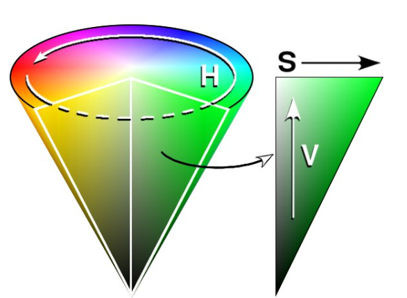

## OpenCV入门
- ### 1.1 OpenCV初体验
- 首先是体验一下OpenCV中的一些参数的使用，和图片三通道数字的一个使用和应用。
  
  ```
  import cv2
  
  if __name__ == '__main__':
    rose = cv2.imread('src/rose.jpg')
    print(rose.shape) # 输出rose的形状，为（491,500,3）也就是三通道491*500像素的图片
    print(type(rose)) # 输出rose的类型，为numpy数组
    print(rose)
    # 最后一维是颜色，蓝0绿1红2，我们可以除了通过：：-1的方式来进行翻转，也可以通过【0,1,2】这样的方式来进行相应的颜色变换操作
    # 除此之外，还可以通过加减的方式来对图像进行相应的操作
    # numpy.dtype是uint8的格式
    print(rose.dtype)
    cv2.imshow('rose', rose[:, :, ::-1]) # 索引和切片的操作。最后一维是颜色，也就是进行颜色上的翻转，由红变蓝。
    cv2.waitKey()
    cv2.destroyAllWindows()
  ```
- ### 1.2 HSV色彩空间
  
  
- HSV 表达彩色图像的方式由三个部分组成：
	- Hue（色调、色相）
	- Saturation（饱和度、色彩纯净度）
	- Value（明度）
- 用上图圆柱体来表示 HSV 颜色空间，圆柱体的横截面可以看做是一个极坐标系 ，H 用极坐标的极角表示，S 用极坐标的极轴长度表示，V 用圆柱中轴的高度表示。Hue 用角度度量，取值范围为0～360°，表示色彩信息，即所处的光谱颜色的位置。
  
  ```
  import cv2
  import numpy as np
  
  if __name__ == '__main__':
    rose = cv2.imread('src/uni.jpg')
  
    hsv = cv2.cvtColor(rose, cv2.COLOR_BGR2HSV)
  
    # 蓝色的hsv的范围
    lower_blue = np.array([110, 50, 50])
    upper_blue = np.array([130, 255, 255])
  
    # 根据蓝色的hsv的范围，生成相应的mask
    mask = cv2.inRange(hsv, lower_blue, upper_blue)
  
    # Bitwise-AND mask and original image
    # 进行二进制的相关操作
    res = cv2.bitwise_and(rose, rose, mask=mask)
  
    # 将黑色的像素点替换成白色的像素点
    for i in range(res.shape[0]):# 高度
        for j in range(res.shape[1]):# 宽度
            if (res[i, j] == 0).all():# 判定
                res[i, j] = 255
  
    cv2.imshow('frame', rose)
    cv2.imshow('mask', mask)
    cv2.imshow('res', res)
  
    cv2.waitKey()
    cv2.destroyAllWindows()
  ```
- ### 1.3 马赛克效果
  
  ```
  import cv2
  import numpy as np
  
  if __name__ == '__main__':
    img = cv2.imread('./src/mosaic.jpg')
    print(img.shape)
  
    # 马赛克方式一
    # img2 = cv2.resize(img, (89, 50))
    # img3 = cv2.resize(img2, (890, 500))
    # cv2.imshow('mosaic', img3)
    # cv2.waitKey(0)
    # cv2.destroyAllWindows()
  
    # 马赛克方式二
    # img2 = cv2.resize(img, (89, 50))
    # img3 = np.repeat(img2, 10, axis=0)# 复制行
    # img4 = np.repeat(img3, 10, axis=1)# 复制列
    # cv2.imshow('mosaic', img4)
    # cv2.waitKey(0)
    # cv2.destroyAllWindows()
  
    # 马赛克方式三
    img2 = img[::10, ::10] # 10个像素点中取一个
    cv2.namedWindow('mosaic', flags=cv2.WINDOW_NORMAL)
    cv2.resizeWindow('mosaic', 890, 500)
    cv2.imshow('mosaic', img2)
    cv2.waitKey(0)
    cv2.destroyAllWindows()
  ```
- 产生马赛克效果的三种方式：
	- 首先先把图缩小，再放大。
	- 缩小图，然后按照一定比例复制行列的像素值
	- 从X个像素点中抽取一个像素。
- #### 1.3.1 人脸马赛克
  
  ```
  import cv2
  import numpy as np
  
  if __name__ == '__main__':
    img = cv2.imread('./src/mosaic.jpg')
    # 人脸定位 切片获取人脸 坐标为（143,42） （239,164）
    face = img[42:164, 138:244]
    # 间隔切片 重复7次
    face = face[::7, ::7]
    face = np.repeat(face, 7, axis=0)
    face = np.repeat(face, 7, axis=1)
    img[42:164, 138:244] = face[:122, :106]
    # 显示图片
    cv2.imshow('face_mosaic', img)
    cv2.waitKey(0)
    cv2.destroyAllWindows()
  ```
- ### 1.4 人脸轮廓识别
- 人脸的详细说明特征，符合其中一部分特征就算做是人脸
- 级联分类器：首先有什么样的特征，其次有什么样的特征，然后再有什么特征，这就是级联分类器
  
  ```
  import cv2
  import numpy as np
  
  if __name__ == '__main__':
    img = cv2.imread('./src/mosaic.jpg')
  
    face_dedector = cv2.CascadeClassifier('./xml/haarcascade_frontalface_alt.xml')
    # 这个函数的本质就是，通过对从左上到右下，图片像素矩阵内的一定大小的矩阵进行判断是否为人脸来判断的
    # scaleFactor参数代表的就是这个固定大小矩阵的缩放至多少倍为止的函数
    # minNeighbors代表上下左右移动多少仍是人脸的一个参数
    # minSize和maxSize则是控制整个输出的最大尺寸和最小尺寸的过滤
    faces = face_dedector.detectMultiScale(img,
                                           scaleFactor=1.05,
                                           minNeighbors=5,
                                           minSize=[60, 60])
    print(faces)
    for x, y, w, h in faces:
        cv2.rectangle(img,
                      pt1=(x, y),
                      pt2=(x+w, y+h),
                      color=[0, 0, 255],
                      thickness=2)
    # 显示图片
    cv2.imshow('face_mosaic', img)
    cv2.waitKey(0)
    cv2.destroyAllWindows()
  ```
- #### 1.4.1 人脸贴图
  
  ```
  import cv2
  import numpy as np
  
  if __name__ == '__main__':
    img = cv2.imread('./src/mosaic.jpg')
    
    # 人脸的详细说明特征，符合其中一部分特征就算做是人脸
    # 级联分类器：首先有什么样的特征，其次有什么样的特征，然后再有什么特征，这就是级联分类器
    face_dedector = cv2.CascadeClassifier('./xml/haarcascade_frontalface_alt.xml')
    # 这个函数的本质就是，通过对从左上到右下，图片像素矩阵内的一定大小的矩阵进行判断是否为人脸来判断的
    # scaleFactor参数代表的就是这个固定大小矩阵的缩放至多少倍为止的函数
    # minNeighbors代表上下左右移动多少仍是人脸的一个参数
    # minSize和maxSize则是控制整个输出的最大尺寸和最小尺寸的过滤
    faces = face_dedector.detectMultiScale(img,
                                           scaleFactor=1.05,
                                           minNeighbors=5,
                                           minSize=[60, 60])
    
    star = cv2.imread('./src/rose.jpg')
    for x, y, w, h in faces:
        h1 = h//2
        w1 = w//2
        # 首先将需要贴图的图片调整到一样的比例
        star_s = cv2.resize(star, (w1, h1))
        for i in range(h1):
            for j in range(w1):
                # 可以根据不同的条件进行筛选合适的像素然后放到合适的地方
                if not (star_s[i, j] > 240).all():
                    img[i+j, j+x+3*w] = star_s[i, j]
                    
                    # 显示图片
                    cv2.imshow('face_mosaic', img)
                    cv2.waitKey(0)
    cv2.destroyAllWindows()
  ```
- ### 1.5 轮廓绘制
- #### 1.5.1 手动RDI
  
  ```
  import cv2
  import numpy as np
  
  if __name__ == '__main__':
    img = cv2.imread('./src/rose.jpg')
  
    h, w, c = img.shape
    # 手工绘制RDI区域
    mask = np.zeros((h, w), dtype=np.uint8)
    x_data = np.array([124, 169, 208, 285, 307, 260, 175])+100
    y_data = np.array([205, 124, 135, 173, 216, 311, 309])+100
    pts = np.c_[x_data, y_data]
    print(pts)
    cv2.fillPoly(mask, [pts], 255, 8, 0)
  
    res = cv2.bitwise_and(img, img, mask=mask)
    # 显示图片
    cv2.imshow('img', res)
    cv2.waitKey(0)
    cv2.destroyAllWindows()
  ```
- #### 1.5.2 绘制轮廓
  
  ```
  import cv2
  import numpy as np
  
  if __name__ == '__main__':
    rose = cv2.imread('./src/rose.jpg')
    gray = cv2.cvtColor(rose, cv2.COLOR_BAYER_BGR2GRAY)
    gray2 = cv2.GaussianBlur(gray, (5, 5), 0)
    canny = cv2.Canny(gray2, 150, 100)
  
    img, contours = cv2.findContours(gray, cv2.RETR_TREE, cv2.CHAIN_APPROX_SIMPLE)
    print(img, contours)
    # 显示图片
    cv2.imshow('rose', rose)
    cv2.imshow('gray', gray)
    cv2.imshow('gray2', gray2)
    cv2.waitKey(0)
    cv2.destroyAllWindows()
  ```
- 绘制轮廓练习
  
  ```
  import cv2
  import numpy as np
  
  if __name__ == '__main__':
    rose = cv2.imread('./src/rose.jpg')
    wang = cv2.imread('./src/mosaic.jpg')
    # 级联过滤器
    face_dedector = cv2.CascadeClassifier('./xml/haarcascade_frontalface_alt.xml')
    # 图片转灰度图
    rose_gray = cv2.cvtColor(rose, cv2.COLOR_BGR2GRAY)
    wang_gray = cv2.cvtColor(wang, cv2.COLOR_BGR2GRAY)
    # 根据阈值生成相关的
    threshold, rose_binary = cv2.threshold(rose_gray, 130, 255, cv2.THRESH_BINARY)
    img, contours = cv2.findContours(rose_binary, cv2.RETR_TREE, cv2.CHAIN_APPROX_SIMPLE)
    areas = []
    for i in img:
        areas.append(cv2.contourArea(i))
    areas = np.asarray(areas)
    # 从小到大，倒数第二个，第二大的轮廓
    index = areas.argsort()
    mask = np.zeros_like(rose_gray)
    mask = cv2.drawContours(mask, img, index[-2], (255, 255, 255), thickness=-1)
    # 提取人脸
    faces = face_dedector.detectMultiScale(wang_gray)
    # 获取人脸的坐标和偏移值长度
    for x, y, w, h in faces:
        mask2 = cv2.resize(mask, (w, h))
        rose_gray2 = cv2.resize(rose, (w, h))
        for i in range(h):
            for j in range(w):
                if (mask2[i, j] == 255).all():
                    wang[i+y, j+x] = rose_gray2[i, j]
  
    cv2.imshow('rose', rose)
    cv2.imshow('mask', mask)
    cv2.imshow('wang', wang)
    cv2.waitKey(0)
    cv2.destroyAllWindows()
  ```
- 二进制轮廓识别
  
  ```
  import cv2
  import numpy as np
  
  if __name__ == '__main__':
    rose = cv2.imread('./src/rose.jpg')
    wang = cv2.imread('./src/mosaic.jpg')
    # 级联过滤器
    face_dedector = cv2.CascadeClassifier('./xml/haarcascade_frontalface_alt.xml')
    # 图片转灰度图
    rose_gray = cv2.cvtColor(rose, cv2.COLOR_BGR2GRAY)
    wang_gray = cv2.cvtColor(wang, cv2.COLOR_BGR2GRAY)
    # 根据阈值生成相关的
    threshold, rose_binary = cv2.threshold(rose_gray, 130, 255, cv2.THRESH_BINARY)
    img, contours = cv2.findContours(rose_binary, cv2.RETR_TREE, cv2.CHAIN_APPROX_SIMPLE)
    areas = []
    for i in img:
        areas.append(cv2.contourArea(i))
    areas = np.asarray(areas)
    # 从小到大，倒数第二个，第二大的轮廓
    index = areas.argsort()
    mask = np.zeros_like(rose_gray)
    mask = cv2.drawContours(mask, img, index[-2], (255, 255, 255), thickness=-1)
    # 提取人脸
    faces = face_dedector.detectMultiScale(wang_gray)
    # 获取人脸的坐标和偏移值长度
    for x, y, w, h in faces:
        mask2 = cv2.resize(mask, (w, h))
        # 这一行代码的效果等于下面的一段代码
        mask3 = (mask2 - 255)*255
        '''
            for i in range(h):
                for j in range(w):
                    if mask3[i,j] == 255:
                        mask3[i,j]=0
                    else mask3[i,j] == 0:
                        mask3[i,j]=255
        '''
        rose2 = cv2.resize(rose, (w, h))
        face = wang[y:y+h, x:x+w]
        # 黑色的地方没有参与运算，白的地方进行与运算
        rose3 = cv2.bitwise_and(rose2, rose2, mask=mask2)
        face = cv2.bitwise_and(face, face, mask=mask3)
        face = cv2.bitwise_or(rose3, face)
        wang[y:y + h, x:x + w] = face
  
    cv2.imshow('rose', rose3)
    cv2.imshow('mask', mask3)
    cv2.imshow('wang', wang)
    cv2.waitKey(0)
    cv2.destroyAllWindows()
  ```
- ### 1.6 直方图的使用
  
  ```
  import numpy as np
  import cv2
  from skimage import data
  import matplotlib.pyplot as plt
  
  if __name__ == '__main__':
    moon = data.moon()
  
    plt.hist(moon.ravel(), bins=256)
    plt.show()
  
    cv2.imshow('moon', moon)
  
    # 直方图均衡化一下之后，明暗对比就可以更加明显一些，就可以将对比度增强
    moon2 = cv2.equalizeHist(moon)
    plt.hist(moon2.reshape(-1), bins=256)
    plt.show()
  
    cv2.imshow('moon2', moon2)
    cv2.waitKey(0)
    cv2.destroyAllWindows()
  ```
- ### 1.7 傅里叶变换
- 原理：傅里叶变换经常被用来分析不同滤波器的频率特性。我们可以使用 2D 离散傅里叶变换 (DFT) 分析图像的频域特性。实现 DFT 的一个快速算法被称为快速傅里叶变换（FFT）。关于傅里叶变换的细节知识可以在任意一本图像处理或信号处理的书中找到。请查看本小节中更多资源部分。对于一个正弦信号：x(t) = Asin(2πft), 它的频率为 f，如果把这个信号转到它的频域表示，我们会在频率 f 中看到一个峰值。如果我们的信号是由采样产生的离散信号好组成，我们会得到类似的频谱图，只不过前面是连续的，现在是离散。你可以把图像想象成沿着两个方向采集的信号。所以对图像同时进行X 方向和 Y 方向的傅里叶变换，我们就会得到这幅图像的频域表示（频谱图）。更直观一点，对于一个正弦信号，如果它的幅度变化非常快，我们可以说他是高频信号，如果变化非常慢，我们称之为低频信号。你可以把这种想法应用到图像中，图像那里的幅度变化非常大呢？边界点或者噪声。所以我们说边界和噪声是图像中的高频分量（注意这里的高频是指变化非常快，而非出现的次数多）。如果没有如此大的幅度变化我们称之为低频分量。
  
  ```
  import cv2
  import numpy as np
  from matplotlib import pyplot as plt
  
  if __name__ == '__main__':
    '''
    首先我们看看如何使用 Numpy 进行傅里叶变换。Numpy 中的 FFT 包可以帮助我们实现快速傅里叶变换。函数 np.fft.fft2() 可以对信号进行频率转换，输出结果是一个复杂的数组。
    本函数的第一个参数是输入图像，要求是灰度格式。第二个参数是可选的, 决定输出数组的大小。输出数组的大小和输入图像大小一样。
    如果输出结果比输入图像大，输入图像就需要在进行 FFT 前补0。如果输出结果比输入图像小的话，输入图像就会被切割。
    现在我们得到了结果，频率为 0 的部分（直流分量）在输出图像的左上角。如果想让它（直流分量）在输出图像的中心，我们还需要将结果沿两个方向平移N2。函数 np.fft.fftshift() 可以帮助我们实现这一步。（这样更容易分析）。
    进行完频率变换之后，我们就可以构建振幅谱了。
    '''
    img = cv2.imread('./src/mosaic.jpg')
    f = np.fft.fft2(img)
    fshift = np.fft.fftshift(f)
    # 这里构建振幅图的公式没学过
    magnitude_spectrum = 20 * np.log(np.abs(fshift))
    plt.subplot(121), plt.imshow(img, cmap='gray')
    plt.title('Input Image'), plt.xticks([]), plt.yticks([])
    plt.subplot(122), plt.imshow(magnitude_spectrum, cmap='gray')
    plt.title('Magnitude Spectrum'), plt.xticks([]), plt.yticks([])
    plt.show()
  ```
  
  ```
  import numpy as np
  import cv2
  from matplotlib import pyplot as plt
  
  '''
  OpenCV 中相应的函数是 cv2.dft() 和 cv2.idft()。和前面输出的结果一样，但是是双通道的。
  第一个通道是结果的实数部分，第二个通道是结果的虚数部分。输入图像要首先转换成 np.float32 格式。
  '''
  if __name__ == '__main__':
  
    # HPF:High Pass Filtering
    '''
    高通滤波其实是一种边界检测操作。这就是我们在前面图像梯度那一章看到的。同时我们还发现图像中的大部分数据集中在频谱图的低频区域。
    '''
    img = cv2.imread('messi5.jpg', 0)
  
    dft = cv2.dft(np.float32(img), flags=cv2.DFT_COMPLEX_OUTPUT)
    dft_shift = np.fft.fftshift(dft)
  
    magnitude_spectrum = 20 * np.log(cv2.magnitude(dft_shift[:, :, 0], dft_shift[:, :, 1]))
  
    plt.subplot(121), plt.imshow(img, cmap='gray')
    plt.title('Input Image'), plt.xticks([]), plt.yticks([])
    plt.subplot(122), plt.imshow(magnitude_spectrum, cmap='gray')
    plt.title('Magnitude Spectrum'), plt.xticks([]), plt.yticks([])
    plt.show()
  
    rows, cols = img.shape
    crow, ccol = rows / 2, cols / 2
  
    # LPF:Low Pass Filtering
    '''
     LPF（低通滤波）将高频部分去除。其实就是对图像进行模糊操作。首先我们需要构建一个掩模，与低频区域对应的地方设置为 1, 与高频区域对应的地方设置为 0。
    '''
    # create a mask first, center square is 1, remaining all zeros
    mask = np.zeros((rows, cols, 2), np.uint8)
    mask[crow - 30:crow + 30, ccol - 30:ccol + 30] = 1
  
    # apply mask and inverse DFT
    fshift = dft_shift * mask
    f_ishift = np.fft.ifftshift(fshift)
    img_back = cv2.idft(f_ishift)
    img_back = cv2.magnitude(img_back[:, :, 0], img_back[:, :, 1])
  
    plt.subplot(121), plt.imshow(img, cmap='gray')
    plt.title('Input Image'), plt.xticks([]), plt.yticks([])
    plt.subplot(122), plt.imshow(img_back, cmap='gray')
    plt.title('Magnitude Spectrum'), plt.xticks([]), plt.yticks([])
    plt.show()
  ```
- ### 1.8 视频的相关操作
- #### 1.8.1 视频中的人脸检测
  
  ```
  import numpy as np
  import cv2
  
  if __name__ == '__main__':
    # 读取视频
    video = cv2.VideoCapture('./src/video.mp4')
  
    face_dedector = cv2.CascadeClassifier('./xml/haarcascade_frontalface_alt.xml')
    while True:
        # 视频可以转化为每一帧图片。这个函数会返回两个参数，一个是retval，另外一个是image。
        # retval表示是否能找到图片，能找到的话，那就会有image函数
        retval, image = video.read()
        if not retval:
            print('视频播放完毕')
            break
        gray = cv2.cvtColor(image, cv2.COLOR_RGB2GRAY)
        faces = face_dedector.detectMultiScale(gray)
        for x, y, w, h in faces:
            cv2.rectangle(image,
                          pt1=(x, y),
                          pt2=(x + w, y + h),
                          color=[0, 0, 255],
                          thickness=2)
        cv2.imshow('video', image)
        key = cv2.waitKey(1)
        if key == 'q':
            print('用户退出了视频观看')
            break
    cv2.destroyAllWindows()
    video.release()
  ```
- #### 1.8.2 视频中加马赛克
  
  ```
  import numpy as np
  import cv2
  
  if __name__ == '__main__':
    # 读取视频
    video = cv2.VideoCapture('./src/video.mp4')
    # 视频的一些属性
    # 帧率
    fps = video.get(propId=cv2.CAP_PROP_FPS)
    # 画面高度
    height = video.get(propId=cv2.CAP_PROP_FRAME_HEIGHT)
    # 画面宽度
    width = video.get(propId=cv2.CAP_PROP_FRAME_WIDTH)
    # 帧数
    count = video.get(propId=cv2.CAP_PROP_FRAME_COUNT)
  
    face_dedector = cv2.CascadeClassifier('./xml/haarcascade_frontalface_alt.xml')
    while True:
        # 视频可以转化为每一帧图片。这个函数会返回两个参数，一个是retval，另外一个是image。
        # retval表示是否能找到图片，能找到的话，那就会有image函数
        retval, image = video.read()
  
        if not retval:
            print('视频播放完毕')
            break
        gray = cv2.cvtColor(image, cv2.COLOR_RGB2GRAY)
        faces = face_dedector.detectMultiScale(gray)
        for x, y, w, h in faces:
            # 给人脸打上马赛克
            face = image[y:y+h, x:x+w]
            face = face[::10, ::10]
            face = np.repeat(np.repeat(face, 10, axis=0), 10, axis=1)
            image[y:y + h, x:x + w] = face[:h, :w]
        cv2.imshow('video', image)
        key = cv2.waitKey(1)
        if key == 'q':
            print('用户退出了视频观看')
            break
    cv2.destroyAllWindows()
    video.release()
  ```
- #### 1.8.3 修改之后保存视频
  
  ```
  import numpy as np
  import cv2
  
  if __name__ == '__main__':
    # 读取视频
    video = cv2.VideoCapture('./src/video.mp4')
    writer = cv2.VideoWriter(filename='./src/test.mp4',
                             fourcc=cv2.VideoWriter.fourcc(*'MP4V'),
                             fps=24,
                             frameSize=(640, 360))
    face_dedector = cv2.CascadeClassifier('./xml/haarcascade_frontalface_alt.xml')
    while True:
        # 视频可以转化为每一帧图片。这个函数会返回两个参数，一个是retval，另外一个是image。
        # retval表示是否能找到图片，能找到的话，那就会有image函数
        retval, image = video.read()
  
        if not retval:
            print('视频播放完毕')
            break
        gray = cv2.cvtColor(image, cv2.COLOR_RGB2GRAY)
        faces = face_dedector.detectMultiScale(gray)
        for x, y, w, h in faces:
            # 给人脸打上马赛克
            face = image[y:y+h, x:x+w]
            face = face[::10, ::10]
            face = np.repeat(np.repeat(face, 10, axis=0), 10, axis=1)
            image[y:y + h, x:x + w] = face[:h, :w]
        writer.write(image)
        cv2.imshow('video', image)
        key = cv2.waitKey(1)
        if key == 'q':
            print('用户退出了视频观看')
            break
    cv2.destroyAllWindows()
    video.release()
    writer.release()
  ```
- #### 1.8.4 摄像头的相关操作
  
  ```
  import numpy as np
  import cv2
  
  if __name__ == '__main__':
    # 打开摄像头
    cap = cv2.VideoCapture(0)
  
    face_dedector = cv2.CascadeClassifier('./xml/haarcascade_frontalface_alt.xml')
    while True:
        # 视频可以转化为每一帧图片。这个函数会返回两个参数，一个是retval，另外一个是image。
        # retval表示是否能找到图片，能找到的话，那就会有image函数
        retval, image = cap.read()
        if not retval:
            break
        gray = cv2.cvtColor(image, cv2.COLOR_RGB2GRAY)
        faces = face_dedector.detectMultiScale(gray)
        for x, y, w, h in faces:
            cv2.rectangle(image,
                          pt1=(x, y),
                          pt2=(x + w, y + h),
                          color=[0, 0, 255],
                          thickness=2)
        cv2.imshow('video', image)
        key = cv2.waitKey(1000//24)
        if key == 'q':
            print('用户退出了视频观看')
            break
    cv2.destroyAllWindows()
    cap.release()
  ```
- ### 1.9 图像形态学
  
  ```
  import numpy as np
  import cv2
  
  if __name__ == '__main__':
    img = cv2.imread('./src/mosaic.jpg', flags=cv2.IMREAD_GRAYSCALE)
    img = (img - 255)*255
  
    kernel = np.ones(shape=[3, 3], dtype=np.uint8)
    # 腐蚀操作，对噪声进行腐蚀
    img2 = cv2.erode(img, kernel=kernel, iterations=1)
    # 膨胀操作
    img3 = cv2.dilate(img2, kernel=kernel, iterations=1)
    cv2.imshow('img', img)
    cv2.imshow('img2', img2)
    cv2.imshow('img3', img3)
    cv2.waitKey(0)
    cv2.destroyAllWindows()
  ```
-