##### 前言
- 前几天一直在看的是关于词向量word2vec的相关知识，知道了现在的NLP可以不根据词性语法等进行操作，可以依托于多维的向量来实现相应词的相关性操作。
- 然后在论文和部分博客中看到了，word2vec的缺点现在越发的显著，主要的问题就是多义词会被这样的一个机制，认定为这是相同的一个向量。因此，在2018年以后就不再使用这样的一个机制了。改用BERT模型。
- 但是我看不太懂BERT这样的一个机制或者说是模型。因此我又翻览了几篇论文。知道了有snownlp和jieba这样的一个分词包。主要就是在深度学习以前流行的一些机器学习算法的实现。
- #### snownlp包
- ##### 概述
- 一个可以方便的处理中文文本内容的python写的类库，受到了TextBlob的启发而写的。
- ##### 安装方式
- 作为一个python的第三方库，最简单的也就是在pycharm的终端进行一个命令执行：
	- pip install snownlp
- 但是作为python，最难的也就是这样。因为作为第三方的原生库，很少能够正常下载下来，大部分都会被墙掉。因此可以使用镜像源也可以使用本地安装的形式。
- 我这次就使用了本地下载。首先是在网上搜索，然后从网上下载下来。
- 下载下来是一个压缩包，找一个地方解压之后，通过cmd寻到这个目录的地方。然后执行：
	- python setup.exe install
- 这样之后，就能完成安装了。
- 但是安装是安装了，但是不知道按到哪儿去了，因此我们需要关注一下这样的问题。因为我们的电脑上可以安装上好几个python的编译器，因此使用本地安装的时候，很容易就出现不知道那一个安装了，哪一个没有安装的情况。
- ##### snownlp的使用
- 1.直接使用原来的模型进行使用：
  
  ```
  from snownlp import SnowNLP
  from snownlp import sentiment
  
  s = SnowNLP(u'这个东西挺好的')
  text = s.words
  print(text)
  s.tags
  positive = s.sentiments
  print(positive)
  pinyin = s.pinyin
  print(pinyin[0])
  ```
  
  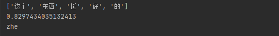
- 2.训练模型并导入自训练的模型
	- 训练
	  
	  ```
	  from snownlp import SnowNLP
	  # 加载情感分析模块
	  from snownlp import sentiment
	  text = '大麦多开一个口ok？？？？正在现场俩口闲死 ​​​​' # 文本
	  s = SnowNLP(text)
	  
	  # todo snownlp常用方法
	  print(s.keywords(10))  # 提取 10个关键词  数字代表提取数量
	  print('/'.join(s.words)) #分词
	  print(s.sentences)  # 断句
	  
	  # s.sentiments  会对文本进行评分
	  
	  f1 = open('./pos.txt', 'a+')  # 存放正面  名字也可自定义哦
	  f2 = open('./neg.txt', 'a+')  # 存放负面
	  if s.sentiments < 0.3:  # 可以自定义范围
	  print('这是一个负面评价')
	  # 这段文本写入neg文件中
	  f2.write(text)
	  f2.write('\n')
	  
	  elif s.sentiments > 0.8:  # 可以自定义范围
	  print('这是一个正面评价')
	  # 这段文本写入pos文件中
	  f1.write(text)
	  f1.write('\n')
	  else:
	  print('这是一个中性评价')
	  
	  # 保存此次的训练模型
	  sentiment.train('neg.txt', 'pos.txt')
	  # 生成新的训练模型
	  sentiment.save('sentiment.marshal')
	  ```
	- 导入加载新模型
		- 从引入 from snownlp import sentiment 进入 sentiment文件， 进而修改data_path 方法
		  
		  ```
		  # -*- coding: utf-8 -*-
		  from __future__ import unicode_literals
		  
		  import os
		  import codecs
		  
		  from .. import normal
		  from .. import seg
		  from ..classification.bayes import Bayes
		  
		  # 加载原来的数据模型
		  # data_path = os.path.join(os.path.dirname(os.path.abspath(__file__)),
		  #                          'sentiment.marshal')
		  
		  # 加载本地新训练的模型   本地路径
		  data_path = 'C:/Users/**/Desktop/python文件/自然语言处理/语言处理/sentiment.marshal'
		  
		  class Sentiment(object):
		  pass
		  ```
- #### jieba包
- ##### 概述
- “结巴”中文分词：做最好的 Python 中文分词组件
- ##### 特点
- 支持三种分词模式：
	- 精确模式，试图将句子最精确地切开，适合文本分析；
	- 全模式，把句子中所有的可以成词的词语都扫描出来, 速度非常快，但是不能解决歧义；
	- 搜索引擎模式，在精确模式的基础上，对长词再次切分，提高召回率，适合用于搜索引擎分词。
- 支持繁体分词
- 支持自定义词典
- MIT 授权协议
- ##### 安装方法
- 和snownlp包安装的方式一致
- ##### 主要功能
- 1.分词
	- jieba.cut 方法接受三个输入参数: 需要分词的字符串；cut_all 参数用来控制是否采用全模式；HMM 参数用来控制是否使用 HMM 模型
	- jieba.cut_for_search 方法接受两个参数：需要分词的字符串；是否使用 HMM 模型。该方法适合用于搜索引擎构建倒排索引的分词，粒度比较细
	- 待分词的字符串可以是 unicode 或 UTF-8 字符串、GBK 字符串。注意：不建议直接输入 GBK 字符串，可能无法预料地错误解码成 UTF-8
	- jieba.cut 以及 jieba.cut_for_search 返回的结构都是一个可迭代的 generator，可以使用 for 循环来获得分词后得到的每一个词语(unicode)，或者用
	- jieba.lcut 以及 jieba.lcut_for_search 直接返回 list
	- jieba.Tokenizer(dictionary=DEFAULT_DICT) 新建自定义分词器，可用于同时使用不同词典。jieba.dt 为默认分词器，所有全局分词相关函数都是该分词器的映射。
- 示例代码
  
  ```
  import jieba
  
  seg_list = jieba.cut("我是新华出版社的工作人员", cut_all=True)
  print("Full Mode:" + " /".join(seg_list))
  
  seg_list = jieba.cut("我是新华出版社的工作人员", cut_all=False)
  print("Default Mode:" + " /".join(seg_list))
  
  seg_list = jieba.cut("我是新华出版社的工作人员")
  print(",".join(seg_list))
  
  seg_list = jieba.cut_for_search("我是新华出版社的工作人员")
  print(",".join(seg_list))
  ```
  
  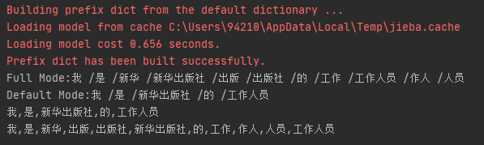
- 就分词来讲，确实这个jieba包的性能优于snownlp。
- 2.添加自定义字典
	- 载入词典
		- 开发者可以指定自己自定义的词典，以便包含 jieba 词库里没有的词。虽然 jieba 有新词识别能力，但是自行添加新词可以保证更高的正确率
		- 用法： jieba.load_userdict(file_name) # file_name 为文件类对象或自定义词典的路径
		- 词典格式和 dict.txt 一样，一个词占一行；每一行分三部分：词语、词频（可省略）、词性（可省略），用空格隔开，顺序不可颠倒。file_name 若为路径或二进制方式打开的文件，则文件必须为 UTF-8 编码。
		- 词频省略时使用自动计算的能保证分出该词的词频。
	- 调整字典
		- 使用 add_word(word, freq=None, tag=None) 和 del_word(word) 可在程序中动态修改词典。
		- 使用 suggest_freq(segment, tune=True) 可调节单个词语的词频，使其能（或不能）被分出来。
		- 注意：自动计算的词频在使用 HMM 新词发现功能时可能无效。
- #### 情感分析模块sentiment原理、源码解析
- snownlp中支持感情分析的模块都在sentiment中，核心的算法就是贝叶斯模型。
- ##### 朴素贝叶斯分类模型
- 分类算法常用的有很多种，朴素贝叶斯算法是其中一个比较常用的，之所以称为朴素贝叶斯算法主要是因为该算法最基本的原理是基于贝叶斯定理的，称为朴素是因为该算法成立的前提是特征之间必须得是独立的。
- 朴素贝叶斯（Naive Bayes）算法理论基础是基于贝叶斯定理和条件独立性假设的一种分类方法。
- **贝叶斯公式**：
	- 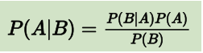
	- **公式解说：**
		- P(A)是先验概率，表示每种类别分布的概率；
		- P(B|A)是条件概率，表示在某种类别前提下，某事发生的概率；该条件概率可通过统计而得出，这里需要引入极大似然估计概念，详见后文。
		- P(A|B)是后验概率，表示某事发生了，并且它属于某一类别的概率，有了这个后验概率，便可对样本进行分类。后验概率越大，说明某事物属于这个类别的可能性越大，便越有理由把它归到这个类别下。
		- **贝叶斯公式**就可以说是简洁版的**贝叶斯定理**。
- “**朴素贝叶斯**”（**Naïve Bayes**）既可以是一种**算法**——朴素贝叶斯算法，也可以是一种**模型**——朴素贝叶斯分类模型（分类器）。
- 为了便于理解，当 B 作为 A 的条件出现时，我们假定它总共只有一个特征。
- 但在实际应用中，很少有一件事只受一个特征影响的情况，往往影响一件事的因素有多个。假设，影响 B 的因素有 n 个，分别是 b1,b2,…,bn。
- 则 P(A|B) 可以写为：
	- 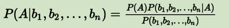
- A 的先验概率 P(A) 和多个因素的联合概率 P(b1,b2,…,bn) 都是可以单独计算的，与 A 和 bi 之间的关系无关，因此这两项都可以被看作常数。
- 对于求解 P(A|b1,b2,…,bn)，最关键的是 P(b1,b2,…,bn|A)。根据链式法则，可得：
	- 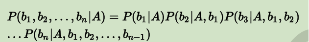
- 上面的求解过程，看起来好复杂，但是，如果从 b1 到 bn这些特征之间，在概率分布上是**条件独立**的，也就是说每个特征 bi与其他特征都不相关。如下图所示：
	- 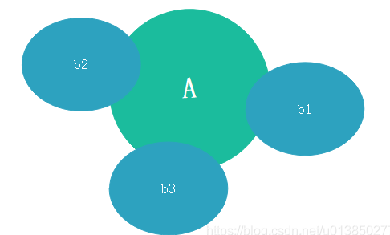
- 那么，当 i≠j 时，有 P(bi|A,bj)=P(bi|A) —— 无关条件被排除到条件概率之外，这一点由上图可以很直观地看出。因此，当 b1，b2，…,bn 中每个特征与其他 n-1 个特征都不相关时，就有：
	- 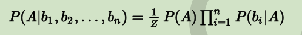
	- 注：是希腊字母，即π的大写形式，在数学中表示求积运算或直积运算，形式上类似于。
	- Z 对应 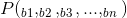。
- 这个函数也就是朴素贝叶斯模型（分类器）的模型函数。
- ##### 使用贝叶斯模型预测
- 有一个朴素贝叶斯分类模型（器），它能够区分出 k 个类 （c1,c2,…,ck）, 用来分类的特征有 n 个：(F1,F2,…,Fn)。
- 现在有个样本 s，我们要用 NB 分类器对它做预测，则需要先提取出这个样本的所有特征值 F1到 Fn，将其带入到下式（因为对应不同分类的分母为固定值，所以公式可简化为如下所示）中进行 k 次运算:
	- 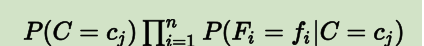
- 然后比较这 k 次的结果，选出使得运算结果达到最大值的那个 cj（j=1,2,…,k）—— 这个 cj 对应的类别就是预测值。求上式的最大值也可以用为如下公式表示：
	- 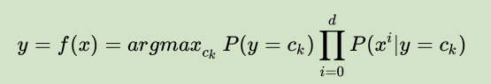
	- **注：**argmax是一种函数，函数y=f(x)，x0= argmax(f(x)) 的意思就是参数x0满足f(x0)为f(x)的最大值；
- 以上这个公式模型内要使用的先验概率和条件概率可以通过在训练样本中间做统计就可以直接获得了。
- ##### 源码解析
- 贝叶斯模型训练
	- 贝叶斯模型的训练过程实质上是在统计每一个特征出现的频次，其核心代码如下：
	  
	  ```
	  def train(self, data):
	   # data 中既包含正样本，也包含负样本
	   for d in data: # data中是list
	       # d[0]:分词的结果，list
	       # d[1]:正/负样本的标记
	       c = d[1]
	       if c not in self.d:
	           self.d[c] = AddOneProb() # 类的初始化
	       for word in d[0]: # 分词结果中的每一个词
	           self.d[c].add(word, 1)
	   # 返回的是正类和负类之和
	   self.total = sum(map(lambda x: self.d[x].getsum(), self.d.keys())) # 取得所有的d中的sum之和
	  ```
	  
	  ```
	  class AddOneProb(BaseProb):
	  
	   def __init__(self):
	       self.d = {}
	       self.total = 0.0
	       self.none = 1 # 默认所有的none为1
	   # 这里如果value也等于1，则当key不存在时，累加的是2
	   def add(self, key, value):
	       self.total += value
	       # 不存在该key时，需新建key
	       if not self.exists(key):
	           self.d[key] = 1
	           self.total += 1
	       self.d[key] += value
	  ```
	- 注：
		- none的默认值为1
		- 当key不存在时，total和对应的d[key]累加的是1+value，这在后面预测时需要用到
		- AddOneProb类中的total表示的是正类或者负类中的所有值；train函数中的total表示的是正负类的total之和。
- 利用贝叶斯模型预测
	- 预测的过程使用到了上述的公式，即
		- 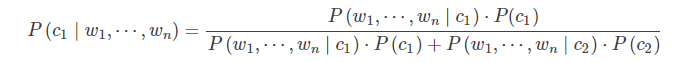
	- 对上述的公式简化：
		- 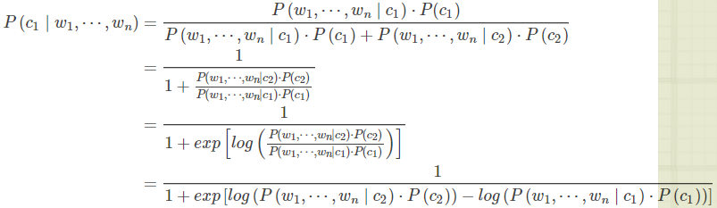
	- 其中，分母中的1可以改写为：
		- 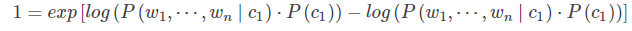
		  
		  ```
		  def classify(self, x):
		  tmp = {}
		  for k in self.d: # 正类和负类
		      tmp[k] = log(self.d[k].getsum()) - log(self.total) # 正类/负类的和的log函数-所有之和的log函数
		      for word in x:
		          tmp[k] += log(self.d[k].freq(word)) # 词频，不存在就为0
		  ret, prob = 0, 0
		  for k in self.d:
		      now = 0
		      try:
		          for otherk in self.d:
		              now += exp(tmp[otherk]-tmp[k])
		          now = 1/now
		      except OverflowError:
		          now = 0
		      if now > prob:
		          ret, prob = k, now
		  return (ret, prob)
		  ```
	- 其中，第一个for循环中的tmp[k]对应了公式中的log(P(ck))log(P(ck))，第二个for循环中的tmp[k]对应了公式中的log(P(w1,⋯,wn∣ck)⋅P(ck))log(P(w1,⋯,wn∣ck)⋅P(ck))。
- #### jieba包使用
- ##### 关键词提取
- **基于TF-IDF算法的关键词抽取**
	- jieba.analyse.extract_tags(sentence, topK=20, withWeight=False, allowPOS=())
		- sentence 为待提取的文本
		- topK 为返回几个 TF/IDF 权重最大的关键词，默认值为 20
		- withWeight 为是否一并返回关键词权重值，默认值为 False
		- allowPOS 仅包括指定词性的词，默认值为空，即不筛选
	- jieba.analyse.TFIDF(idf_path=None) 新建 TFIDF 实例，idf_path 为 IDF 频率文件
- **基于TextRank算法的关键词抽取**
	- jieba.analyse.textrank(sentence, topK=20, withWeight=False, allowPOS=('ns', 'n', 'vn', 'v')) 直接使用，接口相同，注意默认过滤词性。
	- jieba.analyse.TextRank() 新建自定义 TextRank 实例
- ##### 词性标注
- jieba.posseg.POSTokenizer(tokenizer=None) 新建自定义分词器，tokenizer 参数可指定内部使用的 jieba.Tokenizer 分词器。jieba.posseg.dt 为默认词性标注分词器。
- 标注句子分词后每个词的词性，采用和 ictclas 兼容的标记法。
- ##### 并行分词
- 原理：将目标文本按行分隔后，把各行文本分配到多个 Python 进程并行分词，然后归并结果，从而获得分词速度的可观提升
- 基于 python 自带的 multiprocessing 模块，目前暂不支持 Windows
- 用法：
	- jieba.enable_parallel(4) # 开启并行分词模式，参数为并行进程数
	- jieba.disable_parallel() # 关闭并行分词模式
-