## 第 1 章：物理与链路层（信号与帧）
- ## 1.1 JTAG 接口引脚定义与电气特性
- JTAG（Joint Test Action Group，IEEE 1149.1）定义的不仅仅是一套调试协议，还规定了**标准接口引脚、电气时序以及状态机**。对于 MCU、SoC、FPGA、CPU 等芯片而言，JTAG 接口通常由 **4 根必需信号 + 1 根可选信号 + 若干辅助信号**组成。
- ### 1.1.1 JTAG 标准引脚定义
- 最常见的是 **20 Pin（ARM）、10 Pin Cortex、14 Pin TI、16 Pin MIPS** 等接口，但真正属于 IEEE1149.1 标准的只有下面几个信号。
  | -    | 引脚             | 全称         | 方向（目标芯片） | 功能 |
  | ---- | ---------------- | ------------ | ---------------- |
  | TCK  | Test Clock       | 输入         | JTAG 时钟        |
  | TMS  | Test Mode Select | 输入         | TAP 状态机控制   |
  | TDI  | Test Data In     | 输入         | 串行输入数据     |
  | TDO  | Test Data Out    | 输出         | 串行输出数据     |
  | TRST | Test Reset       | 输入（可选） | TAP 复位         |
- 除此之外一般还有：
  
  | 引脚   | 作用             |
  | ------ | ---------------- |
  | GND    | 地               |
  | VTREF  | 目标板IO参考电压 |
  | nRESET | 芯片系统复位     |
  | NC     | 保留             |
- ### 1.1.2各引脚详细说明
- **1. TCK（Test Clock）**
- 所有 JTAG 操作均由 TCK 驱动。
- 每个 TCK 上升沿：
	- 状态机变化
	- 数据移位
	- 指令更新
- 通常：1MHz、5MHz、10MHz、20MHz、50MHz
- 高速 FPGA 可以达到：100MHz+
- 电气要求
	- 输入数字时钟：VIL、VIH
	- 通常：CMOS、LVTTL
- **2. TMS（Test Mode Select）**
- 这是最重要的一根线。它控制：TAP State Machine（TAP状态机）
	- 例如：
	- ```
	    Run-Test/Idle
	    ↓
	    Shift-IR
	    ↓
	    Shift-DR
	    ↓
	    Update-DR
	  ```
- 整个 TAP 状态全部由：TMS+TCK决定。
	- 例如：
	- ```
	    TMS=1
	    Test-Logic-Reset
	    ↓
	    Run-Test
	    ↓
	    Select-DR
	    ↓
	    Select-IR
	    ```
- **3. TDI（Test Data In）**
	- 调试器发送数据：
	- ```
	  Debugger
	  ↓
	  TDI
	  ↓
	  Instruction Register
	  ↓
	  Data Register
	  ```
	- 例如发送：
	- ```
	  EXTEST
	  IDCODE
	  BYPASS
	  ```
	- 或者：
	- ```
	  CPU Debug Command
	  ```
	- 都是经 TDI。
- **4. TDO（Test Data Out）**
- 芯片返回：
- ```
  IDCODE
  CPU寄存器
  Memory
  Trace数据（部分实现）
  ```
- 都是：
- ```
  TDO
  ↓
  Debugger
  ```
- TDO 只在：Shift-IR、Shift-DR状态输出有效。
- 其它时间一般：High-Z方便多个器件级联。
- **5. TRST（Test Reset）**
- 这是可选引脚。
- 作用：立即复位 TAP。否则只能：
- ```
  TMS=1
  连续5个TCK
  进入 Reset
  ```
- 所以很多 MCU没有 TRST
- ARM Cortex-M 基本不用 TRST。
- ### 1.1.3JTAG 电气特性
- IEEE1149.1 并**没有规定具体电压值**，只规定逻辑行为，因此实际电气特性由芯片 I/O 标准决定。
- **输入电压**
	- 例如：
	- 3.3V CMOS
	- ```
	  VIH ≥ 2.0V
	  VIL ≤ 0.8V
	  ```
	- 1.8V IO：
	- ```
	  VIH≈1.2V
	  VIL≈0.4V
	  ```
- 所以：**JTAG 调试器必须适配目标板 IO 电压**。这也是为什么调试器都有：VTRE
- 这是很多人误解的一根线。注意：不是供电；而是：Reference Voltage
	- 例如：
	- 目标板：1.8V；调试器读取：VTREF=1.8V
	- 于是，输出：
	- ```
	  TCK
	  TMS
	  TDI
	  ```
	- 全部变成：1.8V；而不是：3.3V；否则会烧芯片。
- **输入阻抗**
	- 通常：几十 kΩ，甚至100kΩ；内部：Pull-up、Pull-down
	- TDO 驱动能力
	- 一般：CMOS Push-Pull；输出：2\~8mA。不同厂家不同。
- ### 1.1.4 JTAG 时序关系
- 一次 Shift 操作示意：
  
  ```
  TCK
  
  __    __    __
  |  |__|  |__|  |__
  
  TMS
  
  0---------------
  
  TDI
  
  1---0---1---1---
  
  TDO
  
  x---1---0---1---
  
  ```
- 通常：
	- TDI 在 TCK 上升沿前建立（Setup）
	- TDI 在上升沿被采样
	- TDO 在下降沿或随后一段传播延迟后更新（具体实现依芯片而定）
	- 调试器在下一次采样窗口读取 TDO
- ### 1.1.5 JTAG 接口典型连接
  
  ```
          Debugger
        ┌────────────┐
        │            │
  TCK ----┤------------├----> MCU
  TMS ----┤------------├----> MCU
  TDI ----┤------------├----> MCU
  TDO <---┤------------├-----
  TRST----┤------------├----> MCU
  RESET---┤------------├----> nRESET
  VTREF<--┤------------├-----
  GND -----┤------------├-----
        └────────────┘
  
  ```
- ### 1.1.6 JTAG 引脚级联（Daisy Chain）
  
  JTAG 支持多个器件共享同一组控制信号。
  
  ```
           TCK
  ────────────┬────────────┬──────────
  
           TMS
  ────────────┬────────────┬──────────
  
  TDI
  ↓
  
  +--------+
  | Device1|
  +--------+
    │
    ▼
  +--------+
  | Device2|
  +--------+
    │
    ▼
  +--------+
  | Device3|
  +--------+
    │
    ▼
  TDO
  
  ```
  
  其中：
- **TCK**：所有器件共享。
- **TMS**：所有器件共享。
- **TDI**：串联进入第一个器件。
- **TDO**：前一个器件连接到后一个器件的 TDI，最后一个器件的 TDO 返回调试器。
- ### 1.1.7 JTAG 与 SWD 引脚对比
  
  | 功能     | JTAG         | SWD                   |
  | -------- | ------------ | --------------------- |
  | 时钟     | TCK          | SWCLK                 |
  | 模式控制 | TMS          | 与数据复用为 SWDIO    |
  | 数据输入 | TDI          | SWDIO                 |
  | 数据输出 | TDO          | SWDIO                 |
  | 复位     | TRST（可选） | 无                    |
  | 系统复位 | nRESET       | nRESET                |
  | 最少信号 | 4～5 根      | 2 根（SWCLK、SWDIO）  |
  | 支持级联 | 是           | 否                    |
  | 标准     | IEEE 1149.1  | ARM Serial Wire Debug |
- ## 1.2 JTAG TAP 控制器 16 状态机状态转移详解
- 在 JTAG（IEEE 1149.1）标准中，**TAP（Test Access Port）控制器**是一个极其核心的同步有限状态机（FSM）。它拥有 **16 个状态**，仅通过一个控制信号线 **TMS（Test Mode Select）** 在时钟信号 **TCK** 的上升沿跳变来控制整个芯片的测试行为。
- 这 16 个状态在结构上呈现高度的**对称性**：除了公用的复位和空闲状态外，其余状态被平分为两大分支 —— **DR（数据寄存器）分支**和 **IR（指令寄存器）分支**。
  
  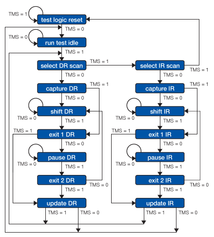
- ### 1.2.1 核心基础状态（公共部分）
  
  无论目前处于什么状态，只要**连续保持 TMS = 1 达到 5 个 TCK 时钟周期**，状态机必然会强行返回到复位状态，这是一种极具鲁棒性的硬件防死锁设计。
  
  1. Test-Logic-Reset（测试逻辑复位）
- **状态行为**：测试逻辑被禁用，芯片正常的功能逻辑被激活。
- **转移条件**：
	- `TMS = 1`：继续保持在 `Test-Logic-Reset`。
	- `TMS = 0`：进入 `Run-Test/Idle`。
	  1. Run-Test/Idle（运行测试/空闲）
- **状态行为**：测试逻辑的某些内部操作（如自检指令）可在此状态下运行；如果无指令运行，则处于等待、空闲状态。
- **转移条件**：
	- `TMS = 0`：继续保持在 `Run-Test/Idle`。
	- `TMS = 1`：进入 `Select-DR-Scan`，开始启动扫描序列。
- ### 1.2.2 两大对称分支详解
  
  当状态机从空闲状态出来后，它会走到一个“十字路口”。根据 `TMS` 的值，决定是操作**数据**还是操作**指令**。DR 和 IR 两大分支的 7 个状态名字和转换逻辑完全对称。
  
  1. DR 分支（Data Register Scan）
  
  主要用于读写边界扫描链或其他数据寄存器（如 IDCODE、BYPASS）。
- **Select-DR-Scan**：数据寄存器扫描选择。
	- `TMS = 0`：进入 `Capture-DR`（捕获数据）。
	- `TMS = 1`：进入 `Select-IR-Scan`（转向指令寄存器操作）。
- **Capture-DR**：数据捕获。在此状态下，数据寄存器会在时钟上升沿并行地将内部核心逻辑的数据“锁存”进移位寄存器中。
	- `TMS = 0`：进入 `Shift-DR`，准备开始移位。
	- `TMS = 1`：不进行移位，直接跳到 `Exit1-DR`。
- **Shift-DR**：数据移位。在这个状态下，**移位寄存器与外部的 TDI 和 TDO 连通**。每来一个 TCK，数据就会向外移出一位（TDO），同时新数据移入一位（TDI）。
	- `TMS = 0`：**保持在此状态**，持续进行串行移位（这是 JTAG 数据传输最长的阶段）。
	- `TMS = 1`：移位结束，进入 `Exit1-DR`。
- **Exit1-DR**：退出移位状态 1。作为一个过渡状态。
	- `TMS = 0`：进入 `Pause-DR`，暂时挂起移位操作。
	- `TMS = 1`：直接进入 `Update-DR`，更新数据。
- **Pause-DR**：暂停数据移位。当外部测试仪需要等待或重新填充缓冲区时，状态机会在此停滞，**此时移位操作暂停，但数据保留**。
	- `TMS = 0`：保持在 `Pause-DR`。
	- `TMS = 1`：进入 `Exit2-DR`。
- **Exit2-DR**：退出移位状态 2。
	- `TMS = 0`：重新回到 `Shift-DR` 继续移位（实现断点续传）。
	- `TMS = 1`：进入 `Update-DR`。
- **Update-DR**：数据更新。在 TCK 的**下降沿**，移位寄存器中的新数据被并行地写入到数据寄存器的锁存输出端，使其真正生效。
	- `TMS = 0`：回到 `Run-Test/Idle` 状态。
	- `TMS = 1`：回到 `Select-DR-Scan` 状态，开启新一轮扫描。
	  
	  2. IR 分支（Instruction Register Scan）
	  
	  专门用于将测试指令（如 EXTEST, SAMPLE/PRELOAD）载入到指令寄存器中，从而决定随后的 DR 扫描要操作哪一个数据寄存器。
	  
	  其 7 个状态的跳转路径与 DR 分支完全一样：
- **Select-IR-Scan**：指令寄存器扫描选择。
	- `TMS = 0`：进入 `Capture-IR`。
	- `TMS = 1`：进入 `Test-Logic-Reset`（强制复位）。
- **Capture-IR**：指令捕获。将一个固定的状态模式（通常最后两位是 `01`，用作完整性校验）锁存进指令移位寄存器。
	- `TMS = 0` -> `Shift-IR`； `TMS = 1` -> `Exit1-IR`。
- **Shift-IR**：指令移位。将指令串行地从 TDI 移入，同时将捕获的校验位从 TDO 移出。
	- `TMS = 0` -> 保持在 `Shift-IR` 移位； `TMS = 1` -> `Exit1-IR`。
- **Exit1-IR**：退出指令移位过渡状态 1。
	- `TMS = 0` -> `Pause-IR`； `TMS = 1` -> `Update-IR`。
- **Pause-IR**：暂停指令移位。
	- `TMS = 0` -> 保持在 `Pause-IR`； `TMS = 1` -> `Exit2-IR`。
- **Exit2-IR**：退出指令移位过渡状态 2。
	- `TMS = 0` -> 回到 `Shift-IR`； `TMS = 1` -> `Update-IR`。
- **Update-IR**：指令更新。移入的新指令在 TCK **下降沿**锁存生效，芯片的测试行为随即改变。
	- `TMS = 0` -> `Run-Test/Idle`； `TMS = 1` -> `Select-DR-Scan`。
- ### 1.2.3 核心状态速查表
  
  为了方便编写 Verilog 仿真代码或调试软件驱动，状态之间的切换可以用下表归纳：
  
  | 当前状态             | TMS = 0 的下一状态 | TMS = 1 的下一状态 | 核心作用与特点                  |
  | -------------------- | ------------------ | ------------------ | ------------------------------- |
  | **Test-Logic-Reset** | Run-Test/Idle      | Test-Logic-Reset   | 复位状态，保证系统安全          |
  | **Run-Test/Idle**    | Run-Test/Idle      | Select-DR-Scan     | 空闲或测试运行状态              |
  | **Select-DR-Scan**   | Capture-DR         | Select-IR-Scan     | DR 分支路口                     |
  | **Capture-DR**       | Shift-DR           | Exit1-DR           | 硬件值并行锁存进 DR 移位寄存器  |
  | **Shift-DR**         | Shift-DR           | Exit1-DR           | TDI - DR - TDO 串行移位         |
  | **Exit1-DR**         | Pause-DR           | Update-DR          | 移位结束的网关过渡              |
  | **Pause-DR**         | Pause-DR           | Exit2-DR           | 暂停移位，等待测试仪响应        |
  | **Exit2-DR**         | Shift-DR           | Update-DR          | 允许重新移位或直接更新          |
  | **Update-DR**        | Run-Test/Idle      | Select-DR-Scan     | DR 数据在**下降沿**并排输出生效 |
  | **Select-IR-Scan**   | Capture-IR         | Test-Logic-Reset   | IR 分支路口 / 连续 1 进复位     |
  | **Capture-IR**       | Shift-IR           | Exit1-IR           | 固定状态码（如 `01`）锁存进 IR  |
  | **Shift-IR**         | Shift-IR           | Exit1-IR           | TDI - IR - TDO 指令移位         |
  | **Exit1-IR**         | Pause-IR           | Update-IR          | 移位结束的网关过渡              |
  | **Pause-IR**         | Pause-IR           | Exit2-IR           | 暂停指令移位                    |
  | **Exit2-IR**         | Shift-IR           | Update-IR          | 允许重新移位或直接更新          |
  | **Update-IR**        | Run-Test/Idle      | Select-DR-Scan     | 新测试指令在**下降沿**生效      |
- ## 1.3 JTAG 扫描链（Scan Chain）拓扑与多芯片级联原理
- ### 1.3.1 JTAG 核心引脚与状态机基础
  
  在理解拓扑之前，需要明确 JTAG 的 4 个核心信号（以及可选的第 5 个）：
- **TCK (Test Clock):** 测试时钟，同步所有 JTAG 操作。
- **TMS (Test Mode Select):** 测试模式选择，控制每个芯片内部 TAP 控制器（TAP Controller）的状态机跳转。
- **TDI (Test Data In):** 测试数据输入，数据在 TCK 上升沿锁存。
- **TDO (Test Data Out):** 测试数据输出，数据在 TCK 下降沿移出。
- **TRST (Test Reset, 可选):** 异步复位信号，低电平有效。
  
  核心机制：串行移位寄存器
  
  JTAG 的核心本质是一个巨大的、可变长度的**串行移位寄存器**。数据从主控端（Debugger）的 TDI 发出，逐位流经芯片内部的寄存器，最终从 TDO 回传给主控端。
- ### 1.3.2 多芯片级联（Daisy Chain）拓扑原理
  
  级联（串联）是多芯片 JTAG 连接最常用、最经济的拓扑结构。它允许调试器仅通过一组 JTAG 引脚控制链上的所有芯片。
  
  1. 物理连接拓扑
  
  在级联结构中，**TMS、TCK、TRST 是并联（广播）的**，而 **TDI 和 TDO 是串联的**。
  
  ```
     [ JTAG Debugger ]
       |   |      |
      TCK TMS    TDI
       |   |      |
       |   |   +--v---------+       +------------+       +------------+
       +---|-->|芯片 A      |       |芯片 B      |       |芯片 C      |
       |   |   |            |       |            |       |            |
       |   +-->|TMS     TDO |======>|TDI     TDO |======>|TDI     TDO |--+
       |       |TCK         |       |TCK         |       |TCK         |  |
       +------>|TCK         |       |TCK         |       |TCK         |  |
               +------------+       +------------+       +------------+  |
                                                                         |
                                                                         |
     TDO <===============================================================+
  
  ```
- **TCK/TMS 广播：** 意味着链上的**所有芯片在同一时刻处于完全相同的 TAP 状态机状态**（例如，同时进入 `Shift-IR` 或 `Shift-DR`）。
- **TDI-TDO 串接：** 数据像流水一样从芯片 A 的 TDO 流入芯片 B 的 TDI。
  
  2. 多芯片级联的工作原理
  
  既然所有芯片的状态机同步跳转，如何做到“只对芯片 B 进行操作，而不影响芯片 A 和 C”？
  
  这依赖于 JTAG 标准定义的指令寄存器（IR）长度以及特殊的 **BYPASS（旁路）** 指令。
  
  ① 什么是 BYPASS（旁路）模式？
  
  当某个芯片被置于 BYPASS 模式时，其内部的 TDI 和 TDO 之间会选通一个**只有 1 位长度的旁路寄存器**（Bypass Register）。此时，移入该芯片的数据只需要延迟 1 个 TCK 周期就会从 TDO 移出。这意味着该芯片对数据流来说变得“近乎透明”。
  
  ② 数据对齐与移位操作步骤
  
  假设链上有 3 片芯片，IR 长度分别为：芯片 A = 4位，芯片 B = 5位，芯片 C = 4位。总 IR 长度 = 13位。
  
  如果我们要向**芯片 B** 写入特定指令，而让芯片 A 和 C 保持旁路，操作流程如下：
- **步骤 1：扫描指令寄存器 (Shift-IR 状态)**&#x8C03;试器需要一次性拼装一个 13 位的串行数据流。为了让 A 和 C 旁路，我们需要将 A 和 C 的对应指令置为全 `1`（IEEE 1149.1 规定，全 `1` 指令强制为 BYPASS 指令）。调试器串行发出这 13 位数据。由于状态机同步，数据精准填充满各芯片的 IR 寄存器。随后状态机跳转至 `Update-IR`，指令正式生效。
	- 芯片 C 的指令（先进入）：`1111` (BYPASS)
	- 芯片 B 的指令（中间）：`10100` (目标操作指令)
	- 芯片 A 的指令（后进入）：`1111` (BYPASS)
- **步骤 2：扫描数据寄存器 (Shift-DR 状态)**&#x6B64;时，芯片 A 和 C 内部选通的是 **1 位的 BYPASS 寄存器**；芯片 B 选通的是其目标指令对应的**数据寄存器（DR）**（假设长度为 32 位）。此时，整条扫描链的总数据长度变为：\$\$\text{总长度} = 1\text{位(A)} + 32\text{位(B)} + 1\text{位(C)} = 34\text{位}\$\$调试器如果要向芯片 B 写入 32 位数据，必须发送 34 位的数据流：数据移位完成后，进入 `Update-DR`，芯片 B 成功捕获 32 位数据，而芯片 A 和 C 仅流过 1 位无意义数据，不改变内部状态。
	- 先发送 1 位哑数据（填充 C 的 BYPASS 位）
	- 再发送 32 位有效数据（目标送往 B 的 DR）
	- 最后发送 1 位哑数据（填充 A 的 BYPASS 位）
- ### 1.3.3 其他 JTAG 拓扑结构
  
  除了级联，为了应对多子卡系统、高可靠性隔离或缩短扫描链长度的需求，还会采用以下拓扑：
  
  1. 星形拓扑（Star Topology / 并联）
  
  每个芯片拥有独立的 TMS 或 TCK 信号，调试器通过片选来决定激活哪一个芯片。
- **连接方式：** 所有芯片的 TDI、TDO、TCK 并联，但 **TMS 独立**（或者 TCK 独立）。调试器选择拉低某个芯片的 TMS，使其进入工作状态，其他芯片的 TMS 保持高电平复位状态，其 TDO 必须处于高阻态（Hi-Z）。
- **优缺点：**
	- *优点*：隔离度高，某一个芯片损坏不影响其他芯片；扫描链短，速度快。
	- *缺点*：消耗主控端更多的引脚，对调试器要求高。
	  
	  2. 基于扫描链路复用器（Scan Bridge / Switch）的拓扑
	  
	  大型系统（如刀片服务器基板）中，常用专门的 JTAG 配置芯片（如 TI 的 SCANSTA 系列或通过 CPLD 动态切换）。
- **原理：** 调试器首先连接到主控 Bridge 芯片，通过向 Bridge 发送指令，动态地将某些子扫描链接入或切出主链。
- **应用场景：** 允许热插拔的系统，当某个子板被拔出时，Bridge 自动将其短路，保证主链不闭合断开。
- ## 1.4 SWD 协议双线半双工通信时序与帧结构
  
  SWD（Serial Wire Debug）可以理解成：**用两根线实现 JTAG Debug Port 的串行访问**。其中：
- **SWCLK**：时钟，由 Host/Debug Probe 单向驱动
- **SWDIO**：双向数据线，由 Host 和 Target 交替驱动
- 通信方式是**半双工（Half-Duplex）**
- 一个典型 SWD 访问由 **Request → ACK → Data** 三部分组成
  * 一个完整的数据传输通常是 **46 个 SWCLK 周期**。
  
  如果你正在从 **JTAG → SWD → DAP → OpenOCD/Debug Probe** 这个方向学习，那么 SWD 时序是非常值得彻底搞清楚的一层。
- ### 1.4.1 SWD 的物理连接
  
  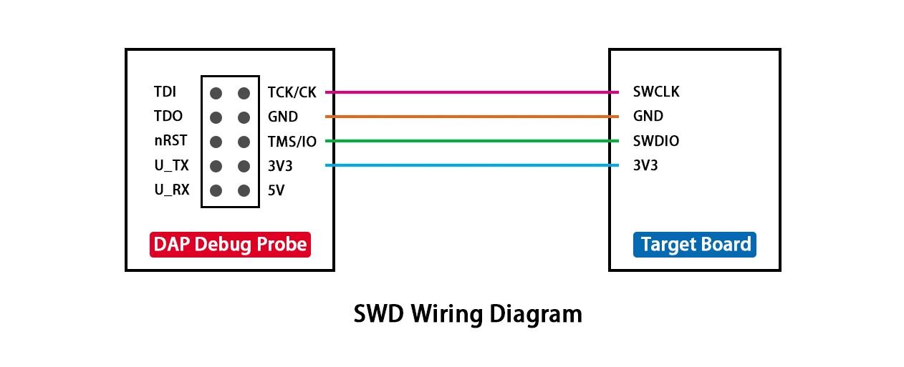
- 最基本的连接只有：
  
  ```
  Debug Probe                         MCU
  ┌──────────────┐                  ┌──────────────┐
  │              │                  │              │
  │     SWCLK ───┼─────────────────► SWCLK        │
  │              │                  │              │
  │     SWDIO ◄──┼─────────────────► SWDIO        │
  │              │                  │              │
  │      GND ────┼────────────────── GND          │
  │              │                  │              │
  └──────────────┘                  └──────────────┘
  ```
  
  这里最关键的是：
  > **SWCLK 永远由 Host 驱动，而 SWDIO 是双向的。**
  
  所以 SWD 相比 JTAG 少了：TCK、TMS、TDI、TDO；
  变成：SWCLK、SWDIO；
  但它并不是简单地把 JTAG 的 4 根信号线“压缩”成 2 根线，而是重新定义了一套串行 Debug Port 访问协议。
- ### 1.4.2 为什么 SWD 是半双工？
  
  SWDIO 是一根线。
  
  因此不可能出现：
  
  ```
  Host ───────► Target
  Host ◄─────── Target
  ```
  
  同时发生。
  
  而是：
  
  ```
  时间 →
  ─────────────────────────────────────────────►
  
  Host 驱动 SWDIO
       │
       ▼
  ┌──────────────┐
  │   Request    │
  └──────────────┘
       │
       │ Turnaround
       ▼
  Target 驱动 SWDIO
       │
       ▼
  ┌──────────────┐
  │     ACK      │
  └──────────────┘
       │
       │
       ▼
  Target / Host
  根据操作方向驱动
  Data
  
  ```
  
  所以 SWD 的核心问题之一就是：
  
  > **什么时候 Host 驱动 SWDIO，什么时候 Target 驱动 SWDIO？**
  
  这就是 **Turnaround（Trn）** 存在的原因。
- ### 1.4.3 一个 SWD Transaction 的整体结构
  
  一个典型 SWD transaction：
  
  ```
                一个完整 SWD Transaction
  ┌─────────────────────────────────────────────────────┐
  │                                                     │
  │  Request        ACK             Data                │
  │                                                     │
  │  8 bits         3 bits          33 bits             │
  │                                                     │
  │  Host ───────►  Target ───────► Host/Target         │
  │                                                     │
  └─────────────────────────────────────────────────────┘
  ```
  
  其中：Request 8 bit：
  
  ```
  START
  APnDP
  RnW
  A2
  A3
  PARITY
  STOP
  PARK
  ```
  
  也就是：
  
  ```
  1 + 1 + 1 + 2 + 1 + 1 + 1
  = 8 bits
  ```
  
  ACK 3 bit：ACK\[2:0]
  
  Data 32 bit 数据：DATA\[31:0] 再加：PARITY ，所以33 bits
- ### 1.4.4 SWD Request 帧结构
  
  这是 SWD 最重要的一个帧。
  
  ```
  Bit：
  
  7       6       5       4    3    2    1    0
  ┌───────┬───────┬───────┬────┬────┬────┬────┬────┐
  │ PARK  │ STOP  │ PARITY│ A3 │ A2 │ RnW│APnDP│START│
  └───────┴───────┴───────┴────┴────┴────┴────┴────┘
  
  ```
  
  注意一个非常容易混淆的问题：
  
  > **SWD 是 LSB First。**
  
  所以物理线上首先发送的是：
  
  ```
  START
  APnDP
  RnW
  A2
  A3
  PARITY
  STOP
  PARK
  ```
  
  而不是从 Bit7 开始发送。官方资料也明确规定地址字段采用 LSB-first。
- #### 1.4.4.1 START
  
  START 固定：
  
  ```
  START = 1
  ```
  
  作用就是告诉 Target：
  
  > 一个新的 SWD Request 开始了。
- #### 1.4.4.2 APnDP
  
  ```
  APnDP = 0 → DP
  APnDP = 1 → AP
  ```
  
  也就是：
  
  ```
  0 → Debug Port
  1 → Access Port
  ```
  
  所以：
  
  ```
  Host
  │
  │ Request
  │
  ├── APnDP=0 ──► DP
  │
  └── APnDP=1 ──► AP
  ```
  
  这是理解 SWD 和 DAP 关系的关键。
  
  实际上：
  
  ```
  SWD
  │
  ▼
  SWD-DP
  │
  ├── DP Registers
  │
  └── AP
      │
      └── MEM-AP
           │
           └── MCU System Bus
  ```
  
  所以你后面分析 OpenOCD、DAP、Cortex Debug 时，会不断遇到：
  
  ```
  DP
  AP
  MEM-AP
  ```
- #### 1.4.4.3 RnW
  
  ```
  RnW = 1 → Read
  RnW = 0 → Write
  ```
  
  例如：
  
  ```
  APnDP = 0
  RnW   = 1
  ```
  
  表示：
  
  ```
  读取 DP 寄存器
  ```
  
  而：
  
  ```
  APnDP = 1
  RnW   = 0
  ```
  
  表示：
  
  ```
  写 AP 寄存器
  ```
- #### 1.4.4.4 A2 / A3
  
  SWD Request 中只有：
  
  ```
  A[3:2]
  ```
  
  两个地址 bit。
  
  因为 SWD Debug Port / Access Port 的寄存器访问粒度主要是 32-bit，而寄存器地址低两位天然为：
  
  ```
  00
  ```
  
  所以只需要传：
  
  ```
  A3
  A2
  ```
  
  例如：
  
  ```
  A[3:2] = 00
  ```
  
  访问：
  
  ```
  0x0
  ```
  
  ```
  A[3:2] = 01
  ```
  
  访问：
  
  ```
  0x4
  ```
  
  ```
  A[3:2] = 10
  ```
  
  访问：
  
  ```
  0x8
  ```
  
  ```
  A[3:2] = 11
  ```
  
  访问：
  
  ```
  0xC
  ```
- #### 1.4.4.5 PARITY
  
  Request 中的 parity：
  
  ```
  PARITY = parity(APnDP, RnW, A2, A3)
  
  ```
  
  是**偶校验**。
  
  也就是说：
  
  ```
  APnDP ⊕ RnW ⊕ A2 ⊕ A3 ⊕ PARITY = 0
  
  ```
  
  例如：
  
  ```
  APnDP = 1
  RnW   = 1
  A2    = 0
  A3    = 1
  
  ```
  
  其中有：
  
  ```
  1 + 1 + 0 + 1 = 3
  
  ```
  
  个 1。
  
  为了使总数成为偶数：
  
  ```
  PARITY = 1
  
  ```
- #### 1.4.4.6 STOP 和 PARK
  
  两个固定字段：
  
  ```
  STOP = 0
  PARK = 1
  
  ```
  
  所以 Request 最后两个 bit 永远是：
  
  ```
  0 1
  
  ```
  
  因此一个典型 Request：
  
  ```
  START APnDP RnW A2 A3 PARITY STOP PARK
  1     0    1  0  0    0     0    1
  
  ```
  
  物理线上仍然是从左边的 START 开始发送。
- #### 1.4.4.7 Request → ACK 的关键：Turnaround
  
  这是 SWD 和普通 SPI 最大的区别之一。
  
  Host 发完：
  
  ```
  Request
  
  ```
  
  之后：
  
  ```
  Host
  │
  │ SWDIO = output
  │
  ▼
  ┌────────────┐
  │  Request   │
  └────────────┘
       │
       ▼
   Turnaround
       │
       ▼
  Target
  │
  │ SWDIO = output
  │
  ▼
  ┌────────────┐
  │    ACK     │
  └────────────┘
  
  ```
  
  也就是说：
  
  ```
  Host → Target
  
  ```
  
  切换成：
  
  ```
  Target → Host
  ```
  
  中间必须让双方都释放 SWDIO。
- #### 1.4.4.8 TrN 是什么？
  
  TrN：
  
  ```
  Turnaround
  ```
  
  就是：
  
  > **SWDIO 总线方向切换期间的高阻态时间。**
  
  可以理解成：
  
  ```
  Host Drive
     │
     ▼
     Z
     │
     ▼
  Target Drive
  ```
  
  这里：
  
  ```
  Z = High Impedance
  ```
  
  非常重要。
  
  不能这样：
  
  ```
  Host = 1
  Target = 0
  
       ↓
  
  SWDIO = ？？？
  ```
  
  否则两个输出驱动器可能发生总线争用。
  
  所以必须：
  
  ```
  Host release
      ↓
     Z
      ↓
  Target drive
  ```
- #### 1.4.4.9 ACK 阶段
  
  Target 接管 SWDIO 后发送：
  
  ```
  ACK[2:0]
  ```
  
  常见 ACK：
  
  | ACK   | 含义  |
  | ----- | ----- |
  | `001` | OK    |
  | `010` | WAIT  |
  | `100` | FAULT |
  
  也就是：
  
  ```
  001 → OK
  010 → WAIT
  100 → FAULT
  ```
  
  这三个状态非常重要。
  
  例如：
  
  ```
  Host:
    Request
       │
       ▼
  Target:
    ACK = 001
       │
       ▼
    Data
  ```
  
  表示：
  
  > 请求成功，可以继续数据阶段。
  
  如果：
  
  ```
  ACK = 010
  ```
  
  那么通常意味着：
  
  > Target 当前还不能完成请求。
  
  Debug Probe/Host 通常需要重新发起访问。
- #### 1.4.4.10 Write Transaction
  
  以：
  
  ```
  Write
  
  ```
  
  为例。
  
  完整结构：
  
  ```
                Write Transaction
  
  Host                                      Target
  │                                           │
  │ Request                                   │
  │ 8 bit                                     │
  ├──────────────────────────────────────────►│
  │                                           │
  │              Turnaround                   │
  │───────────────────── Z ─────────────────│
  │                                           │
  │                    ACK                    │
  │◄────────────────── 3 bit ────────────────┤
  │                                           │
  │              Turnaround                   │
  │───────────────────── Z ─────────────────│
  │                                           │
  │ Data                                      │
  │ 32 bit + parity                           │
  ├──────────────────────────────────────────►│
  │                                           │
  
  ```
  
  因此 Write：
  
  ```
  Host → Target
  Request
  
  Target → Host
  ACK
  
  Host → Target
  DATA
  
  ```
  
  这里会出现**两次方向切换**。
  
  ***
- #### 1.4.4.11 Read Transaction
  
  Read 就不一样。
  
  ```
                Read Transaction
  
  Host                                      Target
  │                                           │
  │ Request                                   │
  │ 8 bit                                     │
  ├──────────────────────────────────────────►│
  │                                           │
  │              Turnaround                   │
  │───────────────────── Z ─────────────────│
  │                                           │
  │                    ACK                    │
  │◄────────────────── 3 bit ────────────────┤
  │                                           │
  │                    DATA                   │
  │◄────────────────── 32 bit ───────────────┤
  │                                           │
  │                  PARITY                   │
  │◄──────────────────── 1 ──────────────────┤
  
  ```
  
  所以 Read：
  
  ```
  Host → Target
  Request
  
  Target → Host
  ACK + DATA
  
  ```
  
  只需要一次方向切换。
  
  这也是为什么：
  
  ```
  Write
  
  ```
  
  和：
  
  ```
  Read
  
  ```
  
  的 SWD 时序图并不完全一样。
- ### 1.4.5 为什么一个 Packet 是 46 clocks？
  
  把 Write 算一遍：
  
  ```
  Request
  8 bit
  
  ACK
  3 bit
  
  DATA
  32 bit
  
  Parity
  1 bit
  
  ```
  
  合计：
  
  ```
  8 + 3 + 32 + 1
  = 44 bits
  
  ```
  
  但是还存在：
  
  ```
  Turnaround
  
  ```
  
  因此完整 transaction 通常是：
  
  ```
  46 clocks
  ```
  
  即：
  
  ```
  8
  +
  1/2 turnaround
  +
  3
  +
  1.5 turnaround
  +
  33
  ≈ 46 clocks
  
  ```
  
  具体 TrN 的实现时序非常值得注意：第一次方向切换期间，Target 可以在 SWDCLK 上升沿开始驱动 ACK，因此这一阶段约为半个周期；Write 的 ACK→Data 方向切换则包含更长的 TrN，典型为 1.5 个周期。
- ### 1.4.6 SWD 的时钟边沿
  
  这里也非常容易在自己实现 SWD Probe 时搞错。
  
  一个典型规则是：
  
  Host → Target
  
  Host 在：
  
  ```
  SWDCLK falling edge
  
  ```
  
  附近改变 SWDIO。
  
  Target 在：
  
  ```
  SWDCLK rising edge
  
  ```
  
  采样。
  
  也就是：
  
  ```
          ┌───────┐
  SWCLK ────┘       └───────
          ↑       ↑
        Sample   Sample
  
  ```
  
  而 Target → Host 的数据方向则相应按照协议时序进行驱动/采样。Infineon 的 SWD 时序说明也明确给出了 Host 写数据在下降沿驱动、Target 在下一上升沿读取，以及读数据由 Target 驱动、Host 在后续下降沿读取的规则。
- ### 1.4.7 一个完整的 Read 示例
  
  假设：
  
  ```
  读取 DP 的某个寄存器
  
  ```
  
  Host 首先构造：
  
  ```
  START = 1
  APnDP = 0
  RnW   = 1
  A2    = ...
  A3    = ...
  PARITY = ...
  STOP  = 0
  PARK  = 1
  
  ```
  
  形成：
  
  ```
  ┌──────────────────────────────┐
  │ 1 │ 0 │ 1 │ A2 │ A3 │ P │ 0 │ 1 │
  └──────────────────────────────┘
  
  ```
  
  Host 发送：
  
  ```
  SWDIO
   │
   ├── 1
   ├── 0
   ├── 1
   ├── A2
   ├── A3
   ├── P
   ├── 0
   └── 1
  
  ```
  
  然后：
  
  ```
  Host release SWDIO
          ↓
         TrN
          ↓
  Target drive SWDIO
  
  ```
  
  Target 返回：
  
  ```
  ACK = 001
  ```
  
  也就是：
  
  ```
  OK
  ```
  
  随后 Target 继续发送：
  
  ```
  DATA[0]
  DATA[1]
  ...
  DATA[31]
  PARITY
  ```
  
  最终：
  
  ```
  Host 得到：
  
  ACK = OK
  DATA = 0xXXXXXXXX
  PARITY = 0/1
  ```
- ### 1.4.8 SWD 的“帧”和 JTAG 的“帧”思维不太一样
  
  这一点对你现在学习 **JTAG → SWD** 特别重要。
  
  JTAG 更容易理解成：
  
  ```
  TAP Controller
     │
     ├── IR Scan
     │
     └── DR Scan
  
  ```
  
  而 SWD 更像：
  
  ```
  SWD Transaction
       │
       ├── Request
       │
       ├── ACK
       │
       └── Data
  
  ```
  
  所以：
  
  ```
  JTAG
  ↓
  TAP State Machine
  ↓
  IR/DR Scan
  ↓
  Debug Register
  
  ```
  
  而 SWD：
  
  ```
  SWD
  ↓
  SWD Packet
  ↓
  Request
  ↓
  ACK
  ↓
  Data
  ↓
  DP/AP Register
  
  ```
  
  这也是为什么在你的 **JTAG/SWD Debug Probe** 设计中，可以把底层抽象成：
  
  ```
  ┌───────────────────────────────┐
  │       Debug Transport         │
  ├───────────────────────────────┤
  │ JTAG Transport │ SWD Transport│
  └────────┬───────┴───────┬──────┘
         │               │
         ▼               ▼
      JTAG TAP          SWD
         │               │
         └───────┬───────┘
                 ▼
              DAP / DP
                 │
          ┌──────┴──────┐
          ▼             ▼
         AP             DP
          │
       MEM-AP
          │
          ▼
      System Bus
  
  ```
  
  如果把整个 SWD 通信压缩成一张图：
  
  ```
                 SWD WRITE
                   
  Host                                          Target
  │                                               │
  │────── Request 8bit ─────────────────────────►│
  │                                               │
  │────────────── TrN ────────────────           │
  │                                               │
  │◄──────────── ACK 3bit ───────────────────────│
  │                                               │
  │────────────── TrN ────────────────           │
  │                                               │
  │────── DATA 32bit + PARITY ─────────────────►│
  │                                               │
  
  
                 SWD READ
  
  Host                                          Target
  │                                               │
  │────── Request 8bit ─────────────────────────►│
  │                                               │
  │────────────── TrN ────────────────           │
  │                                               │
  │◄──────────── ACK 3bit ───────────────────────│
  │                                               │
  │◄──────────── DATA 32bit ─────────────────────│
  │◄──────────── PARITY ─────────────────────────│
  │                                               │
  
  ```
  
  其中最核心的三个知识点就是：
  
  ```
  ① SWDIO 是双向线
        ↓
  ② Host / Target 必须通过 TrN 进行方向切换
        ↓
  ③ 每次访问都是 Request → ACK → Data
  
  ```
  
  而再往上层就是：
  
  ```
  SWD
  ↓
  SWD-DP
  ↓
  DP Register / AP
  ↓
  MEM-AP
  ↓
  AHB/APB/System Bus
  ↓
  CPU / Memory / Peripheral
  
  ```
- ## 1.5 JTAG 与 SWD 模式切换序列（Line Reset / Select Code）
  
  这个问题是理解 **ARM Debug Port 从 JTAG-DP 切换到 SW-DP** 的关键。
  
  需要先明确一点：
  
  > **JTAG ↔ SWD 的切换，不是通过某个普通寄存器配置完成的，而是通过 SWJ-DP（Serial Wire/JTAG Debug Port）识别的特殊时序序列完成的。**
  
  典型 Cortex-M 调试器连接时，会经历：
  
  ```
  上电
  │
  ▼
  JTAG 模式
  │
  │ 发送 SWJ Switch Sequence
  ▼
  SWD 模式
  │
  ▼
  SW-DP
  │
  ▼
  AP / MEM-AP
  │
  ▼
  MCU
  ```
- ### 1.5.1 为什么需要模式切换？
  
  ARM Cortex-M 的 Debug Port 可以支持两种物理调试接口：
  
  ```
                 SWJ-DP
                   │
          ┌────────┴────────┐
          │                 │
       JTAG-DP            SW-DP
          │                 │
     TCK/TMS/TDI/TDO     SWCLK/SWDIO
  
  ```
  
  也就是说，同一个 Debug Port：JTAG-DP和SW-DP共存。
  
  复用关系通常是：
  
  ```
  JTAG              SWD
  ────              ───
  TCK      ↔        SWCLK
  TMS      ↔        SWDIO
  TDI
  TDO
  nRESET
  ```
  
  所以 MCU 并不知道你究竟想使用：JTAG还是SWD，必须通过特殊序列告诉它。
- ### 1.5.2 SWJ Switch Sequence
  
  最经典的：JTAG → SWD，切换序列是：
  
  ```
  SWDIO:
    50 个连续的 1
          ↓
    16-bit JTAG-to-SWD
          ↓
    至少 2 个 idle cycle
  
  ```
  
  也就是：
  
  ```
  ┌────────────────────┐
  │ 50 × 1             │
  └─────────┬──────────┘
          ↓
  ┌────────────────────┐
  │ JTAG → SWD sequence│
  │      0xE79E        │
  └─────────┬──────────┘
          ↓
  ┌────────────────────┐
  │ idle ≥ 2 clocks    │
  └────────────────────┘
  
  ```
  
  这里有一个**非常容易踩坑的地方**：
  
  > `0xE79E` 是按 SWD/JTAG switch sequence 的位发送规则描述的，不能简单理解成“在 SWDIO 上先发送 0xE7，再发送 0x9E”。
  
  实际发送时需要按照 **LSB-first** 的方式发送这个 16-bit 序列。
- ### 1.5.3 为什么要先发送 50 个 1？
  
  这是为了让 Debug Port 进入一个**确定状态**。
  
  可以理解为：
  
  ```
  SWDIO = 1
  SWCLK ↑
  SWDIO = 1
  SWCLK ↑
  SWDIO = 1
  SWCLK ↑
  ...
  
  ```
  
  连续：≥ 50 cycles，之后：JTAG TAP
  
  会被置于一种不会误识别普通 JTAG 操作的状态。
  
  这一步可以理解成：
  
  > **Synchronize / Reset the interface state**
  
  所以一个可靠的 Debug Probe 在尝试切换接口之前，通常都会先发送大量 `1`。
  
  ***
- ### 1.5.4 JTAG → SWD 的完整序列
  
  假设当前 MCU 处于：JTAG mode
  
  Host Debug Probe，想切换成：SWD mode
  
  那么：
  
  ```
  SWDIO
  │
  │ 11111111111111111111111111111111111111111111111111
  │  └──────────── 50 × 1 ──────────────────────────┘
  │
  │  JTAG → SWD sequence
  │
  │  0xE79E
  │
  │  Idle
  │
  ▼
  SWD mode
  ```
  
  时钟：
  
  ```
  SWCLK
  ↑ ↓ ↑ ↓ ↑ ↓ ↑ ↓ ↑ ↓ ...
  ```
  
  这里 **SWCLK 必须继续提供时钟**，因为 SWDIO 上的序列本质上仍然是一个串行协议操作。
- ### 1.5.5 `0xE79E` 到底怎么发送？
  
  这是学习 SWD 时特别值得搞清楚的一个细节。
  
  假设：0xE79E
  
  二进制：
  
  ```
  1110 0111 1001 1110
  
  ```
  
  如果按照 MSB-first：
  
  ```
  1110011110011110
  ```
  
  但 SWD/SWJ sequence 的发送是：LSB-first
  
  所以实际 bit 顺序是：0111100111100111
  
  也就是：
  
  ```
  0 1 1 1 1 0 0 1 1 1 1 0 0 1 1 1
  ```
  
  因此实现一个 Probe 时，不能简单：send\_u16(0xE79E);
  
  然后默认硬件会按照你想要的方向发送。
  
  必须确认底层 SPI/GPIO/FPGA：bit order
  
  到底是什么。
- ### 1.5.6 切换后为什么还要 Idle？
  
  切换序列之后通常需要：至少 2 个 clock cycles的 idle。
  
  可以理解为：
  
  ```
  Switch Sequence
      │
      ▼
  ┌─────────┐
  │ Idle    │
  │  ≥2 clk │
  └────┬────┘
      ▼
   SW-DP
  
  ```
  
  这样 Target 有时间完成：JTAG-DP->SW-DP接口状态切换。
- ### 1.5.7 SWD → JTAG
  
  反过来也可以：
  
  ```
  SWD
  ↓
  JTAG
  ```
  
  使用：50 × 1，之后发送：JTAG-to-SWD switch sequence 的反向序列
  
  经典序列为：0xE73C，然后：≥ 2 idle clocks
  
  所以可以记成：
  
  ```
          50 × 1
             │
     ┌───────┴────────┐
     │                │
     ▼                ▼
  JTAG → SWD        SWD → JTAG
     │                │
   0xE79E           0xE73C
     │                │
     └───────┬────────┘
             ▼
          Idle ≥2
  
  ```
- ### 1.5.8 一个实际 Debug Probe 的初始化流程
  
  如果你以后自己实现一个类似 **J-Link/OpenOCD Debug Probe** 的底层驱动，这个流程就非常重要。
  
  典型流程可以是：
  
  ```
  ① Probe 上电
       │
       ▼
  ② SWCLK 输出
       │
       ▼
  ③ SWDIO 输出
       │
       ▼
  ④ 发送 ≥50 个 1
       │
       ▼
  ⑤ 发送 JTAG → SWD Switch Sequence
       │
       ▼
  ⑥ SWDIO 释放
       │
       ▼
  ⑦ Idle ≥2 clocks
       │
       ▼
  ⑧ 开始 SWD transaction
       │
       ▼
  ⑨ 读取 DP IDCODE
       │
       ▼
  ⑩ 初始化 DP
       │
       ▼
  ⑪ 初始化 AP
       │
       ▼
  ⑫ MEM-AP
       │
       ▼
  ⑬ 访问 MCU Memory / Core Register
  
  ```
  
  其中：读取 DP IDCODE是非常重要的验证步骤。
  
  如果你切换 SWD 后能够正确读到：DP IDCODE
  
  基本就可以证明：
  
  ```
  SWDIO
  SWCLK
  SWJ switch
  SWD transaction
  SW-DP
  ```
  
  整个链路基本已经工作。
- # 第 2 章：硬件抽象层（调试器与驱动）
- ## 2.1 ARM ADI（v5/v6）架构中的 DP 与 AP 访问原理
  
  ARM ADI（Debug Interface Specification）规范定义了外部调试器与芯片内部 CoreSight 调试组件通信的架构。整体核心是由 **Debug Access Port (DAP)** 构成的两级分层访问机制：外部连接控制 **DP (Debug Port)**，再由 DP 路由控制多个 **AP (Access Port)** 访问芯片内部的总线与组件。
  
    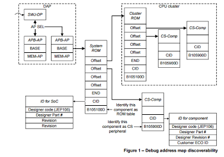
  
  **1. 架构分层职责**
  
  * **Debug Port (DP):** 负责处理外部物理协议（SWD、JTAG 或 ADIv6 中的 SWJ-DP/MIN-DP），提供对调试器本身控制寄存器（如上电、选择 AP）的直接访问。
  * **Access Port (AP):** 负责对接芯片内部的系统总线或调试组件。常见的有 **MEM-AP**（通过 AHB/AXI/APB 总线直接读写内存及外设）和 **JTAG-AP**。
  
  **2. DP 访问原理**
  
  DP 寄存器空间很小（通常只暴露 4 个地址偏移：`0x0`, `0x4`, `0x8`, `0xC`），通过内部 **SELECT 寄存器** 实现分页与寻址：
  
  * **SELECT 寄存器（DP 偏移 0x8）:**
  * **APSEL:** 选择当前要操作的 AP 端口索引（最多支持 256 个 AP）。
  * **APBANKSEL \[7:4]:** 选择当前 AP 内部的寄存器页（Bank）。
  * **DPBANKSEL \[3:0]:** 选择 DP 自身的寄存器页（ADIv5/v6 用于扩展 DP 寄存器）。
  * **常规 DP 访问流程:**
  1. 调试器向 DP 发送硬件级别的协议命令（如 SWD 读写请求）。
  2. 读写 `DP0x00`（IDCODE）、`DP0x04`（CTRL/STAT，用于给 Debug 系统供电及状态查询）、`DP0x08`（SELECT）和 `DP0x0C`（RDBUFF，读取缓冲）。
  
  **3. AP 访问原理**
  
  AP 寄存器无法直接通过物理总线的线缆指令读写，必须**借助 DP 间接透传**：
  
  1. **设置寻址目标:** 调试器写入 `DP SELECT` 寄存器，设定 `APSEL`（目标 AP）和 `APBANKSEL`（目标页）。
  2. **发出 AP 访问命令:** 物理层发起对 AP 寄存器的读写指令（如 SWD 的 `APnDP=1` 访问标志）。
  3. **读写解耦 (Pipeline 机制):**
   * **写 AP:** 数据通过 DP 传输直接写入目标 AP 寄存器。
   * **读 AP:** 读 AP 寄存器是**两阶段异步**的。发起 AP 读指令后，AP 将数据打入 DP 的 `RDBUFF`，此时物理线上返回的数据往往是上一次传输的旧值；调试器需紧接着读取 `DP RDBUFF`（`DP 0x0C`）才能拿到真实的 AP 读结果。
  
  **4. 典型场景：通过 MEM-AP 读写内存**
  
  读写芯片 RAM 或外设寄存器是调试中最常见的 AP 操作，依靠 MEM-AP 内部的 4 个核心寄存器实现：
  
  |                                     |                                                                     |
  | ----------------------------------- | ------------------------------------------------------------------- |
  | **CSW (Control/Status Word)**       | 配置传输属性（如数据位宽 8/16/32-bit、地址自动递增模式）            |
  | **TAR (Transfer Address Register)** | 写入要访问的芯片物理内存地址（如 `0x20000000`）                     |
  | **DRW (Data Read/Write)**           | 读写数据的通道。写入即发起写内存，读取（结合 `RDBUFF`）即发起读内存 |
  | **BD0\~BD3 (Banked Data)**          | 配合地址自动递增进行高效块传输                                      |
  
  **读内存操作示例步骤:**
  
  1. 配置 `DP SELECT` 选中 MEM-AP 及对应 Bank。
  2. 写 `CSW` 配置为 32-bit 自动递增模式。
  3. 写 `TAR` = `0x20000000`（设置目标起始地址）。
  4. 读 `DRW`（触发 MEM-AP 向总线发起总线读，同时启动 DP 传输）。
  5. 读 `DP RDBUFF`（或连续读取下一个 `DRW`）获取真正从 `0x20000000` 读出的数据。
- ## 2.2 RISCV DTM访问原理
- 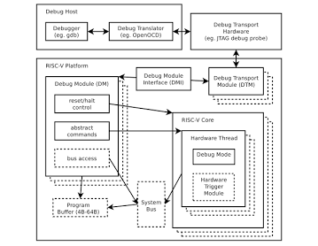
- RISC-V 的核心访问链条可以概括为：**DTM (物理连接) ➔ DMI (内部总线) ➔ DM (控制核心) ➔ Hart (CPU核) / System Bus (内存)**。
- ### 2.2.1. 核心架构组件及职责
  
  |                                      |                                      |                                                                                                                                                                |
  | ------------------------------------ | ------------------------------------ | -------------------------------------------------------------------------------------------------------------------------------------------------------------- |
  | **DTM***(Debug Transport Module)*    | **DP**                               | **物理传输模块**。对接外部物理总线（JTAG、cJTAG 或 USB 等），负责解包外部物理信号，并转换为芯片内部统一的 **DMI** 总线事务。                                   |
  | **DMI***(Debug Transport Interface)* | 相当于 DP 与 AP 之间的内部总线       | **调试传输接口**。一条极简的内部读写总线，包含 Address（通常 7-12 bit）、Data（32 bit）和 Operation（Read/Write/NOP）。                                        |
  | **DM***(Debug Module)*               | 类似于 **MEM-AP / Core-AP** 的集合体 | **调试核心模块**。包含控制 CPU 停机/单步的寄存器、抽象命令接口（Abstract Commands）、程序缓冲区（Program Buffer）以及系统总线访问控制器（System Bus Access）。 |
  | **Hart***(Hardware Thread)*          | **CPU Core**                         | RISC-V 规范中的硬件线程/处理器核心。DM 通过发送控制信号或注入指令来操作 Hart。                                                                                 |
- ### 2.2.2. DTM ➔ DMI 的访问原理
  
  外部调试器（如 OpenOCD / J-Link）无法直接操作 DM，必须先经过 DTM 翻译：
  
  1. **JTAG IR / DR 操作**：以常见的 JTAG DTM 为例，TAP 控制器定义了特殊的 JTAG 寄存器，如 `dtmcs`（DTM 控制和状态）和 `dmi`（DMI 访问寄存器）。
  2. **通过 DMI 寄存器发起请求**：调试器将 `[Address, Data, Opcode]` 打包移入 JTAG 的 `dmi` 寄存器：
   * `Opcode = 1`：读操作 (Read)
   * `Opcode = 2`：写操作 (Write)
  3. **两阶段读机制**：与 ARM 的 `RDBUFF` 异步读类似，RISC-V 发起 DMI Read 请求后，DTM 会异步去读 DM；调试器在下一个 JTAG 扫描周期才能从 `dmi` 寄存器中把读到的数据移出。
- ### 2.2.3. DM 内部的两种主流访问机制
  
  选中 DM 后，调试器如何控制 CPU 或读写内存？RISC-V 提供了两种互补机制：
- #### 2.2.3.1. **机制 A：抽象命令 (Abstract Commands) —— 控制与寄存器访问**
  
  调试器通过读写 DM 内部固定的 **Abstract Command 寄存器组** 来控制 Hart 或访问 CPU 内部通用寄存器（`x0`-`x31`）、CSR 等：
  
  1. **设置目标**：写 `dmcontrol` 寄存器中的 `hartsel`，选中当前要调试的 Hart。
  2. **发起 Abstract Cmd**：写 `command` 寄存器，设定动作（如“读取寄存器 `x10`”）。
  3. **获取结果**：检查 `abstractcs` 中的 `busy` 标志；完成后从 `data0` 寄存器直接取出 `x10` 的值。
  
  > **停止/复位 Hart**：也是通过写 `dmcontrol` 寄存器的 `haltreq`（暂停）、`resethaltreq`（复位后立即暂停）等控制位实现。
- #### 2.2.3.2. **机制 B：程序缓冲区 (Program Buffer) & 系统总线 (SBA) —— 内存访问**
  
  读写 RAM 或外设寄存器通常有两种途径：
  
  1. **Program Buffer (PBuf) 注入执行**：
   * DM 内部包含一小块 SRAM（通常 2\~8 条指令大小）。
   * 调试器将几条正常的 RISC-V 汇编指令（如 `lw x10, 0(x11)`）写入 Program Buffer。
   * DM 强制让 Hart 执行这几条指令，从而借助 CPU 自身的能力读写内存。
  2. **System Bus Access (SBA) 直接总线访问**（类似于 ARM 的 MEM-AP）：
   * 如果 DM 硬件集成了 SBA 模块，DM 自身就具备直接接管系统总线（如 AHB/AXI/TileLink）的能力。
   * 调试器设置 `sbaddress0`（目标物理地址），读写 `sbdata0` 即可直接触发总线读写，**无需打扰 CPU 执行**。
- ## 2.3 CMSIS-DAP协议解析
  
  **CMSIS-DAP**（Cortex Microcontroller Software Interface Standard - Debug Access Port）是 ARM 官方推出的开源调试协议标准，用于将上位机（PC）的调试指令转换为目标芯片（ARM Cortex 内核）的 SWD/JTAG 信号。
- ### 2.3.1. 协议核心架构
  
  CMSIS-DAP 位于 Host（PC 调试软件，如 Keil、OpenOCD）与 Target（目标 MCU）之间，扮演传输桥梁的角色：
  
  * **上位机 (Host PC)**：通过 USB 发送预设的 DAP 命令（Command Packet）。
  * **固件 (DAP Firmware)**：运行在 MCU 上，解析 USB 命令并驱动 GPIO/硬件外设产生 SWD 或 JTAG 时序。
  * **目标板 (Target Device)**：通过 SWD/JTAG 接口连接到 DAP 硬件，响应内存读写、寄存器访问及复位操作。
  
  在 ARM 生态体系中，CMSIS-DAP 占据着**连接软件生态与硬件调试物理层**的核心纽带位置：
  
  ```
  +-------------------------------------------------------------+
  |    上位机 IDE / 调试器 (Keil MDK, OpenOCD, CLion, VS Code)    |
  +-------------------------------------------------------------+
                              │  (1. CMSIS-DAP Command Packet)
                              ▼
  +-------------------------------------------------------------+
  |    调试器 MCU (例如 STM32F103 / RP2040 运行 DAP 固件)         |
  +-------------------------------------------------------------+
                              │  (2. 硬件物理波形)
                              ▼
  +-------------------------------------------------------------+
  |    目标芯片 CoreSight 架构 (DP -> AP -> Memory/CPU Regs)     |
  +-------------------------------------------------------------+
  
  ```
  
  1. **破除私有厂商壁垒**：在 CMSIS-DAP 出现前，主流调试器协议多为闭源私有（如 J-Link 的 JTAG 封装协议、ST-Link 专有协议）。CMSIS-DAP 作为 **ARM 官方开源标准**，让任何硬件厂商和开发者都能零授权费实现标准的调试器。
  2. **连接 IDE 与物理硬件的“翻译官”**：上位机（如 OpenOCD、Keil）无需了解具体的 USB 读写细节和微控制器 GPIO 翻转逻辑，只需打包标准 DAP 命令；硬件端则只需专注于把 DAP 命令高效翻译成物理 SWD/JTAG 电平。
  3. **CoreSight 系统的透传接口**：它本质上是 ARM **CoreSight 架构**的远程调用协议（RPC）。它通过标准指令直接映射访问目标芯片内部的 **DP（Debug Port）** 和 **AP（Access Port）**，从而实现对 CPU 内核（内核寄存器、断点控制）和系统总线（RAM/Flash）的绝对控制。
- ### 2.3.2. 传输层版本对比 (USB Transport)
  
  CMSIS-DAP 协议定义了指令集，但在 USB 传输层有两个主流版本：
  
  | USB 接口类 | USB HID (Human Interface Device)  | USB WinUSB / Bulk                            |
  | ---------- | --------------------------------- | -------------------------------------------- |
  | 驱动要求   | 免驱（利用操作系统自带 HID 驱动） | 需要 WinUSB 驱动（Windows 10/11 可自动加载） |
  | 传输速度   | 较慢（受到 HID 1ms 轮询周期限制） | 极快（充分利用 USB Bulk 满速/高速带宽）      |
  | 常见应用   | 早期 DAPLink 制作、对速率要求不高 | 现代高性能调试器（如 J-Link 替代方案）       |
- ### 2.3.3. 数据包结构 (Packet Format)
  
  CMSIS-DAP 的通信模式采用 **请求-响应 (Request-Response)** 机制。上位机发送发送数据包（Request），调试器执行后返回应答数据包（Response）。
  
  请求数据包 (Request Packet)
  
  ```
  +-----------------+-------------------+-----------------------+
  |  Command ID     |  Data Byte 1      |  Data Byte 2 ...      |
  |  (1 Byte)       |  (参数/寄存器/地址) |  (有效 Payload 数据)    |
  +-----------------+-------------------+-----------------------+
  
  ```
  
  响应数据包 (Response Packet)
  
  ```
  +-----------------+-------------------+-----------------------+
  |  Command ID     |  Status / Count   |  Return Data ...      |
  |  (1 Byte)       |  (执行状态/成功数) |  (读取到的数据)        |
  +-----------------+-------------------+-----------------------+
  
  ```
- ### 2.3.4. 关键命令分类 (Command Set)
  
  CMSIS-DAP 指令集包含以下几类核心命令：
  
  **通用信息类 (General Information)**
  
  * `DAP_Info (0x00)`：获取调试器的基本信息（固件版本、Vendor 名称、最大 Pack Size 等）。
  * `DAP_Connect (0x02)`：建立调试连接，指定使用 **SWD Mode (1)** 或 **JTAG Mode (2)**。
  * `DAP_Disconnect (0x03)`：断开与目标芯片的连接。
  * `DAP_HostStatus (0x01)`：控制调试器上的 LED（如连接状态灯、运行状态灯）。
  
  **时序与控制类 (Control & Timing)**
  
  * `DAP_Delay (0x09)`：等待指定微秒数。
  * `DAP_ResetTarget (0x0A)`：触发目标芯片复位信号线（RESET 引脚）。
  * `DAP_SWJ_Clock (0x11)`：设置 SWD/JTAG 接口的时钟频率（TCK / SWCLK）。
  
  **核心读写传输 (SWD/JTAG Transfer)**
  
  * `DAP_Transfer (0x05)`：**核心指令**。用于批量执行 SWD/JTAG 的 DP (Debug Port) 或 AP (Access Port) 寄存器读写。
  * 请求中包含一系列 Transfer Request Byte（指定 DP/AP 寄存器地址、读写标志）。
  * 返回实际执行成功的传输次数及读取的数据。
  * `DAP_TransferBlock (0x06)`：用于对单个 DP/AP 寄存器进行**连续块读写**（大大提高了烧录 Flash 和读取大块内存的效率）。
  
  **SWD/JTAG 特有配置**
  
  * `DAP_SWD_Configure (0x13)`：配置 SWD 模式下的数据周转时间（Turnaround Period）、数据校验（Data Phase）等。
  * `DAP_SWJ_Sequence (0x12)`：直接输出自定义的 SWCLK/SWDIO 序列（常用于切换 SWD/JTAG 模式，即 JTAG-to-SWD 序列）。
- ### 2.3.5. 一次典型调试调用的数据流
  
  以 OpenOCD 通过 SWD 模式读取 MCU RAM 内存为例：
  
  1. **握手初始化**：
   * PC 发送 `DAP_Connect (0x02)`\$\rightarrow\$ DAP 初始化 SWD 引脚，返回 `0x01`（成功）。
   * PC 发送 `DAP_SWJ_Clock (0x11, Clock=1000000)`\$\rightarrow\$ 设置 SWCLK 为 1MHz。
   * PC 发送 `DAP_SWJ_Sequence` 刷出复位及 JTAG-to-SWD 切换序列。
  2. **连接调试端口**：
   * PC 发送 `DAP_Transfer (0x05)` 读 DP 的 `IDCODE` 寄存器，验证 CPU 类型（如 Cortex-M4）。
  3. **内存读写**：
   * PC 通过 `DAP_Transfer` 配置 AP 的 `TAR`（Target Address Register）为目标 RAM 地址。
   * PC 发送 `DAP_TransferBlock (0x06)` 批量读取 `DRW`（Data Read/Write Register），把芯片 RAM 内的数据回传给 PC。
- ### 2.3.6. 参考资料
  
  https://arm-software.github.io/CMSIS-DAP/latest/index.html
  
  https://github.com/ARM-software/CMSIS-DAP
- # 第 3 章：调试交互模型（GDB/LLDB 状态机与符号抽象）
- ## 3.1 OpenOCD target抽象层与MCU寄存器映射机制
  
  OpenOCD（Open On-Chip Debugger）的 **Target 抽象层** 与 **MCU 寄存器映射机制** 是其能够跨越不同的 CPU 架构（如 ARM Cortex-M/A/R、RISC-V、MIPS）和各大厂商 MCU，实现统一调试接口的核心架构。
- ### 3.1.1. Target 抽象层架构
  
  OpenOCD 的 Target 抽象层采用面向对象的 C 语言设计设计模式（即通过结构体与函数指针表实现继承与多态），将具体的硬件差异抽象为统一的操作接口。
  
  ```
              ┌───────────────────────────┐
              │   GDB Server / Telnet CLI │
              └─────────────┬─────────────┘
                            │ (调用统一接口)
              ┌─────────────▼─────────────┐
              │   Target Interface (C API) │
              └─────────────┬─────────────┘
                            │
      ┌─────────────────────┼─────────────────────┐
      │                     │                     │
  ┌─────▼──────────┐   ┌──────▼─────────┐   ┌───────▼────────┐
  │ Cortex-M Target│   │ RISC-V Target  │   │  MIPS Target   │
  └─────┬──────────┘   └──────┬─────────┘   └───────┬────────┘
      │                     │                     │
  ┌─────▼──────────┐   ┌──────▼─────────┐   ┌───────▼────────┐
  │  ADI v5 / DP   │   │ RISC-V Debug Module│ MIPS EJTAG    │
  └────────────────┘   └────────────────┘   └────────────────┘
  
  ```
  
  核心数据结构 `struct target`
  
  在源码 `src/target/target.h` 中，`struct target` 定义了一个调试目标的抽象实体。它主要包含三部分：
  
  * **状态与元数据**：如目标状态（`TARGET_RUNNING`, `TARGET_HALTED`, `TARGET_RESET`）、架构类型、内存映射等。
  * **Target Type 函数指针表 (****`struct target_type *type`****)**：多态的核心，声明了所有必须或可选实现的操作（如读写内存、复位、断点控制等）。
  * **架构专属私有数据 (****`void *arch_info`****)**：指向特定架构的上下文结构体，如 `struct armv7m_common` 或 `struct riscv_info`。
  * **`struct target`****（基类实例）**：记录具体芯片的操作状态（`TARGET_HALTED`, `TARGET_RUNNING`）、内核类型、打断点/观察点的链表，以及所属的 `target_type` 指针。
  * **`struct target_type`****（虚函数表 vtable）**：每种内核架构（如 `cortex_m.c`、`riscv-013.c`）都会静态定义一个该类型的结构体变量，包含指向具体 API 实现的函数指针。
  * **架构特定私有结构体（子类数据扩展）**：
  * 对于 ARM Cortex-M：`target->arch_info` 指向 `struct armv7m_common`，其中包含 NVIC（中断控制器）、FPB（硬件断点/重映射单元）、DWT（数据观察点和追踪）等硬件特征。
  * 对于 RISC-V：`target->arch_info` 指向 `struct riscv_info`，包含 Debug Module (DM) 寄存器地址和 abstract command 支持状态。
  
  关键 Target 接口函数
  
  | poll()                              | 查询目标 CPU 当前运行状态 | 读取 Debug Fault Status Register (DFSR)      |
  | ----------------------------------- | ------------------------- | -------------------------------------------- |
  | halt()                              | 强制暂停 CPU 运行         | 向 CoreDebug->DHCSR 写入 Halt 指令           |
  | resume()                            | 恢复运行                  | 还原上下文并向 DHCSR 写入 Debug Key & Enable |
  | read\_memory() / write\_memory()    | 读写目标总线内存空间      | 通过 ADI v5 AP 接口发起 AHB/AXI 总线事务     |
  | read\_phys\_memory()                | 读写物理内存（绕过 MMU）  | 直接调用物理总线访问接口                     |
  | assert\_reset() / deassert\_reset() | 控制硬件/软件复位信号     | 操作 SRST 引脚或触发 NVIC System Reset       |
- ### 3.1.2. MCU 寄存器映射机制
  
  OpenOCD 对 MCU 寄存器的映射分为 **CPU 核心通用寄存器（Core Registers）** 与 **外设/特殊功能寄存器（SFRs / Peripheral Registers）** 两个维度。
  
  CPU 通用寄存器的映射与缓存 (`reg_cache`)
  
  为了让 GDB 能够读取和修改 CPU 寄存器（如 R0\~R15、PC、SP、PSR 等），OpenOCD 建立了统一的寄存器缓存机制。
  
  ```
  GDB (发送 'g' / 'p' 包)
   │
   ▼
  OpenOCD reg_cache ───(缓存有效?)───► [直接返回 Cache 数据]
   │ No
   ▼
  架构专属 read_reg()
   │
   ▼ (以 ARM Cortex-M 为例)
  操作 DCRSR / DCRDR 调试寄存器
   │
   ▼
  硬件 CPU Core 寄存器
  
  ```
  
  * **`struct reg`****&#x20;与&#x20;****`struct reg_cache`**：每个寄存器对应一个 `struct reg`，包含寄存器名称、大小（Bit 宽度）、数据缓冲区指针（`value`）、状态标志（`dirty` 表示已被修改未同步到硬件，`valid` 表示当前缓存值有效）。
  * **延迟写入（Lazy Write）**：当用户在调试器中修改寄存器（如 `set $r0 = 5`）时，OpenOCD 仅更新 `reg_cache` 并将 `dirty` 标志设为 true。直到执行 `resume` 恢复运行前，才一次性刷入硬件。
  * **核心寄存器读取路径**：
  * 在 **ARM Cortex-M** 上：CPU 挂起后，OpenOCD 通过 NVIC 调试组件中的 **DCRSR**（Debug Core Register Selector Register）写入寄存器编号，再从 **DCRDR**（Debug Core Register Data Register）中读取值。
  * 在 **RISC-V** 上：通过 Abstract Control and Status (abstractcs) / Abstract Commands 寄存器执行 `Access Register` 命令读取。
  
  外设映射与总线级寄存器读写（SFR / MMIO）
  
  对于 MCU 的外设控制寄存器（如 RCC、GPIO、UART 等），OpenOCD 采用 **内存映射 I/O (MMIO)** 模型。由于外设寄存器本质上都映射在 CPU 的物理地址空间中，OpenOCD 并不在 C 语言层硬编码每个 MCU 的每个外设寄存器，而是将其归一化为统一的内存总线访问。
  
  读写访问流
  
  当调试器发送读写外设寄存器的请求（例如读取 STM32 的 GPIOA\_ODR `0x48000014`）时：
  
  1. **GDB 协议解析**：GDB 发送 `m` (Read Memory) 或 `M` (Write Memory) 数据包。
  2. **Target 层路由**：OpenOCD 将请求转发给 `target->type->read_memory()`。
  3. **调试接口协议转换**：
   * **ARM 架构**：调用 ADI (ARM Debug Interface) v5/v6 驱动，通过 DP (Debug Port) 选择 AP (Access Port，如 AHB-AP / AXI-AP)，生成标准总线读写传输。
   * **RISC-V 架构**：通过 System Bus Access (SBA) 模块或通过在 Target 上注入执行数据传输指令来完成总线读写。
  4. **硬件响应**：调试器硬件（J-Link / ST-Link / CMSIS-DAP）将请求转换为 SWD 或 JTAG 物理时序，打入 MCU 总线并返回结果。
  
  外设寄存器的定义与可视化（SVD 支持）
  
  虽然 OpenOCD 内核仅处理地址与数据，但为了在 CLI 或 GDB 中直观显示外设寄存器，OpenOCD 提供了对 CMSIS-SVD（System View Description）文件的映射解析能力：
  
  * **SVD 解析**：用户可以在 OpenOCD TCL 配置或前端（如 Cortex-Debug 插件）中装载 MCU 的 `.svd` 文件。
  * **结构化映射**：SVD 文件建立了 `外设名称 -> 基地址 -> 寄存器偏移 -> 位域 (Bitfield)` 的映射表。
  * **交互实现**：当用户请求查看 `GPIOA->ODR` 时，系统自动完成 `0x48000000 + 0x14` 的地址计算，发起 `read_memory()` 获得 32-bit 数据后，再依据 Bitfield 定义解析并打印掩码位。
- ### 3.1.3. 经典响应控制流
- #### 3.1.3.1. 典型的控制响应流：以 Halt（强制暂停 CPU）为例
  
  当调试器或用户发出 `halt` 指令时，OpenOCD 的底层交互步骤如下：
  
  ```
  [User/GDB] -> (发送 'interrupt' 或 'halt')
    │
    ▼
  [target.c] -> target_halt(struct target *target)
    │  (调用虚函数)
    ▼
  [cortex_m.c] -> cortex_m_halt(struct target *target)
    │
    ├─► 1. 读取 NVIC 中的 DHCSR (Debug Halting Control and Status Register)
    │
    ├─► 2. 向 DHCSR 写入 Debug Key (0xA05F) | C_HALT | C_DEBUGEN
    │      └─► 发起 DAP 总线传输写寄存器 `0xE000EDF0`
    │
    └─► 3. 循环调用 poll()，直至 DHCSR 的 S_HALT 位置 1
  ```
- #### 3.1.3.2. 寄存器读写与同步逻辑（三阶段）
  
  阶段 1：内核被挂起 (Halted)
  
  当目标内核进入 `TARGET_HALTED` 状态时，OpenOCD **不会** 立即拉取所有寄存器的值，而是将所有寄存器的 `valid` 和 `dirty` 标志置为 `false`。
  
  阶段 2：读取与修改 (GDB 交互)
  
  * **读取（****`get_reg`****）**：
  * 检查 `reg->valid`。若为 `true`，直接返回 `reg->value`。
  * 若为 `false`，触发 `reg->type->get()`（如 `armv7m_get_core_reg()`）。
  * 从硬件读取值写入 `reg->value`，并设置 `valid = true`。
  * **写入（****`set_reg`****）**：
  * 更新 `reg->value` 的内容。
  * 将 `reg->valid` 置为 `true`，**`reg->dirty`****&#x20;置为&#x20;****`true`**。此时不立刻写入硬件。
  
  阶段 3：恢复运行 (Resume)
  
  在内核重新恢复运行（`target_resume`）前，OpenOCD 会遍历整个 `reg_cache`：
  
  ```
  遍历 reg_cache 中所有的 reg:
  └── 如果 reg->dirty == true:
        ├── 调用 reg->type->set() 将本地 value 写入 CPU 硬件
        └── 重置 reg->dirty = false
  ```
- #### 3.1.3.3. Cortex-M 与 RISC-V 核心寄存器读写硬件细节
  
  由于 CPU 暂停时无法执行普通 `MOV` 或 `LD` 指令，OpenOCD 需要使用硬件调试模块的特殊通路来读取核心寄存器：
  
  * **ARM Cortex-M (通过 CoreDebug 单元)**：
  * 读 R0\~R15、xPSR：写寄存器编号到 `DCRSR` (0xE000EDF4)，触发硬件搬运，然后从 `DCRDR` (0xE000EDF8) 读取 32 位数值。
  * 读 FPU 浮点寄存器（S0\~S31）：利用同样的 `DCRSR/DCRDR` 机制，配合特权选择码。
  * **RISC-V (通过 Debug Module 抽象命令 Abstract Commands)**：
  * 写寄存器选择码与 `Access Register` 命令到 `command` (0x17) 寄存器。
  * 调试模块 (DM) 暂停 CPU 内部流水线，将目标寄存器的值放入 `data0` (0x04) 寄存器。
  * OpenOCD 通过 JTAG/SWD 读取 `data0`。
- ## 3.2 OpenOCD 复位逻辑与时序控制
  
  > 可观测性始于一个确定的起点：目标必须停在可复现的状态上。本小节讨论 OpenOCD 的复位机制，在厘清 SRST 与 TRST 两根复位信号、Cortex-M 三种复位方式的基础上，说明 `reset run / halt / init` 的命令语义、复位事件的触发顺序、复位时序参数的作用，以及 `reset halt` 所面临的时序竞争。
- ### 3.2.1 复位的目标与难点
  
  观测一个 MCU 的运行时行为，前提是先让它停在一个确定、可复现的状态。最理想的状态是「刚上电、时钟刚起、但一条用户代码都还没执行」——只有这样，IDE 才能先设置断点、配置 trace，再放它跑，从而拿到从第一行代码起完整无缺的观测数据。
  
  难点在于复位横跨软硬件：它既涉及探针拉动的 SRST、TRST 两根物理信号，也涉及芯片内部 CoreSight 调试逻辑的复位，还受制于板级电路（复位 RC 延时、按键消抖）与芯片 ROM 上电流程。OpenOCD 之所以把复位拆成这么多可选配置和事件，正是因为它必须面对一个事实——**没有一种复位序列能适配所有板子**。
- ### 3.2.2 SRST 与 TRST 复位信号
  
  OpenOCD 能操控的复位信号只有两根，理解它们的区别是理解后面一切的基础。
  
  **SRST（System Reset,nSRST）** 是系统复位，对应芯片的复位引脚，复位整个芯片——内核、外设、时钟树通常都归零，是「硬复位」的核心手段。**TRST（Test Reset,nTRST）** 只复位 JTAG 的 TAP 控制器（测试逻辑），不影响芯片功能逻辑，作用是把扫描链状态机拉回确定状态。一个值得记住的不对称性：JTAG 协议本身能用 TMS 时序触发「测试逻辑复位」，所以 **TRST 缺失不算问题**；而 SRST 缺失则会严重影响能否可靠地复位目标。
  
  这两根信号在不同板子上的处境千差万别，`reset_config` 就是用来描述这些差异的：
  
  | 维度                  | 可选值                                                         | 含义                                               |
  | --------------------- | -------------------------------------------------------------- | -------------------------------------------------- |
  | signals 信号          | none（默认）/ trst_only / srst_only / trst_and_srst            | 板上实际接了哪根信号                               |
  | combination 组合      | separate（默认）/ srst_pulls_trst / trst_pulls_srst / combined | 两根信号是否互相牵动（如 SRST 拉低也复位测试逻辑） |
  | gates 门控            | srst_gates_jtag（默认）/ srst_nogate                           | SRST 拉低期间是否门控 JTAG 时钟                    |
  | connect_type 连接     | connect_deassert_srst（默认）/ connect_assert_srst             | 连接目标时是否先拉住 SRST                          |
  | trst_type / srst_type | push_pull / open_drain                                         | 信号驱动方式                                       |
  
  其中 **gates 直接决定复位期间能否与目标通信**。默认的 `srst_gates_jtag` 表示 SRST 拉低时 JTAG 时钟被门控、无法通信；而 `srst_nogate` 表示复位期间仍可发 JTAG 命令——这正是 3.1.7 节「复位期间就布置好停住条件」得以成立的前提。`connect_assert_srst` 则提供一条「救命通道」：当目标因选项字节配置错误或跑飞了代码而连不上时，可以先拉住 SRST，让芯片停在复位态再建立调试连接。[citation](https://openocd.org/doc/html/Reset-Configuration.html)
- ### 3.2.3 Cortex-M 的复位方式
- SRST 只是「一种」复位手段。对 Cortex-M 而言，芯片内部还提供两种基于软件机制的复位，OpenOCD 用 `cortex_m reset_config` 来选择：
  
  | 方式        | 机制                       | 复位范围                    | 典型适用                   |
  | ----------- | -------------------------- | --------------------------- | -------------------------- |
  | srst        | 拉动物理 nSRST 引脚        | 整个芯片                    | 板上接了 SRST 时优先       |
  | sysresetreq | 写 AIRCR 的 SYSRESETREQ 位 | 内核 + 外设，调试逻辑不断开 | M0 / M0+ / M1 等无 SRST 时 |
  | vectreset   | 写 AIRCR 的 VECTRESET 位   | 仅内核，外设不受影响        | M3 / M4 / M7 的安全默认    |
  
  这里有三条关键事实。其一，**默认行为是「板上有 SRST 就用 SRST，没有则回退到 VECTRESET」**。其二，Cortex-M0、M0+、M1 **不支持 VECTRESET**——它们没有这条机制的实现，必须改用 SYSRESETREQ。其三，SYSRESETREQ 与 VECTRESET 都属于「软复位」，通过调试访问端口（DAP）写内核寄存器触发，而非拉物理引脚，好处是**调试连接不因此断开**。
  
  代价则落在复位范围上。VECTRESET 只复位内核，外设与时钟全都不动，文档明确建议此时用一个 `reset-init` 事件处理器手动复位外设；不过它被视为 M3/M4/M7 上的「安全选项」。SYSRESETREQ 相当于一次完整的系统复位，同时仍保留调试连接，对可观测性工具而言往往更「干净」。[citation](https://openocd.org/doc/html/Architecture-and-Core-Commands.html)
-
- ### 3.2.4 复位命令的语义
  
  `reset` 命令带一个可选参数，决定复位之后发生什么；不带参数时默认等价于 `reset run`。
- **reset run** —— 复位目标后立即放它运行。多用于固件烧录完成后让新固件开始执行。
- **reset halt** —— 复位后立即停住 CPU，**理想情况下停在复位向量、第一条指令尚未执行之前**。这是调试与可观测性的默认起点。
- **reset init** —— 等价于 `reset halt`，再加上执行 `reset-init` 事件脚本，用于板级初始化（配置 PLL 与时钟、初始化外部 DRAM、设置引脚复用等）。
  
  三者的差别，本质是「复位后让目标走多远」。`reset halt` 看似最干净，但它隐含一个时序假设：**从 SRST 释放到调试逻辑成功让内核停住，这个窗口必须短于目标执行第一条指令所需的时间**。这个假设并不总能成立，3.1.7 节将专门讨论。
  
  （OpenOCD 另外也提供更底层的 `adapter assert` / `adapter deassert` 原语，用于手工构造复位序列。）
-
- ### 3.2.5 复位事件链
- OpenOCD 把一次复位拆成一连串有序的**事件（events）**。每个事件都是一个可挂载 Tcl 处理器的钩子，经 `-event` 配置。想在复位序列的某个精确时刻插入动作——降时钟、写寄存器、加延时——靠的就是这些钩子。完整顺序如下：
  
  1. **reset-start** —— 复位处理的第一步。文档建议在这里用 `jtag_rclk` 或 `adapter speed` 把 JTAG 时钟降到低速，因为复位会关掉 PLL，高速时钟此时尚不可用。
  
  2. **reset-assert-pre** —— 在 SRST 真正拉低（或 `reset-assert` 触发）之前。
  
  3. **reset-assert** —— 若不提供此处理器，内核会去拉 SRST；若提供了，支持该事件的内核会改用它而**不**拉 SRST。这正是「JTAG 适配器没有 SRST 线」或「多目标只想复位其中一个」时的关键机制。
  
  4. **reset-assert-post** —— SRST 已拉低之后。
  
  5. **reset-deassert-pre** —— 准备释放 SRST 之前。
  
  6. **reset-deassert-post** —— SRST 已释放之后（若目标使用了 SRST）。
  
  7. **reset-init** —— 在 `reset-deassert-post` 之后触发，仅被 `reset init` 命令使用，用于板级初始化。
  
  8. **reset-end** —— 复位处理的最后一步。
  
  这条链把「什么时候做什么」完整暴露给板级脚本，也正是同一颗芯片在不同板子上需要不同复位配置的原因。[citation](https://openocd.org/doc/html/CPU-Configuration.html)
- ### 3.2.6 复位时序参数
- 除事件钩子外，OpenOCD 还提供几个直接操控时序的参数，用来应对真实硬件的物理约束：
- **adapter srst pulse_width** <ms> —— nSRST 拉低后**至少要维持**多少毫秒才允许释放，用于满足「复位脉冲不得短于某值」的芯片要求。
- **adapter srst delay** \<ms\> —— nSRST 释放后，OpenOCD 在开始新的 JTAG 操作前要等多少毫秒。板上有复位按键、带硬件消抖时尤其需要。
- **jtag_ntrst_assert_width** <ms> 与 **jtag_ntrst_delay** <ms> —— nTRST 对应的脉冲宽度与释放后延时。
- **srst_gates_jtag / srst_nogate** —— 是否在 SRST 拉低期间门控 JTAG 时钟。
  
  这几项合起来，构成「复位脉冲多宽、释放后等多久、复位期间能不能通信」的完整时序控制。文档特别提醒：复位电路（RC 延时、复位监控芯片、片上特性）可能在适配器停止输出复位之后，仍然**延长**复位效果一段时间——这正是 `adapter srst delay` 存在的意义。[citation](https://openocd.org/doc/html/Reset-Configuration.html)
- ### 3.2.7 reset halt 的时序竞争
- 这是整套复位逻辑里最微妙、也最影响可观测性的一点。
  
  要真正做到 `reset halt`，理想序列是：**先拉住 SRST，再借 TRST 复位 TAP，然后在 SRST 仍被拉住的情况下，通过 JTAG 下达让 CPU 在复位向量处停住的命令；最后才释放 SRST——此时系统已在调试器控制下停稳，一行代码都没跑。**
  
  对 Cortex-M，实现「停在复位向量」的技巧是**向量捕获（Vector Catch,VC_CORERESET）**：在调试异常与监控控制寄存器（DEMCR）里置位，使内核复位后于复位向量处触发调试断点。但它有前提——SRST 拉低期间必须能与 JTAG 通信（即需要 `srst_nogate`），否则无法在释放复位前就把向量捕获布置好。
  
  一旦这个前提不成立，就会退化成那条熟悉的告警：**「srst pulls trst - can not reset into halted mode. Issuing halt after reset.」** 它的含义是——OpenOCD 无法在复位态内让内核停稳，只能先释放复位、等目标跑起来之后再补发一条 halt，**于是目标可能已经执行了若干条指令**，硬件状态未必干净。
  
  一个真实的反例是 PSoC 4：它复位后会先执行系统 ROM 的初始化代码，再跳转到用户 Flash 的复位向量；而这段 ROM 受保护、不可读也不可调试，导致 `VC_CORERESET` 失去作用，`reset halt` 无法按要求停住。这类芯片只能靠 `sysresetreq` 或板级其它手段迂回。可见 `reset halt` 的可靠性高度依赖板级与芯片实现——它不是纯软件动作，而是「探针信号 + 芯片复位流程 + 调试逻辑」三者时序配合的结果。
- ### 3.2.8 典型的 reset halt 序列
- 把上述要素串起来，一次 `reset halt` 大致经历以下步骤：
  
  ```mermaid height=580
  sequenceDiagram
  participant U as GDB / CLI
  participant O as OpenOCD
  participant A as 适配器
  participant T as 目标芯片
  U->>O: reset halt（或 reset init）
  O->>O: reset-start：降低 JTAG / SWD 时钟
  O->>O: reset-assert-pre
  O->>A: adapter assert srst
  A->>T: nSRST 拉低（维持 pulse_width）
  O->>O: reset-assert-post
  Note over O,T: 若为 srst_nogate，复位期间即可扫链
  O->>O: reset-deassert-pre
  O->>A: adapter deassert srst
  A->>T: nSRST 释放
  O->>O: reset-deassert-post（等待 srst delay）
  O->>T: 设置 VC_CORERESET / 请求 halt
  T-->>O: 在复位向量处 halted
  O->>O: reset-init（仅 reset init：配置 PLL / DRAM）
  O->>O: reset-end
  O-->>U: target halted，可开始观测
  ```
  
  请看倒数第四步：如果在 `reset-deassert-post` 之后才去设置向量捕获，就已经存在目标抢先执行代码的窗口。真正干净的 `reset halt`，依赖的是「复位期间就把停住条件布置好」。
- ### 3.2.9 复位正确性对可观测性的影响
- 对可观测性工具而言，复位不是「开始调试」的前置琐事，而是观测数据的**零时刻**。如果 `reset halt` 实际停在了复位后第 N 条指令，那么：
- 断点位置、变量初值会与预期不符，因为它们是在若干条指令之后才被观测到的；
- SWO / ITM trace 的时间轴会缺头——最关键的上电初始化过程根本没被采到；
- 若工具依赖「停在复位向量」来做确定性重放或功耗基线测量，这个前提一旦被打破，结果就不可复现。
  
  因此，成熟的可观测性工具在建立连接后常做的一件事，是**确认自己究竟停在何处**（读 PC、读复位原因），而不是想当然地假定 `reset halt` 一定成功。理解复位事件链与那几项延时参数，也正是为了在出问题时知道该往哪一层去拧。
- ### 3.2.10 复位配置要点
- 回到实践。配置复位时，先分清板上到底接了哪些信号，用 `reset_config` 如实声明——声明错了，后面的时序全都无从谈起。接着在 `reset-start` 里把时钟降到低速，在 `reset-init` 里再把 PLL 与外部存储器配起来（如果用了 `reset init`）。若芯片不支持 VECTRESET（如 M0 / M0+），记得改用 `cortex_m reset_config sysresetreq`。当目标在复位期间无法通信时，要接受 `reset halt` 会退化为「先复位、再 halt」，并据此调整对观测零时刻的预期。最后，遇到「就是复位不对」的疑难板子，不要停留在高层命令上——用 `adapter assert` / `adapter deassert` 与 `jtag arp_*` 原语手工拼出可用时序，再固化成自定义的 `init_reset` 或 `reset-assert` 处理器。
- **OpenOCD 的复位逻辑，本质是在「探针信号时序」与「芯片内部复位流程」之间寻找一个能稳定停在确定性起点的窗口。** `reset_config` 描述硬件差异，复位事件链给出干预时机，延时参数锁定物理约束，三者共同决定可观测性能否从一个干净的零时刻开始。
- ## 3.3 OpenOCD 内存动态烧录算法与 FLASH 实现（Algorithm in RAM）
  
  > 本小节讨论 OpenOCD 如何完成 Flash 编程：它并不在主机侧逐位驱动 Flash 控制器，而是把一小段目标侧代码（算法 / Flash Loader）下载到目标 RAM 中运行，由它完成擦除与写入。这里梳理这一机制的架构、执行流程、接口约定与降级路径。
- ### 3.3.1 问题背景与 Flash 编程约束
- 内存可以像写变量一样直接写入，Flash 却不行。Flash 的写入遵循一套硬性时序：先解锁（unlock），再擦除（erase 把整块置为全 1），然后按页 / 字编程（program 只能把 1 变成 0），每一步之后还要轮询状态寄存器等待操作完成。这些序列不但时序敏感，而且擦除一次可能耗时数百毫秒。
- 如果让主机通过 JTAG / SWD 逐位去驱动 Flash 控制器，会有两个致命问题：一是**极慢**，每次状态轮询都要一趟调试事务；二是**不可靠**，Flash 忙等期间调试接口可能无法保持实时，控制序列极易被打断。OpenOCD 的解法是反过来——把执行这些序列的任务交给目标 CPU 自己：**把一小段专门做 Flash 操作的代码搬进目标 RAM 里运行，主机只负责搬运数据与收集结果。** 这就是所谓「Algorithm in RAM」。
- ### 3.3.2 架构总览
- 理解这套机制，要先把几个对象摆清楚。**Flash 驱动（flash driver）** 是 OpenOCD 里针对某类 Flash 的实现，实现 `erase` / `write` / `protect` 等回调。用户通过 `flash bank <driver> <base> <size> <chip_width> <bus_width> <target> [driver_options]` 声明一个 **Flash Bank**，把某段地址区间绑定到某个驱动与目标上。[citation](https://openocd.org/doc/html/Flash-Commands.html)
- 真正干活的 **算法映像（algorithm / loader）**，是驱动自带的一段目标机器码，源码放在 OpenOCD 的 `contrib/loaders/flash/` 下，编译后被内嵌进驱动（以字节数组形式存在），运行时被写入目标的 **工作区（working area）**——一块从目标 RAM 中划出来的区域。主机与算法之间通过工作区里的一块**参数结构**交换信息。整体关系如下：
- ```mermaid height=460
  flowchart TB
  HOST["OpenOCD 主机侧<br/>flash 驱动 + Flash Bank"] --> WA["目标 RAM 工作区<br/>working area"]
  WA --> ALG["算法映像<br/>(Flash Loader 机器码)"]
  WA --> PARAM["参数块<br/>dest / src / count / status"]
  ALG --> FC["目标 Flash 控制器<br/>/ SPI-QSPI 外设"]
  FC --> FL["NOR / NAND / SPI Flash"]
  ```
  
  这张图的关键在于：**主机与目标之间只有两条数据通路——把字节写进工作区、把结果读回工作区，以及让目标 CPU 去执行算法。** 主机本身从不直接触碰 Flash 控制器寄存器。
- ### 3.3.3 工作区、算法映像与参数块
- 三个对象各司其职。**工作区**是 RAM 中一段被 OpenOCD 预留的区域，通过目标的 `-work-area-phys` / `-work-area-size` 配置；它的大小直接决定了能否启用快速算法。**算法映像**是位置相关或位置无关的目标代码，被写到工作区的固定入口地址；它内部不依赖 libc、不使用向量表，是一个自洽的裸机小程序。**参数块**是一段约定好布局的结构，典型字段包括目标 Flash 地址（dest）、数据缓冲区地址（src）、字节数（count）以及返回状态（status / result）。主机填好参数、把 CPU 的 PC 指向算法入口并放它跑；算法读参数、搬数据、驱动 Flash 控制器，最后把状态写回参数块。
  
  > 这套机制的本质是「主机只做搬运与编排，目标 CPU 做有状态的时序操作」。算法映像相当于一个临时被注入目标 RAM 的、一次性的 Flash 驱动进程——它运行、汇报、退出，然后工作区可被回收或复用。
- ### 3.3.4 烧录执行流程
- 按时间顺序，一次 `flash write_image` 大致经过以下步骤：
  
  1. **准备工作状态**。文档强制的先决条件是：编程前必须先执行 `reset init`，且在编程会话结束前不要再发 `reset` / `reset halt` / `resume`。`program` 脚本会显式地替你调用 `reset init`。[citation](https://openocd.org/doc/html/Flash-Commands.html)
  
  2. **识别与配置**。通过 `flash bank` 配置，`flash probe` 校验并识别 Flash 参数。
  
  3. **分配工作区**。驱动向目标申请一块 RAM 工作区（`target_alloc_working_area`）。若 RAM 已被占用或未初始化，这里就会失败或退化。
  
  4. **下载算法**。驱动把内嵌的算法映像写入工作区入口。
  
  5. **组织参数**。把 dest / src / count 等写进参数块，并把待写数据填入工作区中的数据缓冲区。
  
  6. **启动算法**。把 PC 设为算法入口、配置好所需寄存器，然后恢复目标运行。
  
  7. **等待完成**。主机通过等待接口（`target_wait_algorithm`）等待算法执行完毕——算法在结束时写回状态并抵达约定的退出点。
  
  8. **读回结果**。主机读取状态字段；非零即表示失败，据此报错或重试。
  
  9. **分块循环**。Flash 编程通常按块进行：把映像切成块，对每块重复「填缓冲 → 启动 → 等待 → 读状态」，直到写完，最后按需校验（verify）。
  
  ```mermaid height=520
  sequenceDiagram
  participant U as 用户 / 脚本
  participant O as OpenOCD
  participant RAM as 目标 RAM 工作区
  participant T as 目标 CPU / Flash
  U->>O: reset init
  U->>O: flash write_image erase app.elf
  O->>O: 解析映像 / 推断所属 bank
  O->>RAM: 申请工作区 + 下载算法映像
  loop 按块写入
    O->>RAM: 写参数块 + 待写数据
    O->>T: 设置 PC=算法入口，恢复运行
    T->>T: 执行擦除 / 编程序列
    T->>RAM: 写回状态（完成 / 出错）
    O->>T: 等待退出点 (target_wait_algorithm)
    O->>RAM: 读回状态并校验
  end
  O-->>U: 报告写入字节数与耗时
  ```
- #### 目标侧算法的内部步骤
- 上面是从主机视角看到的编排；把镜头推进到算法映像本身，它「算完一块」的内部序列大致如下：
  
  1. **取参数**。算法入口的第一件事，是从工作区参数块读出目标 Flash 地址（dest）、源数据缓冲地址（src）与字节数（count）。
  
  2. **解锁**。按芯片约定的密钥 / 命令序列写 Flash 控制寄存器，解除写保护——未解锁时，后续任何编程操作都会被控制器忽略。
  
  3. **按需擦除**。若本块涉及擦除，先选定扇区并启动擦除，然后**轮询状态寄存器**，等待忙标志清零、擦除完成位置位。这一步往往是整个流程中最耗时的部分。
  
  4. **逐字编程**。对源缓冲中的每个字（word / halfword）循环：置位编程使能位 → 把数据写到目标地址 → 轮询状态直到本次编程完成 → 检查错误标志（编程错误、写保护错误）。由于写入只能把 1 翻成 0，擦除必须先于编程。
  
  5. **收尾**。关闭编程模式、按需重新加锁，并把结果码写回参数块的 status 字段。
  
  6. **抵达退出点**。跳转到约定的退出点（通常是死循环或断点），让主机据此判定算法结束。
  
  主机与算法之间的「结束握手」正落在第 6 步：主机无需理解算法内部，只要等待目标抵达那个退出点，再读回 status 即可。运行期间算法可以自由占用目标寄存器——它对目标而言就是一段一次性的运行代码，真正需要交还给主机的，只有写进参数块的那个状态。
- 在**异步加载器**里模型稍有不同：主机不再「填一块、等一块」，而是靠双缓冲（乒乓）与算法并行推进——算法处理当前缓冲的同时，下一块数据的投递被重叠进来。但「算法读参数 → 操作 Flash → 写回状态 → 抵达退出点」这条主干并未改变。
- #### 寄存器级实例：STM32 内部 Flash
- 把上面的抽象步骤落到具体寄存器，以 ST 的 FPEC 接口（STM32F1 系列）为例，算法实际操作的寄存器是 `FLASH_KEYR`、`FLASH_CR`、`FLASH_SR` 与 `FLASH_AR`（基址 `0x40022000`）：
  
  | 算法步骤 | 具体寄存器操作 |
  | --- | --- |
  | 解锁 | 依次写 `FLASH_KEYR` = `0x45670123`、`0xCDEF89AB`；密钥序列错误会触发总线错误，并锁定到下次复位 |
  | 等空闲 | 轮询 `FLASH_SR.BSY`（bit0）直到为 0，`BSY` 置位期间不允许写 `FLASH_CR` |
  | 页擦除 | 置 `FLASH_CR.PER`（bit1），把页地址写入 `FLASH_AR`，再置 `FLASH_CR.STRT`（bit6）启动；随后轮询 `FLASH_SR.BSY` |
  | 编程 | 置 `FLASH_CR.PG`（bit0），向目标地址写入半字；随后轮询 `FLASH_SR.BSY` |
  | 查结果 | 读 `FLASH_SR` 的 `EOP`（成功）与 `PGERR` / `WRPRTERR`（出错）；写 1 清除 `EOP` |
  | 收尾 | 清 `FLASH_CR.PG`，如需可置 `FLASH_CR.LOCK`（bit7）重新加锁 |
  
  同族的 STM32F4 接口（基址 `0x40023C00`）整体一致，差异集中在两点：**擦除改用扇区号而非地址**——不写 `FLASH_AR`，而是把扇区号写进 `FLASH_CR.SNB`（bit6:3），再置 `FLASH_CR.SER`（bit1）与 `FLASH_CR.STRT`；**编程位宽可配**——由 `FLASH_CR.PSIZE`（bit9:8）决定按字节 / 半字 / 字写入，状态寄存器则扩展出 `PGAERR`、`PGPERR`、`PGSERR` 等对齐 / 并行度错误位。越往新系列（如 L4、G0），寄存器组织与错误位还会继续分化，这正是 Flash 驱动「一芯片一实现」的根源。[citation](https://github.com/KarpelesLab/rsemu/issues/15)
  
  上面这些动作，正是 OpenOCD 内嵌的那段 Flash Loader 在目标 RAM 里逐条执行的指令——所谓 Algorithm in RAM，落到实处就是上面这张表里的读写序列。
- ### 3.3.5 同步算法与异步 Flash Loader
- 上面描述的是最通用的**同步算法**模型：主机喂一块、等一块。OpenOCD 还提供一条更快的通路——**异步 Flash Loader**。它使用「乒乓缓冲」：主机把下一块数据填入第二个缓冲区的同时，目标正在用第一个缓冲区编程，从而让主机侧的 USB 传输与目标侧的 Flash 编程重叠起来。
- 一个具体的形态出现在 TI 某系列驱动的文档里：**驱动把一个乒乓（ping-pong）Flash Loader 算法加载到 SRAM 的 **<strong>`0x20000000`</strong>**，实现按扇区的高吞吐写入；如果工作区不可用（例如应用本身就驻留在 SRAM），则退回到逐字直接写寄存器的慢速路径。** 该驱动的文档还特别要求工作区必须配置在 `0x20000000`。[citation](https://openocd.org/doc/html/Flash-Commands.html)
- 异步加载器有使用门槛。以 nRF51 的日志为例，OpenOCD 会提示「using fast async flash loader. This is currently supported only with ST-Link and CMSIS-DAP」，并给出「add ‘set WORKAREASIZE 0’ …… to disable it」的关闭办法——说明这条快路径**依赖探针类型**（需要 ST-Link 或 CMSIS-DAP 这类支持相应传输的后端），并非所有适配器都能启用。
- ### 3.3.6 算法接口约定与运行约束
- 算法虽然是驱动私有的，但要能被安全地注入并运行，必须满足一组共同约定：
- **自包含与位置约束**：算法是一段裸机代码，不调用 libc、不依赖目标的中断向量表或启动代码，按工作区入口地址运行。
- **参数与结果经由工作区**：所有输入（dest / src / count）与输出（status）都通过 RAM 中的参数块传递，而非通过寄存器协议或调试口协商。
- **明确的退出信号**：算法做完后必须让主机能判定「已完成」——通常以写回状态字并抵达约定的退出点 / 断点来实现，主机据此结束等待。
- **不得破坏调试连接**：算法在运行中不能复位或关闭调试逻辑，否则主机将失去对目标的控制，无法读回结果。
- **中断、看门狗与栈的处理**：算法通常需在可控的中断状态下运行；若目标看门狗在擦除的长耗时期间未被喂狗，会被复位，因此规范做法是在编程会话前关掉或延缓看门狗。
- ### 3.3.7 工作区不足与降级路径
- 工作区是这套机制里最容易被忽视的资源约束。如果目标 RAM 太小、已被占用，或未按驱动要求配置地址，OpenOCD 无法分配工作区，就会打印类似 **「not enough working area available … falling back to slow memory writes」** 的提示，转入慢速回退路径——直接在主机侧逐字读写，速度往往下降一个数量级甚至更多。
- 不同驱动对工作区的要求也不一样：CFI 外部 NOR 驱动「可利用目标专用工作区显著提速」，lpcspifi 驱动则**强制要求至少 1 kB 工作区**，且「配置得更大可显著缩短编程时间」；另有一些驱动需要先配好 DRAM 控制器、把工作区建得足够容纳读写缓冲。[citation](https://openocd.org/doc/html/Flash-Commands.html) 这也解释了为什么 `reset init`（配置 PLL、时钟、外部存储器）常常是成功烧录的前置条件——没有可用的 RAM，就没有工作区，也就没有快速算法。
- ### 3.3.8 典型失败模式
- 这套机制在实践中暴露出的问题很有规律。**工作区冲突**是最常见的一类：当被烧录的程序本身要驻留在 SRAM，或应用已占用工作区地址时，算法会破坏自身或被破坏，表现为读到错误状态乃至通信中断。**RAM 未初始化**是另一类：若 DDR / SDRAM 尚未由 `reset-init` 配好就试图把工作区放在其中，算法根本无法运行。**看门狗复位**会在长擦除期间悄悄打断算法，使主机的等待超时。**探针不支持的快路径**（异步加载器）则会退化为慢速写入，若脚本仍按高吞吐预期等待，容易误判为卡死。而**外部 SPI / QSPI Flash** 的驱动常常还要求先由目标代码把外部 Flash 映射或切换到对应位宽，才谈得上编程。
- # 第 4 章：控制流微观实现
- ## 4.1 硬件断点（Hardware Breakpoint）的实现原理
  
  硬件断点的价值集中在两点：它**不改动目标内存**，也**不引入任何运行时指令开销**。这两点让它既能断在只读的 Flash/ROM 代码上，又能安全地用在实时性敏感的路径里。代价是数量极其有限——它是一类被刻意做小的”稀缺资源”。本节说明这套机制在硬件层面究竟是怎么搭出来的，并对照 ARM Cortex-M 与 RISC-V 两种实现路径。
- ### 4.1.1 本质：并联在取指/访存通路上的地址比较器
  
  硬件断点之所以不必改写内存，是因为它根本没有去碰内存。它的核心是把一段纯组合逻辑的**地址比较器（address comparator）**并联在处理器取指（以及访存）的通路上：每个取指周期，CPU 把当前的**取指地址**送到比较器的一端，另一端是若干个**断点寄存器**（里面存着你要停下的地址）。两者相等时，比较器输出一个 `Match` 信号交给后级**调试逻辑**，由后者决定是让 CPU 立即停机（`Halt`），还是抛出一个断点异常（`Breakpoint Exception`）。
  
  关键在于这条链路是**并行旁路**的：比较发生在取指的同一拍里，CPU 不需要执行任何额外指令，所以既没有插桩，也没有运行时开销。这也解释了为什么硬件断点永远数量有限——比较器必须多路并行、还要挤进处理器的关键时序路径，每多一个比较器都在面积与时序上付出真实代价。**数据观察点**（watchpoint）用的是同一套比较器结构，只是它的输入接在 load/store 的地址线上，而不是取指地址线上。
  
  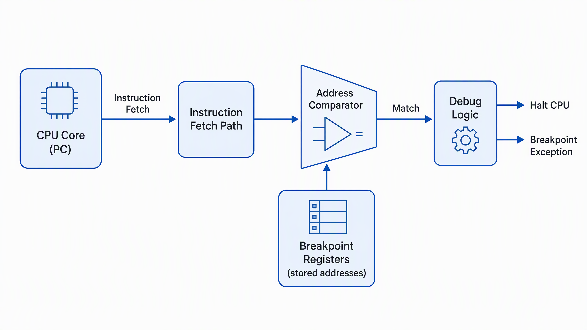
  
  用一张流程图把这条数据通路再抽象一遍：断点寄存器与实时地址同时进入比较器，命中信号只决定“是否触发”，至于触发之后是停机还是异常，由调试逻辑分流。
  
  ```mermaid height=360
  flowchart LR
  A[CPU 取指 / 访存] --> B[地址比较器组]
  C[断点寄存器<br/>存储目标地址] --> B
  B -->|命中 Match| D{调试逻辑}
  D -->|停机| E[Halt / 进入 Debug Mode]
  D -->|异常| F[Breakpoint Exception / DebugMonitor]
  ```
- ### 4.1.2 比较器如何判定“命中”
  
  落到门级，实现其实很朴素：把当前地址与断点寄存器的内容做**按位比较 + 掩码**。为了省资源、也为了对齐，匹配往往是**半字或字节粒度**的——例如 ARM 用地址的 `bit1` 来选择命中的是 32 位取指里的哪一个半字。在此之上会叠加一些让它更好用的机制：只比较地址部分位的**掩码/范围匹配**、**宽度匹配**（RISC-V 的 `size` 字段），以及把多个比较器**串联**（RISC-V 的 `chain`），从而在不显著增加硬件的前提下组合出复杂的触发条件。
  
  命中之后的行为有两种典型流派。一种是**替换指令**：比较器命中时，让取指单元返回一条陷阱指令（ARM 的 `BKPT`），效果上等价于“就地打了个断点”，但 Flash 一个字节都没动。另一种是**直接产生异常或停机事件**，把控制权交给处理器的异常或调试逻辑。两条路殊途同归——都是把一个纯硬件的“地址相等”条件，转化成一次可控的控制流转移。
  
  > “匹配”与“触发”是两件事：比较器只负责输出“命中”这个布尔条件，是停机、抛异常还是进入调试模式，取决于其后接的调试逻辑与配置字段。这个分工在两种架构里都成立，只是配置字段的名字不同。
- ### 4.1.3 ARM Cortex-M:FPB 实现
  
  在 Cortex-M 上，承担指令断点的是 **FPB（Flash Patch and Breakpoint Unit，闪存补丁与断点单元）**。从名字即可看出它的双重身份，但就“断点”而言，它做的事与 4.1.1 完全一致：FPB 挂在 CPU 与 Flash 之间的取指通路上，内部包含 `FP_CTRL`（全局使能，并**报告**本芯片实际有几个比较器）和一组 `FP_COMP0…n`（每个保存一个待比较地址，外加一个 `REPLACE` 控制字段）。
  
  当取指地址与某个被使能的 `FP_COMPn` 命中时，FPB **向处理器返回一条 **<strong>`BKPT`</strong>，处理器随即进入停机调试状态，或触发 `DebugMonitor` 异常。使用前需要先打开 `DEMCR.TRCENA`，再置位 `FP_CTRL.ENABLE`（写 `FP_CTRL` 时还须带 `KEY=1`，否则写入被忽略），并单独使能对应的比较器。整套寄存器映射在 `0xE0002000`。
  
  这里体现出 ARM 的一个组织特征：**指令断点与数据观察点被拆成两条独立通路**——指令断点走 FPB，数据观察点走 **DWT（Data Watchpoint and Trace）**，后者自带一组数据地址比较器去监视 load/store 地址。
  
  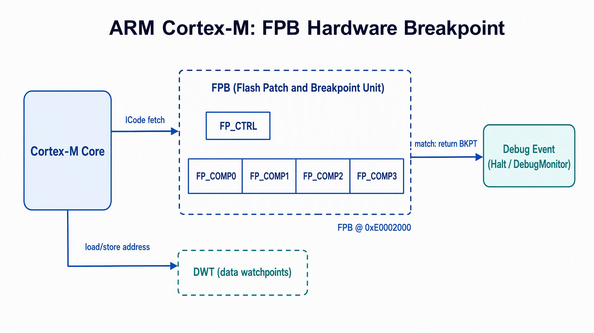
- ### 4.1.4 RISC-V:Trigger Module 实现
  
  RISC-V 没有 FPB 这个组件，它把“指令断点”和“数据观察点”**合并进一个 Trigger Module**。配置通过 CSR 完成：`tselect` 选择第几个触发器，`tdata1` 存放类型与控制（核心是 `mcontrol` / `mcontrol6`），`tdata2` 存放待匹配的地址或数据值。同一个 `mcontrol` 触发器，用 **execute 位**去匹配就是**指令断点**，用 **load/store 位**去匹配就是**数据观察点**——这一点比 ARM 更统一。
- 命中后走哪条路，由 `tdata1` 里的 <strong>`action`</strong>** 字段**决定：`action=0` 表示“抛出 breakpoint 异常”，交给处理器的 trap handler（软件或内核自身调试，如 Linux 的 perf / ptrace 常用）；`action=1` 表示“进入 Debug Mode”，交给外部的 Debug Module（JTAG 调试器使用）。因此分工非常清楚：**Trigger Module 决定“什么时候触发”，Debug Module 决定“触发之后如何控制”**。
- 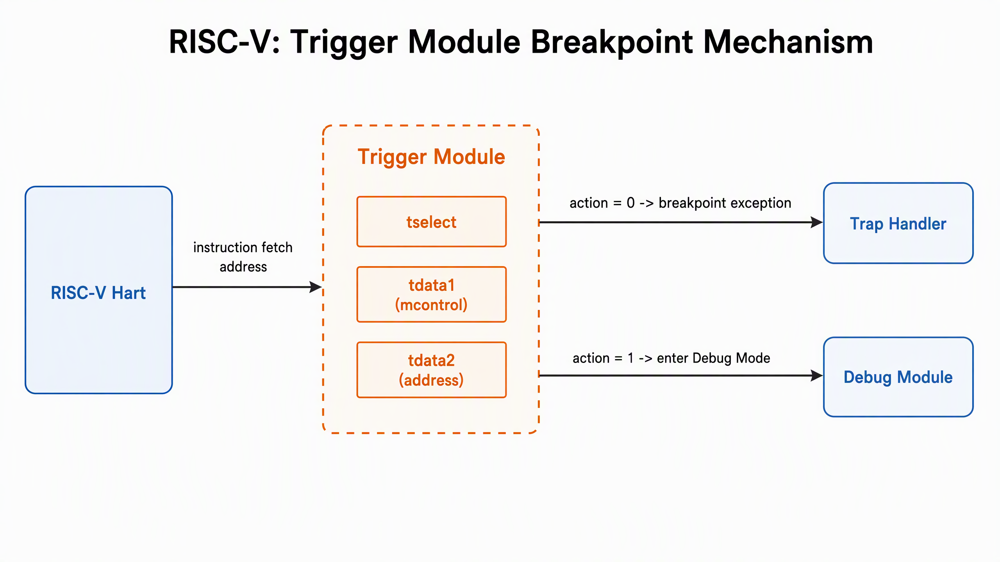
- ### 4.1.5 对照总结与工程含义
  
  把两种实现并排看，硬件断点可以归纳成一句话：**在取指/访存通路上并联一组地址比较器，命中即注入一个调试事件**。ARM 与 RISC-V 的差别不在原理，而在组织方式——ARM 是“分而治之”，RISC-V 是“统一触发器”。
- | 维度 | ARM Cortex-M | RISC-V |
  | --- | --- | --- |
  | 承担组件 | FPB（指令）+ DWT（数据） | Trigger Module（统一） |
  | 指令断点载体 | FPB 的 code comparator（`FP_COMPn`） | `mcontrol`/`mcontrol6` 的 execute 匹配 |
  | 数据观察点载体 | DWT 的数据地址比较器 | `mcontrol`/`mcontrol6` 的 load/store 匹配 |
  | 配置接口 | 内存映射寄存器（`0xE0002000` 起） | CSR（`tselect`、`tdata1..3`、`tinfo`） |
  | 命中动作 | 返回 `BKPT` → 停机 / `DebugMonitor` 异常 | `action=1` 进 Debug Mode;`action=0` 抛断点异常 |
  | 数量 | 由 `FP_CTRL` 报告（实现相关） | 由 `tinfo` 报告（0 至多个） |
  | Flash 补丁 | ARMv7-M 有 `FP_REMAP` remap;ARMv8-M 起取消 | 无标准化机制，靠软件搬运或厂商私有实现 |
  | 与调试模块分工 | 事件注入 FPB/DWT，控制由 CoreSight 调试逻辑 | 触发由 Trigger Module，控制由 Debug Module |
- 两家都不约而同地把断点做成“少而精”的资源，原因一致：硬件并行比较的代价决定了它无法像软件断点那样近乎无限。因此在实际工程里，**大量断点仍然依赖 RAM 里的软件断点（**<strong>`BKPT`</strong>** / **<strong>`EBREAK`</strong>**）兜底**，硬件断点则专门留给“必须断、却又改不得内存”的场合——只读 Flash/ROM 中的代码，正是它最主要的存在理由。
-
- ## 4.2 软件断点（Software Breakpoint）：陷阱指令替换与 PC 回退机制
  
  与 4.1 的硬件断点相反，软件断点不依赖任何地址比较器，走的是“改内存”的路线：调试器把目标地址上的那条指令**临时替换**成一条专门的“陷阱指令”（trap instruction），让 CPU 一执行到那里就自动陷入调试环境；等用户放行时，再把原指令**恢复**回去执行。这条路简单、几乎不占硬件资源、数量也几乎不限，但前提是那段内存**可写**——代码跑在 ROM/Flash 里时，纯软件断点就得另想办法。
  
  本节说明它的两个核心环节——陷阱指令替换，以及被替换后必须解决的 PC 回退问题；再分别看 ARM 与 RISC-V 的做法，最后回答“这套机制到底需不需要硬件支持”。
- ### 4.2.1 基本机制：替换—命中—恢复—单步—重插
  
  软件断点的标准流程是五步：
  
  1. **替换**：调试器读出目标地址 `A` 上的原始指令并保存，然后向 `A` 写入一条陷阱指令。
  
  2. **命中**：程序执行到 `A`，陷阱指令被执行，CPU 产生异常或直接进入调试状态，控制权交给调试器。
  
  3. **恢复**：用户放行时，调试器把 `A` 上的**原始指令写回**。
  
  4. **单步**：为了让这条“被替换过的”指令真正执行一次，先让它**单独执行一条指令**（single-step）。
  
  5. **重插**：单步完成后，再向 `A` 写回陷阱指令，然后继续运行——这样断点下次还能命中。
  
  “恢复/单步/重插”是 GDB 等调试器的通用做法。它带来两个现实约束：一是**放行那一刻 **<strong>`A`</strong>** 上必须是可写内存**（Flash 不行）；二是单步期间断点被短暂移除，在多线程/多核场景下可能出现“另一个核恰好经过同一地址，却因为断点被摘掉而没命中断点”的竞态。
  
  关键在第 3、4 步：要让“原始指令”执行，**放行时 PC 必须指向 **<strong>`A`</strong>。而陷阱指令被执行时 PC 究竟被保存成多少，正是下一节的“PC 回退”要回答的问题。
  
  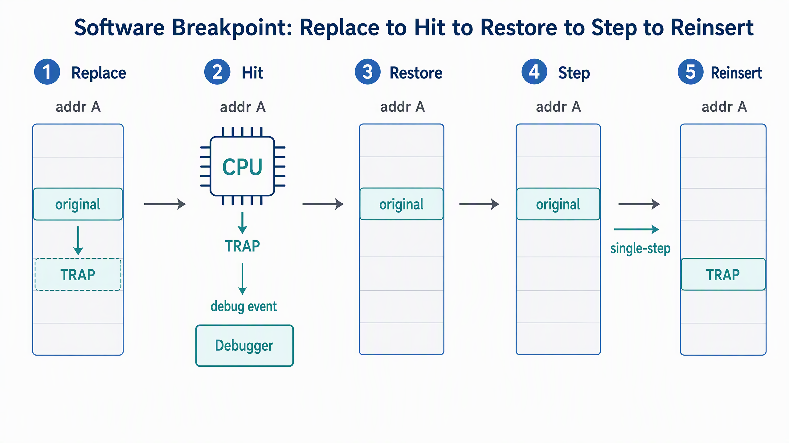
- ### 4.2.2 PC 回退：陷阱执行后 PC 落在哪里
  
  这里有一个容易踩的坑。CPU 执行陷阱指令时，语义上**原指令并没有完成**，因此被保存下来的返回 PC绝不能是 **A的下一条指令** ——否则放行后就会跳过原指令，程序行为错乱。理想情况下，架构应当把返回 PC 停在被替换的地址 `A` 本身，这样调试器只要“把原指令写回、再执行一次”即可。
- 不同架构的约定并不统一，可归为两类：
- **“PC 停在被替换处”**：陷阱被当作一次**同步异常或故障**，硬件保存的 PC 就是陷阱指令所在的地址 `A`.Cortex-M 的 `BKPT`、RISC-V 的 `EBREAK` 都属于这一类。
- **“PC 已经前进，需要回退”**：硬件把返回地址保存为 `A` 加一个偏移（通常是指令长度），调试器或异常处理程序必须**减去偏移**（即“回退”）才能回到 `A`。经典 ARM（A 系列，走预取中止模型）和 x86 的 `INT3` 就是这一类。
  
  所以“PC 回退机制”的含义可以统一表述为：**调试器（或异常处理程序）必须保证放行时 PC 指向 **<strong>`A`</strong>。在 ARM Cortex-M 和 RISC-V 上，这一步几乎由硬件代劳（同步异常天然把 PC 留在陷阱处）；而在经典 ARM 与 x86 上，则需要显式做一次数学校正。
  
  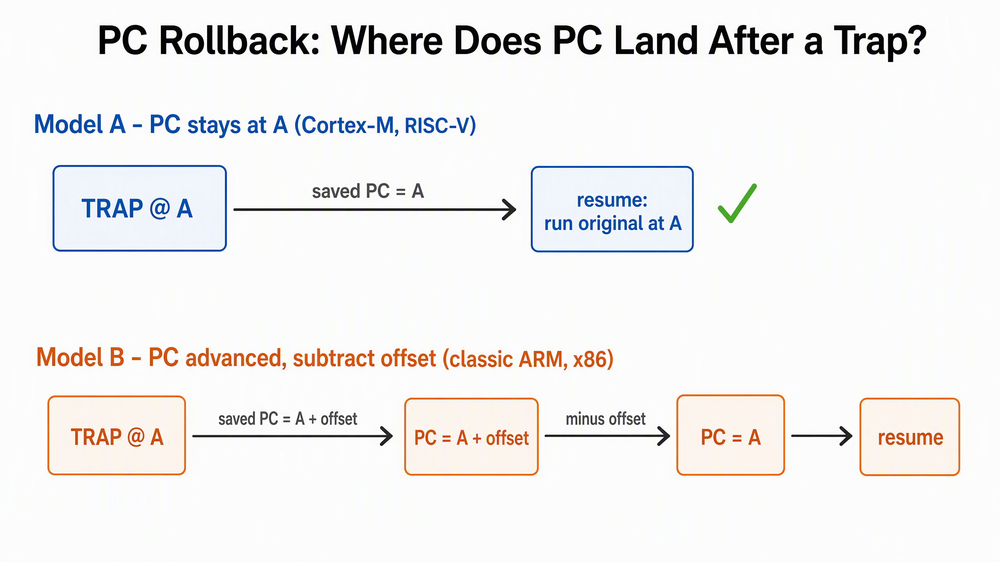
- ### 4.2.3 ARM 的实现：BKPT 与返回地址
  
  ARM 的软件断点指令是 **BKPT**：Thumb 态编码为 16 位的 `0xBE00 | imm8`（常用的 `BKPT #0` 就是 `0xBE00`），ARM 态为 32 位的 `0xE1200070`。执行 BKPT 时，去向取决于调试配置：
- 若挂着调试器且使能了停机调试（halting debug），处理器**直接进入 Debug state**；
- 否则若使能了 `DebugMonitor`（`DEMCR.MON_EN`），触发 <strong>`DebugMonitor`</strong>** 异常**；
- 再否则**升级为 HardFault**（未连接调试器时 BKPT 被“提升”为硬件故障）。
  
  返回地址方面，在 **Cortex-M（ARMv7-M / ARMv8-M）**上，BKPT 被当作**同步故障**处理：压栈的返回 PC 指向 **BKPT 指令本身**，而不是下一条。这正是“PC 停在被替换处”的模型——调试器把原指令写回 `A`、PC 又恰好在 `A`，就能重新执行原指令，**无需做减法回退**。反过来，如果某段代码本意是“执行到 BKPT 就跳过”（把 BKPT 当断言用），处理程序则要**加上指令长度**把 PC 推过它；ST 官方的 `DebugMon_Handler` 示例正是读取异常栈帧里的 PC（`[sp, #24]`）后执行 `add #2`（Thumb 下 BKPT 为 2 字节）。
  
  而在**经典 ARM（A 系列）**上，BKPT 被规定为“**表现得像一次预取中止（Prefetch Abort）**“：返回地址（`LR_abt`）不是 BKPT 本身，而是它之后再偏移一个流水线量（ARM 态一般为 `+4`），因此异常处理程序要拿到真正的 BKPT 地址，就得执行 `LR − 4`——这才是名副其实的“PC 回退”。
  
  还有一个容易忽略的现实：**ARM 并没有强制一条唯一的“官方”软件断点指令**。在带操作系统的 ARM（如 Linux）上，常见做法反而是写入一条**未定义指令（UDF，ARM 态编码 **<strong>`0xE7F000F0`</strong>**）**，由内核把它翻译成 `SIGTRAP`/`SIGILL`，而把 `BKPT` 留给半主机（semihosting）与裸机调试。
- ### 4.2.4 RISC-V 的实现：EBREAK 与 mepc / dpc
  
  RISC-V 的软件断点指令是 **EBREAK**：32 位编码 `0x00100073`；在支持压缩指令（C 扩展）时，还有一个 16 位的 **C.EBREAK（**<strong>`0x9002`</strong>**）**。执行 EBREAK 时，去向同样是分层的：
- 若当前**已处于 Debug Mode**，则留在 Debug Mode，跳到 `dm_halt_addr`；
- 否则若对应的 `dcsr.ebreakm / ebreaks / ebreaku` 被调试器置位，则**进入 Debug Mode**；
- 再否则，触发一次**断点异常**（`mcause = 3`），进入 M 态（若 `medeleg[3]=1` 可委托给 S 态处理）。
  
  PC 方面，RISC-V 的约定非常干净：<strong>`mepc`</strong>**（异常 PC）指向 EBREAK 指令本身的地址，而不是下一条**——`ecall` 与 `ebreak` 都是如此，这也是它相比其他架构的一个明确取舍。进入 Debug Mode 时保存现场用的是 `dpc`，同样指向 EBREAK 的地址。所以 RISC-V 属于“PC 停在被替换处”的模型，**不需要减法回退**。
  
  但 RISC-V 在这里埋了一个“指令长度”的坑：如果异常处理程序确实想把 EBREAK **跳过**（而不是重新执行原指令），必须先**判断这条 EBREAK 是 16 位的 C.EBREAK 还是 32 位的 EBREAK**，再把 `mepc` 加上对应长度——因为压缩指令扩展让 RISC-V 的指令长度不再固定。对软件断点而言，调试器的做法与 ARM 相同：把原指令写回，让 PC（`mepc` 或 `dpc`）停在断点地址，再单步执行一次原指令。
- ### 4.2.5 是否依赖硬件支持
  
  一句话概括：**软件断点“改的是内存”，但整条链路仍然离不开硬件支撑**——只不过它依赖的不是比较器，而是另一组机制。
  
  **需要硬件支持的部分：**
- **一条架构定义的陷阱指令**（ARM 的 `BKPT`、RISC-V 的 `EBREAK`）。没有它，只能退而求其次用非法/未定义指令，语义更脏。
- **陷入调试的通道**：ARM 的停机调试（`DHCSR`）或 `DebugMonitor` 异常；RISC-V 的 Debug Module 加 `dcsr.ebreak*`。没有这层，陷阱只能退化成一个普通异常。
- **单步执行能力**（用于第 4 步“恢复 + 单步”）：ARM 的 step 位 / `DebugMonitor`;RISC-V 的 `dcsr.step`。
- **可写内存的访问通路**：调试器得能把陷阱指令写进去——RISC-V 走 Debug Module 的 abstract command / system bus access,ARM 走 DAP.
  
  **不需要的部分：** 地址比较器（那是 4.1 的硬件断点）。也正因为不用比较器，软件断点在数量上几乎不受限制。
  
  反过来，硬件能力也划定了软件断点的边界：**当代码位于 ROM/Flash 时，纯软件断点直接失效**（写不进去）。这时要么改用硬件断点（ARM 可用 FPB 的 remap 把取指重定向到 RAM，RISC-V 用 Trigger Module 的 execute 触发器），要么由调试器把断点指令**真的烧写进 Flash**（如部分工具支持的“无限 Flash 断点”），但后者会带来 Flash 磨损与速度问题。
  
  | 维度 | ARM | RISC-V |
  | --- | --- | --- |
  | 陷阱指令 | `BKPT`（Thumb `0xBE00` / ARM `0xE1200070`;Linux 常用 `UDF`） | `EBREAK`（`0x00100073`）/ `C.EBREAK`（`0x9002`） |
  | 命中去向 | Debug state / `DebugMonitor` / HardFault | Debug Mode（`dcsr.ebreak*`）/ 断点异常 `cause=3` |
  | 保存的 PC | Cortex-M:BKPT 地址；经典 ARM:`LR = +4`，需减回 | `mepc` / `dpc` = EBREAK 地址 |
  | PC 回退 | Cortex-M 免回退；经典 ARM 需 `LR − 4` | 免回退 |
  | 跳过陷阱 | 需加指令长度（Thumb `+2`） | 需加指令长度（16/32 位不定，须先判长） |
  | 硬件依赖 | 陷阱指令 + 调试/单步 + 内存写 + 可写内存 | 同左 |
  
  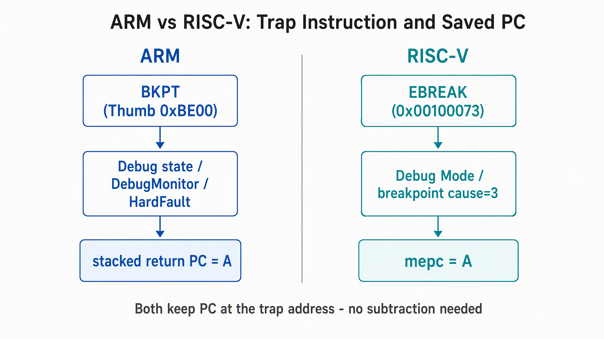
- ## 4.3 数据观察点（Watchpoint）与 MCU 数据观察点单元（DWT）
  
  前两节都在“指令流上设卡”：4.1 的硬件断点停在某条指令的**取指地址**上，4.2 的软件断点停在“某条指令被替换成陷阱”的位置上。它们回答的是同一个问题——**程序执行到哪一行时停**。但有一类最难查的 bug 恰恰相反：你知道**某个变量被改坏了**，却完全不知道**是哪条指令、在哪个时刻碰了它**。断点在这里几乎帮不上忙，因为你连“该在哪里下断点”都说不出来。
  
  数据观察点（Watchpoint，也叫 data breakpoint）把触发条件从“取指”换成了“访存”：它盯住的是一段**数据地址**，谁读它、谁写它，就当场停下。在 MCU 上最经典的一套实现，就是 ARM Cortex-M 的 **DWT（Data Watchpoint and Trace，数据观察点与跟踪）单元**。先给结论：**观察点几乎只能靠硬件实现**——它借用的正是 4.1 里那类地址比较器，只不过这次接在了 load/store 通路上。本节先说清它与断点的差别，再讲通用原理，然后落到 ARM DWT 的寄存器级实现，最后对照 RISC-V 如何用同一个 Trigger Module 复用出 load/store 触发器。
- ### 4.3.1 触发条件从“取指”换成“访存”
  
  断点与观察点的差别可以压成一句话：**断点监视的是“执行到哪个地址”，观察点监视的是“访问了哪个地址”**。前者接在取指通路上，命中意味着“即将执行某条指令”；后者接在访存通路上，命中意味着“某次 load/store 碰到了这块数据”。
  
  观察点按访问方向又分三种，GDB 用三个命令分别对应：
- **写观察点**（GDB 的 `watch`）：只在**写入**该地址时触发，是治“变量被莫名改坏”最常用的一种。
- **读观察点**（`rwatch`）：只在**读取**该地址时触发，可以抓“谁在读取一块尚未初始化的内存”。
- **读写观察点**（`awatch`）：读或写都触发。
  
  它真正解决的，是“事后诸葛亮”式的调试困境。内存踩踏的成因五花八门——数组越界写、野指针、悬垂指针、缓冲区溢出、栈溢出、缺锁的并发写——但症状往往离得很远：等系统真正 HardFault、或算出一个离谱结果时，**最初那次越界写入的现场早已消失**。观察点把“事后回溯”变成“当场截获”：只要盯住被踩的那个变量，谁能改写它，谁就是凶手。4.3.5 会给出一个典型场景——一个 `uint16_t[2]` 的小缓冲区，因为把 `sizeof` 当作元素个数误用，越界写坏了紧挨着它的一个函数指针。
- ### 4.3.2 通用原理：接在访存地址总线上的比较器
  
  观察点与 4.1 的硬件断点**同源**：核心都是一组纯组合逻辑的**地址比较器**，差别只在“比谁”。硬件断点把**取指地址**送进比较器；观察点把 **load/store 的访存地址**送进比较器。每个访存周期，CPU 把即将访问的地址交给比较器的一端，另一端是观察点寄存器里存的“要盯的地址”；相等即命中，比较器输出 `Match` 信号交给调试逻辑，由后者决定是停机还是抛调试异常。
  
  这条链路同样是**并行旁路**：比较与访存发生在同一拍，不插桩、不改内存、没有运行时开销。也正因如此，观察点与硬件断点共享着同一份“昂贵”的硬件资源——并行比较器——数量瓶颈也一模一样：通常只有 **2 到 4 个**，用掉一个就少一个。
  
  在此之上会叠加几项让它更好用的能力：
- **掩码 / 范围匹配**：把地址的低若干位“忽略掉”，一条比较器就能盯住一整块**对齐**的区域。ARM 用 `DWT_MASKn` 指定忽略的低位数（NRF52 上最多 15 位，即一条观察点覆盖 32KB 对齐区域）；RISC-V 用 `mcontrol6.match` 的 NAPOT 模式覆盖一个 2 的幂大小的对齐范围。注意范围**必须按大小对齐**——想盯 `0x20000002` 起的 4 个字节，就得拆成两条（`0x20000002` 掩 1 位 + `0x20000004` 掩 1 位）。
- **数据值匹配**：更进一步，可以只在“写入的值恰好等于某个特定值”时才触发。这在硬件上需要**两个比较器串联**——一个比地址、一个比数据值。ARM 靠 `DATAVMATCH` 和 `DATAVADDR0/1` 把两个比较器挂在一起；RISC-V 靠 `chain` 把地址触发器与数据值触发器串成一条链。
- **触发去向**：命中之后是让 CPU 停机、抛一个调试异常，还是只往跟踪单元发一个事件包，都由配置决定（与 4.1 那条“匹配 ≠ 触发”的分工一致）。
  
  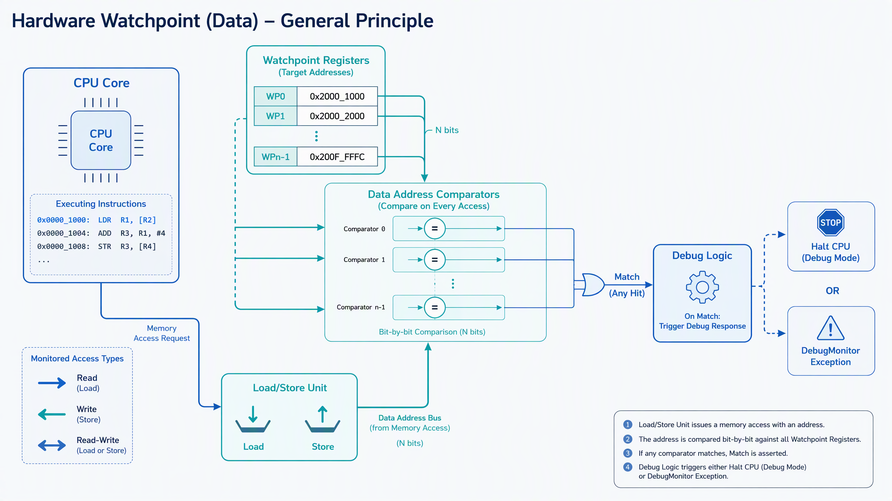
- ### 4.3.3 ARM Cortex-M：DWT 单元
  
  在 Cortex-M 上，数据观察点落在 **DWT（Data Watchpoint and Trace）单元**里。它是 CoreSight 调试体系的一部分，寄存器**内存映射**在 `0xE0001000`。配置一条观察点要用三个寄存器（n 为比较器序号，每个比较器占 16 字节）：
- `DWT_COMPn`（`0xE0001020 + 16n`）：存放**待比较的地址**。
- `DWT_MASKn`（`0xE0001024 + 16n`）：指定**忽略的低位数**，把匹配放宽成一块对齐区域。
- `DWT_FUNCTIONn`（`0xE0001028 + 16n`）：选择**功能与访问类型**。
  
  `DWT_FUNCTION` 的低 4 位 `FUNCTION` 字段直接决定“盯什么”，编码非常简洁：
  
  | `FUNCTION` | 监视的对象 | 命中效果 |
  | --- | --- | --- |
  | `0b0000`（0x0） | 无 | 比较器禁用 |
  | `0b0100`（0x4） | 取指地址 | PC 事件（等价于取指断点） |
  | `0b0101`（0x5） | 读 / load | 观察点事件 |
  | `0b0110`（0x6） | 写 / store | 观察点事件 |
  | `0b0111`（0x7） | 读或写 | 观察点事件 |
  
  比较器的可用个数由 `DWT_CTRL`（`0xE0001000`）的 `NUMCOMP` 字段（`bits[31:28]`）报告：满配 DWT 有 **4 个**比较器，精简版只有 **1 个**。要想在“地址匹配”之外再叠加“数据值匹配”，就置位 `DWT_FUNCTION.DATAVMATCH`，并用 `DATAVADDR0/1` 指明另一个比较器作为数据比较器，同时用 `DATAVSIZE`（`bits[11:10]`）声明访问宽度（字节 / 半字 / 字）。此外 `DWT_COMP0` 还能转而比较周期计数器 `CYCCNT`。
  
  需要强调：**DWT 并不只是“观察点单元”**，它是“数据观察 + 跟踪 + 系统剖析”三合一。同一套比较器除了产生观察点事件，还能：做 **PC 采样**（`DWT_PCSR`）、充当周期计数器（`CYCCNT` 32 位自增）与各类事件计数（CPI、异常、睡眠、LSU、指令折叠等），还能把事件经 **ITM** 以数据包形式输出给外部工具。也正因为共用同一批比较器，观察点、跟踪触发与 PC 采样之间是**互相争抢**的关系。
  
  使用前要先打开 `DEMCR.TRCENA`（跟踪使能）。命中后，DWT 把事件交给调试逻辑，去向与 4.1 一致：要么**停机进入 Debug Mode**，要么触发 <strong>`DebugMonitor`</strong>** 异常**（需使能 `DEMCR.MON_EN`）。这里再次印证了 ARM 的组织特征——**指令断点走 FPB，数据观察点走 DWT，两条独立通路**（对照 4.1.3）。
  
  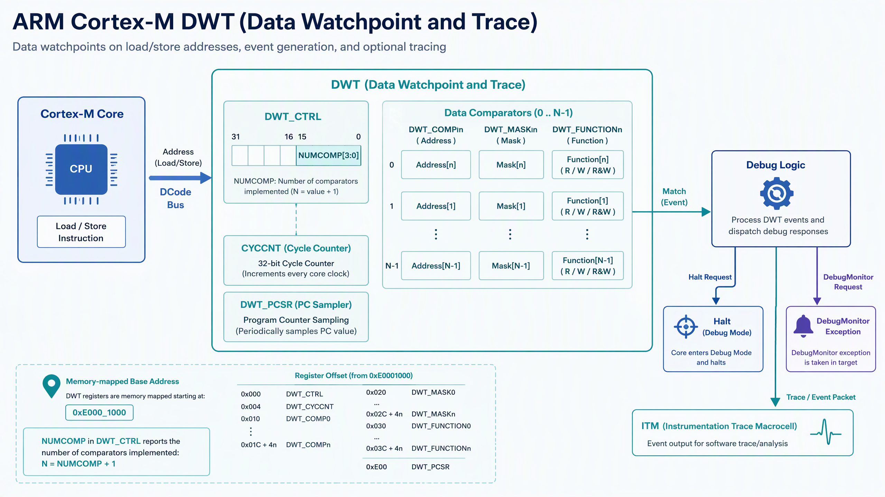
- ### 4.3.4 RISC-V：复用 Trigger Module 的 load/store 触发器
  
  RISC-V 没有独立的“观察点单元”，而是**复用 4.1 里那个 Trigger Module**：同一个地址 / 数据匹配触发器，配 `execute` 相关字段就是**指令断点**，配 `load` / `store` 相关字段就成了**数据观察点**——指令侧与数据侧合并在一套 CSR 里，比 ARM 的 FPB / DWT 分家更统一。
  
  配置依旧通过 `tselect` / `tdata1` / `tdata2` 完成，触发器类型为 `mcontrol`（type 2）或更新的 `mcontrol6`（type 6）。与观察点相关的字段有：
- <strong>`load`</strong> **/** <strong>`store`</strong> **位**：决定盯的是“读”还是“写”（两者都置即读写）。
- <strong>`select`</strong>** 位**：`0` 表示匹配**地址**（`tdata2` 存目标虚拟地址），`1` 表示匹配**数据值**（`tdata2` 存被读出 / 写入的值）。地址触发器存的，是这次访问的**最低虚拟地址**。
- <strong>`match`</strong>** 字段**：匹配方式，含相等、**NAPOT**（一块 2 的幂对齐范围）、掩码等，等价于 ARM 的掩码 / 范围匹配。
- <strong>`size`</strong>** 字段**：限定访问宽度（8/16/32/64… 位），只匹配对应宽度的访存。
- <strong>`timing`</strong>** 位**：`0` = 在指令提交**前**触发，`1` = 提交**后**触发。
- <strong>`chain`</strong> **位**：把触发器串成链。想做“数据值匹配”，就把一个 `load` / `store` **地址**触发器与一个 `select=1` 的**数据值**触发器链起来；**链上各触发器的** <strong>`timing`</strong> **必须一致，否则永不触发**，且只有**最后**一个触发器上的动作生效，并要求“同一条指令同时命中链上所有触发器”。
- <strong>`action`</strong>** 字段**：去向与 4.1 完全一致——`0` 抛**断点异常**（并写入 `tval`，值为触发的那次访问地址），`1` 进入 **Debug Mode**（外部调试器用），另有用于跟踪的动作码。
- <strong>`hit`</strong> **位**：命中后置位，供调试器确认“确实命中了”。
  
  RISC-V 在这里留下了两个要调试器小心的坑，都写在规范里：其一，<strong>`timing=0`</strong> **的 load 数据触发器**会让这次 load 在放行后被**重做一遍**，甚至在 `select=1` 时真的发起一次访存——若目标是内存映射 I/O，就会带来副作用，所以调试器一般优先尝试 `timing=1`；其二，NAPOT 只保证支持某些 2 的幂范围，并非任意范围都成立。这两点与 ARM 那条“范围必须对齐”是同一种现实约束。
  
  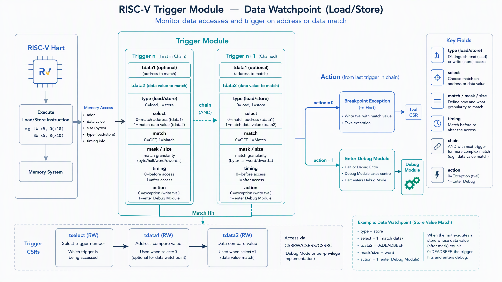
- ### 4.3.5 对照总结与工程含义
  
  把两边并排看，观察点同样能归纳成一句话：**把 4.1 那组地址比较器从取指通路挪到访存通路，必要时再串一个比数据值的**。ARM 与 RISC-V 的差别，仍然是“分而治之”对“统一触发器”。
  
  | 维度 | ARM Cortex-M DWT | RISC-V Trigger Module |
  | --- | --- | --- |
  | 承担组件 | DWT（数据观察点与跟踪） | Trigger Module 的 `load`/`store` 触发器 |
  | 配置载体 | `DWT_COMPn` / `DWT_MASKn` / `DWT_FUNCTIONn` | `mcontrol`/`mcontrol6` 的 `load`/`store` + `select`/`match`/`size` |
  | 读 / 写区分 | `FUNCTION`=5\(读\)/6\(写\)/7\(读写\) | `load` / `store` 位 |
  | 范围匹配 | `DWT_MASKn` 忽略低 N 位（须对齐） | `match` = NAPOT（须对齐） |
  | 数据值匹配 | `DATAVMATCH` + `DATAVADDR0/1` 串联比较器 | `chain` 串联 `select=1` 的数据值触发器 |
  | 触发时机 | 命中即发事件（时机固定） | `timing` 位可选 before / after |
  | 配置接口 | 内存映射寄存器（`0xE0001000` 起） | CSR（`tselect` / `tdata1` / `tdata2` / `tinfo`） |
  | 命中去向 | 停机 / `DebugMonitor` 异常（或 ITM 事件） | `action=1` 进 Debug Mode；`action=0` 抛断点异常（写 `tval`） |
  | 数量 | `DWT_CTRL.NUMCOMP`（满配 4，精简 1） | `tinfo` 报告（0 至多个） |
  | 附加身份 | 兼作 PC 采样、周期 / 事件计数、数据跟踪 | 统一在 TM 内（另含 `icount` 等触发器） |
  
  落到工程上，观察点有几条绕不开的现实约束：
  
  1. **数量极小（通常 2–4 个），是稀缺资源。** 一旦被占满，剩下的只能靠“软件观察点”兜底：调试器**单步执行、每走一步就比对一次内存**——慢成千上万倍，且会严重扭曲实时行为。这与 4.2.5 的结论一致：**观察点没有可用的高效纯软件实现，必须依赖硬件**。
  
  2. **它只能盯“地址”，盯不住“变量”。** 全局 / 静态变量地址固定，最好用；局部变量若被优化进寄存器、或随栈帧移动，观察点就无从下手；大缓冲区一旦超出掩码 / NAPOT 覆盖范围，也只能拆成多条甚至放弃。
  
  3. **它看不见 DMA 的访问。** DWT / Trigger 的比较器挂在**核心的 load/store 通路**上；而 DMA、外设等**总线主控**是直接经总线矩阵读写内存的，不经过核心的访存单元，因此**核心侧观察点通常抓不到这类访问**——这正是“观察点没命中、变量却确实被改了”的典型盲区。要抓这类踩踏，得改用 MPU、总线监视，或把 DMA 缓冲区隔离到独立区域。
  
  4. **与断点互补，也各有禁区。** 断点抓“执行到哪”，观察点抓“谁动了这块数据”；代码在 Flash 里时只能用硬件断点（4.1），而被踩的数据只能靠观察点（本节）。两者合起来，才覆盖了“控制流”与“数据流”这两条最主要的调试需求。
- ## 4.4 符号断点与条件断点：调试引擎侧的实现差异
  
  4.1 到 4.3 讨论的都是断点的**落点**——它最终变成哪种硬件比较器（4.1、4.3），或者内存里被替换成陷阱的那条指令（4.2）。但平常下断点时，我们写的既不是地址、也不是寄存器，而是**名字**（`break main`）、**位置**（`break foo.c:42`）或**条件**（`break loop if i == 5`）。这些“高层断点”在调试引擎内部究竟是怎么落地的？
  
  先给本节的核心结论：**符号断点是一个“解析问题”，条件断点是一个“判定位置问题”**。符号断点负责把“名字 / 源码位置”翻译成具体地址，翻译完之后就**退化**成 4.1 / 4.2 的普通地址断点；条件断点则是在“命中之后”再追加一层**运行时值判定**，而这层判定放在**主机侧**还是**目标侧**，直接决定了它的性能与表达能力边界。
- ### 4.4.1 两种“高层断点”都归约到同一个地址断点
  
  在调试引擎（GDB / LLDB / WinDbg 这类主机侧引擎）眼里，用户下的断点无论长什么样，最终都会被归约成同一件东西：**一组“落脚地址” + 一个“命中后处理策略”**。
- 符号断点提供的是“在哪儿落脚”，它需要一次“名字 → 地址”的解析；
- 条件断点、忽略计数（`ignore`）、命中次数、断点命令（`commands`）提供的是“命中之后怎么办”，它们在同一组落脚点上，各自挂不同的“命中后策略”。
  
  所以严格说，**符号断点和条件断点都不是“第四种断点机制”**——它们只是给 4.1 / 4.2 的地址断点加了一层前端解析或后端判定。这也解释了后面会反复出现的现象：一个“符号断点”能不能落在只读 Flash 上，取决于它底层用的是硬件断点还是软件断点（4.1 / 4.2），而与“它是不是符号断点”这件事毫无关系。
- ### 4.4.2 符号断点：一次“名字 / 位置 → 地址”的解析
  
  符号断点的第一步是**解析（resolution）**：引擎拿着输入，去程序携带的调试信息里查地址。数据来源主要是两类表：
- **符号表**（ELF 的 `.symtab` / `.dynsym`）：名字 → 地址 / 大小，用于函数名断点（`main`、`printf`）。
- **行号表**（DWARF 的 `.debug_line`，配合 `.debug_info`）：地址 ↔（文件, 行号）的双向映射，用于源码行断点（`foo.c:42`）。要注意 DWARF 里函数是**地址区间**（有起止地址），而一行通常只对应区间内的**首个地址**——所以“在函数名上下断点”往往要特意避开编译器生成的序言（prologue），落到函数体的第一行。
  
  解析之所以“麻烦”，是因为文件里的地址并不是运行时的地址，且一个名字常常一对多：
- **地址需要重定位**。链接写进文件的是链接地址，运行时地址 = 链接地址 + 加载基址。桌面上的 PIE / ASLR 会让同一符号每次运行落在不同地址；在 MCU 上，`.data` 段被启动代码从 Flash 搬到 RAM、以及“跑在 RAM 里的函数”，也会让符号的真实地址偏离链接地址。引擎必须先知道这段映像被加载到了哪里，才能算对。
- **一个名字可能对应多个地址**。C++ 的重载、模板实例化、`inline` 函数，以及多个编译单元里的同名 `static` 函数，都会让一个符号名解析出**候选地址列表**。现代调试引擎把这称为“歧义断点解析”（ambiguous breakpoint），并可能一次性在多个位置都落下断点。
- **优化会让映射变脆**。内联函数没有独立入口地址；一行的代码可能被拆分到多处；语句边界与地址不再一一对应。行号表在 `-O2` 下仍可用，但精度下降，可能出现“断点在源码上看着对、实际落点偏了一行 / 一段”。
- **断点可以先“待定”（pending）**。当某个模块**还没加载**时——动态库、插件，或尚未下载的代码——引擎会先把你的请求记成“待定断点”，等新模块加载、符号变得可见时再重新解析、补下断点。GDB 正是这么做的：每当有新的共享库被加载，它会**重新求值所有断点**，把能匹配上的待定断点转成普通断点。
  
  最后一点很关键：如果二进制被 `strip` 过、或编译时没开 `-g`，符号表 / 行号表就缺失或残缺，符号断点直接失效，只能退回“按地址下断点”（用 `nm` 之类的工具手动找地址）。这再次说明：符号断点解决的是“信息可得性”问题，而不是运行时机制问题。
  
  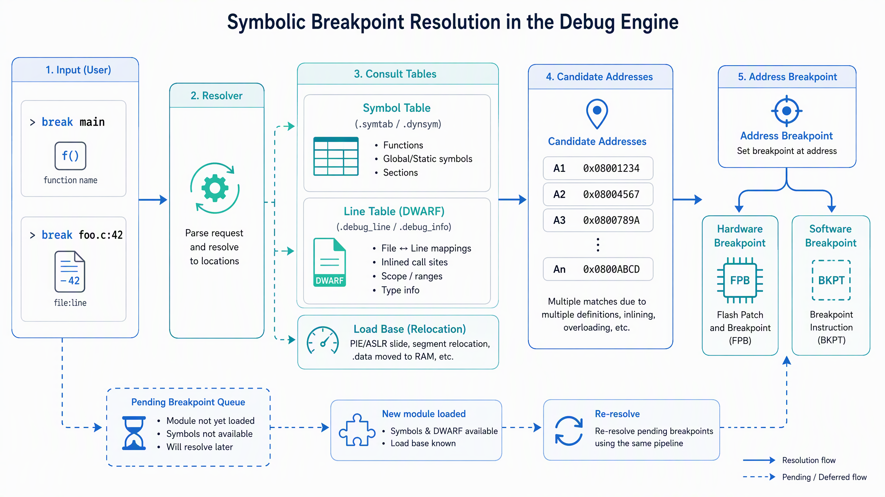
- ### 4.4.3 条件断点：真正的分歧在“在哪一侧判定”
  
  条件断点最容易被误解的地方，是以为“条件”由目标机在执行时自己判断。**经典实现恰恰相反**：目标对条件一无所知。
  
  关键在于，条件是一个**运行时的值判定**，它必须绑定在“命中之后”。而这个判定放在哪一侧，存在两条截然不同的实现路线——GDB 甚至把它做成了一个显式开关 `set breakpoint condition-evaluation`，提供三种取值：
- **主机侧判定**（`host`，也是默认 / 标准模式）：引擎把断点当作**无条件**地址断点下到目标（`Z0` 包 / 4.2 的陷阱指令）。每次命中，目标先**停机**、把控制权经调试协议交回**主机**；主机**读回**寄存器与内存，在**主机上**用调试器语言的表达式求值器判断条件；若为假，主机就**自动继续**（用户完全无感）。代价非常直白：**每命中一次就要停一次机 + 一次主机往返**，通常在数百微秒到毫秒量级。放在高频循环体、或“每个中断都命中”的位置，几乎不可用，而且会严重破坏实时行为。
- **目标侧判定**（`target`）：引擎在插入时就把条件**下载到目标**，由目标自己求值，只在条件为真时才向主机报告一次停机。要能这么做，目标必须有执行这个条件的能力——通常是**硬件比较器**。例如 ARM Cortex-M 的 DWT 可以用两个比较器（`DATAVMATCH` + `DATAVADDR0/1`）实现“地址 + 数据值”的条件（4.3.3），RISC-V 则用 `mcontrol6` 的 `select=1` 数据值触发器与地址触发器 `chain` 成链（4.3.4）。这类“带值条件的观察点”完全由硬件判定，**没有主机往返**；部分调试探针（如 J-Link）也会在自己的固件里做一层有限的条件求值，省掉到主机的往返，但仍可能短暂停机。
- <strong>`auto`</strong>：让引擎自行决定用哪种——能用目标侧就用目标侧，否则回退到主机侧。
  
  两条路线的取舍，本质是一组对偶：
  
  |  | 主机侧判定 | 目标侧判定 |
  | --- | --- | --- |
  | 表达能力 | 强（任意表达式、可调用函数、可索引符号） | 弱（通常只有等值 / 范围比较） |
  | 性能 / 实时性 | 差（每次命中都停机 + 往返） | 好（命中才报告，几乎无往返） |
  | 状态副作用 | 有（读寄存器、读内存，甚至执行函数） | 基本没有（纯比较；探针读 MMIO 除外） |
  | 可用性前提 | 只要能停机、能读回内存 | 需要硬件 / 探针支持这种条件 |
  
  还有两点容易被忽略。其一，**忽略计数与条件是同类**：“`ignore N`”（忽略前 N 次命中）也是一个“命中后判定要不要停”，如果计数留在主机侧，同样要付出每次命中的往返成本。其二，**工具链常常卡在中间**：硬件明明支持带值条件的观察点，但调试后端 / 探针（如 OpenOCD、某些 IDE 插件）不一定实现了对多个 DWT 比较器的组合支持，于是条件“退化成每次都停”——你会看到断点“不管值是多少都命中”。这说明目标侧条件能不能真正生效，不只取决于硬件，还取决于**从引擎到探针再到硬件这整条链路的支持程度**。
  
  当条件判定太贵时，还有一种“曲线”做法：**不停止，改用追踪（tracepoint / 日志点）**。把断点变成“记录一个事件”，由跟踪单元（ARM 的 ETM / ITM、RISC-V 的 trace）采集执行流与数据，事后再过滤和打印。它把“高频判定”从同步停机变成了异步记录，代价是需要跟踪硬件和足够的缓冲。
  
  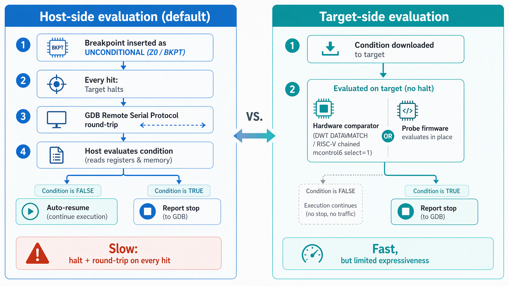
- ### 4.4.4 二者正交：一个管“断在哪”，一个管“停不停”
  
  把两者放在一起看，它们其实是**正交**的两件事：
- **符号断点**解决“**断在哪**”——把名字 / 源码位置翻译成地址，属于**编译期 / 加载期信息**的问题；
- **条件断点**解决“**断了之后停不停**”——在命中点做**运行期值判定**，属于**判定放在哪一侧**的问题。
  
  正因为正交，它们可以自由叠加：`break foo.c:42 if x > 0` 就是“先做符号解析得到地址，再把条件挂到这个地址断点上”。也正因为正交，二者**失效的原因完全不同**：符号断点失败，多半是“没有调试信息 / 地址重定位 / 名字有歧义”；条件断点失败，多因“性能太差（主机侧判定）、表达力不够（目标侧硬件判定），或条件里引用的变量被优化掉了”（后者与 4.3 的“盯不住变量”是同一种问题）。
  
  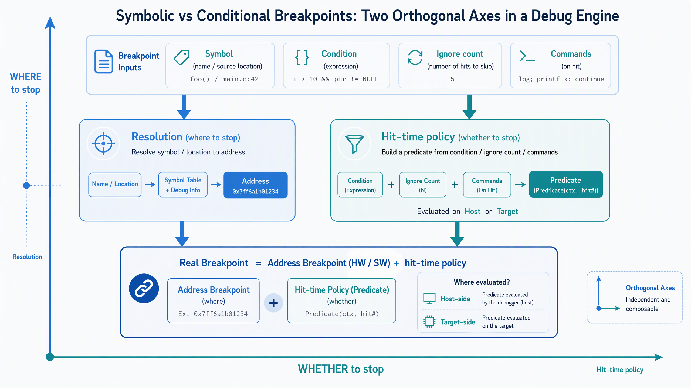
- ### 4.4.5 对照总结与工程含义
  
  | 维度 | 符号断点 | 条件断点 |
  | --- | --- | --- |
  | 本质 | 名字 / 位置 → 地址的**解析** | 命中点上的**运行时判定** |
  | 依赖的信息 | 符号表 / 行号表（DWARF）+ 加载基址 | 目标当前的寄存器 / 内存值 |
  | 落地机制 | 解析后**退化**成 4.1 / 4.2 的地址断点 | 落点不变，**附加**一层判定 |
  | 判定所在 | 主机侧一次性解析 | 主机侧或目标 / 探针侧（本节关键差异） |
  | 主要失效原因 | 无调试信息、重定位、名字歧义、优化 | 主机侧太慢、目标侧表达力有限、变量被优化 |
  | 与硬件关系 | 间接（取决于底层断点类型） | 直接（值条件可用 DWT / Trigger 硬件实现） |
  
  落到工程上：
  
  1. **符号断点“能不能下”，取决于两件事**：目标有没有调试信息（符号表 / 行号表），以及底层断点类型——代码在只读 Flash 上时只能靠硬件断点（4.1），而“符号”本身并不解决这个问题。
  
  2. **条件断点要先想清“判定放哪侧”**：高频路径上优先用**目标侧**（带值条件的观察点 / 探针判定），绝不要走“每次命中都主机往返”的路；实在只能用主机侧条件时，退到**追踪 / 日志点**往往更划算。
  
  3. **让条件表达式“廉价且无副作用”**：避免在条件里调用函数、避免访问内存映射寄存器（MMIO）——主机侧求值会真的去读，可能改变外设状态。
  
  4. **与 4.3 呼应**：条件里“值到某值才停”本质就是观察点的一种特化（地址 + 数据值匹配）——所以条件断点的目标侧实现，和 4.3 的带值观察点是同一套硬件。
- ## 参考资料
- ARM,《BKPT — Cortex-M3 / Cortex-M7 Instruction Set》
- ARM,《Breakpoint instruction \(BKPT\) — Programmer's Model》
- ARM,《Flash Patch and Breakpoint Unit \(FPB\) in Arm Cortex-M Explained》
- ARM,《Cortex-M7: About the FPB》
- Memfault,《How do breakpoints even work?》
- Doulos,《Using the Cortex-M3/M4 Flash Patch and Breakpoint Unit》
- RISC-V,《The RISC-V Debug Specification》（Sdtrig 扩展 / Trigger Module / EBREAK）
- RISC-V,《The RISC-V Privileged Specification》（EBREAK 与 mepc）
- OpenHW Group,《CORE-V CV32E40P User Manual — Debug & Trigger》
- ARM,《Cortex-M3 / Cortex-M4 Technical Reference Manual — Data Watchpoint and Trace Unit \(DWT\)》
- Memfault,《Faster Debugging with Watchpoints》
- GDB,《Debugging with GDB》—— Set Breaks / Break Conditions（condition-evaluation 的 host 与 target 模式）
- Microsoft,《WinDbg — Breakpoint Syntax》（歧义断点解析）
- Embecosm,《Howto: GDB Remote Serial Protocol》
- Sy Brand,《Writing a Linux Debugger — Part 7: Source-Level Breakpoints》
- # 第5章：调试会话的表达层
- ## 5.1 调试交互模型的核心表征：控制交互模型与对象观测模型
  
  让目标停下来只是手段。一个已经停下来的目标如何被表征，是另一个问题：开发者直接面对的那一层——变量面板、调用栈、反汇编、内存视图，以及 Continue 按钮——本质上是一组关于目标状态的表征（representation），而非目标本身。本节要确立的，正是这组表征的基本结构：它只有两条腿，而这两条腿的语义并不相容。
  
  界面上的每一个面板，都在回答两个问题之一：**执行将走向何处**，或者**状态当前如何**。前者作用于目标，后者读取目标。在物理层面，两者最终都归结为对目标寄存器或内存的一次访问——在 CMSIS-DAP 上，停住内核（写 `DHCSR.C_HALT`）与读取一个 `uint32_t` 变量，经由的是同一类 AP 内存事务。但在语义层面，它们分属两个互不相容的模型：前者是**有限状态机**，后者是**类型化对象图**。将两者视为同一件事来实现，是调试器交互层多数缺陷的共同成因；这类缺陷通常表现为功能可用、偶发异常、难以复现。
  
  此外需要先行说明：两个模型都是**有损投影**（lossy projection）。目标真实的执行状态不可枚举，内存本身只是一片无名的字节；界面上的“运行中/已停止”与可展开的变量树，都是压缩后的产物。压缩本身并不构成缺陷，问题在于压缩是否**明确表达了自身的损失**。控制模型损失的是“目标在某一时刻所处的真实状态”，因此必须保留一个**未知态**；观测模型损失的是“从根节点不可达的一切”，因此必须能够报告**该值不可用**。调试交互设计的优劣，很大程度上取决于是否承认这一损失，而不是以上一次的旧值将其掩盖。
- ### 5.1.1 两种动作，两种表征
  
  把两个模型并排放在一起，差异立刻显现。
  
  | 维度 | 控制交互模型 | 对象观测模型 |
  | --- | --- | --- |
  | 回答的问题 | 它接下来会怎么走 | 它此刻是什么 |
  | 作用的范围 | 整个目标（全局执行状态） | 局部数据（某个对象） |
  | 表征形式 | 有限状态机 + 异步事件流 | 类型化对象图 + 惰性游标 |
  | 基本动作 | 有副作用的**转移** | 原则上无副作用的**读取** |
  | 时间性 | 单向、有序、不可交换、不可回退 | 某一时刻的快照，可重复读取 |
  | 并发性 | 单写者，必须串行化 | 多读者，可以并发 |
  | 压缩方式 | 无限的真实状态 → 四五个抽象状态 | 整个地址空间 → 从根可达的类型化子图 |
  | 损失如何表达 | 未知态（`unknown`） | 不可用值（optimized out / unavailable） |
  | 失败的表现 | 状态错乱，界面呈现失真 | 显示过期值，界面呈现滞后 |
  
  最后两行的区分需要强调：**控制通道的失效表现为“错”，观测通道的失效通常表现为“旧”**。前者的代价显著高于后者，这也解释了为什么两类通道在工程上被区别对待——互斥、回执、超时与心跳检测，主要都加在控制一侧。
- ### 5.1.2 控制交互模型：一台被压缩成四个状态的机器
  
  目标真实的执行状态是“PC 停在某个地址、寄存器各是一组值、内存是一片字节”。这个状态空间无法枚举，也无法全部搬进界面。所以控制模型做的第一件事是压缩：把它折叠成少数几个抽象状态。
  
  最小的一组是四个：**运行中（running）、已停止（halted）、复位中（reset）、未知（unknown）**。
  
  转移动作同样少得出奇：**让它停（halt）、让它走（continue）、让它走一步（step）、让它重来（reset）**。断点、观察点、条件命中、单步跳过这一整类机制，在这个模型里都不是独立的动作，而是**转移上的守卫（guard）**——断点是“continue 直到地址 A 命中”，观察点是“continue 直到地址 A 被写入”，单步跳过（step over）是“step 一步，若进入函数则在返回地址放一个临时断点再 continue”，运行到光标处是“continue 到一个临时断点”。换句话说：
  
  > **控制模型只有四个转移，其余一切能力都是给“continue”加条件。**
  
  这一视角的解释力在于：它说明了为什么一个调试器最核心的状态机往往只有几百行代码，而断点系统、符号系统与条件求值却可以扩展到数万行——复杂度几乎全部集中在守卫上，而非转移上。
  
  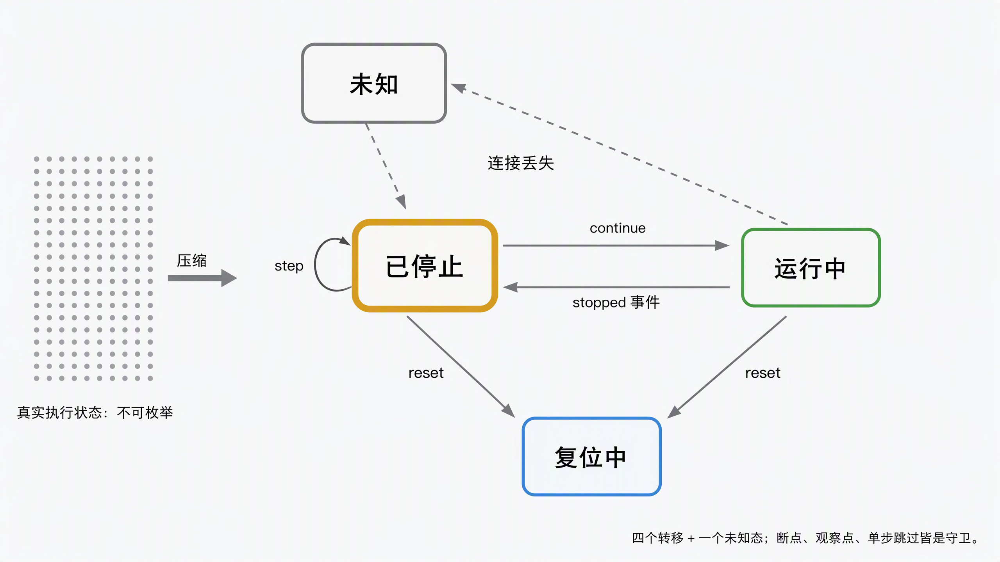
  
  **真值不在命令的返回值里。** 这是控制模型最容易写错的地方。写 `DHCSR.C_HALT = 1` 并不意味着核已经停了——这个请求要等到下一个指令边界才生效，可能还要等一次正在进行的总线事务结束；只有 `DHCSR.S_HALT` 读出 1，才说明它确实进了调试状态。同理，往 `DCRSR` 写入寄存器编号之后立刻去读 `DCRDR`，拿到的可能是上一次的残值，必须先轮询 `DHCSR.S_REGRDY`。于是“发出命令”与“进入状态”是两件分离的事，中间隔着一整条异步链路：探针固件 → 调试端口 → 芯片内部调试逻辑 → 主机。
  
  正因如此，成熟实现都不把控制通道做成同步函数调用，而是做成“命令 + 队列 + 事件回执”。GDB 的远程协议用 `T05` 这类停止回复异步地告知状态变化；DAP 用 `stopped` / `continued` 事件；OpenOCD 把目标状态缓存在 `target->state` 里，但那个缓存只有在 `target_poll()` 打探过之后才敢说是真的，这直接决定了它必须有一个“轮询—比对—发事件”的主循环。
  
  > `halt` 的返回值只表示“请求已被接受”，不表示“目标已经停住”。界面若在这个空隙里把状态切成“已停止”并立刻去读变量，读到的就是旧值或未就绪值。这类缺陷在桌面目标上几乎不可见，在带缓存、带 DMA、带低功耗模式的 MCU 上却会稳定复现。
  
  **未知态必须是一个真实存在的状态，而不是“沿用上次”。** 目标可能被看门狗复位、可能被外部调试器抢走、可能因为探针掉线而失联。此时主机侧的状态机并不是“仍然 halted”，而是“不知道”。这条规则听起来只是严谨，实际上决定了一整类体验：如果界面用灰色表示未知、用绿色表示运行、用黄色表示停止，用户一眼就能判断“我看到的是不是真的”；如果界面永远显示上一次的自信状态，用户就会开始怀疑工具，进而怀疑自己的代码。
  
  **停止的原因是控制模型的一部分。** 状态机只回答“停了”，不回答“为什么停”。而人在看到暂停时的第一个问题恰恰是后者。Cortex-M 把这件事做成了一个专门的寄存器：`DFSR` 的 `HALTED`、`BKPT`、`DWTRAP`、`VCATCH`、`EXTERNAL`、`STEP` 六个位，分别对应“调试请求”、“断点指令”、“观察点”、“向量捕获”、“外部调试请求”、“单步完成”。DAP 则把它抽象成 `stopped` 事件的 `reason` 字段（`breakpoint`、`step`、`exception`、`pause`、`entry` 等），并用 `hitBreakpointIds` 指明是哪一个断点命中。缺了这一层，界面就只能猜，用户就无法区分“我的断点生效了”和“我手滑点了暂停”——这两种情形在后续操作上的处理方式完全不同。
  
  **控制通道是单写者的。** 同一个调试会话，可以同时开十个变量视图，但不能同时按两次 Continue。控制的串行性来自物理约束，不是设计口味：目标只有一个执行流（多核是“每个核一个状态机 + 一套全局 run control”），两个互相竞争的 `continue` 会让状态机进入无法判定的状态。多核把这个问题的复杂度从 $$4$$ 个状态推到 $$4^n$$,DAP 用 `allThreadsStopped`、`allThreadsContinued` 这类字段来妥协，本质上是承认“精确到每个线程的独立控制”在多数目标上并不成立。
- ### 5.1.3 对象观测模型：一棵被剪成树的对象图
  
  目标的物理真相只有一样东西：地址空间里的字节，加上一组寄存器。所谓“变量”、“结构体成员”、“任务控制块”，都是主机侧**重建**出来的。重建需要三样输入：内存里的字节、调试信息提供的类型与位置、以及当前的**控制点**（PC 与栈帧）。
  
  第二样东西是第 5 章往后要展开的主题，这里先记住它的角色：调试信息（DWARF 的 `DW_TAG_variable`、`DW_AT_location`、`DW_AT_type`）回答的是“名字对应哪个地址、那个地址上的字节该按什么类型解释”。第三样东西则把观测模型牢牢钉在了控制模型上——这一点在 5.1.4 会展开。
  
  **对象图不是树，但界面只能是树。** 指针会产生别名，结构体可以自引用，链表天然成环。界面是有限深度的树，所以必须做投影，常见三种手段：深度截断（到第 N 层就停）、惰性展开（用户点开才去读）、身份标记（同一个地址再次出现时标注“已展开”而不是无限复制）。三种手段都在丢失信息，区别只在于丢得是否可预期。一个把递归结构展开成无限树的调试器，会在一秒内把目标读死；一个把环形链表悄悄剪断、却不做任何标记的调试器，会让用户误以为链表只有三节。
  
  **句柄是远端的游标，不是本地指针。** DAP 用 `variablesReference` 表示“这个节点可以展开，把这个数字传回 `variables` 请求就能拿到子节点“。它的设计意图很清楚：这是一枚只在**当前这次停顿期间**有效的临时游标，目标一旦恢复执行，之前拿到的引用就应当视为失效。这个约束不是实现偷懒，而是语义必然——下一次停下来时，栈可能已经换了一层，那块内存里可能已经是另一个对象。把这类句柄当成稳定 ID 缓存起来，是客户端最容易犯的错，也是“幽灵变量”这类问题的直接来源。
  
  **观测模型里的“对象”其实有三种来源**，它们在界面上长得一模一样（都能展开、都有类型、都能设值），但底层的读取代价与失效条件相去甚远。
  
  | 对象类别 | 典型例子 | 数据来源 | 读取代价 | 失效条件 |
  | --- | --- | --- | --- | --- |
  | 语言对象 | 局部变量、结构体成员、数组元素 | DWARF 类型 + `location` 求值（可能跨寄存器拼装） | 中，一次展开可能触发多次 `DW_OP_piece` 求值 | PC 离开该变量 location 的有效区间 |
  | 机器资源 | 通用寄存器、内存页、外设寄存器与位域 | 架构定义 + SVD 设备描述 | 低到中，但读外设寄存器可能有副作用 | 复位会重置一部分；其余无生命周期概念 |
  | 运行时对象 | RTOS 任务、堆块、文件描述符 | OS awareness 插件从内存里反推（如 FreeRTOS 的 `pxCurrentTCB`、就绪链表） | 高，展开一个节点可能要读几十个地址 | OS 内部结构本身合法时才有意义 |
  
  把三者统一成同一棵树，是 DAP 这类统一抽象的功劳：客户端只管“展开节点”，不必知道背后是 DWARF 还是 SVD。但这个统一也掩盖了代价差异——**展开一个“任务”节点和展开一个 **<strong>`int`</strong>** 成员，成本可能差两个数量级**。这就是为什么“变量面板一停就卡三秒”的问题，根因往往不在渲染，而在于把三种来源的对象当成了同一种东西，逐个节点串行往返。
  
  **观测的三个语义难点。** 第一个是**一致性**：在目标运行中读一个 64 位变量，硬件上是两次 32 位读，两次之间若被中断修改，拼出来的值从未真实存在过（撕裂读）。停机读就没有这个问题——但“停机”也不是真的冻结：核停了，定时器、DMA、外设还在跑，DMA 写过的缓冲区仍会变。所以同一次停顿内的多个视图必须共享同一份读取结果（读缓存或读取窗口），否则寄存器面板与变量面板可能来自两个不同的瞬间，用户看到的“系统状态”根本不自洽。
  
  第二个是**有效性**：被优化掉的变量没有 `location`；被分配到寄存器的变量在某个 PC 区间内有效、区间外不可读；跨寄存器的值需要 `DW_OP_piece` 逐段拼装；已经 `free` 的对象只剩一块被复用的内存。这意味着“变量存不存在”这件事，答案取决于 **PC 落在哪里**——一个纯粹的控制模型概念。观测模型的可解释性，寄生在控制模型的时间线上。
  
  第三个是**副作用**，也是嵌入式与通用调试最大的分野：
  
  > 在嵌入式里，“读”不是纯函数。读一个 read-to-clear 的状态寄存器会清掉中断标志；读一个 FIFO 数据寄存器会把数据取走；读某些外设会推进内部状态机。CMSIS-SVD 甚至为这件事准备了专门的字段——`readAction`（`clear`/`set`/`modify`/`modifyExternal`）与 `modifiedWriteValues`，用来在设备描述里把“读一次会发生什么”显式建模。观测者效应在这里不是哲学问题，而是每个内存视图都必须面对的实现约束：**盲目地轮询一个外设寄存器，就是在改目标的行为。**
- ### 5.1.4 两个模型的接头：用 epoch 把观测钉在时间线上
  
  到此为止，两个模型各自成立。它们真正的耦合点只有一处：**时间**。
  
  控制模型的时间是一条**有向、有序、不可回退**的执行线——先 A 后 B 就是先 A 后 B。观测模型的时间却是**一次快照**：它没有方向，可以被重复读，可以被多个视图并发消费，也可以被丢弃重来。把快照挂到时间线上，需要一个显式的标记。工程上通常叫它 **epoch**（世代）、stop id，或者 snapshot id：每进入一次“由控制动作导致的停顿”，epoch 加一。
  
  由此可以得到三条规则，它们几乎能解释交互层所有“该刷新没刷新”和“不该刷新乱刷新”的问题。
  
  **规则一：任何观测结果都必须带 epoch。** 一个变量值不是一个数，而是“在 epoch 7 时该变量的值”。丢掉这个标签，值就变成了不可判定真伪的断言。
  
  **规则二：任何改变执行状态的动作都使 epoch 递增，并使所有旧观测整体失效。** `continue`、`step`、`reset` 都属于此类。所以“单步之后变量面板要重建”不是界面偷懒，而是语义要求——栈可能已经换帧，地址上的对象可能已经换了人。反过来说，把上一次停顿的值继续显示、却不标注“该值来自上一次暂停”，等于向用户提供了错误的状态信息。
  
  **规则三：观测不得改变控制状态。** 这是模型的纯度要求，也是现实中最容易被破坏的一条。DAP 的 `evaluate` 请求允许在目标上调用函数（GDB 的 `print` 同样可能触发函数调用），于是“看一眼”这个动作可以产生内存写入、外设动作，甚至改变控制流。业界的做法是给观测动作标注语义：DAP 的 `evaluate` 带 `context` 字段（`watch`、`repl`、`hover`、`clipboard`），后端据此决定“允许到什么程度”。这是一种务实的妥协——承认观测可能不纯，但要求它**至少被声明**。
  
  把这三条规则放进一次完整的往返，时序如下。
  
  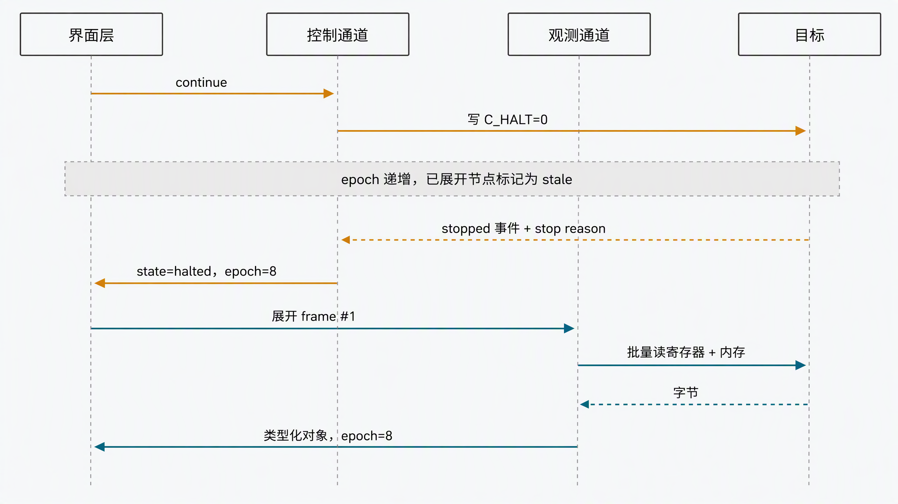
  
  失效的**粒度**值得单独说，因为它常常被过度简化成“一律全刷”。
  
  | 控制动作 | 语义后果 | 应失效的范围 |
  | --- | --- | --- |
  | `continue` / `step` | 执行点移动，栈帧可能改变 | 全部观测（栈、变量、寄存器、内存视图） |
  | 复位 / 重新加载 | 执行点回到入口，内存被重写 | 全部观测 + 符号基址与断点使能状态 |
  | 运行时写入内存或寄存器 | 某个对象的值被外部改变 | 依赖该地址的对象（无法精确追踪，实践上全部失效） |
  | 增删断点 / 观察点 | 世界的**规则**变了，世界的**状态**没变 | 不失效观测；但会影响后续命中的时机与代价 |
  
  最后一行是个有用的区分：断点属于“守卫”，它改变的是转移的条件，而不是目标当前的值。把断点的增删也当成状态变更去全量刷新，是常见但无谓的界面抖动来源。
- ### 5.1.5 混用的代价与工程切分：两条通道、一个纪元
  
  把上面的区分说清楚之后，回头看几个经典设计，它们的问题都是一句话：**用一套表征去做另一套表征的事**。
  
  **反例一：观测走控制通道。** GDB 的 `print` 在语义上是一条**命令**，与 `continue` 共享同一条通道，因此二者必须互斥——程序跑着的时候你没法打印。这不是 GDB 的疏忽，而是“命令式调试器”这套表征的必然结果。要打破它，只能把观测从控制通道里搬出去：live watch 靠探针周期性偷读内存，RTT 靠在目标内存里开环形缓冲区由主机轮询，trace 靠硬件把事件流异步送出。这些方案的共同代价是**失去精确的时间点**——你看到的值不再对应“某一次停顿”，而对应“某个粗略的采样时刻”。它们用观测模型的准确性，换取了“运行中也能观测”的能力。
  
  **反例二：把 halt 当作同步调用。** 主机发出停止请求，函数返回，界面立刻切到“已停止”并去读寄存器。真实情况是：请求还在路上，或者正在等指令边界，或者寄存器传输尚未完成（`S_REGRDY` 仍为 0）。于是读回一组似是而非的值，用户以为是目标的状态，其实是上一次的残影。正确的写法只有一种：把“请求”和“状态”分开，等事件、等标志位，再读。
  
  **反例三：把对象当地址。** 界面在第一次停顿时记下 `&var`，下次停顿后直接用这个地址去读，把结果当作“同一个变量”。栈帧一旦被复用，那个地址上可能已经是另一个函数的局部变量。用户会看到一个值莫名其妙地跳变、类型却完全对得上——这类“幽灵变量”只在特定调用深度、特定优化级别下复现，排查成本极高。根因就是把“对象”降格成了“地址”：对象有身份和生命周期，地址没有。
  
  三个反例指向同一个结论：**控制是状态机，观测是带 epoch 的惰性图。任何一边越界，都会产生“看起来正常、偶发错误”的缺陷。**
  
  由此可以确定交互层的架构形状。它在结构上只有两句话：控制与观测各走一条通道，两条通道共享同一个 epoch。
  
  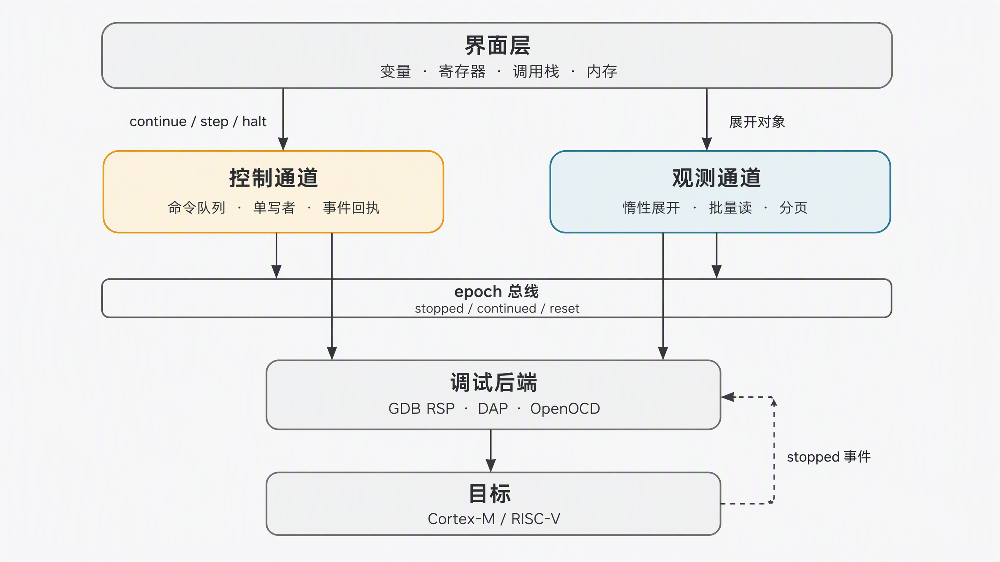
  
  控制通道的职责单一：维护那个四状态的状态机，把用户的意图排成有序的命令队列，用全局互斥保证单写者，用事件回执把真值同步回来。它对上层暴露的东西很少——`(state, reason, epoch)` 三元组，加上一个事件流。这个接口足够小，小到可以被测试、被录制、被回放。
  
  观测通道的职责是“按需重建”。它以 `(epoch, 对象引用)` 为键做惰性展开，并且必须做三件优化：**合并**（同一帧的多个成员一次读回）、**去重**（多个视图请求同一地址只读一遍）、**分页**（一次只取一页子节点）。这三件事不是性能优化，而是可用性底线——一次停顿后变量面板可能要展开上百个节点，若逐节点往返，每一次往返几百微秒，用户看到的就是“每次单步卡三秒”。DAP 的 `variables` 分页、OpenOCD 的 `mdw` 批量读、CMSIS-DAP 的 `DAP_TransferBlock`，都是同一条原则在不同层的体现：**把多次语义上的小读，压成一次物理上的大读。**
  
  两条通道唯一必须交叉的地方，是断点与观察点。
  
  它们属于控制模型——是 `continue` 上的守卫，其物理实现是地址比较器、陷阱指令替换与数据比较器这一类机制（FPB 与 Trigger Module、`BKPT`/`EBREAK`、DWT）。但要设置它们，系统必须先回答“用户所指定的 `foo.c:42` 对应哪个地址”，以及“该变量的地址与大小是多少”——这需要符号表、行号表与类型信息，全部属于观测模型的输入。
  
  | 模型 | 核心表征 | DAP 落点 | GDB RSP 落点 | OpenOCD 落点 | 典型故障 |
  | --- | --- | --- | --- | --- | --- |
  | 控制 | 状态机 + 事件流 | `continue`/`next`/`stepIn`、`stopped`/`continued` 事件、`capabilities` | `vCont;c`/`vCont;s`、`T05` 停止回复、`?` 查询状态 | `target->state`、`target_poll()`、`reset halt` | 状态机与实际不一致，界面失实 |
  | 观测 | 类型化对象图 + 惰性游标 | `scopes`/`variables`/`variablesReference`/`evaluate` | `m`/`M` 内存读写、`g`/`p` 寄存器、`Z`/`z` | `mdw`/`mww` 批量访问、SVD 外设树 | 显示过期值、幽灵变量、读取有副作用 |
  | 接缝 | 守卫 + 符号解析 | `setBreakpoints`、`setDataBreakpoints`、`setFunctionBreakpoints` | `Z0`/`Z1`/`Z2`/`Z3`/`Z4` | `bp`/`wp` 命令 + 符号表 | 断点下不去、下到了错的地址 |
  
  控制与观测在这里正式接合：**断点的“能不能断”属于控制模型，断在哪则取决于观测模型的输入。** 而要让观测模型真正把那片字节还原为“一个名为 `sensor_state` 的枚举、其第三个成员当前为 `IDLE`”，还需要一整套类型系统与调试信息在主机侧完成求值——那是这棵树真正的根系。
  
  据此可以概括本节的核心结论：控制模型规定世界如何变化，观测模型刻画世界当前的样子，epoch 则界定所观察的是哪一个世界。三者缺一，界面所呈现的状态即不可信。
-
- ## 5.2 GDB 远程调试协议（RSP）：核心控制报文的结构与代价
- 5.1 是从界面这一侧把交互层划分为两条语义不同的通道的。若把观察位置从界面移到传输链路上，同一结构会以另一种形态呈现：控制通道是一条**停等的、不携带报文身份的、没有独立事件通道的**链路；观测通道则表现为一串定长的十六进制读取。GDB 远程串行协议（Remote Serial Protocol，RSP）是考察这一点的合适样本——它是现存最古老的调试协议之一，为 1980 年代的串口 stub 而设计，至今仍是 OpenOCD、J-Link GDB Server、pyOCD、QEMU 以及多数芯片厂商 stub 的共同基础。
- RSP 的价值不在于技术上的先进，而在于它的原始性：每一项取舍都能在报文层面直接指认——没有包序号，没有版本号，没有事件通道，没有事务标识。5.1 所建立的三个要素——四状态机、守卫、epoch——在本协议中有两项被完整编码进报文，第三项则完全缺席。本节先分析控制侧报文（`?`、`c`/`s`/`vCont`、停止回复、`Z`/`z`、带外打断与能力协商），再补上观测侧仅有的两条原语——寄存器的 `g`/`p` 与内存的 `m`/`M`/`X`。
- ### 5.2.1 报文层：只有校验和、没有身份的停等协议
  
  RSP 的传输层可以用一句话说完：把命令包在 `$` 与 `#` 之间，`#` 后跟两位十六进制校验和；接收方回一个字节表示收到（`+`）或校验失败（`-`）。
  
  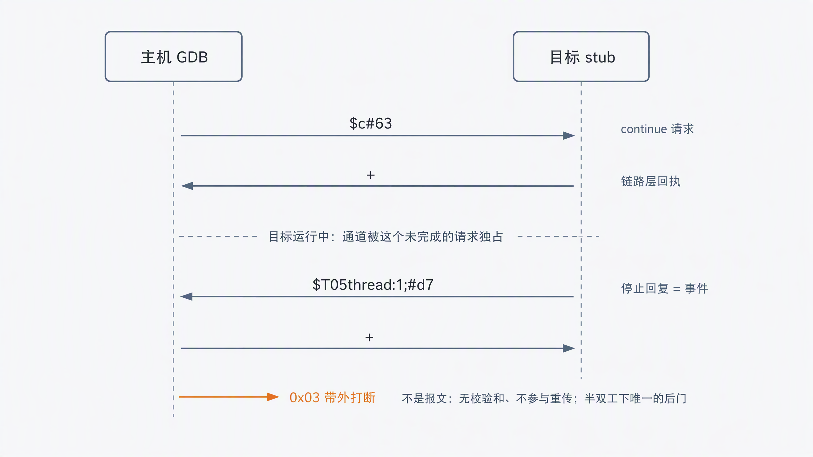
  
  在这张时序图上，有两处需要盯住。第一处是第二个 `+`：它确认的是“停止回复”这一包，而这一包同时也是**事件本身**——链路层的回执与状态机的转移挤在同一个往返里。第二处是那条橙色箭头：它不参与上面的任何一个往返，它插在报文边界之外。
  
  `$?#3f` 是最短的合法 RSP 报文：`?` 是“报告上一次停止的原因”，`3f` 就是问号的 ASCII 值——单字符报文的校验和恰好等于它自己的编码。整个协议的表达力就建立在这个形状上：纯 ASCII、纯请求响应、纯文本可读。它带来五个后果，几乎解释了 RSP 此后诸多设计取向的由来。
  
  **校验和只有 8 位。** 它把 `$` 与 `#` 之间的所有字节相加模 256，因此能可靠抓住单比特错误与帧边界错位，却对“两个错误互相抵消”无能为力——随机损坏被漏检的概率约为 $$1/256$$。在 9600 波特率的串口线上，这个强度够用；在现代链路上，它剩下的唯一用途是**发现错位**。RSP 从未把校验和当作完整性保证，上层也就不该指望它。
  
  **没有包序号。** 这是全协议最要命的一处空缺，却极少被讨论。TCP 用序号去重，RSP 没有序号可用：收到 `-` 时，发送方唯一能做的就是**原样重发**；而接收方无法判断这一包是新的，还是刚才那一包的重复。于是 RSP 的正确性建立在两个隐含假设之上——所有报文在语义上幂等（`m`、`g`、`?` 都是读，重发无害），且链路严格交替（同一时刻最多一个未完成请求）。一旦某个报文不幂等，重传就从恢复手段变成了破坏手段。这一点会在 5.2.4 具体发作。
  
  **停等，没有流水线。** 请求发出去，必须等回包才能发下一个。吞吐因此被往返时间锁死，而不是被带宽锁死。这条约束解释了 RSP 里一堆看起来奇怪的设计：`m` 一次能读多长由 `PacketSize` 决定，而不是由“想读多少”决定；`g` 一次取回全部寄存器，而不是逐个 `p`；回复允许游程编码（`*` 加计数字符，压缩重复字节）；以及 `QStartNoAckMode` 这个纯粹为省往返而生的模式——关掉 ACK 之后每个包少一次单字节往返，在长 RTT 链路上收益相当可观。它们都是同一条原则的产物：**既然往返昂贵，就尽量减少往返次数。**
  
  **二进制必须转义。** `#`、`$`、`}`、`*` 出现时要写成 `}` 加“原字节异或 0x20”。这是 ASCII 协议携带二进制数据的通行代价，也解释了 `X`（二进制写内存）这个报文为什么存在：与其在文本里转义，不如换一个入口。
  
  **唯一的带外信号是 0x03。** 它甚至不算报文——没有 `$`、没有校验和、不参与重传，就是插在报文边界之外的一个裸字节，含义是“打断当前操作”。它的存在本身就承认了一件事：**RSP 是半双工的，而且存在可以无限长的请求。** 当 `c` 已经发出、目标正在跑，这条链路上没有任何合法位置可以插入新命令，所以协议必须留一个后门。这个后门是 5.1 那句“控制通道是单写者”最物理的体现，也是嵌入式场景中最常失效的一环。
  
  | 报文层构件 | 原始动机 | 结构性代价 |
  | --- | --- | --- |
  | `$...#xx` 加 8 位校验和 | 串口线上的帧定界与错位检测 | 不保证完整性；只能发现“这包坏了”，不能发现“这包旧了” |
  | `+` / `-` 与整包重传 | 用最小代价实现可靠传输 | 无包身份，重传必须幂等；非幂等报文丢包时会被执行两次 |
  | 停等（一问一答） | stub 侧单线程、无缓冲区 | 吞吐被 RTT 锁死；长操作独占通道 |
  | ASCII 加转义 | 可读、可移植、可人工调试 | 带宽翻倍；二进制路径需要专门报文（`X`） |
  | `0x03` 带外打断 | 半双工下唯一的抢占手段 | 不属于报文层：无校验、无重传，依赖传输层能否插队 |
  
  > `0x03` 是一条“协议之外的协议”。它在 TCP 上传到 OpenOCD 的 socket，再由 OpenOCD 翻译成一次 halt 请求发给探针；而探针能不能在目标运行期间响应，取决于固件是否留了独立的打断通路——有的用单独的控制端点，有的只能在下一次批量事务的边界上退出。同一个 Ctrl-C，在不同探针上的手感差异（立刻停、要按两次、按了没反应直到下一个断点命中），根因都在这一段，而不在 GDB。
  
  综合这五条，可以得到一个较为明确的判断：RSP 的报文层是**为一条会出错的慢速串口线设计的最小可用方案**。它用 ASCII 换来了可读性与可移植性——串口、TCP、管道、USB HID 都能承载；用停等换来了实现简单——一个几百行的 C 状态机就能撑起一个 stub；用“无身份”换来了头部零开销。代价被完整地转移给了上层：去重、关联、超时、恢复，全部要由主机侧自己补。
- ### 5.2.2 控制报文：六条报文与一台四状态机
  
  把 5.1 的四状态机摊到报文上，会发现它小得惊人。
  
  | 语义 | 报文 | 回复 | 备注 |
  | --- | --- | --- | --- |
  | 查状态 | `?` | 停止回复 / `W` / `X` | 报的是**上一次**停止，不是此刻 |
  | 继续 | `c`、`C sig`、`vCont;c` | 停止回复（阻塞） | 回复即事件 |
  | 单步 | `s`、`S sig`、`vCont;s:thread` | 停止回复（阻塞） | 多核/多线程下语义需由 `vCont` 细化 |
  | 停止 | `vCont;t`、`vCtrlC`、`0x03` | `OK` / 停止回复 | 前两者要求非停止模式；`0x03` 随时可发 |
  | 复位 | `R xx` | 无 | 具体行为由 stub 自定 |
  | 分离 | `D` | `OK` | 目标是否继续运行取决于 `qAttached` |
  
  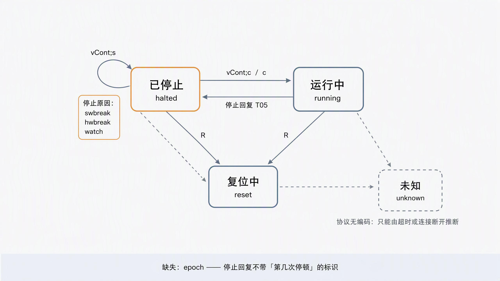
  
  与 5.1 那张状态机图并置看，会发现报文序列把四个状态填满了，却在两个位置留了空白：`未知` 只能靠虚线维系，时间轴（epoch）则完全没有对应物。
  
  <strong>`c`</strong>** 的回复不是 **<strong>`OK`</strong>**，而是直到目标停下来才发出的停止回复。** 这一条是理解整个协议形态的钥匙：RSP 把“一个可能持续几分钟的操作”和“一次状态变化”合并进了同一个往返。它带来三个连锁结果。
  
  其一，**没有并发**。目标运行期间主机不能读内存、不能设断点、不能查栈——不是因为不想，而是因为链路上唯一的那个“在途请求”还没回来。5.1 反例一说的“观测走控制通道导致二者必须互斥”，在 RSP 里不是设计选择，而是协议被迫。
  
  其二，**状态变化没有独立报送通道：事件是对提问的回答**。这直接决定了 `?` 的语义只能是“报告上一次停止的原因”，stub 完全可以把最近那条停止回复缓存起来原样重发。于是 `?` 的答案可能是几十秒前的，而格式完全正确、毫无破绽——这正是 5.1 里“用旧值掩盖未知”在协议层的版本。真正即时的查询是 `qfThreadInfo`（有哪些线程）与 `qC`（当前线程），它们不落在状态机的时间线上。
  
  其三，**超时与心跳必须由主机自己发明**。`c` 没有“还在跑”的中间回执，主机无法区分“目标在正常执行”与“链路已经断了”。这就是为什么几乎所有宿主实现都要额外维护一个 transport 层心跳，而不是信任 `c` 的阻塞语义。
  
  **非停止模式是对这个缺陷的补丁。** 先发 `QNonStop:1`，此后 `vCont;c` 立刻回 `OK`（不再阻塞），停止事件被**排队**，主机用 `vStopped` 一个个取走：回 `T05...` 表示队列里还有一个事件，回 `OK` 表示队列空了。这是一个非常诚实的工程妥协——既然没有推送通道，就用轮询模拟推送，代价是事件延迟从“发生即达”退化为“下一次轮询才到”，并且主机的状态机必须自己维护一个待取队列。这也解释了为什么非停止模式实现起来远比它看起来复杂：它把 RSP 缺掉的那半个事件通道，搬到了主机侧用状态机硬撑。
  
  <strong>`H`</strong>** 报文暴露了协议的隐式状态。** `Hg0` 与 `Hc1` 分别设置“通用线程”与“当前线程”，此后所有 `g`、`p`、`c`、`s` 都作用于被选中的那个。于是两个字节完全相同的 `g` 报文，在不同时刻含义不同——报文不再是纯函数，协议里藏着一个被 `H` 悄悄修改的全局变量。这是 RSP 里少数几处隐式上下文之一，也是多线程 stub 的高发错误区：`Hc-1` 表示“所有线程”，与“没有线程”在编码上只差一个负号，而这两者的行为完全不同。
  
  <strong>`vCont`</strong>** 是唯一的复合命令。** `vCont;s:1;c` 的意思是“单步线程 1，其余线程继续”：用 `;` 分隔动作、用 `:` 分隔参数，在一个报文里表达逐线程的策略。两层分隔符嵌在一行 ASCII 里，是典型的“后期追加”痕迹——按线程控制是在 all-stop 之后才补上的，只能硬塞进原有语法。它的好处是省往返，坏处是任何一层解析出错都会静默地变成另一种策略。
  
  最后是 5.1 强调过的那条底线：**未知态必须是一个真实存在的状态。RSP 做不到。** 协议里没有表达“我不知道”的编码——`?` 必须交出一个信号号，一个不确定自己状态的 stub 最省事的做法是回 `S05`，假装目标停在 SIGTRAP 上。于是主机无法区分“确实停在断点上”和“stub 刚复位、什么都不清楚”。可靠的“未知”只能从传输层推断：超时、`E` 回复、连接断开。这解释了一个现象：所有成熟实现都要在 RSP 之上再包一层状态机（OpenOCD 的 `target->state`、GDB 自己的 `remote_state`）。不是它们不信任协议，而是**协议里没有地方存放“不知道”**。
- ### 5.2.3 停止回复：唯一的事件，也是最重的一包
  
  真正的状态转移全部承载在一个报文上：
  
  ```plaintext
  $T05thread:1;0d:2000b0e0;0f:0d20b0e0;#xx
  │ │
  │ └─ 信号号（05 = SIGTRAP）
  └─── 类型：T 带附加信息，S 只有信号号
     其后是 key:value; 序列：thread、core、寄存器快照、断点类型、观察点地址……
  ```
  
  <strong>`T`</strong>** 与 **<strong>`S`</strong>** 的差别，就是“停止原因”这一层信息的有无。** 只回 `S05` 的老 stub 让主机只能知道“停了”，无法知道“为什么停”——5.1 强调过的那层信息，在这里是可以被整包丢掉的。
  
  **信号号是 Unix 的遗产。** `05` 是 SIGTRAP，`02` 是 SIGINT（主机打断造成的停止），`0b` 是 SIGSEGV。裸机没有信号这个概念，但 stub 必须挑一个数报上去——这个语义错配是 RSP 最陈旧的角落。现代做法是叠加上下文：`swbreak:` 与 `hwbreak:` 两个后缀让主机区分软断点与硬断点命中，`watch:`/`rwatch:`/`awatch:` 报出被触发的观察点地址。至此，“停止原因”才真正与**具体是哪一个守卫**建立了对应关系——而这层对应必须由 `qSupported` 事先协商，stub 不发，主机就不该指望。
  
  **寄存器快照是“示意的”，不是“完备的”。** `0d:2000b0e0;` 以十六进制寄存器号（即 `g` 报文的顺序）为键，只包含架构规定的少数“加急”寄存器（Cortex-M 上是 SP 与 PC），其余要靠随后的 `g` 一次取回。限制有两个来源：包大小，以及**协议里没有寄存器映射**——主机只能按架构硬编码去解释这些裸十六进制数，真正把这件事结构化的 `qXfer:features:read`（下发 target.xml）是很多年后才补上的。
  
  这个包在结构上很特殊：它同时属于三个模型。**状态**（一台状态机完成了一次转移）、**守卫**（是哪一个条件被触发）、**观测**（一小片寄存器快照）。历史叠加让一个报文承担了三重语义，这也是主机侧解析逻辑最容易出错的地方：任何字段的缺失都迫使主机退化为“保守解释”，而保守解释往往就是“把旧值当新值用”。
  
  更麻烦的是一致性。`T` 里的 PC 与随后 `g` 取回的值可能不一致——如果 stub 在两次读取之间还在收尾（比如它是在回了 `T` 之后才真正冻结其他核，或者暂停期间仍在服务中断）。5.1 要求同一次停顿内的所有观测共享同一个读取窗口，而 RSP 恰恰不提供窗口，它只提供一个**约定**：停下之后目标不会自己动。这个约定在多核、DMA 与“暂停时仍响应中断”的实现上会破，而破的方式非常安静——值看起来只是“稍微晚了一点”。
- ### 5.2.4 断点报文：守卫的参数化，与三种沉默的失败
  
  断点与观察点在 RSP 里只有两个报文：`Z type,addr,kind` 增，`z type,addr,kind` 删。
  
  | `type` | 含义 | `kind` 的语义 |
  | --- | --- | --- |
  | 0 | 软件断点 | 断点指令的字节长度（Thumb 2，ARM/RISC-V 4） |
  | 1 | 硬件断点 | 同上 |
  | 2 | 写观察点 | 被监视区域的字节数 |
  | 3 | 读观察点 | 同上 |
  | 4 | 读写观察点 | 同上 |
  
  <strong>`kind`</strong>** 的语义由架构决定，协议完全不管。** 这是典型的“协议留白”：RSP 只规定它是一个数，怎么解释交给 stub 与架构。于是 `Z0,0x8000,2` 在 Cortex-M 上意味着“插一条 2 字节的 BKPT”，在 RISC-V 上意味着“插一条 4 字节的 ebreak”。主机必须先知道自己在跟什么架构说话，才能把参数填对——这正是 5.1 那句“断点能不能断属于控制、断在哪取决于观测模型”在报文上的样子：**报文本身是纯控制的，但它的参数只能由符号表与架构信息生成。**
  
  <strong>`z`</strong>** 必须逐字段匹配。** 删一个断点时，地址、类型、`kind` 任何一项不一致，stub 都有理由拒绝或忽略。这不是苛刻，而是因为没有 ID——RSP 里断点没有句柄，只能用内容寻址。所有“断点删不掉、越删越多”的问题都源于此处；而多删一次与少删一次在界面上都表现为“断点还在”。
  
  **三种失败，语义完全不同，报文里却长得一样。** 第一种是硬断点资源耗尽：比较器只有那么几个，超额时回 `E` 或空包，而主机无法知道还剩几个。第二种是软断点落在 Flash 上：stub 写不进去，可能回 `E`，也可能“成功地”写进了一个 RAM 影子缓冲——于是断点永远不命中。第三种是条件断点：`ConditionalBreakpoints+` 允许主机把条件表达式**原样发给 stub**（`Z0,addr,kind;cond`），这意味着求值要在目标侧完成——在一个没有符号表、没有类型系统、只有几百字节缓冲区的固件里。实践上几乎无人这么做，GDB 默认走另一条路：主机侧单步加求值，代价是每次命中要停两次。
  
  第三个例子值得停一下：它是“把观测逻辑塞进控制通道”的又一次发作，只不过这次塞进了目标固件里。**条件断点本质上是观测（读变量），却被编码成了控制报文的一个后缀。** RSP 里大量别扭之处都源于同一个病因——通道只有两条，而需要表达的东西有五种。
  
  **增删断点不使观测失效。** 5.1 的那张表在这里得到印证：`Z`/`z` 改变的是守卫，不是目标状态，一个正确的客户端在设完断点后不需要重读任何变量。反过来说，`R`（复位）会让所有守卫失效——硬件比较器被清零、被替换的指令被写回原值——主机必须重新下发全部 `Z` 包。忘了这一步的表现是“复位之后断点全丢”，这是裸机调试里最常见的错觉之一，也是“断点是控制模型的对象，却需要观测模型来定位”这层纠葛的日常代价。
- ### 5.2.5 观测报文：两条原语，其余全在主机侧
  
  前四节讨论的都是“世界如何变化”。5.1 的另一半——目标当前是什么——在 RSP 里得到的支持小得不成比例：只有两条原语，一条按编号取寄存器，一条按地址取字节。变量、结构体、数组、位域、RTOS 任务列表，协议一概不知。
  
  | 报文 | 语义 | 回复形态 | 主要限制 |
  | --- | --- | --- | --- |
  | `g` / `G` | 读 / 写全部寄存器 | 定长十六进制串（无分隔、无长度前缀） | 布局靠架构硬编码；包长随架构膨胀 |
  | `p n` / `P n=v` | 读 / 写单个寄存器 | 该寄存器的十六进制值 | 每次一个往返 |
  | `m addr,len` | 读内存 | 十六进制字节，允许游程编码 | 不能部分成功；无原子性保证 |
  | `M addr,len:XX` | 写内存（文本） | `OK` | 带宽翻倍 |
  | `X addr,len:二进制` | 写内存（转义二进制） | `OK` | 转义规则仍需遵守 |
  | `qXfer:...:read` | 读目标描述、内存布局 | 分块，`m` 续 / `l` 止 | 无状态续传，靠偏移 |
  | `qSearch:memory` | 在目标内存中搜索 | 首个命中地址 | 计算被下推到目标侧 |
  | `qCRC` | 计算内存段校验 | 32 位校验值 | 同上 |
  
  <strong>`g`</strong>** 是唯一的整机快照，也是协议里最脆的一包。** 它的回复是一串没有分隔符的十六进制字符：Cortex-M 在不带浮点时是 17 个 32 位寄存器（r0–r12、SP、LR、PC、xPSR），共 136 个字符；带 FPU 的核还要再追加 33 个。主机只能按“第几个寄存器、多宽、什么字节序”去切片，任何一处理解不一致，整条串从此错位——而且错位之后每个切片仍然是一个合法数字，显示出来完全正常。这仍是 5.2.3 那句结论的延续：**协议里没有寄存器映射，映射只能由双方各自硬编码**。直到 `qXfer:features:read` 下发 target.xml，这件事才从“约定”变成“目标自述”。
  
  <strong>`g`</strong>** 与 **<strong>`p`</strong>** 的取舍，实际上就是 5.1 的读取窗口。** `p n` 一次一个寄存器，精确但每个都要一次往返；`g` 一次全量，冗余但只花一次往返。主流实现的选择是：每次停顿后先发一次 `g`，把寄存器整批取回并缓存，栈回溯与变量求值都从这份缓存中取；只有写回（`P`）或读取另一帧时才补发 `p`。这正是 5.1 要求的“一次停顿共享一份读取结果”，只是**协议不提供窗口，每个客户端都得自己造一个**。
  
  <strong>`m`</strong>** 既不能部分成功，也不保证原子。** 一次读取要么返回请求长度的字节，要么整包报错——跨越未映射区域、跨越页边界、超出 stub 内部缓冲，都会整体失败，主机只能自己切成更小的块重试。更要紧的是两次 `m` 之间没有任何屏障：中断、DMA、另一个核都可能改写内存。于是“读一个 64 位变量 = 两次 32 位 `m`”会读出从未同时存在的值（撕裂读），“展开一个结构体 = 五次 `m`”会拼出一个从未同时成立的快照。RSP 对此没有任何表达手段——它没有事务，也没有 epoch。
  
  **批量读的天花板就是 **<strong>`PacketSize`</strong>**。** 5.1 要求观测通道做合并、去重、分页；在 RSP 之上，这三件事各有各的上限：合并的上限是一次 `m` 能装多少字节，去重只能靠主机侧缓存，分页则是客户端行为而非协议能力。真正有效的加速只有两条路——让 stub 一次多读（把块大小调到适配器允许的上限），或者**把读操作下推到目标侧**：`qSearch:memory`、`qCRC`、`vFlashWrite` 都属于后者。它们背后的判断一致：既然链路比内存贵得多，就让数据在靠近存储的地方被消费掉，只把结论传回来。
  
  **写路径中真正危险的不是内存，而是寄存器。** `M` 与 `X` 语义相同，后者只是省掉转义；同址同值的重复写入是幂等的，因此 RSP“原样重发”的重传策略在写内存上仍然成立（`vFlashWrite` 是例外，擦除状态不可重复）。而 `P` 写寄存器是**唯一能从观测侧侵入控制侧的操作**：改 PC 就是跳转，改 SP 就是换栈，改 xPSR 就是改状态标志。它形式上属于“写寄存器”，语义上却是一次控制动作——5.1 规则三（观测不得改变控制状态）在这里被协议彻底放弃，只剩下客户端自律。
  
  **读外设时，协议没有地方标注副作用。** `m 0x40001000,4` 就是四个字节，RSP 并不知道那是一个 read-to-clear 的中断标志。5.1 提到的 SVD `readAction` 只能在主机侧生效：由 OpenOCD 或 IDE 在展开外设树时决定“这一项可以安全轮询、那一项必须单次读取”。协议越原始，这层语义就越依赖上层补齐，而补不补得上完全取决于上层是否愿意做。
  
  <strong>`O`</strong>** 包是唯一的推送缝隙。** 在等待 `c` 的停止回复期间，stub 可以插入 `O` 包，把目标的控制台输出送到主机。这是 RSP 里唯一一处“最终回复之前还能发东西”的例外，理由很实际：串口 stub 没有别的地方安放 `printf`。这条例外恰好反证了 5.2.2 的判断——不是协议不允许推送，而是它只为“输出文本”这一个场景开了口子，通用的事件通道始终缺席。
  
  因此，“读取寄存器与内存”在 RSP 中并不是一项受协议支持的能力，而是两条原语加上整套主机侧重建。协议交付的是一片无类型字节与一组无名字的寄存器值；把它们还原成“某个结构体的第三个成员此刻是 `IDLE`”，需要的类型信息、位置表达式与生命期判定，协议一个字都没有提供。
-
- ### 5.2.6 能力协商：没有版本号的协议如何演化
  
  RSP 没有版本字段。它靠 `qSupported` 做一次能力广播，此后所有扩展特性都是**可选**的：不认识的报文一律回空包，主机见到空包就当不支持。
  
  ```plaintext
  主机 → $qSupported:multiprocess+;swbreak+;hwbreak+;qXfer:features:read+;#xx
  stub → $PacketSize=1000;qXfer:features:read+;QStartNoAckMode+;swbreak+;hwbreak+;#xx
  ```
  
  这条设计的优点是扩展永不破坏老 stub；缺点是**“协议”其实是一张特性矩阵**，而矩阵的每一格在不同实现里的行为都可能不同。OpenOCD、J-Link GDB Server、pyOCD、QEMU 之所以在同一个 GDB 面前表现不一致，根因往往不是谁有 bug，而是各自支持的子集不同——而子集的边界恰恰落在最要紧的地方：`swbreak`、`vCont`、`QStartNoAckMode`、`PacketSize`。
  
  `vMustReplyEmpty` 这个报文存在的唯一目的是**测谎**：它必须回空包。一个“对所有不认识的报文都回 `OK`”的 stub 会在这里露馅；主机一旦发现它回了 `OK`，就知道这个 stub 的“不支持”信号不可信，此后所有能力探测都要打折。一个协议需要专门设计一条报文来验证“你对不支持的报文是否诚实”，这件事本身就说明了无版本号演化的代价。
  
  两个扩展的影响跨越两条通道。一是 `PacketSize`：它是 5.2.5 所称“批读天花板”的协议来源——一次 `m` 最多只能装这么多字节，超出部分必须拆成多个往返，5.1 里“把多次语义小读压成一次物理大读”这条原则到此为止。真正的批量优化因此只能发生在 RSP **之下**（探针固件把多次 AP 事务合成一次块传输）或**之上**（宿主侧缓存加一次性大读），协议本身不提供这个机会。二是 `qXfer`：把寄存器描述（`target.xml`）与内存布局（`memory-map.xml`）做成按偏移分块读取的对象，`m` 表示还有后续、`l` 表示这是最后一块。它没有会话、没有事务 ID，靠 `offset,length` 做无状态续传——这一点与 `vFlashErase`/`vFlashWrite`/`vFlashDone` 那套有始有终、却也没有事务标识的写 Flash 流程，恰好构成两种风格：**能无状态就无状态，不能无状态就靠严格顺序。**
  
  `qXfer` 的意义不止于省事。它把“寄存器是什么、内存长什么样”从协议硬编码里搬了出来，交给目标自描述——观测模型的元数据来源就此从“主机猜”变成“目标说”。而这份描述只到类型与布局为止，再往下一层（这个字节是个 `enum sensor_state`，第三个成员叫 `IDLE`）就是调试信息与类型系统的事了。
- ### 5.2.7 三处结构性空缺，与它们在现代协议里的落点
  
  把上面各节收拢，RSP 的问题可以精确地归为三处空缺，而不是笼统的“古老”。
  
  **第一，没有包身份。** 因为无序号、无事务 ID，协议既不能去重，也不能把回复关联到请求——它靠严格交替来替代关联，靠要求幂等来替代去重。代价是重传语义脆弱、长操作无法并行、`vFlashWrite` 这类有状态的写只能依赖“顺序即正确”。
  
  **第二，没有事件通道。** 状态变化只能作为回复出现，因此 `c` 必须是阻塞的，因此必须留一个 `0x03` 后门，因此非停止模式只能用 `vStopped` 轮询硬撑出一个伪事件流。
  
  **第三，没有 epoch，也没有 unknown。** 停止回复里没有任何“第几次停顿”的标识，主机只能靠自己发过几个 `c`、收过几个 `T` 来隐式计数；而“我不知道目标现在什么状态”在协议里根本没有编码位置，只能由传输层失败来间接表达。
  
  这三处空缺在观测侧同样成立，只是表现形式不同。没有读取窗口，撕裂读与不自洽的快照就无法避免；没有 epoch，拼装出来的对象无法标注属于哪一次停顿；`m` 失败只回一个 `E`，于是“该地址读不到”与“该对象不存在”在协议层面无法区分——而这恰是 5.1 要求观测模型必须能够报告的那类损失。
  
  | RSP 的空缺 | 后果 | 现代协议里的对应物 |
  | --- | --- | --- |
  | 无包身份 | 重传需幂等、请求无法关联 | DAP/JSON-RPC 的 `seq` 与 `request_seq` |
  | 无事件通道 | 长请求阻塞一切，需带外打断 | DAP 的 `stopped`/`continued`/`output` 事件流 |
  | 无 epoch | 观测值无法标注所属停顿 | 宿主侧 epoch（5.1.4）；`stopped` 事件把停顿本身结构化 |
  | 无 unknown | 状态机失联时只能撒谎 | `capabilities`、连接生命周期、显式的断开事件 |
  
  RSP 到 DAP 的演化，常被描述成“把 ASCII 换成 JSON”。这个描述抓错了重点。真正的变化是**给一台状态机补上它一直缺的三样东西**：请求的身份、事件的通道、观测的时间戳。报文格式的现代化只是顺带结果——毕竟一个带 `seq` 的 ASCII 协议同样可以工作得很好。
  
  而 RSP 之所以仍然值得逐包读一遍，是因为它把成本暴露得最彻底。当你在 DAP 里看到一个 `variablesReference` 的分页、一个 `stopped` 事件、一个 `seq` 号时，应该能立刻想到它们各自在补哪个洞；也应该能想到，这些洞不是抽象的设计洁癖，而是当年一条 9600 波特率串口线上真实发生过的、必须用某个办法绕过去的问题。
- ## 5.3 GDB/MI 机器接口：语法构成、异步通知与结构化输出
  
  GDB 向使用者提供两类接口：命令行接口（CLI）与机器接口（MI，Machine Interface）。前者服务于人，输出以可读性为目标；后者服务于程序，输出以可稳定解析为目标。本节讨论 MI 的语法构成、记录体系与异步语义，并考察其结构化能力的实际边界。
  
  有必要首先澄清 MI 的定位：它不是一条独立的传输协议，也不改变调试会话的任何内在机制。它所改变的是 GDB 组织输出的方式——由面向阅读的连续文本，改为逐行划分、带类别标记与可选令牌的记录。通信仍经由同一条标准输入输出，命令仍由同一个执行器按序处理，内部状态仍为同一套。这一定位决定了 MI 的能力范围：它可以在表达层实现结构化，却无法在机制层引入新的通道或新的并发。
  
  正因如此，MI 提供了一个有价值的观察样本：一个单线程、命令式的调试器，在把自身输出改造为可编程接口的过程中，会在何处遇到结构性限制。这些限制大多不属于实现缺陷，而属于命令式模型在表达层面的固有约束。
- ### 5.3.1 设计动因：命令行输出不具备稳定的接口语义
  
  命令行接口的输出以人为读者。`$1 = 0x2000`、`#0  main () at sensor.c:42`、`Program received signal SIGTRAP, Trace/breakpoint trap.` 这类文本，其格式取决于多项可配置因素：`set print` 系列选项、语言模式、终端宽度，乃至本地化译文。工具若以正则表达式解析这些文本，实际上是把 GDB 的默认打印格式当作了接口契约；而这一契约从未被承诺，编译选项、版本升级与目标架构均可能使其改变。
  
  MI 的处理方式是在 GDB 内部并存两套输出语法：一套供人阅读，继续随版本演进；一套供程序解析，力求保持稳定。与此同时保留一条退路 `-interpreter-exec console "..."`，允许前端按需取回原始的命令行输出。这条退路在后续分析中会反复出现：它既是兼容性的保障，也是结构化收益的主要泄漏点。
  
  MI 作为 GDB 的一种前端接口存在，启动时以 `--interpreter=mi2`（或 `mi3`）指定。此时同一份 GDB 具备两套输出语法，而命令执行器、目标状态机与表达式求值器完全共用——结构化仅发生在输出边界，并未触及内部机制。
- ### 5.3.2 语法构成：记录、令牌与三种值
  
  MI 的记录类别可由下表完整列出。
  
  | 前缀 | 记录类别 | 含义 | 是否带令牌 |
  | --- | --- | --- | --- |
  | `^` | 结果记录 | 一条命令的最终结果：`done`、`running`、`connected`、`error`、`exit` | 是 |
  | `*` | 异步执行记录 | 目标状态确实发生了变化：`running`、`stopped` | 否 |
  | `=` | 异步状态记录 | 状态相关的侧信息：`thread-created`、`library-loaded`、`breakpoint-modified`、`memory-changed` | 否 |
  | `+` | 异步通知记录 | 进度类提示，如 `download` | 否 |
  | `~` | 控制台流 | GDB 自身的输出文本 | 否 |
  | `@` | 目标流 | 被调试程序的标准输出 | 否 |
  | `&` | 日志流 | GDB 的内部日志 | 否 |
  | `(gdb)` | 提示符 | 命令边界 | 否 |
  
  一条记录由三部分构成：可选的令牌前缀（十进制整数）、一个类别标记，以及以逗号分隔、以等号连接的结果列表。值的形态仅有三种：常量（C 风格的带引号字符串）、元组 `{name=value,...}` 与列表 `[value,...]`，三者可任意嵌套；布尔量写作 `"y"` 与 `"n"`，数值一律表示为字符串。整套语法约十余个产生式，规模小于通用的文本序列化格式，却足以表达任意层次的数据；代价是书写冗长，且解析器必须自行处理转义与嵌套。
  
  真正需要留意的是它不具备什么。MI 不携带类型信息：`value="5"`、`value="0x2000"`、`value="{a = 1, b = 2}"` 在语法上完全同类，均为常量字符串；它同样没有长度前缀、模式定义与引用机制。因此 MI 只保证结构与嵌套关系可解析，不保证内容语义可解析。这是它最需要被准确理解的性质：**结构化的外壳，非结构化的内核**。以 `-data-evaluate-expression` 为例，其结果与命令行 `print` 的输出并无本质差别，仍是一段需要再次解释的 C 表达式渲染。
- ### 5.3.3 记录时序：结果记录与异步记录的分离
  
  ```plaintext
  → 3-exec-continue
  ← 3^running                    结果记录：命令被接受，令牌 3 回显
  ← *running,thread-id="all"     异步执行记录：状态确已转移
   …… 目标运行，若干秒 ……
  ← *stopped,reason="breakpoint-hit",disp="keep",bkptno="1",
   frame={func="sensor_poll",file="sensor.c",line="42"},
   thread-id="1",stopped-threads="all"
  ← (gdb)
  ```
  
  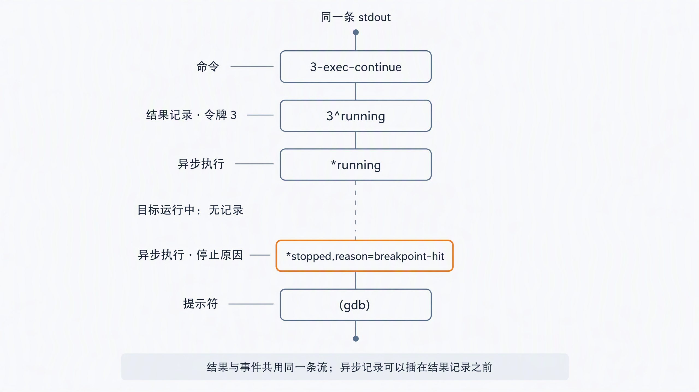
  
  这段往来中最值得注意之处，是 `^running` 与 `*stopped` 分属两条记录。前者是结果记录，表示命令已被接受；后者是异步执行记录，表示目标状态确已改变。这一分离对应一个容易被忽略的事实：命令的返回值与目标的实际状态是两个独立事实，二者在时间上并不重合。MI 将它们分别编码，使前端无需从单次回复中推断状态；能够做到这一点，是因为 GDB 自身即是目标状态的观察者，确切知道两者分别在何时发生。
  
  `*stopped` 的 `reason` 字段进一步把停止原因显式化：`breakpoint-hit`、`watchpoint-trigger`、`end-stepping-range`、`signal-received`、`exited-signalled` 等。配合 `bkptno`、`thread-id` 与 `stopped-threads`，前端可以直接区分“断点命中”与“用户主动中断”，无须依据上下文推测。三股文本流的分工同样重要：`~` 承载 GDB 自身的提示，`@` 承载被调试程序的输出，`&` 承载内部日志；前端可将 `@` 直接导向终端面板而不作解析，这在纯命令行接口下无法实现。
  
  需要一并记录的是一个结构性限制：**上述记录共享同一条输出流**。异步记录可以出现在任意位置，包括某条命令的结果记录之前。因此前端必须实现一个完整的记录状态机——“在等待 `3^done` 时先收到 `*stopped`”属于常态而非异常。输出时序不再是一问一答，而是结果与事件的交织，这一点必须在解析层被显式处理。
- ### 5.3.4 令牌、命令串行与事件的异步性
  
  记录之前的整数前缀（`3-exec-continue`）会在对应的结果记录上原样回显（`3^running`、`3^done`、`3^error`），从而使回复可以归属到具体请求。但令牌的作用仅限于此：它只在单一命令通道内有效，GDB 始终按顺序执行命令。令牌提供的是回复归属，而非请求并行。
  
  由此需要区分两个常被混淆的概念：**MI 的异步属于事件异步，而非请求并发。** 目标运行期间，`-exec-interrupt` 可以立即生效，少数状态类命令仍可使用；但绝大多数命令会被拒绝，并提示目标线程正在运行。GDB 不提供队列语义、优先级或超时机制，这些全部需由前端实现。基于 MI 构建的集成环境普遍保有一层自己的命令队列，原因正在于此：它们并非在重复 GDB 的功能，而是在补足 GDB 有意不提供的部分。
- ### 5.3.5 结构化输出的分层与停顿标识的缺失
  
  MI 各命令族的输出，结构化程度并不齐整。
  
  | 命令族 | 输出形态 | 类型化程度 |
  | --- | --- | --- |
  | `-stack-list-frames` | 帧列表，含 `level`/`addr`/`func`/`file`/`line` | 半结构化：字段固定，但只描述位置，不描述数据 |
  | `-var-create`、`-var-list-children`、`-var-update` | 变量对象树，含 `name`/`numchild`/`type`/`value`/`has_more` | 结构化：最接近类型化对象图的形态 |
  | `-data-evaluate-expression` | 单个 `value` 字符串 | 非结构化：C 表达式渲染 |
  | `-data-read-memory-bytes` | `memory=[{begin=...,offset=...,contents="00112233"}]` | 无类型字节：仅给出地址范围与十六进制内容 |
  
  `-var-*` 族是 MI 中最接近类型化对象图的部分，其字段也较为完整：`numchild` 给出子节点数量，`has_more` 支持分页展开，`in_scope`（取值 `true`、`false`、`invalid`）表示当前是否可读，`type_changed` 表示类型是否改变，`-var-update` 则提供增量结果。就“取值可能不可用”这一表达需求而言，`in_scope` 与 `has_more` 构成了明确的编码。
  
  与一次性快照式的句柄不同，varobj 是**持久对象**：它绑定一个表达式，可跨越多次执行停顿而存在，直至前端显式执行 `-var-delete`；GDB 会在每次停止后重新计算其取值，并通过 `-var-update` 的变化列表通知前端。这带来便利——前端无须每次重建变量树；也带来约束——重算时机由 GDB 决定，而变化列表本身并不标明该结果对应哪一次停顿。
  
  `-data-read-memory-bytes` 则划出了清晰的边界：其 `contents` 字段是一串十六进制字节，除地址范围外不附带任何类型信息。**结构化止于字节，语义解释仍在 GDB 内部的表达式求值器中完成**，前端所得的仍是原始字节与文本。
  
  由此可以归结出一个明确结论：`*stopped` 记录不包含停顿标识（stop id），只有 `reason` 与 `thread-id`。前端若需为自己的视图标注“数据属于哪一次停顿”，只能依据已接收的 `*stopped` 计数进行隐式推导。换言之，**MI 提供了事件，却没有提供事件的编号**；基于 MI 构建的集成环境普遍维护一层会话缓存，根本原因即在于此。
- ### 5.3.6 版本演化与实现代价
  
  MI 不设版本协商机制，而依靠 `-list-features` 与 `-list-target-features` 返回的特性名列表（如 `frozen-varobjs`、`pending-breakpoints`、`thread-info`、`data-read-memory-bytes`、`breakpoint-notifications`）进行能力探测；扩展方式为新增命令与新增字段，旧前端忽略未知内容即可。这是一种以能力列表替代版本号的演化策略：兼容性由探测保证，而非由契约保证；其代价是行为差异往往只能在实际使用中暴露。
  
  代价有三层。第一层是解析成本：MI 的语法规模虽小，却要求一个完整的解析器——C 字符串转义、元组与列表的混合嵌套、可选令牌，其编写成本高于通用的文本序列化格式。这是以文本模拟结构所必然支付的代价。
  
  第二层是退路带来的语义泄漏。`-interpreter-exec console` 一旦被大量使用，结构化的收益便整体退回为文本解析；更细微的是，GDB 内部部分命令的实现本就以命令行路径为基础，再由 MI 层包装输出，因此 `~` 流中可能混入不属于该命令结果的内容。前端若不在解析层区分“流”与“结果”，就会出现来源不明的文本插入。
  
  第三层，也是影响最为深远的一层：**MI 只对一条通道做了结构化，并未将控制与数据分离。** `-exec-*` 与 `-data-*` 共用同一条标准输入输出，因此目标运行期间无法读取变量；控制动作与观测请求在同一队列中串行等待。MI 使一条命令通道变得可编程、可归属、可携带事件，却没有使其成为两条通道。
  
  | 能力 | MI 的支持情况 | 说明 |
  | --- | --- | --- |
  | 结果归属 | 提供 | 令牌回显，回复可对应到请求 |
  | 状态变化通知 | 提供 | `*`、`=`、`+` 三类异步记录 |
  | 输出分流 | 提供 | `~`、`@`、`&` 三股文本流 |
  | 类型化取值 | 部分 | varobj 结构化；求值类命令仍为文本 |
  | 停顿标识 | 不提供 | 无 stop id，仅有 `reason` 与 `thread-id` |
  | 请求并发 | 不提供 | 命令按序执行 |
  | 通道分离 | 不提供 | 控制与数据共用同一条流 |
  
  据此可以给出对 MI 的历史评价：它不是过渡性的产物，而是命令式调试器对自身输出所做的一次系统性改良——将文本结构化、将停止原因显式化、将结果与事件分离、为命令添加归属。它未能做到的，是离开那条命令通道；而这一点无法通过继续增加记录类型来弥补，因为限制不在表达层，而在执行模型。
- ## 5.4 调试适配器协议（DAP）：IDE 与调试器之间的标准化交互规范
  
  一个编辑器若要同时支持多种语言与多种调试后端，将面临组合爆炸的约束：$$M$$ 个前端与 $$N$$ 个调试器两两对接，需要 $$M \times N$$ 份适配实现，且每一份都随双方版本独立漂移。调试适配器协议（Debug Adapter Protocol，DAP）用一条 JSON 消息流把两者隔开，将这一乘积降为 $$M + N$$：前端只需实现一次协议客户端，调试器一侧只需实现一次适配器。该协议由 Microsoft 于 2016 年前后提出，源自 VS Code 的调试扩展实践，其消息封装沿用了语言服务器协议（LSP）已验证的基础协议；此后陆续被 Eclipse、Neovim、Emacs、JetBrains 等前端采纳，成为编辑器与调试器之间事实上的通用接口。
  
  在展开分析之前，需要先行澄清 DAP 的定位。它既不是调试引擎，也不是传输层协议；它所规定的只是一个前端如何与一个调试适配器对话——消息如何封装、会话如何推进、能力如何声明。适配器内部可以是 GDB 的机器接口、LLDB 的原生 API、Delve，也可以是直接操作探针的自研后端。因此，DAP 标准化的是**交互的形状**，而不是**调试的语义**。这一区分贯穿本节：凡涉及"某个值是什么类型""这批读数是否属于同一次停顿"，协议一律不作规定，而交由适配器与前端各自处置。
- ### 5.4.1 结构定位：一次解耦及其代价
  
  DAP 的最小结构由三方构成：**客户端**，即编辑器或 IDE 中的调试前端；**适配器**，实现协议的一端，负责把 DAP 消息翻译为具体调试器或调试服务器的操作；**被调试程序**。第四方是可选的调试服务器，例如 gdbserver、OpenOCD 与各类目标 stub，此时适配器反过来扮演客户端角色，向下使用该服务器自己的协议通信。这层嵌套解释了为什么同一个 IDE 在换用不同芯片、不同语言时界面无需改动：变动全部被吸收在适配器一侧。
  
  部署形态有两种常见选择。其一是**独立进程**，适配器通过标准输入输出与客户端相连，崩溃、内存泄漏与权限问题因此被隔离在子进程之内，这也是 VS Code 的默认安排。其二是**内嵌实现**，适配器以库的形式链接进客户端，省去一次进程边界与序列化开销，代价是失去隔离性。远程调试则常取第三种：适配器监听 TCP 端口或命名管道，由客户端连入，调试能力因此可以部署在另一台主机上。
  
  解耦的收益直接：调试能力从 IDE 内核中被剥离为可替换的部件，新增语言支持不再需要修改编辑器本体。代价则集中在两处。其一是**多一层翻译**：每条语义都要经历"前端意图—协议消息—后端操作"的三段转换，任何一段的信息缺失都会在末端表现为前端功能的静默降级。其二是**隐式约定的显式化**：后端若以隐含上下文表达状态——例如由前一条命令设定、后续命令默认继承的"当前线程"——适配器必须自行保存它，并在每次请求中补齐；这项工作无法自动化，只能由适配器作者逐项判断。
  
  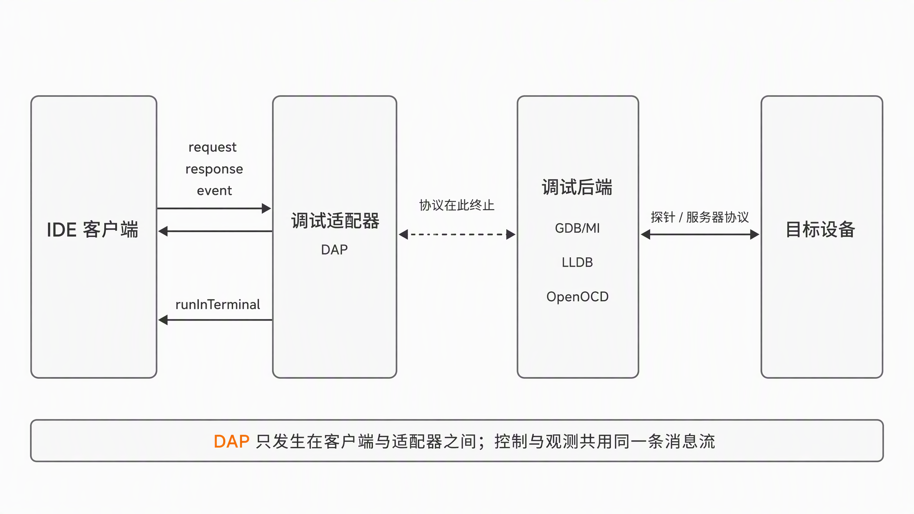
- ### 5.4.2 消息层：三种类型与一个长度前缀
  
  DAP 的报文封装沿用基础协议：一行 `Content-Length: N` 头部、一个空行、随后 $$N$$ 个字节的 UTF-8 JSON。由于它只要求一条能够承载字节流的双向通道，标准输入输出、TCP、命名管道均可使用，无须为每种传输方式重复定义语义。
  
  消息本身只有三种类型，构成完整文法。
  
  | `type` | 必填字段 | 作用 |
  | --- | --- | --- |
  | `request` | `seq`、`command`、`arguments` | 客户端发起一个动作 |
  | `response` | `seq`、`request_seq`、`success`、`command`、`body` | 对某一条请求的唯一答复 |
  | `event` | `seq`、`event`、`body` | 适配器主动通知，无对应请求 |
  
  `seq` 单调递增，`response.request_seq` 回显被答复请求的 `seq`，这是消息归属的唯一依据。协议不承诺答复与请求同序：不同请求可以交错处理，事件可以插在任意位置，包括某条请求的答复之前。这条约束决定了前端的实现形态——必须维护一张以待答复 `seq` 为键的表，而不能依赖到达顺序或"一问一答"的配对假设。
  
  ```json
  → {"seq":1,"type":"request","command":"initialize",
   "arguments":{"clientID":"demo","adapterID":"cortex",
                "linesStartAt1":true,"pathFormat":"path"}}
  ← {"seq":1,"type":"response","request_seq":1,"success":true,
   "command":"initialize",
   "body":{"supportsConfigurationDoneRequest":true,
           "supportsSetVariable":true}}
  ← {"seq":2,"type":"event","event":"initialized"}
  → {"seq":2,"type":"request","command":"setBreakpoints",
   "arguments":{"source":{"path":"/src/sensor.c"},
                "breakpoints":[{"line":42}]}}
  ← {"seq":3,"type":"response","request_seq":2,"success":true,
   "command":"setBreakpoints",
   "body":{"breakpoints":[{"id":1,"verified":true,"line":42}]}}
  ```
  
  这段往来已显出协议的两项性质。其一，断点答复中的 `verified` 字段承认断点可能**并未真正生效**：地址不可达、硬件断点资源耗尽、编译优化导致行号无对应指令，都属常态而非异常。前端必须能够渲染"未生效断点"，而不能假定设置即成功。其二，`initialized` 事件与任何请求都无对应关系，它标记的是"适配器已就绪、可以接受断点配置"这一状态变化。把状态变化从答复中分离出来、以独立消息表达，是 DAP 相对于纯请求响应式接口的实质进步。
- ### 5.4.3 会话生命周期：一次调试的确定性序列
  
  协议为一次调试会话规定了明确的消息顺序。这条顺序并非风格约定，而是若干真实约束的编码结果。
  
  | 阶段 | 客户端发出 | 适配器回应 |
  | --- | --- | --- |
  | 初始化 | `initialize` | 答复 `capabilities`，随后发出 `initialized` 事件 |
  | 建立 | `launch` 或 `attach` | 创建新进程，或连入既有进程 |
  | 配置 | `setBreakpoints`、`setFunctionBreakpoints`、`setExceptionBreakpoints`、`setDataBreakpoints` | 逐条答复，返回 `verified` 与解析后的实际位置 |
  | 提交 | `configurationDone` | 答复后放行执行 |
  | 运行 | `continue`、`next`、`stepIn`、`stepOut`、`pause` | 发出 `continued`、`stopped` 事件 |
  | 观测 | `threads`、`stackTrace`、`scopes`、`variables`、`evaluate` | 逐层返回句柄与已渲染的值 |
  | 结束 | `disconnect`、`terminate` | 发出 `exited`、`terminated` 事件 |
  
  其中值得注意的是 `configurationDone`。断点必须在被调试程序开始执行**之前**一次性提交完毕，否则程序可能在断点安装完成前就已跑过入口，留下一类只在启动阶段出现的漏命中。命令行式的调试器依靠时序约定表达同一意图——先插入断点再执行，顺序颠倒就会漏——而约定是容易被违反的；DAP 把它变成一个显式的同步点：适配器在收到 `configurationDone` 之前不得放行执行。这是协议层面的实质改进，它把一条易于违反的隐式约定，替换为一个无法跳过的状态。
  
  `launch` 与 `attach` 的差别在于进程归属。前者由适配器创建被调试进程并持有其生命周期，后者连接一个已在运行的进程；`disconnect` 时是否终止目标，由请求参数显式声明，而不由消息类型推断。这一区分看似细节，实则是把"谁拥有进程"从上下文猜测变成了协议字段。
  
  运行阶段由若干事件构成观测的时间轴。`stopped` 携带 `reason`（`breakpoint`、`step`、`exception`、`pause`、`entry`、`data breakpoint` 等）、`threadId`、`hitBreakpointIds` 与 `allThreadsStopped`；`continued` 声明恢复执行；`output` 承载被调试程序的输出，并以 `category` 区分标准输出、标准错误与控制台提示。`allThreadsStopped` 这一字段的存在本身就是一次让步：它承认多数后端无法做到逐线程的精确停顿，只能以"全体停住"作为最接近的近似。协议把这一近似显式化为字段，前端据此决定界面语义，而不必猜测。
- ### 5.4.4 能力协商：以自述字段替代版本号
  
  `initialize` 的答复主体是一组能力字段，而不是版本号。`supportsConfigurationDoneRequest`、`supportsConditionalBreakpoints`、`supportsFunctionBreakpoints`、`supportsSetVariable`、`supportsReadMemoryRequest`、`supportsDisassembleRequest`、`supportsStepBack`、`supportsExceptionInfoRequest` 等，各自声明一项能力是否存在；`variableType` 一类字段则指示前端可否信任答复中的某个属性。前端据此决定界面是否呈现相应功能，例如是否显示条件表达式输入框、是否提供反向执行按钮。
  
  这些字段的语义需要精确理解：它们是**存在性声明**，不是行为契约。`supportsSetVariable` 为真，只说明协议入口存在，并不说明哪些作用域可写、写入失败以何种方式报告、写入是否触发副作用。因此前端的正确做法是"能力位加失败回退"：先按能力位呈现，再依据 `success: false` 与 `message` 降级；把能力位当作保证，必然会在某些适配器上失准。这也解释了为何同一前端在不同适配器上表现不一——差异不在前端，而在适配器对同一字段的实现深度。
  
  能力表之外的扩展空间由私有命令承担，通常以双下划线前缀区分。这类扩展只在一家前端与一家适配器之间有效，跨实现即失效；协议不为它们保留语义，也不承诺兼容。因此它们在性质上属于厂商约定，而非协议的一部分。
  
  与能力声明配套的是错误报告。答复中的 `success: false` 同时携带面向人的 `message` 与面向程序的 `body.error`——后者包含错误标识、格式化模板与变量，以及是否应直接展示给用户的标志。把"给人阅读"与"供程序判断"分开表达，是一条务实的设计：调试故障往往既需要用户理解缘由，也需要前端决定是否重试、降级或中止。
- ### 5.4.5 数据模型：句柄、引用与已渲染的值
  
  观测沿一条固定的链路展开：`threads` 取线程，`stackTrace` 取栈帧并得到 `frameId`，`scopes` 取该帧的作用域并得到 `variablesReference`，`variables` 以该引用展开子节点。`frameId` 与 `variablesReference` 都是**会话内的临时句柄**：仅在当前这次停顿期间有效，一旦收到 `continued` 即应视为失效。
  
  这一生命期约束不是实现上的简化，而是语义上的必然。恢复执行后，栈帧可能已被弹出，那块内存可能已被另一个对象复用；继续使用旧句柄读取，得到的是"看起来正常但已不属于该对象"的值，也就是通常所说的幽灵变量。协议以 `continued` 事件作为这一约束的隐式边界，前端若把句柄当作稳定标识缓存，就会在这个边界上出错。
  
  分页在协议中有明确位置：`variables` 答复可携带 `namedVariables` 与 `indexedVariables`，前端据此对大型结构体与数组分块取子节点，配合 `start`、`count` 参数控制范围。这是 DAP 少有的显式分页支持，也说明协议作者清楚"一次展开上百个节点"属常态而非边缘情况。
  
  真正的限制在值的表达。`Variable.value` 与 `evaluate` 的结果永远是**字符串**：`"0x2000"`、`"5"`、`"{a=1, b=2}"`、`"std::vector of length 3"` 在协议层面完全同类。类型信息只能经由 `type`（需 `variableType` 能力为真）与 `presentationHint` 附带，且均为自由文本，无法被程序化解释。于是前端在不解析字符串的前提下无法完成三件事：按类型渲染、对数值做比较或编辑、判断两个值是否相等。换言之，**协议搬运的是后端已经渲染过的值，而不是值本身**。
  
  `memoryReference` 与 `readMemory` 是对这一限制的补丁：把"读一段内存"单列为请求，绕开值的渲染路径，直接返回地址与字节。但它补上了字节，没有补上类型——从字节到"某个结构体的第三个成员当前为 IDLE"，仍需要类型描述、成员偏移与位置表达式，而这些都不在协议之中。
- ### 5.4.6 反向请求与多会话
  
  DAP 并非严格的单向客户端—服务器模型。适配器可以反过来向客户端发出请求，最典型的两条是 `runInTerminal` 与 `startDebugging`。前者服务于必须在终端中运行的被调试程序：标准输入与 tty 归属于编辑器一侧，适配器无法自行创建可见终端，只能请求客户端代劳。后者服务于复合调试：一个适配器请求客户端再启动若干会话，从而覆盖多进程协作、父子进程与容器内附加等场景。
  
  因此客户端也必须实现完整的消息循环——既能发出请求并等待答复，也能接收请求并予以答复——而不能只做"发送后阻塞等待"。反向请求还带来一个状态归属问题：线程、栈帧、变量引用与断点编号均只在所属会话内唯一，跨会话不可互换。多会话界面上看似"同一个"变量，在两个会话中可能对应完全不同的句柄，前端若按名称或地址做跨会话缓存，冲突几乎是必然的。
- ### 5.4.7 标准化的边界与实现代价
  
  把上述分析收拢，DAP 的边界可以归为三点：单通道、无快照语义、翻译损失。
  
  **控制与观测共用同一条消息流。** 目标运行期间，`variables`、`stackTrace` 一类请求通常被适配器拒绝或推迟，因为后端此刻并不提供稳定的读取窗口。协议没有为观测另开通路，也没有提供运行中读取的旁路；可行的代偿只有一种——适配器在每次停顿之前预先缓存必要的读取结果，待前端请求时返回缓存。这实际上是把"快照"这一职责从协议下沉到了实现层。
  
  **协议不保证一组答复来自同一个世界状态。** 一次变量面板展开会产生多次请求，各次请求之间存在真实的时间间隙，而协议既无事务概念，也无停顿编号。前端只能以 `continued` 事件为界，推断"这批值大致属于哪一次停顿"；若适配器允许在暂停期间继续求值，多次求值之间的一致性更无从声明。结构化在这里止步：语法层面的正确性可以保证，语义层面的一致性无法保证。
  
  **翻译损失是普遍而非例外。** 绝大多数适配器是既有后端的薄壳，需要把后端的事实拼装成协议字段：停止原因需要映射，命中断点需要由后端编号反查，变量树需要在后端的表达式求值之上逐层展开。凡映射不到的部分，协议层面不会有任何提示，只表现为前端某项功能不亮，或某个字段恒为默认值。这正是同一 IDE 在不同语言、不同适配器上体验差异明显的直接原因——差异不在编辑器，而在适配器把多少后端语义成功翻译了过来。
  
  代价可以概括为一句话：JSON 冗长、往返次数多、适配器事实上成为策略层。分页、缓存、类型推断、去重与限流，全部由适配器与前端自行实现，规范一概不管。这也意味着适配器的质量差异不会被协议抹平，只会被协议隐藏。
  
  据此可以给出对 DAP 的评价：它以极小的规范体积完成了一次职责重划，把"调试界面"与"调试引擎"之间的接口固定下来，使两者得以各自演化。它统一了消息文法、会话顺序与能力声明；它没有统一调试的数据语义，也并不打算统一。一个 IDE 能否把某块内存还原成"某个结构体的第三个成员此刻为 IDLE"，取决于适配器背后是否真有调试信息与表达式求值器，而不取决于协议写了什么。这或许解释了为何协议普及多年之后，各语言的调试体验差距依旧明显：能够被标准化的部分已经标准化完毕，剩下的部分无法通过继续增加字段来解决。
- # 第六章 调试信息的结构化、重建与呈现：从元数据到可用的调试视图
- ## 6.1 交互模型中的符号映射机制：ELF 结构与 DWARF 地址-源码双向映射
  
  调试界面上有两类动作看起来毫不相干：下一个断点该落在哪个地址，以及变量面板如何把一片字节显示成一个对象。它们各自都需要同一件东西——一张把名字、地址、源码位置与类型串起来的主机侧映射表。本节要打开的正是这张表。
  
  本节只打开它的一半：**名字与地址、地址与源码位置之间的映射**。
  
  先把结论放在前面：
  
  > 交互层里所有的“名字”，最终都要落到一个“地址”上——地址是唯一的公共坐标系。ELF 提供的是**名字到地址的点索引**，DWARF 提供的是**地址到源码位置的区间映射**。前者是一次可能失败的重定位解析，后者是一次区间查找及其反向索引；两者不是同一个函数，代价也不对称。
  
  至于为什么恰好是这两个格式，这是工具链的事实而非审美选择：GCC 与 Clang 系产出的可执行与可重定位文件是 ELF，调试信息是 DWARF；Windows 上对应 COFF/PE 与 PDB，macOS 上对应 Mach-O 与 dSYM。外壳可以换名字，三个角色却恒定不变——一个描述“哪些字节被放到哪个地址”的**装载视图**，一个描述“名字对应哪个地址”的**符号视图**，一个描述“地址对应哪一行”的**位置视图**。以下分析对三者同样成立，只是字段名不同。
- ### 6.1.1 唯一的公共坐标系：一个地址有三种值
  
  要让后面所有讨论都不出错，必须先钉死一件事：**“地址”这个词在调试链路上至少指三个不同的数**。它们常常相等，于是错误被长期掩盖，只在特定配置下爆发。
  
  | 名称 | 出处 | 含义 | 何时不等于运行时地址 |
  | --- | --- | --- | --- |
  | 链接地址（VMA） | `sh_addr`、`p_vaddr`、`st_value`、DWARF 里的全部地址 | 链接器按链接脚本假定的运行时位置 | 桌面 PIE/ASLR；镜像被搬进 RAM 执行 |
  | 加载地址（LMA） | `p_paddr`、链接脚本的 `AT()` | 这段字节被烧写或放置在介质的何处 | `.data` 的初值在 Flash、运行时在 RAM，二者必然不同 |
  | 运行时地址 | 目标回报的 PC、`st_value` 加基址 | 指令真正执行时所在的地址 | 它是前两者的合成结果 |
  
  这张表解释了嵌入式里最典型的“符号全对、断点全不中”：链接脚本用 `AT()` 把 `.data` 初值放在 Flash，启动代码把它拷进 RAM、把 `.bss` 清零；`.text` 若被搬进 RAM 运行（换取取指带宽，或在 Flash 擦写期间继续执行），也与链接地址分家。此时 ELF 里 `st_value` 写的是 RAM 侧的 VMA，烧写工具关心的是 LMA，调试器关心的是 VMA——**三个工具读同一个文件，各取一半字段**，谁也不觉得自己错。
  
  桌面上的问题被一句 load bias 概括了：运行时地址 = 链接地址 + 基址。PIE 下基址由内核随机选，调试器从 `/proc/pid/maps`、`NT_FILE` 注记或 `qXfer:libraries` 里读回来。MCU 上绝大多数工程没有动态加载，基址是 0，所以“重定位”这个词在嵌入式语境里几乎无人提起——它不是不存在，而是**恰好等于零**。一旦出现 bootloader 把应用搬到别处，或者双镜像各自独立链接，这个零立刻变成几十 KB 的偏移，症状是“断点显示已生效，但永不命中”。
  
  > “地址”必须带限定语。写日志、建缓存、比较断点时，如果一个数来自 ELF 的 `st_value`、另一个来自目标回报的 PC，两者相等只是巧合。可靠的做法是在自己的模型里显式区分 `link_addr` 与 `runtime_addr`，并只保留一个换算函数：加法要么做零次，要么做一次。
  
  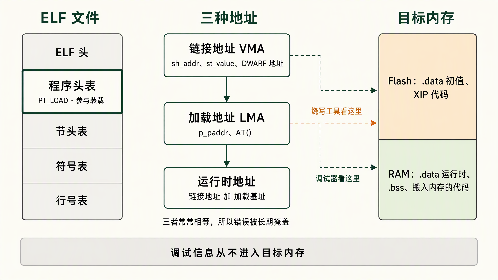
- ### 6.1.2 ELF：一个可装载映像，外加两张表
  
  ELF 结构被讨论得很多，但对调试器而言只有三件事有用，而它们的读者互不相同。
  
  **程序头表**（`PT_LOAD`） 告诉装载器：这段字节从文件偏移 X 处取，放到虚拟地址 Y，占 Z 字节内存。这是纯粹的运行时视图，只有带 `SHF_ALLOC` 属性的节参与；`.text`、`.rodata`、`.data`、`.bss` 在这里，而 `.symtab`、`.debug_*`、`.comment` 一个都不在。这一点常被忽略却至关重要：**调试信息从不进入目标内存**，它只存在于主机的文件系统里。
  
  **节头表** 告诉任何离线工具：文件里有哪些段、各自在哪、彼此如何引用。调试器读 DWARF 全靠它——`.debug_line` 的字节、`.debug_str` 的字符串、由 `sh_link` 指出的关联节，全部按节定位。这也解释了为什么 `strip` 只删节、不动装载布局，二进制仍能正常跑：被删掉的东西本来就没有人装载。
  
  **符号表**（`.symtab` 加 `.strtab`）才是“断点参数里的那个名字”最终变成数字的地方。
  
  由此得到一条贯穿本节的性质：**目标只知道自己被执行到了哪个地址，其余一切都在主机的文件里。** 调试会话的一半工作量，是把文件里的静态知识与目标上的动态事实对齐；对齐的接点只有一个，就是地址。
  
  **两张符号表，命运完全不同。** `.symtab` 是给链接器与调试器看的完整名单，含局部符号（`static` 函数、文件作用域变量）；`.dynsym` 是给动态链接器看的导出与导入名单，必须在运行时可用，因此随映像装载。`strip` 删掉 `.symtab` 与全部 `.debug_*`，却保留 `.dynsym`——这就是“release 版本还能看到 `printf`、却看不到自己的 `static` 辅助函数“的全部原因。MCU 工程通常是全静态链接，`.dynsym` 几乎为空，所以一旦 `strip`，符号信息是真的没了，只剩地址可用。
  
  **符号表不是“名字到地址”的数组，而是一组带分类的记录。** 每条 `Elf32_Sym` 只有 16 字节，真正参与映射的是四个字段。
  
  | 字段 | 内容 | 调试器如何使用 |
  | --- | --- | --- |
  | `st_name` | `.strtab` 中的偏移，不是字符串本身 | 必须解引用字符串表；表损坏时名字变成乱码，而不是报错 |
  | `st_value` | 链接地址；对 `SHN_UNDEF` 无意义 | 唯一被拿来与 PC 比较的量 |
  | `st_size` | 符号占用的字节数 | 决定“PC 是否落在该函数内”；汇编函数、由 `.bin` 反包成的 ELF 里常为 0 |
  | `st_info` / `st_shndx` | 绑定（LOCAL / GLOBAL / WEAK）、类型（FUNC / OBJECT / NOTYPE）、所属节 | 决定“同名该选哪个”“这个符号是否真在这张映像里” |
  
  `st_size` 为 0 这件事值得单独记一笔。函数边界本应由它给出，但手写汇编、链接脚本导出的符号（`_estack`、`__data_start`）、以及 `objcopy -I binary` 反包出来的映像，常常不填或填错。于是“这个地址属于哪个函数”退化为“取小于等于该地址的最近符号”——一个**启发式**，而不是一次查询。栈回溯显示错位的函数名、内联边界被算错，多数根因在此。现代工具的做法是优先用 DWARF 的 `DW_AT_low_pc` 与 `DW_AT_ranges`（真实区间，且支持不连续），符号表只在没有调试信息时兜底。
  
  符号表要求所有 `STB_LOCAL` 排在前面，`sh_info` 给出第一个非局部符号的下标。这不是格式洁癖，而是为了让局部符号能按编译单元批量裁剪；对调试器的意义则是：**查找必须带作用域**。两个文件各有一个 `static void init(void)`，表里就有两条同名记录，靠 `st_shndx` 区分；C++ 的重载与模板实例化把这个现象放大成“一个名字对应几十个地址”。“一个名字对应多个地址”的歧义就发生在这里——不是引擎笨，而是映射本身就是一对多，引擎只能选择“全都下”或者“报错让用户挑”。
  
  另外，`st_name` 指向的是修饰名。`_Z6sensorv`、`_ZN5flash5writeEPKhj` 需要 demangle 才能显示成人读得懂的形式；但用户下断点时敲进去的是源码里的名字，所以引擎必须同时维护“修饰名”与“源码名”两套索引，并在匹配时做一次重载决议。`break flash::write` 偶尔会反问“你要哪一个”，原因不在于交互没做好，而在于这一层映射的基数从来就不唯一。
- ### 6.1.3 行号表：从字节码程序到区间矩阵
  
  如果说符号表是点，行号表就是线。DWARF 的 `.debug_line` 并不是一张表，而是一段**字节码程序**——line number program，由一台状态机执行，输出一张“行号矩阵”（line number matrix）。
  
  标准为这台状态机定义了十来个寄存器：`address`、`file`、`line`、`column`、`is_stmt`、`basic_block`、`end_sequence`、`prologue_end`、`epilogue_begin`、`isa`、`discriminator`。程序是一串操作码，绝大多数只是改写这些寄存器；只有 `DW_LNS_copy` 与“特制操作码”（special opcode）才**输出一行**——把当前快照追加进矩阵，随后清掉几个易变位。
  
  这个设计换取的是压缩率：一条“地址前进 3 条指令、行号加 2、输出”的常见情形，被编码成**一个字节**。代价则是不能随机访问——必须先完整执行一遍程序，才能得到可二分的数组。于是所有实现都在加载时把矩阵物化成按地址排序的 `(address, file, line, flags)` 数组，之后只查这个数组。GDB 的 `linetable` 与 LLDB 的 `LineTable` 是同一结构的两个变体。
  
  **一行不是点，是区间。** 矩阵里一条 `(addr_i, line_i)` 的真实含义是：“从 `addr_i` 起，直到下一条记录之前，源码位置是 `line_i`“；而 `end_sequence` 标记这次连续区间到此为止，其后的地址不再有含义——函数之间可能有空洞，也可能被链接器重排到另一处。这条语义直接决定了两件事：**地址到行天然适定**，二分找到不大于 PC 的最后一条记录即可，复杂度是 $$O(\log n)$$；**行到地址天然一对多**，同一行可能对应多段代码，必须返回候选列表。
  
  **为什么“行”不等于“指令”。** 编译器只在语句边界上发 `is_stmt`，其余记录的存在意义仅是让“停在这里时显示的行号连续”。于是矩阵里堆积着大量 `is_stmt=0` 的行——它们是“可以落点但不该主动落点”的地址。GDB 处理行断点时所做的，正是从该行的全部地址里挑出 `is_stmt=1` 且不落在函数序言内的一个，`prologue_end` 这个标记就是为此新增的（DWARF 3）。用户看到的“断点下在 `if` 那一行、实际停在函数第一句“，既不是编译器的问题，也不是断点机制的问题，纯粹是这张表的语义。
  
  **地址增量为什么以** `min_inst_length` **为单位。** 特制操作码把“行增量、地址增量”压进一个字节，地址增量只能是 `min_inst_length` 的整数倍——Cortex-M 的 Thumb 是 2，ARM 是 4，x86 是 1。一旦真实前进量不是它的整数倍（对齐填充、超长指令、跨 sequence 的跳转），编码器就只能退回 `DW_LNS_advance_pc` 或 `DW_LNE_set_address`，表随之膨胀。`DW_LNE_set_address` 还是唯一携带**重定位**的操作码：在未链接的目标文件里，它的操作数是 0 加一个待定符号；只有链接完成，里面才是链接地址。这就是“调试器只该吃已链接映像”的技术原因——未链接产物里的调试节需要调试器自行重定位，各工具链的支持参差不齐，工程惯例因此是交 `.elf` 而不是 `.o`。
  
  DWARF 5 把文件表重写成带格式描述符的条目，可以携带源文件的 MD5（`DW_LNCT_MD5`）。这是整条链路上唯一一个“源码与二进制是否同一份”的可验证线索：调试器能算出本地文件摘要并比对，从而把“文件被改过、行号全错”从玄学变成可诊断的告警。工程上多数 IDE 选择忽略它，代价是每次接手别人的构建产物，都要重新经历一轮“为什么断点偏了三行”。
- ### 6.1.4 两个方向：一次往返的两条链路
  
  把两个方向并排，代价差异一目了然。
  
  | 方向 | 触发者 | 关键操作 | 复杂度 | 结果形态 | 典型失败 |
  | --- | --- | --- | --- | --- | --- |
  | 名字 → 地址 | `break sensor_poll`、`break sensor.c:42`、回溯显示函数名 | 查符号表（含 demangle、重载决议）；查行号矩阵的反向索引 | 符号表可二分；行到址通常要预建散列 | 候选地址列表，1 到几十个 | 名字没对上、多定义、该行无 `is_stmt` 地址 |
  | 地址 → 源码 | 目标停止、`bt`、`info line *0x...` | 二分符号表；二分行号矩阵；叠加内联区间 | $$O(\log n)$$，但一次要走三张表 | 单行，加一条内联位置栈 | 落在库函数、汇编或 `end_sequence` 之后 → 无源码 |
  
  **一次“下断点”的完整链路。** 用户输入 `break sensor.c:42`，引擎要做六件事：归一化路径（基线是编译时的 `DW_AT_comp_dir`，不是当前工作目录）；在 `.debug_info` 的编译单元列表里筛出源文件匹配者；进该 CU 的行号矩阵取该行的全部地址，按 `is_stmt` 与序言过滤；把候选地址加上**加载基址**；交给控制侧，由它决定用硬件断点还是软件断点（代码在只读 Flash 上时软件断点写不进去，只能改用硬件比较器——这个分岔在此生效）；若该 CU 尚未加载，则整个请求进入 pending 队列，等模块到位后重做前五步。
  
  其中第 4 步那次加法值得停一下：**前五步全在链接地址域内完成，只有最后一步跨进运行时域。** 把加法放在循环之外只加一次，是正确写法；把它放进每次地址比较，等于加了两次；把它忘掉，等于一次也没加。三种写法的症状差别很大——第二种半夜中、第三种全不中、第一种才对——而它们在代码审查里看起来几乎一样。
  
  **一次“停下来”的完整链路。** 目标回报 PC 之后，引擎要做四件事，第一件就有陷阱：**调整 PC**。软件断点命中的是“陷阱指令已经执行完”的状态，PC 已指向下一条指令；Cortex-M 的 `BKPT` 是 2 字节，所以要减 2，ARM 的 `BKPT` 是 4 字节减 4，RISC-V 的 `ebreak` 也是 4。而硬件断点命中时，核心是在指令**执行之前**停住的，PC 就停在断点指令上，一分都不能减。同一个“停下来了”，减不减取决于断点类型——连“停在哪”这个看似纯粹属于观测的问题，都必须先向控制侧问清它用了什么机制。
  
  > PC 的“伪值”不止一处。除了断点后要回退，ARM 状态下读 PC 寄存器得到的是“当前指令地址加流水线偏移”（ARM 加 8、Thumb 加 4），必须由目标描述扣除。这两处修正的失败方式相同：地址整体偏了几字节，于是行号落在相邻的上一行，看起来像是“编译器的行号不准”。
  
  第二件是二分符号表取函数名，第三件是二分行号矩阵取文件与行——若 PC 落在 `end_sequence` 之后，就只剩地址、没有行，这是常态（库函数、启动代码、被 `--gc-sections` 丢弃后又复用的段）。第四件是把内联展开：`.debug_info` 里的 `DW_TAG_inlined_subroutine` 用 `DW_AT_ranges` 描述“被展开的这段代码对应哪一次调用”，用 `DW_AT_call_file` 与 `DW_AT_call_line` 指回调用点。所以“一个 PC 对应一行”并不够用，用户要看到的是“`sensor_poll` 的第 42 行，被 `main` 的第 17 行内联“这样一串。`addr2line -i` 与 GDB 的内联帧，都是把这条区间链逐层展开的结果。
  
  于是关于“双向”这个词，需要一个更准确的表述：**地址到源码不是函数，而是“从最内层区间向外走到编译单元的链”**，只有不考虑内联时才退化为单值；行到地址甚至不是二元关系，而是带策略的候选集合。两者都不可逆，所谓双向映射只是说有两条查询路径，而不是说它构成一个双射。
  
  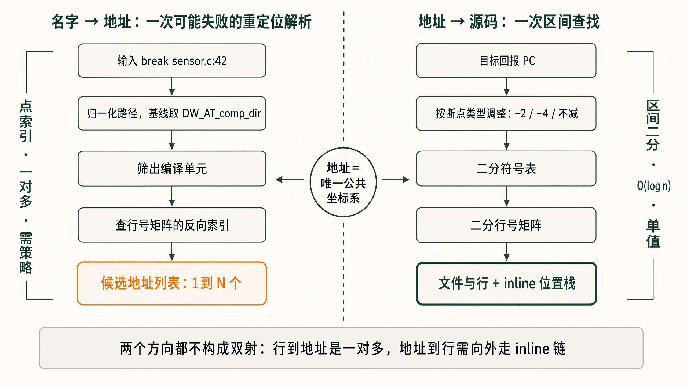
- ### 6.1.5 映射失效的四种方式
  
  这张表值得单独列出，因为它把“调试器不灵”这一类含混抱怨，拆成了四种可诊断的故障。
  
  | 失效 | 直接原因 | 现象 | 可诊断性 |
  | --- | --- | --- | --- |
  | 无调试信息 | `strip`、未开 `-g`、只拿到 `.bin`、只给了 `.hex` | 断点只能按地址下；变量面板空；源码视图不亮 | 高——检查 `.debug_*` 节是否存在 |
  | 基址错 | PIE 未取加载基址、bootloader 搬移、`.data` 的 VMA 与 LMA 混用 | 断点“已生效但不命中”；回溯地址整体平移 | 中——符号与 PC 的差值恒定，是个可测的常数 |
  | 优化折叠 | 行合并、指令重排、变量无 `location` | 断点落在相邻行；单步跳跃；值显示为 `optimized out` | 低——一切看起来都正常 |
  | 源码不同步 | 改了源文件没重编、构建目录与调试机路径不同 | 行号整体偏移；断点位置对不上却“似乎有规律” | 中——DWARF 5 的 MD5 可查，但多数工具不查 |
  
  四种里有两种属于“信息缺失”，两种属于“信息错位”。前者只能靠补信息（重新编译、找回未 strip 的映像、按 build-id 索取分离的调试文件），后者必须靠对齐。工程上常见的做法是把调试信息与固件拆开：`objcopy --only-keep-debug` 产出独立的 `.debug` 文件，映像里只留 `.gnu_debuglink` 与 build-id，设备上烧小的那份、主机上留全的那份，二者靠标识配对。这不是优化，而是把“映射的输入”从目标挪到它该在的地方——调试信息本来就不进目标内存，它该留在主机侧。
  
  还有一条性质值得记下：**符号映射在一次映像加载期间是常量。** 名字到地址、地址到行，只要映像没变，答案就不变；只有复位、重新下载、模块加载这三种事件会改写它。这与观测数据“每停一次就整体失效”恰好相反。两个失效轴必须分开：把映射当成观测去刷新，会得到“每次单步都重新解析符号表”的卡顿；把观测当成映射去缓存，会得到“重烧固件后仍用旧符号”的静默错误。前者慢得明显，后者错得安静。
- ## 6.2 运行时上下文重建：基于调用栈重建（Stack Unwinding）的函数链路还原
  
  符号映射只回答“一个地址对应哪儿”，而界面上的调用栈从来不是一个地址，是一串。目标停下来时，主机手里只有一份**现场**：PC 指向某条指令，SP 指向栈的某处，还有十几个通用寄存器的值。界面上那张调用栈——`main` → `sensor_task` → `sensor_poll` → `read_reg`——在这份现场里一个字都没有。它是被**重建**出来的，重建过程叫栈回溯（stack unwinding）。
  
  这里有一个顺序容易被搞反。表面上，界面先显示函数名、再显示行号，看起来像是“先查符号、再拼调用栈”。实际上，**符号映射的输入来自回溯的输出**：回溯器先把一个现场解成一串 `(PC, CFA, 寄存器集合)`，符号层才有东西可查。所以回溯与符号映射是上下游关系，而非并列关系——后者解决“一个地址对应哪一行”，前者解决“一共有哪些地址”。
  
  先把结论放在前面：
  
  > 回溯不是“读栈”，而是**在目标二进制的元描述上执行一台解释器**：用一份随 PC 变化的规则表，把“当前帧的寄存器集合”逐步变换成“调用者的寄存器集合”，反复迭代直到栈底。栈里没有帧，帧是对寄存器的约束。
  
  由此得到两个必须分清的东西，它们的混淆几乎是所有“调用栈少一层／多一层”问题的根源：
  
  > **栈帧链不是调用链。** 前者是内存布局，后者是程序结构；尾调用让前者比后者短，内联让后者比前者长。
- ### 6.2.1 帧：不是结构体，是一组约束
  
  最常见的误解是把帧当成栈上的一个结构体，里面有返回地址、参数、局部变量，位置固定。实际没有这种东西。**帧是调用者与被调用者之间的一份协议**：进入函数时，双方约定哪些寄存器归谁、栈指针降到哪、返回地址存在哪。协议由 ABI 规定，由编译器在序言与尾声里执行。
  
  Cortex-M 上这份协议就是 AAPCS：`r0`–`r3` 传参兼临时寄存器，`r4`–`r11` 由被调用者保存，`r12` 是调用间的临时寄存器，`r13` 是 SP，`r14` 是 LR，`r15` 是 PC。于是一个典型的 Thumb 函数只有三条与帧有关的指令：
  
  ```plaintext
  sensor_poll:
    push  {r4-r7, lr}      @ 保存被调用者寄存器与返回地址
    sub   sp, sp, #8       @ 给局部变量腾地方
    ...
    add   sp, sp, #8
    pop   {r4-r7, pc}      @ 返回地址直接弹进 PC
  ```
  
  “帧”就是这段被 `push` 与 `sub` 划出来的栈区间，加一份“被保存寄存器的副本”，加一个回到调用者的返回地址。但这份描述仍然依赖 SP，而 SP 在函数体内是变动的（中途还可能再 `push` 一次）。回溯器需要的是一个**与帧内位置无关的参照点**，DWARF 把它定义为 CFA（canonical frame address）：**调用点处的 SP 值**——也就是进入本函数、执行序言之前那一刻的 SP。
  
  CFA 是整个机制的枢纽，因为所有“某寄存器存在哪儿”的规则都相对于它表述：返回地址在 `CFA - 4`，保存的 `r4` 在 `CFA - 8`，如此类推。这样一来，同一个函数在第 3 行和第 300 行停下来，规则表里的偏移不变，变的只是“CFA 怎么由当前 SP 算出来”。用式子写出来，一层回溯就是一次寄存器集合的变换：
  
  $$\mathrm{CFA}_i=\mathrm{SP}_i+\Delta_i,\qquad \mathrm{SP}_{i+1}=\mathrm{CFA}_i,\qquad \mathrm{PC}_{i+1}=M[\mathrm{CFA}_i-4]-\delta$$
  
  其中 $$\Delta_i$$ 来自规则表，$$M[\cdot]$$ 是一次内存读，$$\delta$$ 是调用指令的长度。三个等式里藏着本节后面所有麻烦：$$\Delta_i$$ 需要规则表，$$M[\cdot]$$ 需要栈内存可读，而那个减 $$\delta$$ 的修正几乎没人第一次就写对。
  
  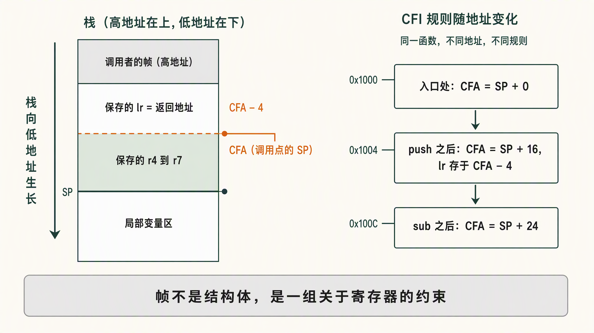
- ### 6.2.2 三种信息来源与它们的可靠性阶梯
  
  回溯器要回答的问题只有两个：“这一帧的 CFA 在哪”与“返回地址存在哪”。这两件事的知识来源有三种，可靠性与代价依次递减。
  
  | 来源 | 载体 | 精度 | 先决条件 | 典型失效 |
  | --- | --- | --- | --- | --- |
  | 调用帧信息（CFI） | `.eh_frame`（随映像装载）或 `.debug_frame`（离线） | 逐地址精确：同一函数的不同位置有不同的规则 | 元数据在、栈内存可读 | 编译时关了 unwind 表；元数据被 strip；JIT 生成的代码没有对应 FDE |
  | 帧指针链 | ABI 约定：`r11` 或 `r7` 指向“保存的旧 fp 加返回地址”组成的链表 | 逐帧精确，但要求每一帧都遵守约定 | 全链路 `-fno-omit-frame-pointer` | 优化后帧指针被当通用寄存器用，链在某处断掉 |
  | 栈扫描与启发式 | 栈内存本身 | 猜测：凡“像返回地址”的字都试一遍 | 只要能读内存 | 把数据当成返回地址，产生幽灵帧 |
  
  这三种并不是可以随便替换的等价物，而是有优先级的：**有 CFI 就用 CFI，没有才退到帧指针，再没有才扫栈**。原因很直接：CFI 描述的是“编译器实际做了什么”，帧指针描述的是“编译器通常怎么做”，栈扫描描述的是“大概也许是这样”。一个诚实的调试器会把后两种的结果标注为推断——因为它们的错误不是崩溃，而是**看起来完全正常的错层**，比崩溃难查得多。
  
  关于 `.eh_frame` 与 `.debug_frame` 的区别，值得单独说一句，因为它解释了嵌入式上“同一条栈，在桌面能看、在板子上只能看一层”的现象。两者格式同源（都是 CIE 与 FDE 的集合），但前者必须存在于运行时——C++ 异常抛出、`backtrace()`、线程取消都要靠它走栈，所以它被放进可装载段，随映像进入目标内存；后者只服务调试器，不装载，字段宽松，可以被 strip 掉。嵌入式为省 Flash 常常在编译时关掉异步 unwind 表，此时 `.eh_frame` 不存在；调试器读不到 FDE，就只能退到帧指针或扫栈。
- ### 6.2.3 CFI：一张随 PC 变化的规则表
  
  CFI 的结构只有两层：**CIE** 与 **FDE**。CIE（common information entry）描述一组函数共有的前提——返回地址存放在哪个寄存器（Cortex-M 上是 `r14`）、代码对齐因子、数据对齐因子（负数，因为栈向低地址生长）、以及若干“初始指令”。FDE（frame description entry）描述一个具体函数，给出它的地址区间，然后是一串字节码，说明在这个区间内如何算 CFA、各寄存器存在哪里。
  
  关键在于它是**字节码**，而不是记录。核心指令只有几条：`DW_CFA_def_cfa reg, off` 定义 CFA，`DW_CFA_offset reg, off` 声明某寄存器被保存在 `CFA + off × data_align`，`DW_CFA_advance_loc` 把“当前地址”推进一段，`DW_CFA_remember_state` 与 `DW_CFA_restore_state` 保存并恢复整套规则。于是 CFI 的语义是：**随时间（地址）推进，规则会变**。
  
  把开头那个 `sensor_poll` 写出来，FDE 大致是：
  
  ```plaintext
  0x0800_1000  DW_CFA_def_cfa r13, 0        @ 入口：CFA = SP + 0，lr 仍在寄存器里
  0x0800_1002  DW_CFA_advance_loc 1
             DW_CFA_def_cfa r13, 16       @ push 完：CFA = SP + 16
             DW_CFA_offset r14, -1        @ 返回地址在 CFA - 4
             DW_CFA_offset r4, -2  ...    @ 保存的 r4 在 CFA - 8 ...
  0x0800_1004  DW_CFA_advance_loc 1
             DW_CFA_def_cfa r13, 24       @ sub 完：CFA = SP + 24
  ```
  
  读这张表要注意第一行与第三段的区别：两者相差两条指令，规则却完全不同。在入口处，返回地址还在 `lr` 里，一次“读 `CFA - 4`”会读到垃圾；`push` 之后它才变成内存里的一个槽。**这正是“停在函数第一行时调用栈少一层”的机制原因**——只不过用 CFI 时它不会发生（规则表明确写了“在寄存器里”），而用帧指针链时它必然发生（链还没建立）。同一种现象在两种实现下一个是正常、一个是缺陷，很多关于调试器“不准”的争论其实是在争这个。
  
  由此也能算出回溯的代价。每层要执行一遍字节码到当前地址（规则条数 $$k$$ 通常十几条），做两三次内存访问；总代价是 $$O(d \cdot k)$$，$$d$$ 为深度。而栈扫描是 $$O(m)$$，$$m$$ 是栈的字节数——在 8 KB 的 MCU 栈上，这意味着上千次候选地址检验，每次还要反查符号表。两者相差不止一个数量级，这解释了为什么在无 CFI 的固件上，某些 IDE 打开调用栈面板要转好几秒。
- ### 6.2.4 一次回溯的完整过程
  
  把上面的零件装起来，一次回溯就是一段循环。以下按 Cortex-M 的实际情形描述。
  
  **第一步，取现场。** 停机状态下，调试器能通过 `DCRSR`/`DCRDR` 读到全部寄存器，所以当前帧的寄存器是**真值**，不需要从栈上推断。这一点常被桌面思维掩盖：x86 上往往只能可靠地读到 PC 与 SP，其余靠猜；Cortex-M 上可以把 r0–r12、SP、LR、xPSR 一次拿全。这让回溯的前半段变简单了，但也带来一个错觉——以为后面的帧也同样“免费”，并非如此。
  
  **第二步，用 PC 查 FDE。** 一次区间查找，与按地址查行号同构，只是查的表不同（`.eh_frame` 而非 `.debug_line`），返回的是一组规则。
  
  **第三步，算 CFA，取返回地址。** 按规则得到 `CFA = SP + Δ`，再取 `RA = *(CFA - 4)`。到这里还有两件事必须做对，否则整条链会安静地偏一层。
  
  **第四步，修正 PC。** 返回地址是“调用指令的**下一条**”，不是调用点本身。为了显示“在第几行调用”，必须回退一个指令长度：ARM 与 Thumb 的 `BL` 都是 4 字节，减 4；RISC-V 的 `jal` 减 4；x86 的 `call` 长度不定，通用做法是减 1——只要求落回 `call` 指令内部，行号查表就能对上，这正是 GDB 里那个看似随意的 `-1` 的由来。而它背后是一条更普遍的规律：**PC 的值几乎从不等于“你以为的那个位置”**——断点命中后要回退陷阱指令的长度，也是同一条规律的另一处发作。
  
  **第五步，恢复调用者。** `SP` 取 `CFA`（这就是 CFA 的定义），`PC` 取修正后的 `RA`；被调用者保存寄存器按规则从栈上逐条取回。然后回到第二步。
  
  **第六步，终止。** 一个没有终止条件的回溯器在遇到损坏的栈时会无限循环或越界读，在 MCU 上表现为调试会话把总线打挂。可靠的实现同时检查四件事：`PC` 为 0（空栈）、`PC` 落在已知栈底符号（`Reset_Handler`、`_start`）、`CFA` 不单调（栈必须严格向一个方向增长）、层数超过上限（通常 128 或 256）。
  
  关于第五步还有一处细节，它划分了“回溯”与“帧内求值”的边界：**推进到下一帧只需要 CFA 与返回地址两条规则**，但如果要在第 3 帧上显示局部变量，就必须把那一帧的被调用者保存寄存器也恢复出来——因为变量的位置表达式（`DW_OP_reg4`、`DW_OP_breg11` 之类）正指着那些寄存器。回溯器与变量求值器因此必须共享同一份“第 i 帧寄存器集合”，否则会出现“函数名对、变量值错”的诡异组合。
- ### 6.2.5 没有规则的时候：帧指针、栈扫描，与三种“合法的缺层”
  
  CFI 缺失并非罕见情况，而是嵌入式的常态（省 Flash、用汇编写启动代码、链接脚本拼出来的二进制）。此时回溯退化为两种手段。
  
  **帧指针链**是最古老的办法。编译器在序言里 `push {r7, lr}; add r7, sp, #0`，让它固定指向“保存的旧 fp”的位置，于是栈上形成一条显式链表，回溯就是沿链表走，每层两次读。代价是牺牲一个通用寄存器（Thumb 上寄存器本就紧张）、序言尾声各多一两条指令、以及最要命的一条——**链只在序言执行完之后才成立**。停在函数第一条指令时，`r7` 还是调用者的，于是回溯会跳过一层。
  
  **栈扫描**是不需要任何元数据的办法：把栈当字数组，每个字都尝试当作返回地址，落在某个可执行区间内就试展开一帧，再用一致性检验筛掉误判（SP 必须单调、CFA 必须递增、返回地址必须落在一个函数的合理范围内）。误判率在优化过的代码上很高，在栈上恰好存着函数指针数组时几乎必然误判。GDB 用 `set heuristic-fence-post` 限制扫描范围，crash dump 分析器则普遍接受“可能有一两帧是假的”，并把它们标注出来。
  
  三种“合法的缺层”必须分清，因为它们在界面上长得一样。
  
  **尾调用。** `return foo(x);` 被编译成 `b foo`（尾调用优化），当前函数的帧直接被 `foo` 复用。回溯看到的是“`foo` 的调用者是 `bar`”，而源码写的是 `bar` → `baz` → `foo`。这不是回溯错了，是**物理栈本来就少了一层**——`baz` 已经把它自己让出去了，只是还没执行返回指令。
  
  **内联。** 被内联的函数没有独立帧，所以栈上根本不存在它。要看它，只能靠 DWARF 的 `DW_TAG_inlined_subroutine` 区间链，也就是从“逻辑”而非“物理”角度补出来。于是调用栈在实现上永远是两层：**物理帧来自 unwinder，逻辑帧来自调试信息**，界面最后把两者合并。把两层塞进同一个结构体，尾调用与内联会同时出错，而且错得相反。
  
  **异常与中断帧。** Cortex-M 的异常入口由硬件自动压栈 8 个字（`r0`–`r3`、`r12`、`lr`、`pc`、`xPSR`），带 FPU 时再压 17 个字与一个保留字。这一帧没有任何 `push` 指令，也没有对应的 FDE；识别它只能靠“当前处于 Handler 模式”这一事实，以及 `EXC_RETURN` 的值。更麻烦的是栈指针：Cortex-M 有 MSP 与 PSP 两个，线程模式用哪个由 `CONTROL.SPSEL` 决定，Handler 模式永远用 MSP。**一条从线程栈穿过异常帧再回到线程栈的回溯，中间换过栈指针**，每一层的 SP 来源都必须记住。这是 RTOS-aware 调试要处理的第一件事，也是“中断里看不到调用栈”的常见原因——回溯器把异常帧当成了普通帧，CFA 直接算错。
- ### 6.2.6 物理帧、逻辑帧与呈现帧：界面上的调用栈是怎么拼出来的
  
  把上面的分工画成三层，整件事就清楚了。
  
  | 层 | 输入 | 输出 | 由谁负责 |
  | --- | --- | --- | --- |
  | 物理帧 | 寄存器 + 栈内存 + CFI（或帧指针、或扫描） | `(CFA, 返回地址, 被调用者保存寄存器)` 的链 | 后端：OpenOCD、GDB、LLDB、J-Link 的 unwinder |
  | 逻辑帧 | 物理帧的 PC + DWARF 内联区间 | 函数名、文件行、内联链 | 符号层：符号表与行号表 |
  | 呈现帧 | 逻辑帧 + 该帧变量 | 可展开的帧对象、作用域、句柄 | 协议层（DAP 的 `stackTrace`／`scopes`） |
  
  三层各有各的失效方式，所以它们必须在界面上被区分开。物理帧可能因为缺 CFI 而少一层，逻辑帧可能因为缺 `-g` 而没有行号，呈现帧可能因为句柄过期而指向另一处——用户看到的“调用栈不对”，往往是这三层里最不显眼的那一层出了问题。
  
  两条工程约束在这里汇合。**其一，回溯结果的生命周期是一个 epoch。** DAP 的 `frameId` 是本次停顿内的临时句柄，一旦 `continued` 就失效；所以回溯结果应该缓存在“本次停顿”这个作用域里，而不是长期保存。**其二，回溯必须与变量面板共享同一份寄存器快照。** 否则第 3 帧的 `pc` 来自第一次读、第 3 帧的局部变量来自第二次读，中间目标若被 DMA 改过内存，用户看到的就是两个不同瞬间拼起来的栈。同一次停顿内的所有读取必须共享一份快照，这条规则在调用栈上比在任何面板上都更硬。
  
  还有一条表达上的要求：**无法回溯时，界面应当显示“??”并保留层号，而不是静默跳过。** 跳过会让用户以为调用链更短，从而往错误的方向排查——这类问题不属于“算错”，而属于“把损失藏起来”，比算错更难发现。
  
  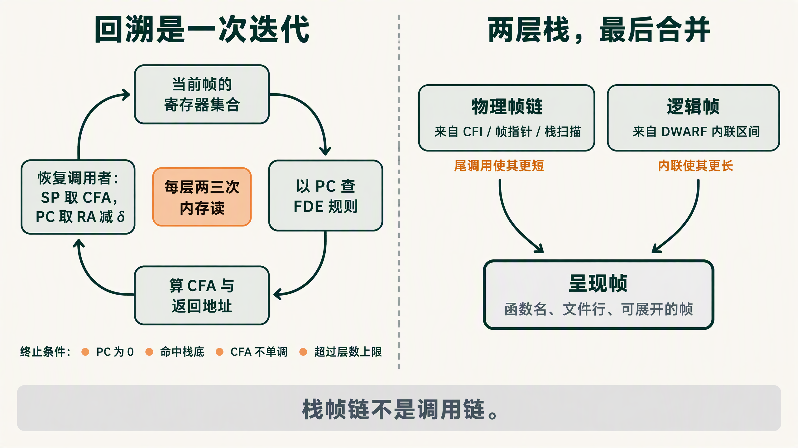
- ## 6.3 LLDB 的交互模型实现与嵌入式适配（SB API 哲学）
  
  同一个“交互模型”，在 GDB 里体现为一套命令加一层 MI 外壳，在 LLDB 里体现为一套对象加一层 C++ 接口。后者值得单独考察，因为 LLDB 从设计之初就把调试器当作**库**而不是**程序**：它要能被 IDE 嵌进去、被脚本驱动、被换一个后端去连一块板子。这个目标逼它回答几个绕不过去的问题——哪些东西可以对外承诺、哪些必须允许变、后端差异往哪里藏。答案就是 SB API，以及它背后那套分层。
  
  结论先行：
  
  > LLDB 的核心不是命令解释器，而是对象模型；命令行只是这套 API 的一个客户端。SB API 的哲学可以收成三句话：**接口即承诺**（一旦暴露就永久维护，所以宁窄勿宽）、**句柄而非数据**（对外给的是内部对象的引用，“有效／无效”是一等状态）、**不做最小公分母**（后端语义直接暴露，不为通用性砍掉表达力）。收益是可嵌入、可脚本化；代价是没有能力协商——能力差异只能靠“调用之后看返回值”发现。
- ### 6.3.1 分层：可替换性比整洁更重要
  
  | 层 | 内容 | 换掉它能得到什么 |
  | --- | --- | --- |
  | SB API | `SBTarget`、`SBProcess`、`SBThread`、`SBFrame`、`SBValue`、`SBError` 等手写门面 | 换语言绑定：C++、Python、Lua |
  | 内部对象模型 | `lldb::Target`、`Process`、`Thread`、`Frame`、`ValueObject`、`Type` | 不对外承诺，可以任意重构 |
  | 插件层 | Process、SymbolFile、ObjectFile、Platform、ABI、Unwinder、DynamicLoader | 换后端：本地进程换远程 stub，DWARF 换 PDB |
  | 核心设施 | `Address`、`Module`、`Stream`、`DataExtractor` | —— |
  
  分层的目的是**可替换**，不是整洁。换一个进程插件，就从一个本地调试器变成远程调试器；换一个 SymbolFile 插件，就从读 DWARF 变成读 PDB。嵌入式适配因此几乎不需要动核心——只需要一个能跑的 `ProcessGDBRemote`、一个 `Platform`，外加正确的 ABI 与寄存器描述。
  
  但插件边界同时也是**信息丢失的边界**：上层只能看到插件愿意暴露的东西。某个后端不提供的能力，在界面上的表现不是“这项能力不存在”，而是“这个功能没做”。这两种说法对用户没有区别，对排查问题却是天壤之别。
  
  还有一点常被忽略：命令解释器与 SB API 是**并列的两个客户端**，不是上下级。于是命令行里能做的事脚本里也能做；而脚本里能做的事，命令行未必有对应命令——能力长在对象模型上，命令只是其中一部分能力的语法糖。
  
  
- ### 6.3.2 句柄而非数据
  
  `SBValue` 默认构造出来是空的，`IsValid()` 为假；拷贝它只是增加一次引用计数，不复制一个字节。这一类对象全部是内部对象的**句柄**，而不是数据本身。
  
  一个句柄服务三个读者，这是 SB API 最实用的设计：
  
  | 形态 | 返回 | 读者 |
  | --- | --- | --- |
  | `GetValueAsUnsigned()` | 整数 | 程序：比较、索引、算偏移 |
  | `GetValue()` | 渲染后的文本 | 人：变量面板、控制台 |
  | `GetData()` | `SBData` 字节块 | 内存视图、十六进制编辑器、导出 |
  
  错误同样不走异常，而走 `SBError`。理由很硬：跨 ABI 边界抛异常不安全，C++ 侧与 Python 侧的异常语义也对不齐。代价则落在调用者身上——**每一次调用都可能失败，检查失败成了调用者的义务**。漏检的表现不是崩溃，而是一个看起来正常的默认值：0、空字符串、空列表。
- ### 6.3.3 状态机：为什么实现里需要十几个状态
  
  `SBProcess::GetState()` 的取值远多于“运行／停止／复位／未知”：`eStateAttaching`、`eStateLaunching`、`eStateConnected`、`eStateRunning`、`eStateStepping`、`eStateStopped`、`eStateCrashed`、`eStateDetached`、`eStateExited`、`eStateUnloaded`、`eStateSuspended`。
  
  多出来的那些几乎都是**过渡态**：正在附加、正在启动、已连接但尚未运行。它们存在的理由只有一个——异步链路上，“请求已发出”与“状态已到达”之间有真实的时间空隙，而界面必须能表达“介于两者之间”。
  
  `SBProcess::Continue()` 返回的 `SBError` 只表示请求被接受。真正的转移要等事件：`SBListener::WaitForEvent` 收 `eBroadcastBitStateChanged`，从 `SBEvent` 里取出新状态与停止信息。这正是“命令的返回值不是真值”的具体形态。
  
  代价随之而来：**请求与事件分离之后，二者不再一一对应**。前端必须维护待决表、超时与重入保护，还要处理“事件先于返回值到达”——在真实链路上，这不是异常顺序，而是正常顺序。
- ### 6.3.4 快照的代价：stop id
  
  LLDB 用 `SBProcess::GetStopID()` 给每次停顿编号，内部的帧对象与值对象都记着自己是在哪个编号下求出来的。`SBValue::GetValueDidChange()` 会在下次访问时比对并刷新。
  
  这里有一个值得注意的取舍：**它倾向于让句柄“活着”，而不是让它立刻失效。** 目标跑过一轮又停下来之后，你手里那个 `SBValue` 依旧是 `IsValid()` 的，读出来的是新世界的数据。它不报错，只是安静地更新。
  
  于是两种语义混在了同一个 API 面上：问“这个值现在是多少”，会随停顿刷新；问“这个值是上一次停顿时看到的”，API 没有字段能表达。要在上层实现“每个值都标注属于哪一次停顿”，只能自己做——把值与 stop id 一起缓存，用编号变化作为失效键。**API 给了你编号，却没把编号贴到值上**；句柄语义省下来的这部分责任，最终落到调用者身上。
- ### 6.3.5 嵌入式适配：缝隙全在元数据
  
  LLDB 连嵌入式只有一条路：`ProcessGDBRemote` 接一个远端 stub——OpenOCD、J-Link GDB Server、pyOCD，或它自己的 `lldb-server`。这条链路上，算法层面的本地化工作几乎没有，成本全花在“让对方说清楚自己是什么”上。
  
  **寄存器描述。** 通过 `qXfer:features:read` 取回 `target.xml`，据此构造寄存器上下文。关键不在寄存器分几组，而在有没有 `generic` 这种标注：哪个是 `pc`、`sp`、`fp`、`lr`、`flags`。厂商的 XML 若把 `r15` 当普通寄存器、不写 `generic="pc"`，LLDB 就找不到 PC——`SBFrame::GetPC()` 返回 0，不报错，回溯与源码位置全线失效。这是“连上了但什么都不能用”最常见的原因，也最难自查，因为连接、读写内存、甚至单步可能全都正常。
  
  **内存映射。** `qXfer:memory-map:read` 告诉它哪段是 Flash、哪段是 RAM。这决定软断点能否落地（只读区写不进去，只能下硬件比较器），也决定读变量时是否需要绕过目标侧缓存。
  
  **能力位与私有扩展。** `qSupported` 里的 `swbreak+`、`hwbreak+`、`PacketSize`、`QStartNoAckMode` 决定基础行为；而它依赖的一批私有包（`jThreadsInfo`、`qMemoryRegionInfo`、`qProcessInfo`、`qHostInfo`）在通用 stub 上往往缺席。缺席不报错，只让某个功能变灰、某个列表变空——**降级是静默的**。
  
  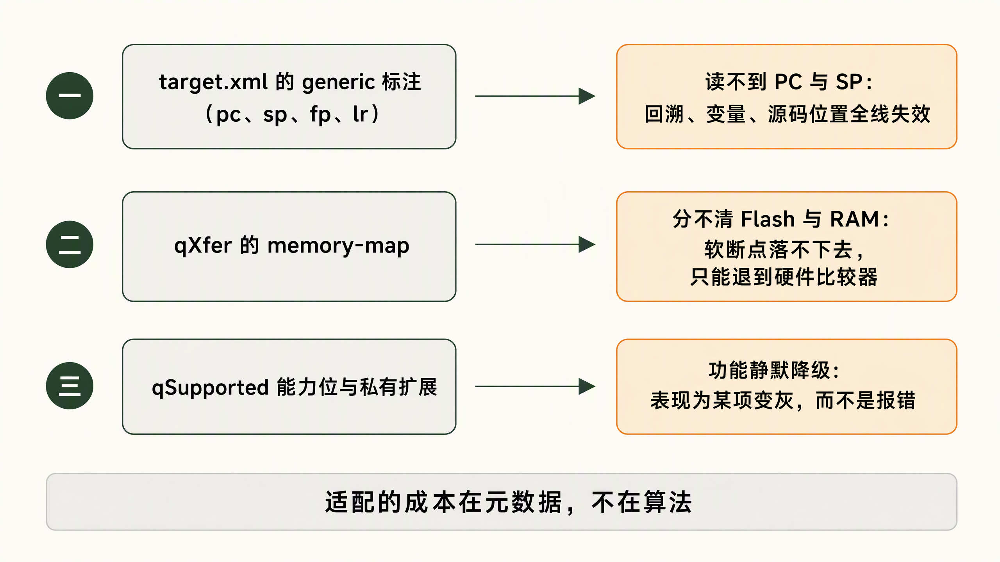
- ### 6.3.6 无 OS 的代价：模型假设与裸机缺口
  
  这套对象模型默认了一件裸机上并不存在的事：有一个进程，进程里有线程，线程有栈帧，模块可以被加载与卸载。把假设搬到 Cortex-M 上，缺口就按对象逐个显形。
  
  **进程与启动。** `SBLaunchInfo` 的语义是“创建并运行一个进程”。裸机上无进程可创建，只能连接或附加——于是“启动调试”这条最常规的路径，在嵌入式上必须被替换成“连接、复位、继续”三步。
  
  **线程。** 硬件只有一个执行流，RTOS 里却有多份“逻辑线程”。LLDB 本身不认识 FreeRTOS，出路只有两条：一是让 stub 通过 `qThreadExtraInfo`／`qfThreadInfo` 把 RTOS 线程伪装成调试线程暴露出来；二是用 Python 脚本读 `pxCurrentTCB` 与就绪链表，在脚本里重建任务视图。后者恰恰证明了可编程性的价值——这类能力不必进核心，用 API 就能拼出来。代价是性能、一致性，以及“内核一升级脚本就坏一次”。
  
  **动态加载器。** 没有共享库这个概念，退到 `DynamicLoaderStatic`，模块列表就是那张 ELF 本身。
  
  **平台。** `Platform` 在远端场景里承担取文件、放文件、执行命令的角色，固件下载与符号文件的远端查找都靠它。它是唯一能表达“远端机器”的对象——虽然对一块裸板来说，这种表达相当勉强。
  
  一句话概括：**裸机适配的本质，是把操作系统本该提供的抽象（进程、线程、内存映射）手工喂给调试器**；喂不进去的地方，就是功能缺口的所在。
- ### 6.3.7 三种“稳定接口”的代价对照
  
  | 维度 | SB API | GDB/MI | DAP |
  | --- | --- | --- | --- |
  | 稳定手段 | C++ ABI，只增不改 | 文本语法，特性名探测 | JSON 语法，能力位声明 |
  | 表达力 | 最强：类型、表达式、帧、值一应俱全 | 中：结构化外壳，文本内核 | 弱：值即字符串，语义靠适配器 |
  | 能力协商 | 无，靠调用后读 `SBError` | 有，`-list-features` | 有，`initialize` 答复 |
  | 演进方式 | 加方法、加重载，旧签名永不删除 | 加命令、加字段 | 加请求、加字段、加能力位 |
  | 跨语言 | 需绑定层，且与库同版本 | 任何语言，解析文本即可 | 任何语言，解析 JSON 即可 |
  | 失败表达 | `SBError` 出参，容易漏检 | `^error` 记录 | `success: false` 加 `message` |
  | 主要代价 | 与库同版本、同平台；API 面极宽 | 无类型，无通道分离 | 语义贫乏，往返次数多 |
  
  这张表指向一个结论：**厚接口把复杂度留在实现里，薄协议把复杂度推给前端。** 前者的上限最高——后端有什么它就能说什么；代价是你必须与它同版本、同语言、同平台。后者的上限最低，换来的是任何前端接任何后端。二者不是先进与落后的关系，而是把同一条“稳定接口”的约束解在了不同位置。
- ### 6.3.8 工程含义
  
  1. **把“接口即承诺”当作约束，而不是口号。** 一旦对外，签名就不能改；真正稀缺的不是功能，而是“以后还能加”的空间。一个方法上百个兄弟，多半不是设计野心的产物，而是“不能动旧签名”逼出来的补偿。
  
  2. **句柄要能自证有效，但无法自证新鲜。** 有效性检查解决前者，停顿编号只解决后者的一半；剩下的一半必须由调用方用缓存键补上。
  
  3. **能力差异要显式化。** 用错误码代替能力位，等于把探测变成试错；试错的真正成本不是慢，而是“试出一个合法但错误的默认值”，然后一路错下去。
  
  4. **适配的战场在元数据。** 寄存器描述里的 `generic` 标注、内存映射、能力位——这三样决定了九成的成败，而它们既不在算法里，也不在核心代码里。
  
  5. **可编程性是嵌入式支持的现实路径。** 面对一个没有标准的 RTOS，脚本比核心灵活；但要承认代价：性能、一致性，以及可维护性。
  
  一个调试器的能力上限，往往不取决于它实现了多少机制，而取决于它把哪些东西放在了“对外承诺”的位置上。选择多承诺，就得到厚重、精确，也只能与同类共存；选择少承诺，就得到轻、通用，也只能表达共性。选哪一种，取决于要解决的是“某一块板子上的所有问题”，还是“所有板子上的某一个问题”。
- ## 6.4 调试器脚本扩展应用：利用 Python CLI 扩展自定义交互命令与自动化内存抽样
  
  调试器的内置机制覆盖的是“所有目标都有的东西”：符号、帧、寄存器、内存。而工程问题偏偏长在边角上——这块板子的内存布局、这个 RTOS 的任务控制块、这个产品自己定义的无锁环形队列、这家客户要求的三十分钟老化测试。等上游把这些做进调试器，产品已经换代两轮了。于是每个成熟调试器都在进程内留了一个扩展点，让使用者自己把命令补上去。
  
  结论先行：
  
  > 脚本的价值不在“少敲几条命令”，而在它把观测变成可重复的实验：一旦能用代码读内存、给样本打上时间与位置标记、把结果落成表格，调试就从“看一眼”变成可积累的证据。代价同样锋利——脚本跑在调试器进程里，它的一次死循环就是整个会话的假死，它的一次误读就是往被测系统里注入了一次副作用。
- ### 6.4.1 扩展点为什么放在进程内
  
  给调试器加能力，位置只有三个，代价结构完全不同。
  
  | 扩展位置 | 典型形态 | 能拿到什么 | 代价 |
  | --- | --- | --- | --- |
  | 改调试器源码 | 加一条内置命令 | 全部内部对象，不受任何约束 | 与上游分叉，每次升级重来一遍 |
  | 外部协议客户端 | 解析 GDB/MI 或 DAP 的文本流 | 只有协议肯暴露的语义 | 表达力被协议卡住，往返次数多 |
  | 进程内脚本 | GDB 的 Python、LLDB 的 Python 模块 | 与内置命令同一套对象句柄 | 与库版本绑定，能阻塞事件循环 |
  
  进程内脚本之所以划算，理由只有一个：**它不需要序列化**。脚本拿到的值是内部对象的句柄，而不是它的文本描述；于是“读出这个结构的第三个成员”既不需要往返，也不需要协议为它专门设计一个请求。协议能表达的是接口设计者预先想到的问题，脚本能表达的是使用者此刻遇到的问题——两者之间隔着一整轮版本发布。
  
  同一个原因带来同一类风险：脚本与调试器**共用一个事件循环**。一个 `while True` 里没有推进目标的调用，界面就再也不会回来；在“目标已停止”的回调里同步执行一条需要目标运行才能完成的命令，就是自我死锁。这不是脚本写得糙，而是“进程内”这个位置本身的性质——你获得的是无中介的访问权，付出的是与宿主共享命运。
  
  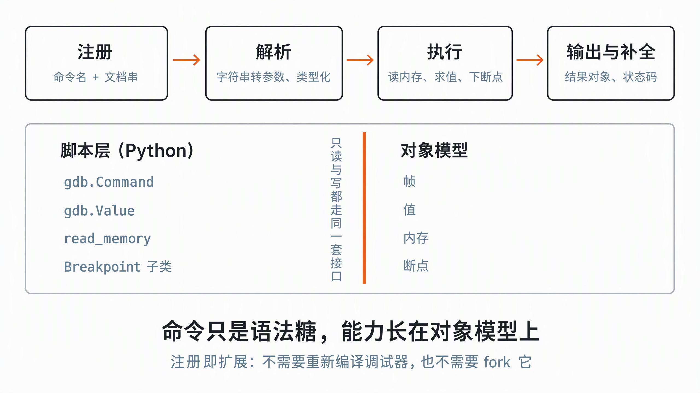
- ### 6.4.2 一个命令的解剖
  
  一条扩展命令的生命被切成四段：注册、解析、执行、输出与补全。四段都有各自的失误方式，而它们的共同点是**失误不会报错，只会让命令变得难用**。
  
  ```python
  import gdb
  
  class Poke(gdb.Command):
    """按类型改写一个变量。用法: tpoke EXPR VALUE"""
  
    def __init__(self):
        super().__init__("tpoke", gdb.COMMAND_DATA, gdb.COMPLETE_EXPRESSION)
  
    def invoke(self, arg, from_tty):
        parts = gdb.string_to_argv(arg)
        if len(parts) != 2:
            raise gdb.GdbError("用法: tpoke EXPR VALUE")
        try:
            slot = gdb.parse_and_eval(parts[0])   # 左值才有 assign
            slot.assign(gdb.parse_and_eval(parts[1]))
        except gdb.error as e:
            raise gdb.GdbError(str(e))            # 变成一句话，而不是一段栈
        gdb.write("%s = %s\n" % (parts[0], slot))
  ```
  
  三处值得逐一说清。**第一处是分词**：`gdb.string_to_argv` 用的是 GDB 命令行自己的分词器，引号、转义、空格的处理与用户敲命令时完全一致；改用手写的 `arg.split()` 会在 `struct foo`、`arr[3].name` 这类带空格的参数上翻车，而且只在部分输入上翻车——最难复现的一类 bug。**第二处是求值**：`parse_and_eval` 交给调试器自己的表达式引擎，脚本不解析语法；能不能赋值由“是不是左值”决定，而这正好把类型检查与可写性判断都留在了唯一权威的地方。**第三处是报错**：`raise gdb.GdbError` 与裸 `raise` 的差别是可见性——前者是给用户看的一句话，后者是给脚本作者看的栈。混用的后果是把“命令用错了”呈现成“调试器崩了”。
  
  输出侧还有一条纪律常被忽略：**不要用 Python 的标准输出**。`print` 写的是 stdout，在部分前端下会被缓冲、被吞掉，或与目标程序输出交错；而 `gdb.write` 可以指定流，`gdb.execute(cmd, to_string=True)` 则把另一条命令的输出捕获成字符串。捕获的代价也要说清：它同时丢掉了异步事件与目标侧的原始输出，只剩命令返回值——对“取一个地址”够用，对“跑一段然后看日志”就不够了。
  
  > 补全不是装饰，它是把“参数空间”暴露给使用者的唯一手段。`COMPLETE_EXPRESSION` 让 Tab 键在符号、成员、寄存器上工作；没有补全，用户只能靠记忆拼写地址表达式，而地址表达式的错误率与长度成正比。一条扩展命令的可发现性，八成取决于它的补全与第一行文档串。
  
  LLDB 侧的对应物形状不同，值得对照着看：
  
  | 环节 | GDB（Python） | LLDB（Python） |
  | --- | --- | --- |
  | 注册 | 继承 `gdb.Command`，在构造函数里声明名字、类别、补全方式 | 用模块提供的命令装饰器，或挂到解释器上 |
  | 取参 | `gdb.string_to_argv` 按命令行规则分词 | 命令串整体传入，自行切分 |
  | 求值 | `gdb.parse_and_eval` | `SBFrame.EvaluateExpression` |
  | 读写内存 | `Inferior.read_memory` / `write_memory` | `SBProcess.ReadMemory` / `WriteMemory` |
  | 报错 | `raise gdb.GdbError` | `SBCommandReturnObject.SetError` |
  | 输出 | `gdb.write`，可指定流 | `SBCommandReturnObject.AppendMessage` |
  | 结果状态 | 默认成功，出错才抛 | 必须显式 `SetStatus` |
  
  最后一行是两种风格的真正分歧：GDB 的路径是“正常就直接写，出错才声明”，LLDB 的路径是“每条命令都必须表态”。前者的代码短，后者不可能忘记报告失败——同一件事，一个把负担放在纪律上，一个把负担放在接口上。
- ### 6.4.3 自动化内存抽样：把“看一眼”变成时间序列
  
  典型需求长这样：某个状态机偶尔卡死，怀疑是共享缓冲区被写坏，想知道那个 64 字节的结构在崩溃前几秒里变成了什么样。手工做法是停下、`p *buf`、继续、再停下，来回十几次，然后凭记忆猜趋势。这是把调试器当放大镜用，而它本来可以当时钟用。
  
  抽样器要回答四个问题：**采哪儿、谁来触发、怎么读、记下来干什么**。第一个问题的答案应当来自符号而不是手抄常量——理由与“读”这个动作的副作用有关；第四个问题决定了输出格式；中间两个决定了成本。
  
  单步驱动的版本最短，也最贵：
  
  ```python
  import gdb
  
  class Sampler(gdb.Command):
    """采样一段内存。用法: msample ADDR LEN N"""
  
    def __init__(self):
        super().__init__("msample", gdb.COMMAND_DATA)
  
    def invoke(self, arg, from_tty):
        p = gdb.string_to_argv(arg)
        if len(p) != 3:
            raise gdb.GdbError("用法: msample ADDR LEN N")
        addr, size, count = (int(gdb.parse_and_eval(x)) for x in p)
        inf = gdb.selected_inferior()
        rows = []
        for seq in range(count):
            buf = inf.read_memory(addr, size)        # 返回 memoryview
            f = gdb.newest_frame()
            rows.append((seq, int(f.pc()) if f else 0,
                         f.name() if f else "??", bytes(buf).hex()))
            gdb.execute("stepi")                     # 逐指令推进
        for r in rows:
            gdb.write("%d\t0x%08x\t%s\t%s\n" % r)
  ```
  
  这段代码能跑，但它同时踩了两个坑：`stepi` 让目标每走一条指令就停一次，**时序已经完全不是原来的时序**；而 `rows` 全存在内存里，`count` 上万时脚本自己成了被测对象。改进方向有两条——换成断点触发，或边采边落盘。
  
  断点驱动的版本更接近生产用法：
  
  ```python
  class Watch(gdb.Breakpoint):
    def __init__(self, spec, addr, size, out):
        super().__init__(spec, internal=True)    # internal: 不污染用户的断点列表
        self.addr, self.size, self.out, self.hits = addr, size, out, 0
  
    def stop(self):
        buf = gdb.selected_inferior().read_memory(self.addr, self.size)
        self.out.writerow([self.hits, int(gdb.newest_frame().pc()), bytes(buf).hex()])
        self.hits += 1
        return False                              # 不停下，让事件循环自己继续
  ```
  
  关键在最后一行。`stop()` 返回 `False` 是“我已处理，请继续跑”，返回 `True` 才是“停下给用户看”。**绝不要在停止回调里调用继续命令**：那是在处理“已停止”事件的过程中请求“开始运行”，重入会让命令解释器与目标状态机的假设同时失效，症状是随机的“目标没有运行”或“命令被忽略”——看起来像调试器的 bug，实际是使用位置错了。
  
  采样的成本可以直接写出来。一次采样要付一次停顿、若干次往返、一次恢复：
  
  $$T_{\text{total}} = N \cdot \left( t_{\text{stop}} + \left\lceil \frac{L}{B} \right\rceil \cdot t_{\text{rtt}} + t_{\text{resume}} \right)$$
  
  其中 $$L$$ 是读取字节数，$$B$$ 是单包有效载荷。$$L$$ 小于 $$B$$ 时往返次数就是 1，此时**增大单次读取长度几乎免费**——这是抽样脚本最值得利用的一点：把 20 个分散的变量改成从一个结构体里一次读回，成本可以从 20 次往返降到 1 次。相对侵入率则是 $$R = T_{\text{total}} / T_{\text{observed}}$$；$$R$$ 超过百分之几，被观测的行为本身就开始变形。
  
  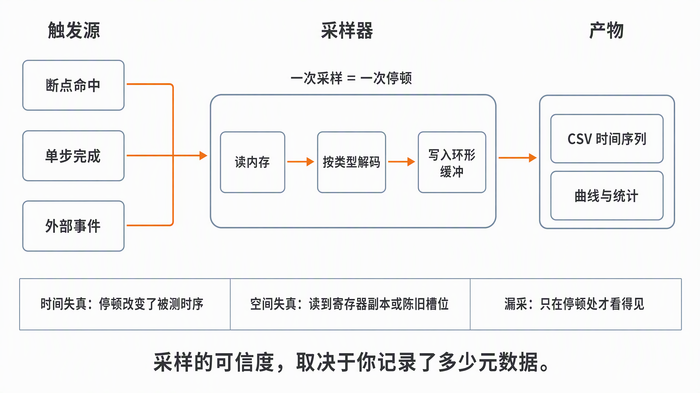
  
  触发源的选择，比采样代码本身更决定结果的可信度：
  
  | 触发源 | 时间分辨率 | 单次开销 | 能看到的量 | 侵入性 |
  | --- | --- | --- | --- | --- |
  | 单步驱动 | 一条指令 | 每步一次完整停顿与恢复 | 任意内存，逐指令 | 极高，时序完全失真 |
  | 断点驱动 | 一次函数调用 | 每次命中一次往返 | 断点处的快照 | 中，改变缓存与执行流 |
  | 硬件触发 | 一个时钟周期 | 近乎为零 | 计数器、跟踪流、DMA 搬运 | 低，但需要预先布置 |
  
  由此可以给“抽样”这个词祛魅：它有两种含义。一种是**统计抽样**，按固定频率取点，在软件调试器里几乎不成立——它没有独立于事件循环的时钟。另一种是**埋点抽样**，在特定事件上取一次快照，这才是脚本能稳定提供的东西。把后者当成前者用，就会得到一条看起来像时间序列、实际是事件序列的曲线。
- ### 6.4.4 三类失真：时间、空间、漏采
  
  **时间失真。**停顿的是 CPU，不是世界。DMA 还在搬数据，定时器还在计数，看门狗在数自己的秒。所以样本上的时间戳是主机时间，不是目标时间；两者的差不是常数，而取决于这次停顿里调试器做了多少事——读了多少字节、回溯了多少帧、前端刷新了几次。要把它拉回来，只能读目标自己的时基：Cortex-M 的 `DWT->CYCCNT`、RTOS 的 tick 计数、或一段被目标代码自增的计数器。**没有目标时基的采样，精度无从谈起。**
  
  **空间失真。**优化之后，一个变量的“位置”不再是一个地址，而是一组随 PC 变化的规则。读内存读到的是最后一次溢出到栈的副本；变量此刻的真值可能在某个寄存器里，内存里的槽位只是上一轮的残值。这不是调试器的缺陷，而是“内存视图”这个抽象在优化代码上的固有盲区——你请求的是“这个地址的字节”，它忠实地给了你。判断办法很土但有效：同一时刻分别读内存与读寄存器，若两者不一致，就说明这个变量已经被分配给了寄存器，内存值不可信。
  
  **漏采。**事件驱动采样的采样率上限由三段时间共同夹住：
  
  $$f_s^{\max} = \frac{1}{t_{\text{stop}} + t_{\text{read}} + t_{\text{resume}}}$$
  
  在 CMSIS-DAP 这类链路上，这个量级通常是几百赫兹到一千赫兹；而目标里的一个控制环可能跑在十千赫以上。于是“为什么我的曲线是阶梯状的”这个问题的答案，往往不在被观测的代码里，而在采样通路上。要看见频率 $$f$$ 的变化，采样率必须高于 $$2f$$；达不到的时候，你看到的不是噪声，而是**混叠**——一个目标里并不存在的低频，看起来却完全合理。
  
  > 抽样脚本读错地址，等于往观测行为里加入一次写入。外设寄存器常是“读即清标志”（状态位、中断挂起、FIFO 出队）；读 Flash 会触发预取与缓存填充，改变后续时序；读某些保留区可能直接引发总线错误并复位目标。一个只读脚本能让板子重启，这不矛盾——它读的不是内存，是副作用。所以采样地址应当来自符号与内存映射，而不是手抄的常量。
- ### 6.4.5 让样本可信：元数据、显式失败与格式
  
  一条样本的可信度，几乎完全由它带了多少元数据决定。只存“值”的采样表，三天后就没人能解释那一列十六进制是什么。
  
  | 列 | 含义 | 省掉它的后果 |
  | --- | --- | --- |
  | `seq` | 样本序号 | 无法识别漏采与乱序 |
  | `stop` / `hit` | 第几次停顿或第几次命中 | 样本与“哪一次停顿时看到的世界”脱钩 |
  | `pc` / `fn` | 采样时的位置 | 同一变量在不同位置语义可能不同 |
  | `cycles` | 目标时基 | 失去唯一不被调试器影响的时钟 |
  | `addr` / `width` | 读的是哪一段 | 事后无法复现 |
  | `raw` | 原始字节 | 解码错了就再也无法重解 |
  
  **失败要响。**`except: pass` 是抽样脚本最常见的自毁方式：一次读失败被吞掉，后面整套统计都建立在一张“样本数对不上”的表上，而曲线的平滑会掩盖丢点。宁可让脚本中断并报出哪一次、哪个地址失败，也不要交付一条漂亮的假曲线。
  
  格式选择没有绝对好坏，只有配套：
  
  | 格式 | 体积 | 可读性 | 追加友好 | 适合 |
  | --- | --- | --- | --- | --- |
  | CSV | 中 | 高 | 好 | 表格、`pandas`、`gnuplot`、贴进文档 |
  | JSONL | 大 | 高 | 好 | 字段会演进、样本带嵌套结构 |
  | 二进制 | 小 | 无 | 极好 | 高频、长时段、事后离线解码 |
  
  最后是复现。一份可信的采样结果需要四样东西一起存档：**脚本、参数、符号文件哈希、目标固件版本**。少了后两样，同一个地址在不同构建里可能指向完全不同的东西，而那些“当时的结论”就再也无法验证。
- ## 6.5 前后端异步事件处理：程序运行中与用户强行打断（Async Stop）的 UI 状态同步
  
  前面讨论的所有机制都隐含一个前提：目标已经停下来了。而真实使用里，绝大部分时间是它在跑，用户在等，或者用户在看着某个还没发生的现象。这段时间里发生的事情没有“请求—响应”的配对结构：用户按下暂停的那一刻，没有任何一个命令在等结果；目标可能已经跑到别处，也可能因为完全不同的原因停下来。
  
  结论先行：
  
  > 异步打断的本质是**两套时间轴的对齐问题**。后端的状态是物理事实，前端的状态是用户信念，两者之间只能靠带编号（epoch）的事件同步，不能靠命令的返回值。而“点暂停到看见画面”这段时间里，真正占大头的往往不是打断本身，而是停止之后的采集——所以停止事件与数据就绪必须是两件事。
- ### 6.5.1 三种停止，一种状态
  
  目标的停下来只有一种终态，却有三种发起方式，它们对 UI 的含义完全不同。
  
  | 发起方式 | 谁决定的停下位置 | 可预期性 | 典型停因 | UI 该默认做什么 |
  | --- | --- | --- | --- | --- |
  | 断点或观察点命中 | 用户事先指定 | 高：位置是确定的 | 断点编号 | 定位到源码行，展开调用栈与局部变量 |
  | 用户强行打断 | 没人决定 | 低：任意指令边界 | `SIGINT` | 说清“是你打断的”，并接受“这里可能没有源码意义” |
  | 目标自身异常 | 硬件或内核 | 中：由故障决定 | `SIGSEGV`、`HardFault`、`SIGTRAP` | 直接跳到故障寄存器与故障地址 |
  
  三者在协议层几乎没有区别——都是“目标进入停止状态并回报一个停因”。差别全在语义上，而这个差别决定了界面接下来该做什么。最容易出的问题正是把三者一视同仁：把一次异步打断当成普通停止渲染，用户看到的是“停在一个陌生的地址上”，而调试器什么也没解释。**用户以为调试器停歪了，其实是他自己按的。**
  
  还有一种更隐蔽的情况：打断落在库函数、启动代码或没有行号信息的区域，此时 PC 有值但没有源码位置。界面若强行显示“最近的一行”，就等于在替目标编造位置——正确做法是显示地址与反汇编，并明确标注“无源码信息”。
- ### 6.5.2 打断的物理路径：一个没有格式的裸字节
  
  在 GDB Remote 协议里，打断只用**一个字节**，即 `0x03`，没有包号，也没有校验和。这个特例不是偷懒，而是逻辑上的必然：一个正常的请求要求对方此刻处于“收包”语义，而打断的目的恰恰是把它从“不收包”的状态里拉出来。协议因此在“对方不听话”的时候也必须能说话，只能退到一个连帧结构都放弃的最小信号。
  
  收到 `0x03` 之后，stub 在下一个安全点停住，回报 `T02`（信号 2，即 `SIGINT`）。这里有两个工程细节值得记住。
  
  **第一，延迟由轮询周期决定，而不是由链路带宽决定。**如果 stub 是轮询式的，它只在每个轮询周期里检查有没有打断字节；在 CMSIS-DAP 这类 USB 设备上，这个周期常常就是一帧，即 1 ms 量级。于是“打断有多快”这个问题的答案，取决于调试探针的轮询实现，而不取决于你点了多快：
  
  $$t_{\text{stop}} = t_{\text{host}} + t_{\text{bus}} + t_{\text{poll}}$$
  
  **第二，打断在总线上是排队的。**你之前发出去的那条命令（读一段内存、取一次寄存器）已经在线上了，打断必须排在它后面。于是“打断”与“读取”会在时间上交叉：你以为打断发生在读取之前，实际上可能反了。这就是为什么在打断之后拿到的数据，必须由 epoch 而不是由“第几个请求”来标识。
  
  LLDB 侧对应 `SBProcess::Stop()`，GDB 侧对应命令行里的中断。两者返回的成功都只表示**请求已被接受**：异步链路上，命令的返回值不是事实，事件才是事实。
- ### 6.5.3 前端三态机：中间态不是装饰
  
  把“运行中／已停止”两态直接映射到按钮，是这类界面最常见的起点，也是最早出问题的地方。至少要三个状态，其中“打断中”是必须存在的：
  
  | 状态 | 允许的动作 | 跳过或误置的后果 |
  | --- | --- | --- |
  | 运行中 | 暂停、断开、终止 | 此时读寄存器会拿到上一次停顿的陈旧值，而且不报错 |
  | 打断中 | 等待；可选地取消 | 若此时按钮仍可点，重复点击会打断自己的采集 |
  | 已停止（带 epoch） | 继续、单步、读写内存 | 迟到的旧事件被渲染，界面回跳一下又跳回来 |
  
  “打断中”存在的理由很具体：它是唯一能吸收重复点击的位置。用户连点三次暂停，前端的正确反应是**只保留一个待决的打断请求**，后两次被合并进第一次——因为后端正在做的就是同一件事。没有这个状态，第二、三次打断会落在后端正在读寄存器、正在回溯的窗口里，于是拿到一个只采了一半的快照，而这个快照看起来完全正常。
  
  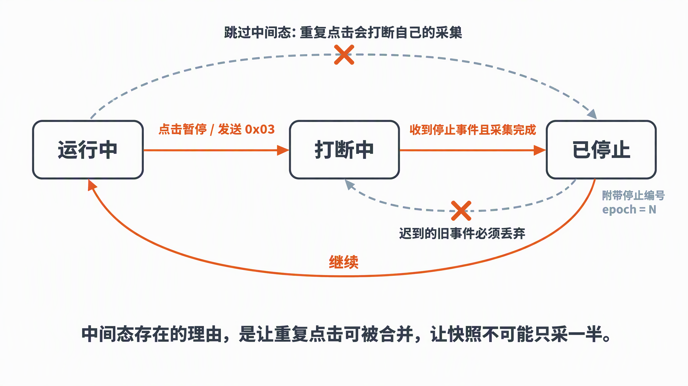
  
  两条被禁止的迁移值得单独说。一条是“运行中直接跳到已停止”：跳过中间态，等于放弃了合并重复请求的机会，也放弃了在这段时间里禁用那些会改变状态的按钮。另一条是“已停止退回到打断中”：这通常不是代码写错了，而是迟到的旧事件到了——上一轮打断的事件终于抵达，而前端已经在下一轮；此时正确的处理是丢弃，不是渲染。
  
  > 状态的合法性由“谁来改”决定，而不是由“值是什么”决定。同一个“已停止”，由事件带出来的、由命令返回值推断出来的、以及由超时兜底猜出来的，可信度完全不同。三者在 UI 上可以显示成一样，但在状态机里必须能区分——否则排查问题时，你无法知道那个停止是目标说的，还是前端猜的。
- ### 6.5.4 一次打断的时间线：停止只是开始
  
  把一次打断拆成五段，就能看清延迟到底花在哪里。
  
  **T0**，用户点击暂停，前端进入“打断中”，禁用所有会改变目标状态的操作。**T1**，打断字节发上总线，排队。**T2**，stub 停住，回报 `SIGINT`——到这一刻，物理事实已经确定，但前端还什么都不知道。**T3**，后端开始采集：取寄存器、回溯调用栈、求值变量、取反汇编。**T4**，后端广播状态事件，带上 epoch。**T5**，前端渲染。
  
  用户感知到的等待是这几段的和：
  
  $$t_{\text{vis}} = t_{\text{int}} + t_{\text{stop}} + t_{\text{capture}} + t_{\text{render}}$$
  
  其中 $$t_{\text{capture}}$$ 常常是最大项，而且随调用栈深度增长：一段二十层的栈，每层要执行一遍规则表、做两三次内存访问，再加上变量面板里逐个求值——在低速探针上是几百毫秒到秒级的量。用户对此的表述通常是“卡了一下”，而卡的地方不是打断，是他看不见的采集。
  
  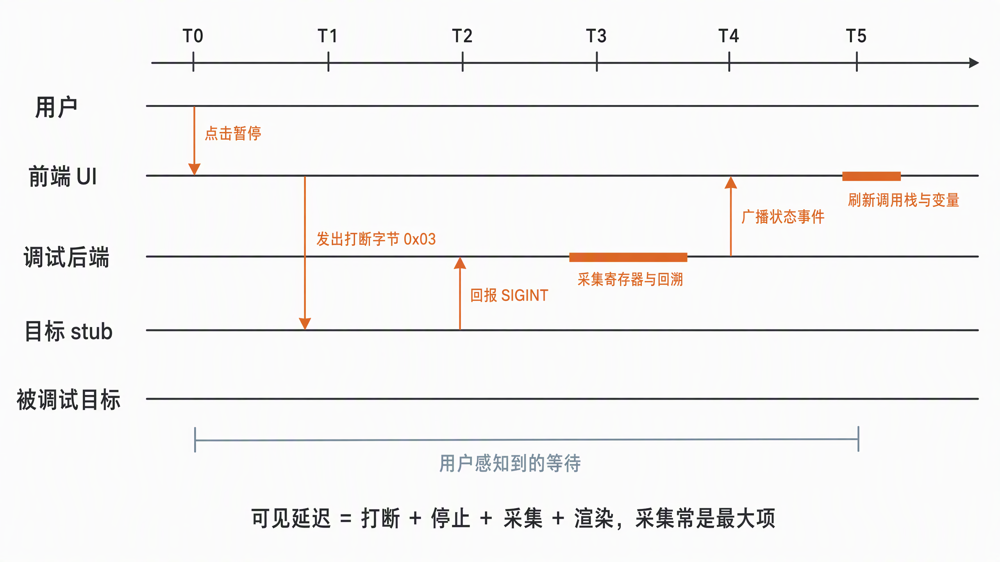
  
  这条时间线直接给出一个设计结论：**如果把“已停止”和“已采集完”合成一个事件，用户就必须等最慢的那一项。**而这两件事在语义上本来就是分开的——一个是物理事实，一个是数据就绪。
- ### 6.5.5 分级采集与按 epoch 丢弃
  
  据此，采集应当分级，让界面尽快从“不知道”变成“知道一部分”。
  
  | 级别 | 内容 | 典型代价 | 失败时的表现 |
  | --- | --- | --- | --- |
  | 一级 | 停因、PC、通用寄存器 | 一次或两次往返 | 几乎没有：拿不到就是链路断了 |
  | 二级 | 调用栈、当前帧的源码位置 | 深度 × 每层两三次往返 | 尾部若干帧显示 `??` |
  | 三级 | 变量值、内存、反汇编 | 按需，单个对象 | 单个面板报错，不影响其他 |
  
  一级到达就点亮“已停止”，二级到达再画出栈，三级等用户展开才拉。这条路径的代价是界面必须能表达“部分可用”——而这恰恰是多数前端最不愿意做的事，因为它意味着三种视觉状态（未加载、加载中、已加载）而不是两种。
  
  一个具体的反模式：**边拉边渲染调用栈**。逐层到达就逐层插入，用户看到的是列表在不停变长，滚动位置随之漂移；如果期间用户点开了某一帧，那一帧可能已经被新插入的帧挤到另一个位置。正确做法是先给出结构占位（深度未知也行），数据到达后替换而不是追加。
  
  与分级采集配套的是丢弃规则：**任何异步到达的数据都必须带它所属的 epoch，当前 epoch 不匹配就丢弃。**这一条没有例外。它是唯一能挡住“上一轮的栈混进这一轮”的机制，而这类串台的表现极其误导——帧名、行号、变量都真实存在，只是属于另一个时刻。
- ### 6.5.6 打断风暴与两种死锁
- 用户在“继续—暂停”之间快速来回点，是压力测试也是真实行为（尤其在追一个偶发问题时）。此时每按一次都会产生一次完整采集，后端队列迅速积压，表现是“越点越卡，最后停在一个很早的位置”。
  
  对策不是加长防抖时间，而是把语义定清楚：**同一时刻只允许一个待决的控制请求**。新的点击到达时，如果已有一个待决的打断，就合并而不是排队；如果后端正在采集，就明确返回“忙”并说明当前状态。静默排队是最糟的选择——它会制造一批“用户早已不想要的”请求，然后逐个执行。
  
  死锁的两种典型形态也都在这一段上。**第一种**：前端在“打断中”等待 stopped 事件来解锁，而后端要等采集完成才发事件，采集里某个求值又需要前端提供上下文——界面于是永久转圈。修法是把“已停止”与“已捕获”拆成两个事件，前者无条件立即发出。**第二种**：后端在采集期间读了内存，而读内存要求目标处于停止状态；若状态机在采集开始时就乐观地把状态标成“运行中”，这些读就会失败并被重试，重试又延长了采集，采集越长越容易超时。修法只有一条：状态迁移只能由事实驱动，不能由“我准备要做了”驱动。
  
  > 一个安静的坑：打断之后立刻读寄存器，可能读到的是打断**之前**的值。原因是打断字节在线上的位置与读请求可能交叉；若 stub 允许多个请求在途而不做严格排序，后端就会把旧值当新值。防御手段不在协议层，而在把每个数据都绑定到 epoch，并在 epoch 变化时作废所有缓存——包括那些“刚刚才读到”的。
- ### 6.5.7 三条不变量
- 把这套机制收成三条可以拿去检查实现的不变量：
  
  **其一，前端状态是用户信念，后端状态是物理事实，两者之间只能通过带 epoch 的事件同步。**任何绕过事件的“乐观更新”都要在事后被纠正，而每一次纠正都是一次界面跳动；用户看到的是闪烁，实际是模型在自我修正。
  
  **其二，停止事件与采集完成必须是两个事件。**前者回答“它现在停着吗”，后者回答“数据齐了吗”。合并之后，前端只能选择“慢”或“错”，没有第三条路。
  
  **其三，任何控制请求都必须可被拒绝，且拒绝要说明当前状态。**“忙”“目标已在运行”“上一次采集尚未完成”——这些回答让前端能给出确定的行为；而静默排队会让前端与后端对同一时刻的理解产生分叉，分叉之后所有的状态显示都不再可信。
  
  一个调试器的“手感”，几乎全部压在这条异步路径上：符号映射再准、回溯再深、协议再规范，只要打断之后界面要转两秒，或者停下来的位置与用户的理解对不上，使用者就会认为它不好用。而这门手艺的核心其实很朴素——**承认停止只是一个时刻，而观测是一段过程**，然后把这两件事在事件模型里分开。
- # 第七章 从结构化到语义化：调试交互的展望与边界
  
  前六章几乎没有出现过“智能”这个词。它们谈的是地址如何对上名字、栈如何一层层拆开、一个裸字节的打断如何把不听话的目标拉回来、一条命令的返回值为什么不算事实。把这些内容合起来看，其实是同一件事：**把调试从“人对着寄存器猜”改造成“机器可以结构化地说出事实”**。
  
  本章要谈的五个方向——增强的上下文组装、死机现场取证、多轮诊断闭环、智能探针、自然语言接口——都发生在这件事之后，而不是之前。这里不给出实现：没有协议字段，没有提示词，没有步骤清单。它只回答两个问题：这些方向各自踩在前六章的哪一块地基上；以及它们一旦成立，代价会出现在哪里。写作上有一条自我约束——凡是落不到“某一类事实、某一条约束、某一种失效”上的说法，宁可不写。
- ## 7.1 交互模型的赋能：可视化标准化与认知降维
- ### 7.1.1 被标准化的不是图形，是事实的形状
  
  第 5.4 节讨论调试适配器协议时，把它的价值说成“一次解耦及其代价”：后端不再需要关心前端的画法，前端不再需要理解后端的方言。但那次讨论漏下了一半收益，而这一半恰好是本章的前提。
  
  DAP 的 `capabilities`、`target.xml` 里的寄存器描述、MI 的记录语法，它们标准化的对象从来不是**图形**，而是**事实的形状**——一个调试器必须能说出哪些事实、以什么结构说出：停止的原因是单个枚举值而不是一句自然语言；变量树是按引用逐层展开而不是一屏文本；寄存器有位域定义而不是一个十六进制数。一旦事实有了稳定形状，它的消费者就不必是人。编辑器、脚本、日志分析器、审计工具、模型，都可以是同一个消费者接口上的客户端。
  
  这解释了前六章为什么反复纠缠“形态”而不是“功能”。一个停在 `0x08001a3c` 上的断点和一个停在“`sensor.c` 第 42 行、属于 `sensor_poll`、被 `main` 内联“的断点，对人的差别是好看，对机器的差别是**能不能与源码、类型、调用链发生关联**。前者是一个孤立数字，后者是一张图的节点。没有这张图，后面所有方向都无从下手。
- ### 7.1.2 四级降维阶梯
  
  把第 5、6 章的内容按“替人省掉了什么”重新排一遍，会看到一条清晰的阶梯。
  
  | 级别 | 输入 | 输出 | 被隐藏的事实 | 失效表现 |
  | --- | --- | --- | --- | --- |
  | 坐标统一 | 目标的一举一动 | 一个数轴上的地址 | 名字、编译单元、加载基址 | 断点“已生效但不命中” |
  | 对象化 | 字节 + 类型描述 | 有名字、有边界、有字段的对象 | 布局、填充、端序、位域 | 值“看起来不对”却不报错 |
  | 时间化 | 一次采集 + 纪元 | 某一时刻的观测集合 | 采集的先后、在途请求的交叉 | 界面回跳、上一轮的栈混进这一轮 |
  | 意图化（展望） | 一个自然语言问题 | 一串可验证的观测与一个假设 | 检索路径与推断过程 | 答案“听起来对” |
  
  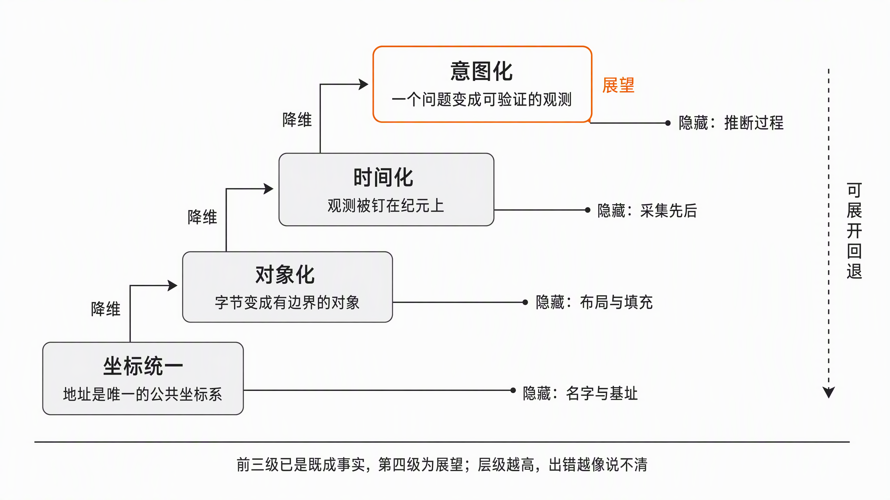
  
  前三级已经是既成事实。第一级是 6.1 的符号映射：地址成为唯一的公共坐标系，名字与源码位置都投影到它上面。第二级是类型与调试信息的重建：字节被还原成对象，人不必再手算偏移。第三级是 5.1 与 6.5 的纪元机制：观测被钉在时间线上，人不必再自己维护“这个值是刚才的还是现在的”。
  
  每一级都在替人省掉一件事，也都在替人藏起一件事。这是降维的定义，不是缺陷——但它决定了一条工程要求。
- ### 7.1.3 降维的代价是可回退性
  
  > 判据只有一条：**任何一层抽象都必须能一键展开回下一层的原始事实。** 从“`sensor_poll` 第 42 行“要能点到那个地址、那段字节、那几位；从”某一时刻的变量树“要能看到它是哪几次读数拼出来的。层级越高，出错的形态越不像”看得见“而越像”说不清“——而”说不清“的错误，人没有办法反驳。
  
  这条要求在前六章里是隐含的，在本章会变成显式的。因为 AI 介入之后，抽象的层数还要再加一层，而这一层恰恰最不可回退：模型的判断没有地址、没有行号、没有纪元，它只有语言。如果下面三层不能一路展开回去，那么这一层的结论就无从复核。
- ### 7.1.4 为什么 AI 的位置在这里
  
  于是可以给本章的展望一个不夸张的定位：**AI 进入调试，不是因为模型比人更懂 Cortex-M，而是因为“已经结构化的痕迹”在数量上超过了人的工作记忆。**
  
  一次故障现场摊开来是几十个寄存器和故障状态位、几百帧调用栈、几千行相关源码、几个硬件比较器、若干条在途的异步请求。人在这堆东西里的瓶颈是注意力，机器的瓶颈是上下文预算。两者都不完美，但形状不同：人擅长判断“这像不像一个真实的问题”，机器擅长穷举“还有哪些组合没被排除”。本章所有方向，本质上都是在这条分界线上做分工。
  
  这也顺带否掉了一种流行做法：把界面截图交给模型看。那等于把第三级降维重新压回第零级——结构变回像素，“第 42 行”变回一片灰色里的一点白，纪元、句柄、类型全部丢失。在这本书的坐标系里，这不像进步，更像把已经修好的桥拆了改划船。
  
  把五个方向与前六章的地基对齐，就是下面这张表。
  
  | 方向 | 依赖的地基 | 真正的难点 | 主要代价 |
  | --- | --- | --- | --- |
  | 7.2 上下文组装 | 符号与行号映射、类型信息、栈回溯 | 检索键是地址与时间，不是语义相似 | 组装耗时、陈旧数据被当成新鲜事实 |
  | 7.3 死机取证 | 异常帧、故障状态寄存器、栈回溯、分级采集 | 现场已被破坏，快照必须自带可信度 | 停机时延与“采全／采快”的取舍 |
  | 7.4 多轮诊断 | 脚本扩展、异步控制与纪元 | 权限分级与假设债务 | 交互成本、确认退化为仪式 |
  | 7.5 智能探针 | 断点编译、类型与数据流、DWT 语义 | 比较器容量与“只知被访问、不知被谁” | 观察者效应 |
  | 7.6 自然语言接口 | 结构化事实、板级知识 | 把意图编译成可验证的观测 | 可信度分级与不可反驳的答案 |
- ## 7.2 增强的调试上下文：三种异构素材的组装
  
  一次真正的诊断需要三类素材，而它们的物理位置、更新频率、可信度全都不一样。**代码库**回答“这段逻辑想干什么”，它是意图与约束，是常量，也最容易读多——几十万行里真正相关的可能只有三屏。**符号与调试信息**回答“这个地址是谁”，它同样在主机上、在一次映像加载期间是常量，但它的读者不是人而是工具的索引结构。**运行时数据**回答“此刻它是什么”，它在目标上，每停顿一次就整体失效一次——6.1.5 里那条“映射与观测是两个失效轴”在这里第二次生效：把三者混成一个上下文缓存，就会得到“重烧固件后仍在用旧符号”或“每次单步都重新解析符号表”。
  
  难的地方从来不是“多”，而是**关联**。这是这一方向最容易被做错的地方：通用的检索增强是文本相似度，而调试里的检索键是**地址、时间与调用关系**。问“这个变量为什么是 0x0”时，相似度检索会捞回一堆讨论空指针的文档，而真正需要的是一条链：变量在 RAM 的哪个偏移 → 哪条指令写过它 → 那条指令属于哪个函数 → 那个函数的源码行 → 那一行依赖的哪个条件没有成立。这不是把文档塞进窗口，是在一张图上从某个节点出发做局部展开。
  
  由此可以预判这个方向成熟的形态：**分层摘要加按需下钻**。先由工具生成一份可验证的摘要——哪些函数在栈上、哪些变量在故障点附近被写过、哪些地址落在没有源码的区域——再让模型提出它要展开哪一段。摘要的意义不只是省 token，而是它天然可校验：每一条都可以被工具复核为真或不真，模型想编也编不出来。
  
  判据也很干脆：**模型能否在不猜的前提下说出“这个地址属于哪一行、这一行属于哪一次调用、这个值是谁写的”。** 凡是需要它猜的，说明上下文没组装好，与模型能力无关——这一条可以直接拿去测任何一个号称“AI 辅助调试”的产品。
  
  至于代价，它会以两种安静的方式出现。其一是组装本身的耗时与符号规模成正比，一次深栈的历史加上类型展开可以轻易吃掉几百毫秒，而这段时间用户面对的是一个已经停住却不动的东西。其二是陈旧数据：一个属于上一纪元的栈帧混进本轮上下文，它不会报错，它只是让结论以一种非常有说服力的方式错下去。第 5.1 节那条“任何异步数据都必须带纪元”的规则，在 AI 这一侧同样没有例外。
- ## 7.3 死机现场的自动取证
  
  HardFault 是嵌入式最典型的“看不到”现场：目标不接受命令，单步没有意义，人手上只剩下复位这一个动作，而复位会抹掉唯一的证据。工程现场最常见的剧本因此是——死机，看一眼串口没输出，复位，加打印，再死一次。**这个循环的每一步都在丢掉信息，而其中第一步最贵。**
  
  方向因此很清楚：把取证从**人的动作**变成**工具的动作**。连上即取证，异常即取证，而不是等人想起来去点暂停。这不是交互习惯的改良，而是时序上的必然：证据的存在窗口只到复位为止，而人反应过来通常已经在复位之后。
  
  一次合格的快照该包含什么，在方向上也是明确的。第一类是**异常帧**：由 `EXC_RETURN` 的取值决定用的是主栈还是进程栈、带不带浮点扩展帧，取错了整体偏移一个常量，症状是“回溯能跑但全是垃圾函数名”。第二类是**故障状态寄存器**：`CFSR`、`HFSR`、`MMFAR`、`BFAR` 把“为什么进 HardFault”从玄学拆成几个具体原因——非法访问、非对齐、总线错误、执行了非法指令——这是整条链路上最便宜也最高价值的一次读数。第三类是**故障前后的一小段历史**：只有指令 trace 或主机侧环形缓冲能提供，也最贵，但它回答的是前两类回答不了的问题：怎么走到这里的。
  
  真正的难点在于**死机时目标已经不可信**。栈指针可能已经被写坏，于是回溯会产出一条看起来完全正常、完全符合 ABI、却完全虚构的调用链——这正是 6.2 里“物理帧与逻辑帧”的区别在最坏情况下的形态。人眼分不出这种虚构，因为它长得和真的一模一样。所以快照在设计上必须**自带可信度**：哪些内存区域校验通过、哪些帧只是推测、哪些值取自缓存而非现场。没有这层标注的“智能诊断”，输出的是一份精致的错误。
  
  时延问题无法绕过：
  
  $$t_{\text{snapshot}} = t_{\text{halt}} + \sum_{i \in \text{regions}} \frac{s_i}{v_{\text{probe}}}$$
  
  以百 KB/s 量级的探针读带宽计，一次几十 KB 的 RAM 转储就是数百毫秒，而真正想要的往往只是其中几片。所以自动取证在方向上必然复用 6.5.5 的分级采集：先取异常帧与状态寄存器（微秒级、几乎必成），再取栈与关键区域，最后才谈全量。**先让人知道“它为什么死了”，再让人知道“它当时在干什么”。**
  
  > 这一方向上最需要提前立规矩的地方：**快照是事实，诊断是假设。** 界面若把“`CFSR` 的 `PRECISERR` 位为 1、`BFAR` 指向 `0x2000_1FFC`“与”可能是 DMA 越界写坏了相邻缓冲区“用同一种字体、同一层缩进并列显示，人一定会把后者当前者。本章将要反复回到这一点。
- ## 7.4 交互式多轮诊断：提议、确认与回读
  
  把 6.4 的脚本扩展与 6.5 的异步控制接起来，就得到了这一方向的基本形状：模型提议一次观测，人确认，工具执行，结果回读，假设更新，再提议。**这个闭环里最值得设计的不是模型的推理，而是“提议”的形状。** 一个可用的提议必须携带三样东西：它要证实或证伪的**假设**；它需要的**权限**（只读内存、写内存、改寄存器、改目标状态）；它的**可撤销性**（做完之后目标还是不是原来那个目标）。
  
  为什么确认必须是人的动作，理由不是礼貌，而是物理事实：调试的目标是有状态、有副作用、而且常常是唯一的一份。改一个寄存器可能让一个本来还能复现的问题从此不再复现；写一片 Flash 可能让“现场”永久消失。所以权限分级在这个方向上是第一性问题，而不是安全模块的附属品——它应该长在交互模型里，而不是包在模型外面。
  
  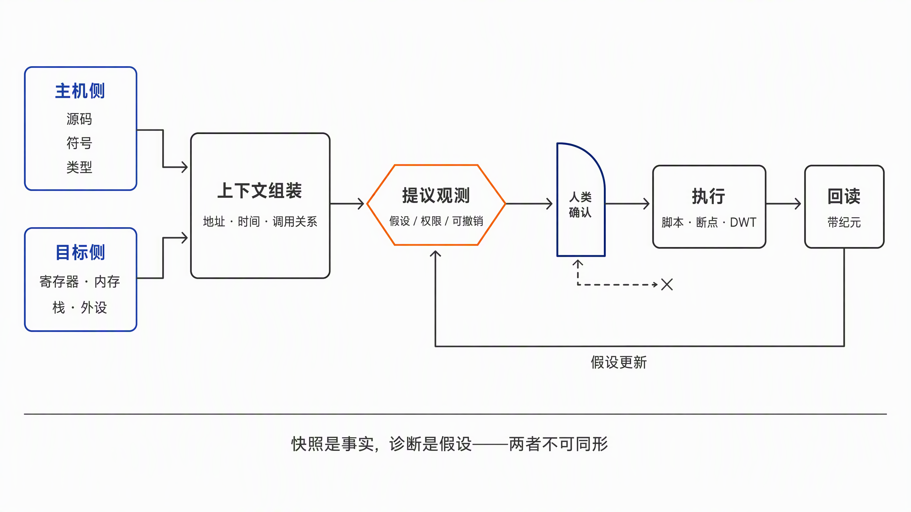
  
  第二个真问题是**假设债务**。每一轮观测都在悄悄引入假设：这个指针有效、这个结构体没被别人改过、这条中断确实在预期时刻发生、这份符号对应的是板子上正在跑的那份固件。假设不被显式化，就会滚雪球，最终得到一个逻辑完全自洽、事实完全错误的结论——而这类结论比“查不出来”更有害，因为它会让人停止怀疑。可预期的工程形态是一份**假设台账**：每条结论挂着它依赖的假设与支持它的事实，任何一条假设被推翻，依赖它的结论自动降级。
  
  判据仍然只有一句：**一次诊断结束后，人能否复述“为什么这么判断”。** 能复述，说明中间的事实与假设都被摆到过台面上；不能复述，这次诊断的价值就等于一次运气，哪怕结论碰巧是对的。
  
  代价则集中在两个地方。一是交互成本：多轮意味着多次等待，而调试的人最缺的正是耐心，于是很容易滑向“全部自动确认”。二是**自动化偏见**——“人确认”退化成“人点确定”，HITL 变成仪式，确认框里的话越来越长、越来越没人读。这是这个方向最大的失败模式，而且它不报错，它只是让人不知不觉地把判断权交了出去。
- ## 7.5 智能条件断点与动态探针
  
  6.1.4 说过，下一次断点本质是一次编译：名字与行号被编译成地址，地址再被编译成软件陷阱或硬件比较器。这一方向要展望的，是把这次编译的**输入**从“一个地址”抬高到“一个症状”。人的输入是“什么时候该停下来”——一句关于系统行为的意图；工具的活是把它翻译成具体的比较器配置。
  
  这里有一条不可协商的硬约束：**DWT 的比较器是个位数**，通常四个以内，而可疑变量往往是二十个。于是问题在数学上就变成了一次带容量约束的选择：
  
  $$\max_{S \subseteq V}\ I(S)\quad \text{s.t.}\ \sum_{v \in S} w_v \le N_{\text{DWT}}$$
  
  其中权重 $w_v$ 不是装饰——地址掩码可以让一个比较器覆盖一整片区域，但掩码越宽，误报越多，于是“容量”与“精度”之间也存在一次换算。三个变量以内，人的直觉还够用；二十个变量加掩码权衡，人的直觉就不够了。**这个位置正好是机器该站的位置，而且它站得住，因为它算的是组合，不是灵感。**
  
  可利用的输入有两类，性质相反。**源码语义**告诉工具哪些变量参与了这个症状的计算——这需要类型与数据流，也就是 6.1 那两张表再往前走一步；它是静态的、便宜的，也可能错得离谱（优化之后数据流会变形）。**系统表现**告诉工具故障前哪些地址被真正写过——这需要 trace 或一次全 RAM 的前后比对；它是动态的、贵的，也更接近事实。好方向必然是两者的交叉验证：静态给出候选，动态给出排除，剩下的少数才值得占用一个比较器。
  
  但对能力上限要诚实：**DWT 只报“这个地址被访问了”，不报“是谁、为什么”。** 要拿到发起访问的那条指令，只能靠命中时的 PC；要拿到更早的因果，只能靠 trace。所以这类功能的说明书第一页就该写着：“本功能的能力由硬件决定，不由模型决定。” 越过这条线的宣传，最终都会以“AI 说是 DMA 干的”这种形式翻车。
  
  代价是观察者效应。观察点本身会改变时序：一个循环里多了一次比较，临界窗口就变了，于是偶发问题可能变得不那么偶发，也可能变得完全不出现。这与 6.5.6 的打断风暴同源——**观测从来不是免费的，它只是把成本从人身上挪到了被测系统身上。**
- ## 7.6 自然语言调试接口
  
  “为什么串口没有输出”是一个意图。“读 `0x40011004` 的第 5 位“是一个命令。这两句话之间的距离，就是这个方向要跨的距离——而它常被误读成一次翻译：把中文翻成 GDB 命令。那样理解会把这个方向做小。**真正的价值在编译：把一个意图编译成一串可验证的观测。**
  
  这决定了它和 7.4 是同一件事的两端：7.4 是模型提议、人确认；7.6 是人提问、模型分解。两端共用一套基础设施——结构化的事实、明确的权限、可回读的结果、不可省的纪元。
  
  判据也随之而来：**每个回答都应当附上它的证据链，以及它被推翻的方式。** 读了哪些地址、用了哪些符号、按什么规则判定；如果哪一条事实不同，结论就会翻转。一个给不出反驳路径的答案，在这本书的标准里不算答案，只算一段流畅的文字。
  
  难点并不在语言理解，而在**语料里没有你的板子**。固件特有的语义——这个引脚接了哪个外设、这条中断在什么条件下会连续触发、这块 Flash 的擦除粒度是多少——不可能从训练数据里获得，只能从工程里取。所以这个方向的多数工作量不在模型，而在**板级知识的可读化**：原理图、引脚复用表、寄存器手册、链接脚本、启动文件，这些今天以 PDF 与注释形式存在的知识，必须变成工具可检索的结构。它与 7.2 是同一件事的两端：一个负责把知识搬进上下文，一个负责把问题翻译成对上下文的查询。
  
  > 代价出现在**可信度分级**上。同一个界面上的两句话，“`USART1->SR` 的 `TXE` 位为 0“与”可能是中断优先级配置导致发送阻塞“，一句来自寄存器读数，一句来自模型推断，必须长得不一样。否则人在连续三次正确的回答之后，会开始相信第四次——而那一次恰恰是模型在补一个它并不知道的因果。
- ## 7.7 结语：把不确定性留在人这一侧
  
  把全章收成三条可以拿去检查任何实现的不变量。
  
  **其一，事实与推断必须不同形。** 工具负责给出可复核的事实，模型负责给出可证伪的假设，两者在界面上不能共享同一种呈现方式。一旦共享，人就会在信息量最低的地方给出最高的信任。
  
  **其二，每一层抽象都必须可展开回下一层。** 从“串口没输出”要能一路点回 `0x40011004` 的第 5 位，从“可能是 DMA 越界”要能点回那一帧、那一条指令、那一个比较器的命中记录。可回退性是降维能被信任的唯一理由，也是 AI 的输出能被复核的唯一通道。
  
  **其三，人的确认必须携带信息量。** 确认框里应该写着“如果这条不成立，那么结论会变成什么”，而不是“是否继续”。没有信息量的确认，只是把责任转移了一次，判断并没有真的发生。
  
  整本书从 SWD 的电气层一路写到 AI 的假说层。中间那一大段——地址的三种取值、行号矩阵的字节码、CFA 规则表、句柄与引用、打断的裸字节、三态机与纪元——看起来是最不“智能”的部分，却恰恰是全部智能的地基。**模型的输出能不能被信任，取决于它脚下那些结构肯不肯说实话。**
  
  所以调试器的演进方向，不是替人做判断，而是把人的注意力从“读地址”挪到“提问题”。这个迁移什么时候算完成？当一个人面对一块陌生板子，他问的第一句话不再是“我该看哪个寄存器”，而是“我怀疑什么”。
-