# 概述
- 这个时代有很多的数据，但我们更渴望知识
- 数据存储的方式：
	- DBMS
	- Data Collection
	- 关系型数据模型
	- 数据仓库
	- 互联网
- 为什么要进行数据挖掘？
	- 数据中有我们想要的知识
	- 数据库分析和决策支持
		- 市场分析与管理
		- 目标营销，客户关系管理，市场篮子分析，交叉销售，市场细分
		- 风险分析与管理
		- 预测，客户保留，改进承保，质量控制，竞争分析
		- 欺诈检测与管理
	- 其他应用方面
		- 文本挖掘(新闻组、电子邮件、文档)和Web分析。
		- 智能查询回答
- **挖掘流程：**
	- 学习应用域
	- 目标数据创建集
	- 数据清洗和预处理
	- 数据规约和转换
	- 选择数据挖掘函数（总结、分类、回归、关联、分类）
	- 选择挖掘算法
	- 找寻兴趣度模式
	- 模式评估和知识展示
	- 使用挖掘的知识
	  
	  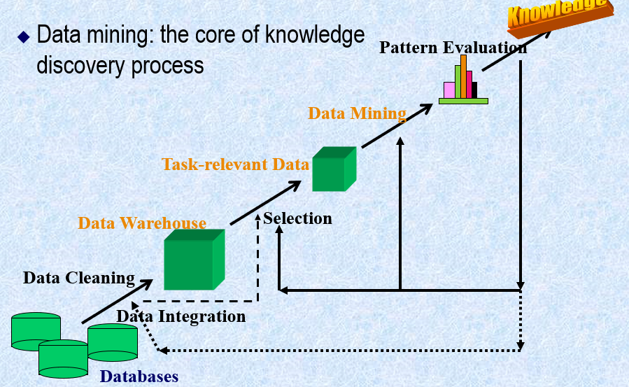
- **概念****/****类描述：一种数据泛化形式，**
	- 用汇总的、简洁的和精确的方法描述各个类和概念，通过
	- （1）**数据特征化：**目标类数据的一般特性或特征的汇总；
	- （2）**数据区分：**将目标类数据的一般特性与一个或多个可比较类进行比较；
	- （3）数据特征化和比较来得到。
- **关联分析：**发现关联规则，这些规则展示属性-值频繁地在给定数据集中一起出现的条件，通常要满足最小支持度阈值和最小置信度阈值。
- **分类：**找出能够描述和区分数据类或概念的模型，以便能够使用模型**预测类标号未知的对象类**，导出的模型是基于训练集的分析。导出模型的算法：决策树、神经网络、贝叶斯、（遗传、粗糙集、模糊集）。
- **预测：**建立连续值函数模型，预测空缺的或不知道的**数值数据集**。
- **孤立点：**与数据的一般行为或模型不一致的数据对象。
- **聚类：**分析数据对象，而不考虑已知的类标记。训练数据中**不提供类标记**，对象**根据最大化类内的相似性和最小化类间的原则**进行聚类或分组，从而产生类标号。
- # 数据仓库
- **数据仓库**是一个**面向主题的**、**集成的**、**时变的**、**非易失的**数据集合，支持管理部门的决策过程。从一个或多个数据源收集信息，存放在一个一致的模式下，并且通常驻留在单个站点。数据仓库通过数据清理、变换、继承、装入和定期刷新过程来构造。
	- **面向主题：**排除无用数据，提供特定主题的简明视图。
	- **集成的：**多个异构数据源。
	- **时变的：**从历史角度提供信息，隐含时间信息。
	- **非易失的：**和操作数据的分离，只提供初始装入和访问。
- **联机事务处理OLTP**：主要任务是执行联机事务和查询处理。
- **联系分析处理OLAP**：数据仓库系统在数据分析和决策方面为用户或‘知识工人’提供服务。这种系统可以用不同的格式和组织提供数据。OLAP是一种分析技术，具有汇总、合并和聚集功能，以及从不同的角度观察信息的能力。
  
  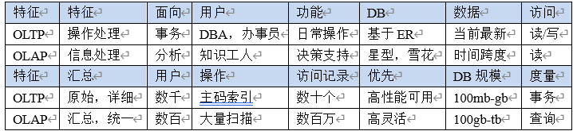
- 多维度数据模型：
	- 多维数据模型将数据看作数据立方体，允许从多个维度对数据建模和观察。包含维表和事实表。
	- 最流行的数据仓库数据模型是多维数据模型，这种模型可以是：
		- **星形模式（**事实表在中间，连接到多个维表**）**
		- **雪花模式（**星型的变种，某些维表规范化，分解到附加维表，以减少冗余**）**
		- **事实星座模式（**多个事实表共享维表**）**
- **数据立方体：**允许从多维对数据建模和观察。它由维和事实定义。
	- **维**：关于一个组织想要保存记录的透视图和实体，每个维都有一个表与之相关联，成为**维表**。
	- **事实表：**包括事实的名称和度量，以及每个相关维表的码。
- **方体Cuboid：**每个数据立方体。
	- **基本方体Base Cuboid：**存放最底层汇总。
	- **顶点方体Apex Cuboid**：最高层汇总，all。
	- **数据立方体D**a**ta Cube：**给定维的集合，可以对维的每个可能子集产生一个方体。结果成为方体的格。
- **多维数据立方体：**提供数据的多维视图，并允许预计算和快速访问汇总数据。
- **度量：**数值函数，通过对给定点的各维-值对聚集数据，计算该点的度量值。
- **概念分层：**映射序列，将底层概念映射到更一般的较高层概念。
- **OLAP操作:**
	- **上卷：**上卷操作通过一个维的概念分层向上攀升或者通过维规约，在数据立方体上进行聚集。
	- **下钻：**下钻是上卷的逆操作，它由不太详细的数据到更详细的数据。
	- **切片和切块：**切片对一个维进行选择。切块对两个以上维进行选择，定义子立方体。
	- **转轴：**可视化操作，转动视角。
	- **钻过**：跨越多个事实表。
	- **钻透**：钻到后端关系表。
- **数据仓库模型的不同类型：**
	- **1、企业仓库：**收集了关于跨部门的整个组织主题的所有信息，跨越整个组织，因此是企业范围的。
	- **2、数据集市：**是企业仓库的一个部门子集，它针对选定的主题，对于特定的用户是有用的，因此是部门范围的，其数据通常是汇总的。
	- **3、虚拟仓库：**虚拟仓库是操作数据库上视图的集合，易于建立，但需要操作数据库服务器具有剩余能力。
- **数据仓库的三层结构：**
	- **1、仓库数据服务器：**使用后端工具（**抽取、清晰、转换、装载、刷新**）和实用程序由操作数据库和其他外部数据源提取数据，进行数据清理和变换并放入仓库底层
	- 2、**OLAP服务器：**直接实现对多维数据的操作,直接为商务用户提供来自数据仓库或数据集市的多维数据。ROLAP:多维数据操作映射到标准关系操作。MOLAP：多维数据视图映射到数组中.HOLAP:结合，历史数据ROLAP,频繁访问数据放到MOLAP.
	- 3、**前端客户层：**包括查询和报表工具、分析工具或数据挖掘工具。
	  
	  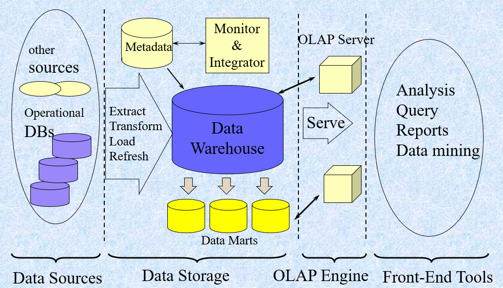
- **数据仓库的设计：**
	- **1、**分析建立企业模型并映射到数据仓库概念模型；
	- 2、逻辑模型的设计
	- 3、物理模型的设计
- **OLAP建模：**
	- **维表设计**（维的变化，维表的共享，层次信息和分类信息的位置）
	- **事实表设计**（事实表的特性，通用数据和专用数据事实表）
- **元数据：**描述数据的数据，定义数据仓库对象的数据。包括数据仓库的结构、操作元数据（数据血统、流通，监控信息）、用于汇总的算法、从操作环境到数据仓库的映射；关于系统性能的数据、商务元数据。
- **部分物化：**选择性预计算各种方体子集或子立方体。
- **冰山立方体：**是一个数据立方体，只存放聚集值大于某个最小支持度阈值的立方体单元。数据立方体计算中多路数组聚集，多路计算
- **BUC：**bottom-up computation
	- 自底向上构造，一种计算稀疏冰山立方体的算法。
	- 数据立方体允许以多维数据建模和观察，它由维和事实定义。
	- 维是关于一个组织想要记录的透视或实体，事实是数值度量的。
- **物理模型的设计：**
	- **1.**确定数据的存储结构（并行RAID）
	- **2.**索引策略（位图索引、连接索引）
	- 3.数据存储策略与性能优化（多路聚集优化、表的归并、分割表的存放、按列存储、存储分配优化）
	- **4.**数据装载接口
	- **5.**并行优化设计
- **位图索引：**在给定属性的位图索引中，属性的每一个值v都有一个位向量，长度为记录的总数，如果数据表中给定行上该属性的值为v, 则在位图索引的对应行上标注该值的位为1，其余为0.，不适用于基数很大的属性。
- **连接索引：**传统的索引将给定列上的值映射到具有该值的行的列表上，连接索引登记来自关系数据库的两个关系的可连接行，对于维护来自可连接的关系的外码和与之匹配的主码的联系特别有用（事实表——维表）。N维，且每个维有Li概念封层，可得到的立方体有
	- 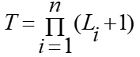
- **多路数组聚集：**是数据立方体的高效计算方式。使用多维数组作为基本数据结构，自底向上的、共享地计算完全数据立方体。使用数组直接寻址的典型MOLAP。
- 方法：最大维在形成单块的平面上。最小为在形成单面的平面上，每个平面必须被排序，并按大小递增的顺序被计算。
- # 数据预处理
- **数据预处理：**不完整的、含噪音的、不一致的
	- 1、**数据清洗**（缺失值（缺少属性值或某些感兴趣的属性，或仅包含聚集数据）、噪声（错误或存在偏离期望的离群值）、非一致）、
	- **2、数据集成**（模式集成（识别实体）、发现冗余（相关分析检测）、数据值冲突检测和处理（不同数据源属性值不同））、
	- **3、数据变换**（平滑（去掉噪声）、聚集（数据汇总）、泛化（概念分层，高层替换低层）、规范化（按比例缩放）、属性构造）
	- **4、数据规约**（数据立方体聚集、维度规约(属性子集选择)、数值规约、离散化和概念分层产生）、
	- **5、数据离散化**（**数值数据：**分箱、直方图、聚类、基于熵的离散化、基于直观划分离散化3-4-5规则（区间的最高有效位的取值个数）；
- **分类数据：**用户或专家在模式级显示说明属性偏序、通过显示数据分组说明分层结构的一部分、说明属性集但不说明偏序（层次高，属性值个数越少）、只说明部分属性集（嵌入数据语义，是语义相关的属性集捆绑在一起））。
- **噪声：**被测量的变量的随机误差或方差。
- **噪音数据处理：**分箱（按箱平均值平滑、按箱中值平滑、按箱边界平滑）、回归、聚类。
- **规范化：**最小-最大规范化；Z-score规范化；小数定标规范化
  
  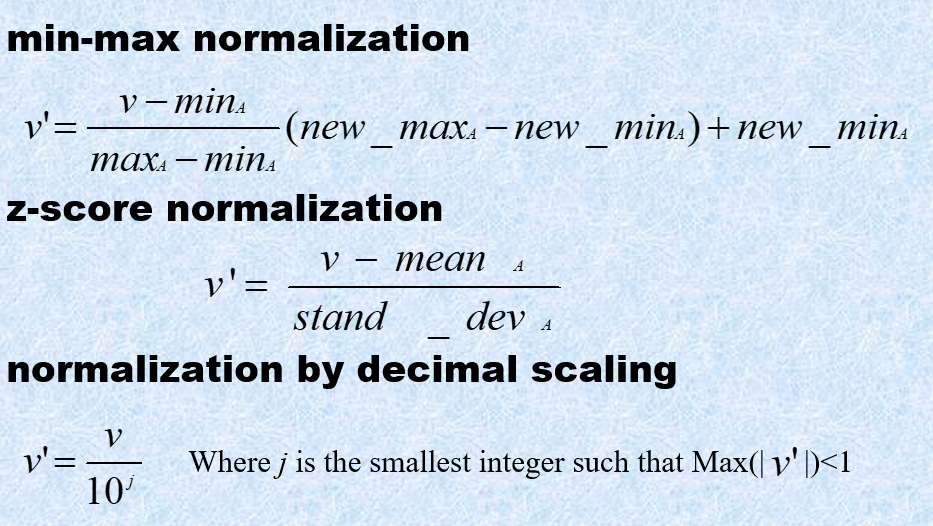
- **数据规约技术：**得到数据集的规约显示，小得多，但保持原数据的完整性。挖掘更有效。
- **属性子集选择：检测并**删除不相关、弱相关或冗余的属性和维
- **维规约**：使用编码机制减小数据集的规模,如**压缩**。
- **数值规约：**用替代的、较小的数据表示替换或估计数据，如参数模型or非参方法（聚类、抽样、直方图（**Equi-depth、equi-width、v-optimal（最小方差）、maxdiff（考虑每对相邻的之间的差，桶的边界具有<桶数-1 >的最大对）**）。
- **概念分层：**对一个属性递归地进行离散化，产生属性值的分层或多分辨率划分。属性的原始数据用更高层或离散化的值替换。
- **离散化：**用少数区间标记替换连续属性的数值，从而减少和简化原来的数据。
- # 特征化和区分
- **描述性数据挖掘：**以简洁概要的方式描述概念或数据集，并提供数据的有趣的一般性质。
- **预测性数据挖掘：**分析数据，建立一个或一组连续值函数模型，预测不知道的数值数据值。
- **概念描述**包括特征化和区分。
	- **特征化：**提供给定数据汇集的简洁汇总。
	- **区分：**提供两个或多个数据集的比较描述。
- **OLAP VS 概念描述：**处理类型、自动化方面比较各自优缺点。
	- Concept description:
		- can handle complex data types of the attributes and their aggregations
		- a more automated process
	- OLAP:
		- restricted to a small number of dimension and measure types
		- user-controlled process
- **数据泛化：**将数据库中的大量任务相关数据从低概念层提升到更高概念层的过程。
- **数据泛化途径：**1、数据立方体（OLAP途径）2、面向属性的归纳
- **面向属性的归纳：**
	- 1、使用数据库查询收集任务相关的数据；
	- 2、考察相关任务集中的各个属性并进行泛化：通过属性删除（两种情况）或者属性泛化
	- 3、通过合并相等的广义元组（每个广义元组代表一个规则析取）并累计对应的计数值进行聚集
- **面向属性归纳方法产生的泛化描述表现形式：**广义关系（表）、交叉表、图、量化特征规则。
- **属性泛化控制：属性泛化阈值控制**（对所有的属性设置一个泛化阈值，或者对每个属性设置一个阈值。如果属性的不同值个数大于属性泛化阈值，则应当进行进一步的属性删除或属性泛化）**广义关系阈值控制：**为广义关系设置一个阈值。如果广义关系中不同元组的个数超过该阈值，则当进一步泛化；否则，不再进一步泛化。
- **特征化 VS OLAP****: **
	- 相同点：在不同抽象层次数据汇总展示；迭代的上卷、下钻、旋转、切片/块。
	- 不同点：特征化：自动产生层次的分配；多个相关维时进行维的相关分析和排序；维和度量的类型可以很复杂
- **量化规则：**带有量化信息的逻辑规则
- **解析特征化：**
	- 1、收集任务相关数据
	- 2、根据属性**分析**阈值分析泛化（对目标类和对比类的候选关系）：属性删除、属性泛化、候选关系
	- 3、属性的相关性分析（信息增益）
	- 4、（去除不/弱相关，对比类的候选关系）形成目标类的初始工作关系
	- 5、在初始工作关系上根据属性**泛化**阈值使用面向属性的归纳
- **类对比：**
	- 1、通过查询处理收集数据库中的相关数据集，并分别划分成目标类和一个或多个对比类。
	- 2、维相关分析（仅选择高度相关的维进一步分析，属性移除和泛化）
	- 3、同步泛化（目标类泛化到维阈值控制的层，对比类概念泛化到相同层）
	- 4、通过对目标类和对比类使用下钻、上卷和其他OLAP操作调整比较描述的抽象层次。
	- 5、导出比较的表示
- **量化特征规则（必要）：T权：P-135，代表典型性**
	- 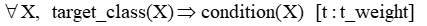
- **量化判别规则（充分）：D权：p-138，代表和对比类比有多大差别（**高D权：概念主要从目标类导出**）**
	- 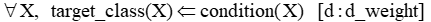
- **量化描述规则(充分必要)：**
	- 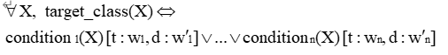
- # 关联规则挖掘
- ## Apriori算法
- ### 概念
- 项集：项的集合
- 支持度：项集A、B同时发生的概率称之为关联规则的支持度。
- 置信度：项集A发生的情况下，则项集B发生的概率为关联规则的置信度。
- 举例说明：
	- 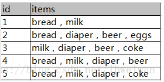
	- 如图数据为顾客购物情况，每一个id对应的items都是一个项集，现在需要对{milk，diaper}与{beer}关联性进行研究，计算支持度与置信度。
	- 计算如下：
		- 计算支持度：计算{milk，diaper}{beer}同时发生的概率就相当于计算{milk，diaper，beer}出现的次数所占数据条的比重，即2/5.
		- 计算置信度：计算{milk，diaper}发生的情况下，则{beer}发生的概率就相当于计算{milk，diaper，beer}出现的次数所占{milk，diaper}发生次数的比重，即2/3.
- 最小支持度：最小支持度就是人为按照实际意义规定的阈值，表示项集在统计意义上的最低重要性。
- 最小置信度：最小置信度也是人为按照实际意义规定的阈值，表示关联规则最低可靠性。
- 如果支持度与置信度同时达到最小支持度与最小置信度，则此关联规则为强规则。
- 频繁项集：满足最小支持度的所有项集，称作频繁项集。
	- （频繁项集性质：1、频繁项集的所有非空子集也为频繁项集；2、若A项集不是频繁项集，则其他项集或事务与A项集的并集也不是频繁项集）
- ### Apriori算法
- 该算法利用了频繁项集所具有的任意频繁项集的子集都是频繁项集的这一性质对数据库进行多次扫描:第一次扫描得到频繁项集的集合L0 ，第k趟扫描前先利用上次扫描的结果项目集Lk-1,产生候选k项集的集合Ck，然后再通过扫描数据库确定C中每一候选k项集的支持数，最后在该次扫描结束时求出频繁k项集的集合Lk，算法的终止条件是Ck或Lk为空。
- **提高Apriori 算法的效率：**
	- 1、基于散列的技术：一种基于散列的技术可以用于**压缩候选k 项集Ck**（eg:在C1中产生L1的过程中，可对每个事务产生所有的2项集，并将它们散列到散列表结构的不同桶中，并增加对应的桶计数，计数低于最小支持桶中的2项集应从2候选项集中删除）
	- 2、事务压缩：不包含任何K频繁项集的事务不可能产生>K的FI应在后继的扫描中删除
	- 3、划分：任何频繁项集必须作为局部频繁项集至少出现在一个划分中。
	- 4、抽样：在样本上降低阈值，牺牲精度换取有效性
	- 5、动态项集计数：只有子项集都频繁才将其加入候选项集
- ### 简单示例
  
  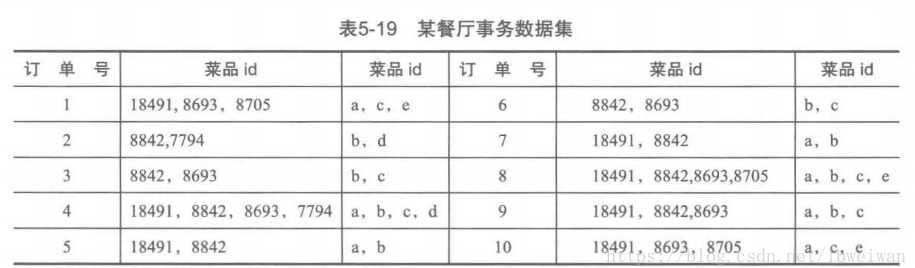
- 算法过程如下：
	- 首先计算出所有的频繁项集，这里最小支持度为0.2
	- 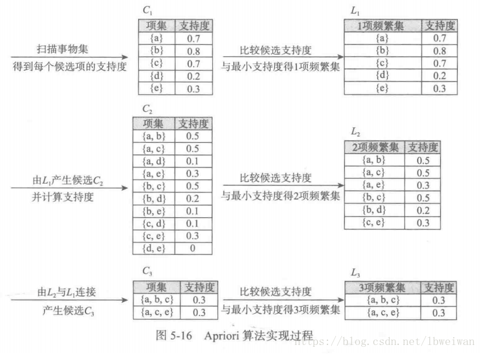
	- 得出L1、L2、L3的各个项集均为频繁项集，再进行计算每个频繁项集的置信度，其中L1不必计算。计算结果如下
	- 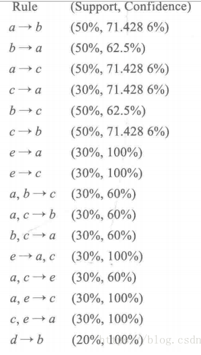
- ## FP Tree算法
- ### FP Tree 数据结构
- 为了减少I/O次数，FP Tree算法引入了一些数据结构来临时存储数据。这个数据结构包括三部分，如下图所示：
- 第一部分是一个项头表。里面记录了所有的1项频繁集出现的次数，按照次数降序排列。比如上图中B在所有10组数据中出现了8次，因此排在第一位，这部分好理解。第二部分是FP Tree，它将我们的原始数据集映射到了内存中的一颗FP树，这个FP树比较难理解，它是怎么建立的呢？这个我们后面再讲。第三部分是节点链表。所有项头表里的1项频繁集都是一个节点链表的头，它依次指向FP树中该1项频繁集出现的位置。这样做主要是方便项头表和FP Tree之间的联系查找和更新，也好理解。
- 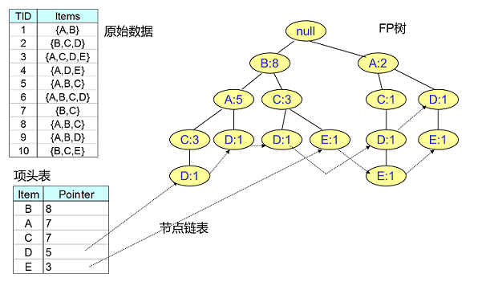
- ### FP Tree 项头表的建立
- FP树的建立需要首先依赖项头表的建立。首先我们看看怎么建立项头表。
- 我们第一次扫描数据，得到所有频繁一项集的的计数。然后删除支持度低于阈值的项，将1项频繁集放入项头表，并按照支持度降序排列。接着第二次也是最后一次扫描数据，将读到的原始数据剔除非频繁1项集，并按照支持度降序排列。
- 上面这段话很抽象，我们用下面这个例子来具体讲解。我们有10条数据，首先第一次扫描数据并对1项集计数，我们发现O，I，L，J，P，M, N都只出现一次，支持度低于20%的阈值，因此他们不会出现在下面的项头表中。剩下的A,C,E,G,B,D,F按照支持度的大小降序排列，组成了我们的项头表。
- 接着我们第二次扫描数据，对于每条数据剔除非频繁1项集，并按照支持度降序排列。比如数据项ABCEFO，里面O是非频繁1项集，因此被剔除，只剩下了ABCEF。按照支持度的顺序排序，它变成了ACEBF。其他的数据项以此类推。为什么要将原始数据集里的频繁1项数据项进行排序呢？这是为了我们后面的FP树的建立时，可以尽可能的共用祖先节点。
- 通过两次扫描，项头表已经建立，排序后的数据集也已经得到了
  
  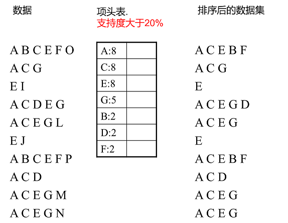
- ### FP Tree的建立
- 有了项头表和排序后的数据集，我们就可以开始FP树的建立了。开始时FP树没有数据，建立FP树时我们一条条的读入排序后的数据集，插入FP树，插入时按照排序后的顺序，插入FP树中，排序靠前的节点是祖先节点，而靠后的是子孙节点。如果有共用的祖先，则对应的公用祖先节点计数加1。插入后，如果有新节点出现，则项头表对应的节点会通过节点链表链接上新节点。直到所有的数据都插入到FP树后，FP树的建立完成。
- 似乎也很抽象，我们还是用第二节的例子来描述。
- 首先，我们插入第一条数据ACEBF，如下图所示。此时FP树没有节点，因此ACEBF是一个独立的路径，所有节点计数为1, 项头表通过节点链表链接上对应的新增节点。
- 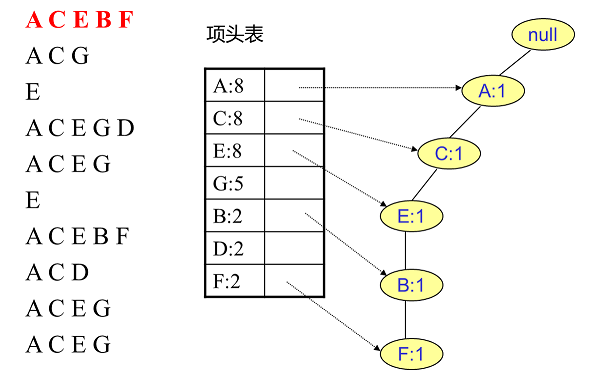
- 接着我们插入数据ACG，如下图所示。由于ACG和现有的FP树可以有共有的祖先节点序列AC，因此只需要增加一个新节点G，将新节点G的计数记为1。同时A和C的计数加1成为2。当然，对应的G节点的节点链表要更新
- 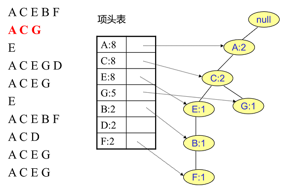
- 同样的办法可以更新后面8条数据，如下8张图。由于原理类似，这里就不多文字讲解了，大家可以自己去尝试插入并进行理解对比。相信如果大家自己可以独立的插入这10条数据，那么FP树建立的过程就没有什么难度了。
- 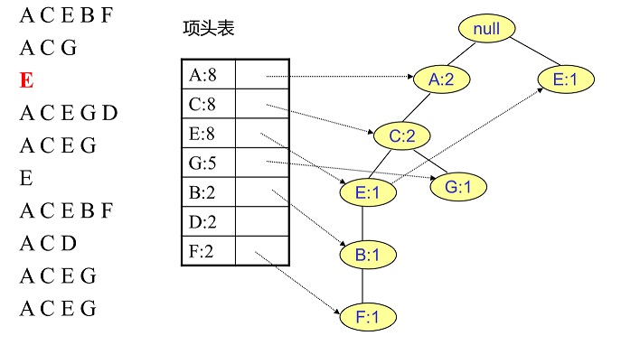
- 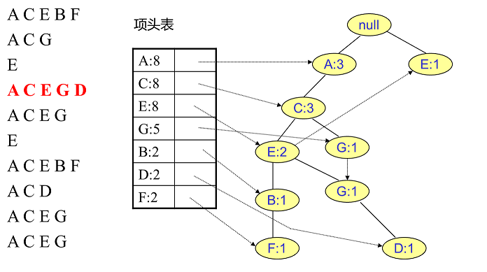
- 这样一直到最后整个树的建立
- 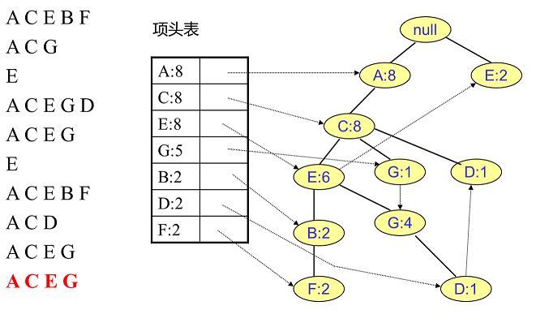
- ### FP Tree的挖掘
- 得到了FP树和项头表以及节点链表，我们首先要从项头表的底部项依次向上挖掘。对于项头表对应于FP树的每一项，我们要找到它的条件模式基。所谓条件模式基是以我们要挖掘的节点作为叶子节点所对应的FP子树。得到这个FP子树，我们将子树中每个节点的的计数设置为叶子节点的计数，并删除计数低于支持度的节点。从这个条件模式基，我们就可以递归挖掘得到频繁项集了。
- 实在太抽象了，之前我看到这也是一团雾水。还是以上面的例子来讲解。我们看看先从最底下的F节点开始，我们先来寻找F节点的条件模式基，由于F在FP树中只有一个节点，因此候选就只有下图左所示的一条路径，对应{A:8,C:8,E:6,B:2, F:2}。我们接着将所有的祖先节点计数设置为叶子节点的计数，即FP子树变成{A:2,C:2,E:2,B:2, F:2}。一般我们的条件模式基可以不写叶子节点，因此最终的F的条件模式基如下图右所示。
- 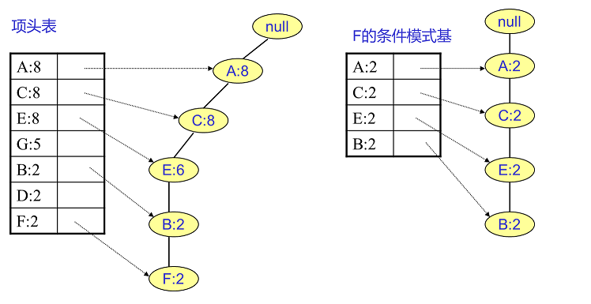
- 通过它，我们很容易得到F的频繁2项集为{A:2,F:2}, {C:2,F:2}, {E:2,F:2}, {B:2,F:2}。递归合并二项集，得到频繁三项集为{A:2,C:2,F:2}，{A:2,E:2,F:2},...还有一些频繁三项集，就不写了。当然一直递归下去，最大的频繁项集为频繁5项集，为{A:2,C:2,E:2,B:2,F:2}
- F挖掘完了，我们开始挖掘D节点。D节点比F节点复杂一些，因为它有两个叶子节点，因此首先得到的FP子树如下图左。我们接着将所有的祖先节点计数设置为叶子节点的计数，即变成{A:2, C:2,E:1 G:1,D:1, D:1}此时E节点和G节点由于在条件模式基里面的支持度低于阈值，被我们删除，最终在去除低支持度节点并不包括叶子节点后D的条件模式基为{A:2, C:2}。通过它，我们很容易得到D的频繁2项集为{A:2,D:2}, {C:2,D:2}。递归合并二项集，得到频繁三项集为{A:2,C:2,D:2}。D对应的最大的频繁项集为频繁3项集。
- 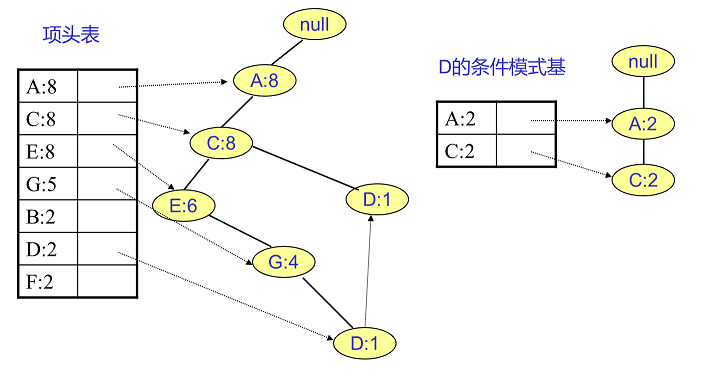
- ### FP Tree算法归纳
- 这里我们对FP Tree算法流程做一个归纳。FP Tree算法包括三步：
	- 1）扫描数据，得到所有频繁一项集的的计数。然后删除支持度低于阈值的项，将1项频繁集放入项头表，并按照支持度降序排列。
	- 2）扫描数据，将读到的原始数据剔除非频繁1项集，并按照支持度降序排列。
	- 3）读入排序后的数据集，插入FP树，插入时按照排序后的顺序，插入FP树中，排序靠前的节点是祖先节点，而靠后的是子孙节点。如果有共用的祖先，则对应的公用祖先节点计数加1。插入后，如果有新节点出现，则项头表对应的节点会通过节点链表链接上新节点。直到所有的数据都插入到FP树后，FP树的建立完成。
	- 4）从项头表的底部项依次向上找到项头表项对应的条件模式基。从条件模式基递归挖掘得到项头表项项的频繁项集。
	- 5）如果不限制频繁项集的项数，则返回步骤4所有的频繁项集，否则只返回满足项数要求的频繁项集。
- # 聚类挖掘
- ## 层次聚类挖掘
- 层次聚类，是一种很直观的算法。
- 顾名思义就是要一层一层地进行聚类，可以**从下而上**地把小的cluster合并聚集，也可以从上而下地将大的cluster进行分割。似乎一般用得比较多的是从下而上地聚集，因此这里我就只介绍这一种。
- 所谓从下而上地合并cluster，具体而言，就是每次找到距离最短的两个cluster，然后进行合并成一个大的cluster，直到全部合并为一个cluster。整个过程就是建立一个树结构，类似于下图。
  
  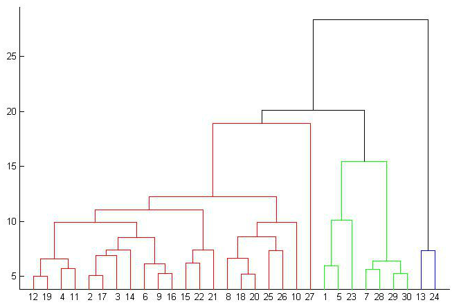
- 一开始每个数据点独自作为一个类，它们的距离就是这两个点之间的距离。而对于包含不止一个数据点的 cluster，就可以选择多种方法了。最常用的，就是average-linkage，即计算两个cluster各自数据点的两两距离的平均值。类似的 还有single-linkage/complete-linkage，选择两个cluster中距离最短/最长的一对数据点的距离作为类的距离。
- 层次聚类较大的**优点**，就是它一次性地得到了整个聚类的过程，只要得到了上面那样的聚类树，想要分多少个cluster都可以直接根据树结构来得到结果，改变 cluster数目不需要再次计算数据点的归属。层次聚类的缺点是计算量比较大，因为要每次都要计算多个cluster内所有数据点的两两距离。另外，由 于层次聚类使用的是贪心算法，得到的显然只是局域最优，不一定就是全局最优，这可以通过加入随机效应解决，这就是另外的问题了。
- ### K-Means聚类算法
- K-means是更为常用的聚类方法之一，尽管它有着很多不足，但是它有着一个很关键的优点：快！K-means的计算复杂度只有O(tkn)，t是迭代次数，k是设定的聚类数目，而n是数据量，相比起很多其它算法，K-means算是比较高效的。
- K-means的目标是要将数据点划分为k个cluster，找到这每个cluster的中心，并且最小化函数
- 其中就是第i个cluster的中心。上式就是要求每个数据点要与它们所属cluster的中心尽量接近。
- 为了得到每个cluster的中心，K-means迭代地进行两步操作。首先随机地给出k个中心的位置，然后把每个数据点归类到离它最近的中心，这样我们就构造了k个cluster。但是，这k个中心的位置显然是不正确的，所以要把中心转移到得到的cluster内部的数据点的平均位置。实际上也就是计算，在每个数据点的归类确定的情况下，上面函数取极值的位置，然后再次构造新的k个cluster。这个过程中，中心点的位置不断地改变，构造出来的cluster的也在变化（动画请看这里）。通过多次的迭代，这k个中心最终会收敛并不再移动。
- ### 基于密度的聚类方法
- **基于密度的方法：**只要邻域中的密度（数据点的数目）大于每个阈值，就继续聚类。
	- **优点：**
		- **1、发现任意形状的簇；**
		- **2、处理噪声；**
		- **3、一次扫描；**
		- **4、需要密度参数作为终止条件；**
	- **DBSCAN：（**具有噪声的基于密度的聚类应用**）**密度可达和密度相连
		- 1.DBSCAN以一个从未访问过的任意起始数据点开始。这个点的邻域是用距离ε（所有在ε距离的点都是邻点）来提取的。
		- 2.如果在这个邻域中有足够数量的点（根据 minPoints），那么聚类过程就开始了，并且当前的数据点成为新聚类中的第一个点。否则，该点将被标记为噪声（稍后这个噪声点可能会成为聚类的一部分）。在这两种情况下，这一点都被标记为“访问（visited）”。
		- 3.对于新聚类中的第一个点，其ε距离附近的点也会成为同一聚类的一部分。这一过程使在ε邻近的所有点都属于同一个聚类，然后重复所有刚刚添加到聚类组的新点。
		- 4.步骤2和步骤3的过程将重复，直到聚类中的所有点都被确定，就是说在聚类附近的所有点都已被访问和标记。
		- 5.一旦我们完成了当前的聚类，就会检索并处理一个新的未访问点，这将导致进一步的聚类或噪声的发现。这个过程不断地重复，直到所有的点被标记为访问。因为在所有的点都被访问过之后，每一个点都被标记为属于一个聚类或者是噪音。
		  
		  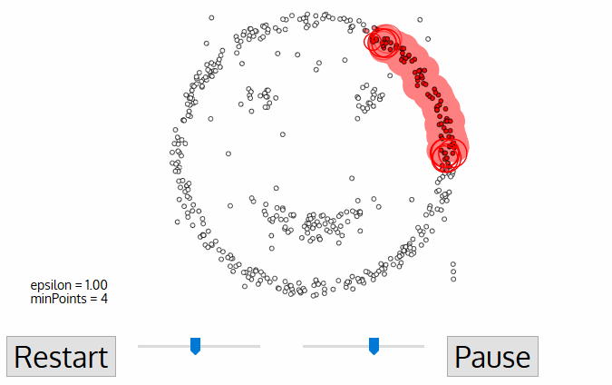
- # 分类和预测
- **分类：**找出描述并区分数据类或概念的模型，以便能够使用模型预测未知对象类的类标记，模型的构建依赖于训练集和分类属性的类标号的使用。
- ## ID3 决策树
- 一种类似于流程图的树结构，其中每个结点代表在一个属性值上的测试，每个分支代表测试的一个输出，而树叶代表类或类分布。
- ### 预备知识
- 信息熵
  
  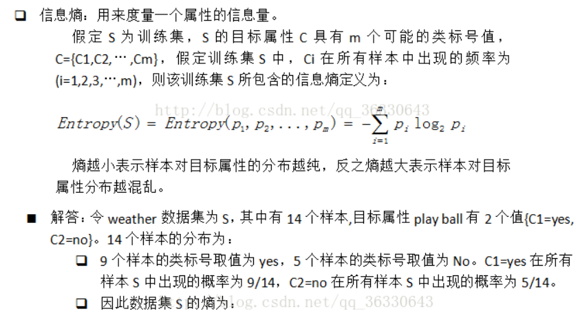
- 信息增益
  
  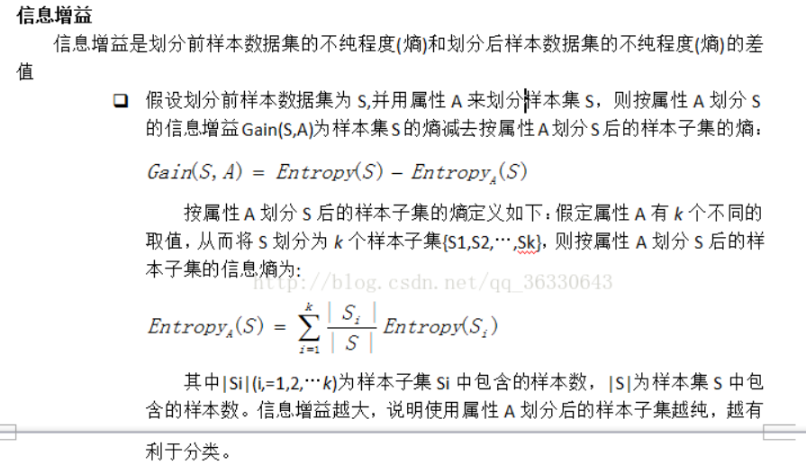
  
  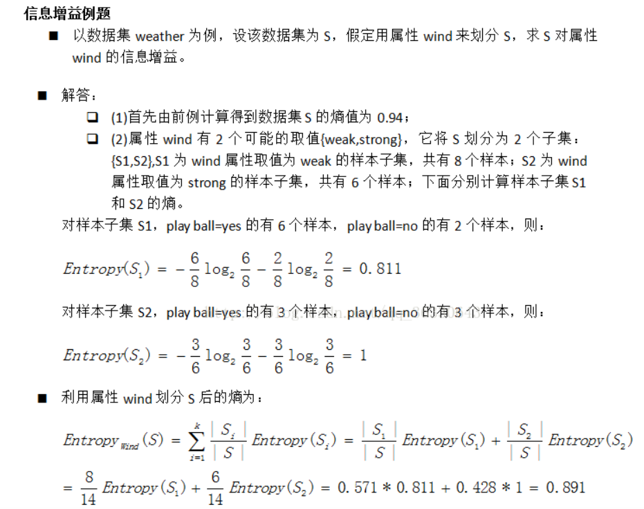
- ### 决策树算法
- 流程：
	- 1、Tree is constructed in a top-down recursive divide-and-conquer manner
	- 2、At start, all the training examples are at the root
	- 3、Attributes are categorical (if continuous-valued, they are discretized in advance)
	- 4、Examples are partitioned recursively based on selected attributes
	- 5、Test attributes are selected on the basis of a heuristic or statistical measure (e.g., information gain)
- 结束条件
	- 1、  所有的样本都属于同一个类
	- 2、  没有剩余的样本可用
	- 3、  没有剩余的属性用来划分（投票）
- ## 贝叶斯算法
- 根据**贝叶斯定理**：P(A|B) = P(B|A) P(A) / P(B)
- 这就是贝叶斯分类器的基本方法：在统计资料的基础上，依据某些特征，计算各个类别的概率，从而实现分类。
- 朴素贝叶斯分类器的公式
- 假设某个体有n项特征（Feature），分别为F1、F2、…、Fn。现有m个类别（Category），分别为C1、C2、…、Cm。贝叶斯分类器就是计算出概率最大的那个分类，也就是求下面这个算式的最大值：
	- P(C|F1F2...Fn) = P(F1F2...Fn|C)P(C) / P(F1F2...Fn)
- 由于 P(F1F2…Fn) 对于所有的类别都是相同的，可以省略，问题就变成了求
	- P(F1F2...Fn|C)P(C)的最大值。
- 朴素贝叶斯分类器则是更进一步，假设所有特征都彼此独立，因此
	- P(F1F2...Fn|C)P(C) = P(F1|C)P(F2|C) ... P(Fn|C)P(C)
- 上式等号右边的每一项，都可以从统计资料中得到，由此就可以计算出每个类别对应的概率，从而找出最大概率的那个类。
- 虽然”所有特征彼此独立”这个假设，在现实中不太可能成立，但是它可以大大简化计算，而且有研究表明对分类结果的准确性影响不大。
  
  
  
  
-