## 1. 编译原理概述
- 什么叫翻译程序
	- 把某一种语言程序(称为源语言程序)等价地转换成另一种语言程序(称为目标语言程序)的程序
- 编译程序
	- 把某一种高级语言程序(源语言程序)等价地转换成另一种低级语言程序（目标语言程序）(如汇编语言或机器语言程序)的程序。（如C语言、PASCAL语言等是编译程序）
- ### 1.1 基本术语
- 源程序(Source Program)：用源语言写的程序。源语言可以是汇编语言，也可以是高级程序设计语言。
- 目标程序(Target Program)：也称为“结果程序”，是源程序经翻译程序加工以后所生成的程序。目标程序可以用机器语言表示，也可以用汇编语言或其它中间语言表示。
- 翻译程序(Translating Program)：是指把一个源程序翻译成逻辑上等价的目标程序的程序。源程序为其输入，目标程序为其输出。
- 汇编程序(Assembler)：是指把一个汇编语言写的源程序转换成等价的机器语言表示的目标程序的翻译程序。
- 编译程序(Compiler)：若源程序是用高级程序设计语言所写，经翻译程序加工生成目标程序，则该翻译程序就称为“编译程序”，也可称为编译器。
- 解释程序：是高级语言翻译程序的一种，他将源语言书写的源程序作为输入，解释一句后就提交计算机执行一句，并不形成目标程序，就像外语翻译中的“口译”一样，不产生全文的翻译文本。
- 运行系统(Running System)：目标程序执行时，需要有一些子程序（如一些连接装配程序及一些连接库等）配合进行工作，由这些子程序组成的一个子程序库称为运行系统。
- 编译系统(Compiling System)：编译程序和运行系统合称编译系统。
- ### 1.2 编译程序的五个阶段
- 1.词法分析：对源程序的字符串进行扫描和分解，识别出每个单词符号。
- 2.语法分析：根据语言的语法规则，把单词符号分解成各类语法单位。
- 3.语义分析与中间代码生成：对各种语法范畴进行静态语义检查，若正确则进行中间代码翻译。
- 4.代码优化：遵循程序的等价变换规则。
- 5.目标代码生成：将中间代码变换成特定机器上的低级语言代码。
- ## 2. 文法和语言
- ### 2.1 符号串和语言
- #### 2.1.1 字母表
- 定义：字母表是有穷非空的符号集合
- 表示：通常用字母表大写字母A，B，...Z和希腊字母∑表示
	- eg: A={0,1}，Σ={a,b,c,d}
- 说明
	- 1）字母表包含了语言中所允许出现的一切符号。
	- 2）字母表中的符号也称字符。
- #### 2.1.2 符号串
- 定义：由字母表中的符号组成的有穷序列。
- 表示：通常由t，u，v，w，x，y，z等小写英文字母来表示。
- 说明
	- 1）符号串由构成的符号的种类、数量、顺序共同决定。
	- 2）不包含任何符号的符号串称为空符号串，简称空串，用ε表示。
- 对于给定的字母表Σ，符号串的递归定义如下：
	- 1）ε是Σ上的一个符号串。
	- 2）若x是Σ上的符号串，a是Σ的符号，则xa是Σ上的符号串。并规定εa=a，aε=a。
	- 3）y是Σ上的符号串，当且仅当y由1）和2）导出。
- 子符号串：一个非空符号串中若干连续符号组成的部分。
- 字符串的前缀和后缀
	- 若z=abd是字母表Σ={a,b,c,d}上的符号串，则ε，a，ab，abd都是z的前缀；ε，d，bd，abd都是z的后缀。
- 符号串之间的运算
	- 连接：符号串x，y的连接xy就是把符号串y写在x后面得到的字符串。
		- eg：若x=ab，y=cd，则xy=abcd，yx=cdab。
	- 2）方幂：若x是符号串，xn表示n个按顺序连接。当n=0时，x0是空符号串ε。
- #### 2.1.3 语言
- 定义：由字母表上的一些符号串组成的集合。
- 说明
	- 空集Ø是一个语言，仅含一个空符号串的集合{ε}也是一个语言。Ø和{ε}是不同的语言。
- 符号串集合之间的运算
	- 1）并集
		- 设A和B是符号串的集合，则A和B的并集定义为A∪B = {x | x∈A or x∈B}。
	- 2）乘积
		- 设A和B是符号串的集合，则A和B的乘积定义为
		- AB = {xy | x∈A and y∈B}。
		- eg：若A={a,b}，B={b,c}，则AB = {ab,ac,bb,bc}。
		- 对任意符号串集合A，有{ε}A = A{ε} = A。
	- 3）幂运算
		- 设A是符号串的集合，则A的幂运算定义为
		- A0 = {ε}
		- A1 = A
		- An = AAn-1（n>0）
		- eg：若A={0,1}，则A0={ε}，A1={0,1}，A2={00,01,10,11}。
	- 4）正闭包与闭包
		- 设A是符号串的集合，则集合A的正闭包A+和闭包A*定义为
		- A+ = A1∪A2∪…∪An∪…
		- A* = A0∪A1∪…∪An∪… = A0∪A+
		- eg：若A={0,1}，则A+={0,1,00,01,10,11,000,001,…}，A*={ε,0,1,0001,10,11,000,001,…}。
- #### 2.1.4 文法的定义
- 产生式规则
	- 1）定义：一个产生式规则是一个有序对(A，α)。通常写作A→α或A::=α。”→"或”::=”表示“定义为”、“由…组成”、“生成”。
	- 2）含义： A→α表示左部符号A生成右部符号串α。
	- 3）若A→α；A→β，则可以写成A→α|β。”|”表示“或”。
	- 4）**非终结符号**：产生式规则左部出现的符号。
	- 5）**终结符号**：不是非终结符号的符号。
	- 6）非终结符号既可以出现在产生式规则的左部，也可以出现在产生式规则的右部。终结符号不能出现在产生式规则的左部。
	- 7）非终结符号通常用大写字母或尖括号括起来的部分表示。
- 文法
	- 1）定义：产生式规则的非空有穷集合。由四元组G=(，，P，Z)组成。
	- 2）：是一个非空有穷集合。它的每个元素称为非终结符号。且∩=Ø。
	- 3）：是一个非空有穷集合。它的每个元素称为终结符号。
	- 4）P：是文法规则(产生式规则)的非空有穷集合，每个产生式规则的形式是A→α或A::=α，其中A∈，α∈(∪)*。
	- 5）Z：是一个非终结符号。称为开始符号或识别符号。它至少要在一条产生式规则的左部出现。有它开始识别定义的语言。
	- 6）通常不必将文法的四元组显式地表示出来，而仅需给出文法的产生式规则集。
	- 7）对于两个不同的文法G[Z]和G’[E]，若这两个文法生成的语言相同，则称这两个文法是等价的。
- #### 2.1.5 语言的形式化定义
- 直接推导和推导
	- 1）直接推导：令G=(，，P，Z)，若A→γ∈P，且α,β∈(∪)*，则称αAβ直接推导出αγβ，表示成αA ⇒ βαγβ。
	- 2）推导：若存在一个直接推导序列：⇒⇒⇒…⇒，则称这个序列是一个从至的长度为n的推导。
		- 当n>0时，至的推导记为 ⇒+，表示从出发，经过1步或者若干步可推导出。
		- 当n≥0时，至的推导记为 ⇒*，表示从出发，经过0步或者若干步可推导出。
- 句型和句子
	- 设有文法G[Z]，Z是文法G的开始符号。
		- 1）句型：若Z ⇒* x，x∈(**∪**)*，则称符号串x为文法G[Z]的句型。
		- 2）句子：若Z ⇒* x，x∈*，则称符号串x为文法G[Z]的句子。
		- 3）句子一定是句型，句型不一定是句子。
- 语言
	- 1）定义：文法G[Z]产生的所有句子的集合称为文法G所定义的语言，记为L(G[Z])，简写为L(G)。L(G)={x| Z ⇒+ x且x∈*}。
	- 2）语言L(G)是*的子集。
	- 3）L(G)中的每一个符号串均由终结符号组成，且该符号串能由开始符号Z推导出来。
- 递归规则(直接递归)
	- 1）定义：一个产生式规则中，出现在左部的非终结符也出现在其右部。
	- 2）种类：左递归、右递归、递归。
	- 3）左递归：A→A…
	- 4）右递归：A→…A
	- 5）递归：A→…A…
- 文法递归
	- 1）定义：对于文法中的任一非终结符，若能建立一个推导过程，在推导所得的符号串中又出现该终结符本身，则称文法是递归的。
	- 2）种类：左递归、右递归、递归。
	- 3）左递归：A ⇒+ A…
	- 4）右递归：A ⇒+ …A
	- 5）递归：A ⇒+ …A…
- #### 2.1.6 短语、直接短语、句柄
- 设G[Z]是一个文法，假定αβδ是文法G的一个句型。
	- 1）短语：若存在Z ⇒+ αAδ且A ⇒+ β，则称β是句型αβδ相对于非终结符A的短语。
	- 2）直接短语：若存在Z ⇒+ αAδ且A⇒β，则称β是句型αβδ相对于产生式规则A→β的直接短语。
	- 3）句柄：一个句型的最左直接短语称为该句型的句柄。
	  
	  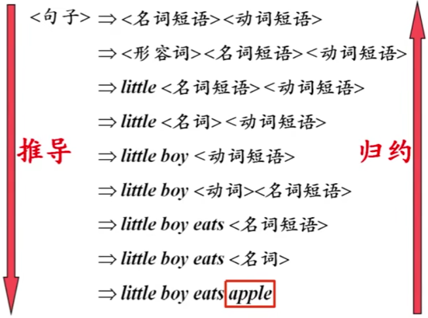
- #### 2.1.7 规范推导和规范归约
- 最左推导：对一个推导序列中的每一步直接推导α⇒β，都是对α中的最左非终结符进行替换。
- 最右推导(规范推导)：对一个推导序列中的每一步直接推导α⇒β，都是对α中的最右非终结符进行替换。
- 规范句型：由规范推导得到的句型。
- 最左归约(规范归约)：规范推导的逆过程。
  
- ### 2.2 语法分析树与文法的二义性
- #### 2.2.1 语法分析树
- 语法分析树：一个句型推导过程的树形表示称为语法分析树，简称语法树。
- 满足条件：设G=(，，P，Z)是一个上下文无关文法。
	- 1）根节点的标记为Z。
	- 2）根节点外的每个节点也有一个标记，它是∪∪{ε}中的符号。
	- 3）每一个内部节点的标记A必在中。
	- 4）若某个内部节点标记为A，其孩子节点的标记从左到右分别为，，…，，则A→必为P中的一条产生式规则。
	- 5）若节点有标记ε，则该节点为叶子，且是它父亲唯一的孩子。
- 构造步骤：已知文法G[Z]，对于w，若Z ⇒* w，则
	- 1）以开始符号Z为标记的根节点。
	- 2）对每一步推导，根据使用的产生式规则生成一颗子树，直到所有叶子节点从左到右的标记符号连接为w为止。
		- 若产生式规则为A→，则生成以A为根节点的子树，其孩子节点从左到右分别为，，…，。
		- eg：设文法G[E]：
		  E→E+T|E-T|T
		  T→T*F|T/F|F
		  F→(E)|i
		- 推导句型T+i*(F-i)的语法树。
		- 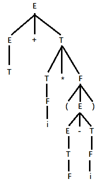
- #### 2.2.2 文法的二义性以及消除二义性
- 文法的二义性
	- 定义：若一个文法存在某个句子对应两棵不同的语法树，则称这个文法是二义的。
	- 特点：为编译程序的执行带来不确定性。
- 消除文法的二义性
	- 不改变文法：通过附加限制性条件消除二义性。寻找充分不必要条件，当文法满足这些条件时可确保文法是无二义性的。
	- 改变文法：改写原有文法，把排除二义性的规则合并到原文法消除二义性。
- #### 2.2.3 文法的化简
- 若一个非终结符不能推导出终结字符串，则该非终结符是无用的，删除所有包括该非终结符的产生式规则。
- 若一个符号不能出现在文法的任何句型中，则该符号是无用的，删除所有包括该符号的产生式规则。
- #### 2.2.4 语言的分类
- 0型文法(短语文法)
	- 1）定义：若文法G[Z]=(，，P，Z)中的每个产生式规则的形式为：α→β，其中α∈(∪)*且至少含有一个非终结符号，而β∈(**∪**)*，则G[Z]为0型文法。
	- 2）特点：0型文法的能力相当于图灵机，识别能力最强。
- 1型文法(上下文敏感文法)
	- 1）定义：若文法G[Z]=(，，P，Z)中的每个产生式规则的形式为：αAβ→αvβ，其中α,β∈(∪)*，A∈，v∈(∪)+，则G[Z]为1型文法。
- 2型文法(上下文无关文法)
	- 1）定义：若文法G[Z]=(，，P，Z)中的每个产生式规则的形式为：A→v，其中A∈，v∈(∪)*，则G[Z]为2型文法。
	- 2）特点：语法结构上下文无关，一般用于识别程序设计语言的语法结构。
- 3型语言(正规文法)
	- 1）种类：右线性文法、左线性文法
	- 2）右线性文法：若文法G[Z]=(，，P，Z)中的每个产生式规则的形式为：A→αB或A→α，其中A,B∈，α∈(∪)*，则G[Z]为右线性文法。
	- 3）左线性文法：若文法G[Z]=(，，P，Z)中的每个产生式规则的形式为：A→Bα或A→α，其中A,B∈，α∈(∪)*，则G[Z]为左线性文法。
	- 4）特点：作为定义程序设计语言规则的文法
	- 5）正规语言：3型文法定义的语言。
- ## 3. 词法分析与有限自动机
- ### 3.1 正则表达式
- 语言 L = { a } { a , b } ∗ ( {  } ∪ ( { . , _ } { a , b } { a , b } ∗ ) )
- 这个语言是指，由a开头，后接任意长度的a、b串，然后再接空串（代表结束）。或者是接以.或_开头的，后接长度大于等于1的a、b串。
- 正则表达式（Regular Expression, RE）是一种用来描述正则语言的更紧凑的表示方法。
- 以上面的语言举例，写成正则表达式则可表示成：r = a ( a ∣ b ) ∗ ( ϵ ∣ ( . ∣ ) ( a ∣ b ) ( a ∣ b ) ∗ )
- #### 3.1.1 正则表达式的定义
- 如果ε是一个RE，L ( ε ) = { ε }
- 如果α ∈ ∑ ，则α 是一个RE,L ( α ) = { α }
- 假设r和s都是RE，表示的语言分别是L(r)和L(s)，则
	- r|s是一个RE，L (r∣s) = L(r) ∪ L(s)
	- rs（r连接s）是一个RE，L (r∣s) = L(r)L(s)
	-  是一个RE，L (  ) = 
	- (r)是一个RE，L((r))=L(r)
	- 注：运算的优先级：*、连接、|
- RE的代数定理
  
  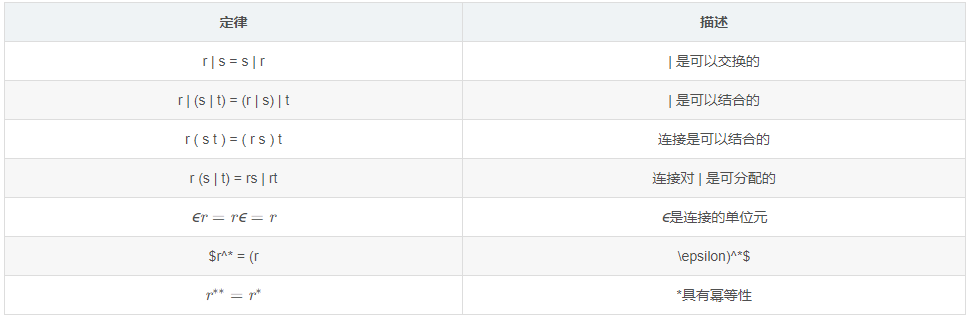
- #### 3.1.2 正则文法与正则表达式等价
- 对任何正则文法G，存在定义同一语言的正则表达式r
- 对任何正则表达式r，存在生成同一语言的正则文法G
- ### 3.2 有穷自动机
- #### 3.2.1 确定的有穷自动机
- 定义：一个确定的有限自动机(DFA) M是一个五元组：M=(S，Σ，δ，，F)，其中：
	- S是一个有限集，它的每一个元素称为一个状态。
	- Σ是一个有穷字母表，它的每个元素称为一个输入字符。
	- δ是一个从S×Σ到S的单值部分映射。δ(s，a)=s’表示在目前状态s下输入字符为a时，将转换到下一个状态s’。s’被称为s的一个后继状态。
	- ∈S，是唯一的初态。
	- F⊆S，F是一个终态集，可以为空。
- DFA的状态转移矩阵
	- DFA可用一个二维矩阵表示，矩阵的行表示状态，列表示输入字符，矩阵元素表示δ(s，a)的值。
- DFA的状态转换图
	- 若设DFA M含有m个状态和n个输入字符，则这个图含有m个状态结点，每个结点至多有n条箭弧射出与其它的状态结点相连接，每个箭弧用Σ中的一个不同输入字符作为标记。整张图含有唯一的初态结点和若干终态结点。
- DFA识别字符串
	- 1）对Σ上的任何符号串w∈Σ*，若存在一条从初态结点到某一终态结点的通路，且该通路上所有弧的标记符连接成的字符串等于w，则称w可被DFA M所识别。若M的初态结点同时又是终态结点，则空字符串ε被M所识别。
	- 2）DFA与语言的关系：DFA M所能识别的符号串的全体记为L(M)。
	- eg：设DFA M=({0,1,2,3}，{a,b}，δ，{3})，其中，δ定义为：
		- δ(0，a)=1，δ(0，b)=2，δ(1，a)=3，δ(1，b)=2，δ(2，a)=1，δ(2，b)=3，δ(3，a)=3，δ(3，b)=3。
		- 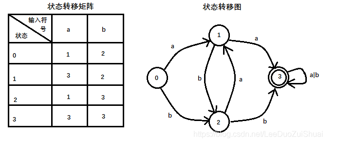
- δ的递归扩展定义
	- 对一个DFA M，其识别的语言L(M)={w|w∈，若存在Z∈F，使δ(，w)=Z}，其中：w=ua∈，则δ(s，ε)=s，δ(s，ua)= δ(δ(s，u)，a)。
- #### 3.2.2 不确定的有穷自动机
- 定义：一个不确定有限自动机(NFA) M是一个五元组：M=(S，Σ，δ，，F)，其中：
	- 1）S是一个有限集，它的每一个元素称为一个状态。
	- 2）Σ是一个有穷字母表，它的每个元素称为一个输入字符。
	- 3）δ是一个从S×Σ到S的子集的映射，即δ：S×Σ*→2S
	- 4）⊆S，是一个非空初态集。
	- 5）F ⊆S，F是一个终态集，可以为空。
- NFA的状态转换图
	- 若设NFA M含有n个状态和m个输入符号，则这个图含有n个状态结点，每个结点可射出若干箭弧与其它的状态结点相连接。对于w∈{ε}∪Σ，若δ(，a)={，，…，}(k≥0)，则从q0出发，分别到，，…，的k条弧，弧上均标记为a。整张图含有唯一的初态结点和若干终态结点。
- NFA识别字符串
	- 1）对Σ*上的任何符号串，若存在一条从某一初态结点到某一终态结点的通路，且该通路上所有弧的标记符号依次连接成的字符串等于w，则称w可被NFA M所识别。若M的某些结点同时又是终态结点，则空字符串ε被M所识别。
	- 2）NFA与语言的关系：Σ*中所有可被NFA M所识别的符号串的集合记为L(M)。
- DFA和NFA的关系
	- 1）DFA是NFA的特例，NFA是DFA概念的推广。
	- 2）NFA能识别的语言都能被一个DFA识别。
	- 3）DFA相对NFA的识别程序更容易实现。
- #### 3.2.3 不确定的有穷自动机的化简
- NFA的确定化：对任给的NFA M。都能相应地构造一个DFA M'，使得L(M')=L(M)。
- NFA的化简思路：DFA的每一个状态代表NFA状态集合的某个子集，构造的DFA使用它的状态去记录NFA读入输入符号之后可能到达的所有状态的集合。
- 闭包：若q为一初始状态，让a为ε，则δ(，a)={，，…，}为所有等价的状态结点构成的集合，这个集合被称为的ε闭包。记为ε-Closure()。
- 推广：集合I的ε-Closure(I)
	- 设I是NFA M的状态集的子集，定义I的ε闭包ε-Closure(I)：
	- 1）若q∈I，则q∈ε-Closure(I)。
	- 2）若q∈I，则从q出发经过任意条ε弧而能到达的任何状态q’，有q’∈ ε-Closure(I)。
- 不确定的有穷自动机的化简示例：将下图NFA M确定化。
	-  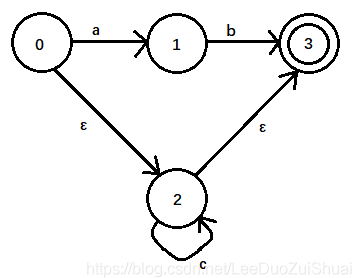
		- 生成DFA M'的初态ε-Closure({0})={0，2，3}。重新命名生成的各个状态：{0，2，3}为0，{1}为1，{2，3}为2，{3}为3。由于{0，2，3}、{2，3}和{3}中均包含M中的终态3，因此0、2、3为M’的终态。
		- 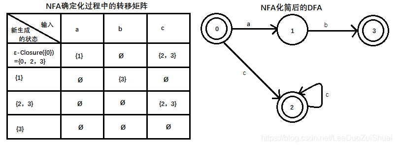
- #### 3.2.4 确定的有穷自动机的化简
- 化简的目的：去除多余或等价的状态，降低存储代价，提高句子识别的效率。
- 有限自动机的多余状态：从初态出发，任何可识别的输入串也不能到达的状态。
- 状态等价：设DFA M=(S，Σ，δ，，F)，对s,t∈S，若对任何α∈Σ*，均有δ(s，α)∈F当且仅当δ(t，α)∈F，则称状态s和t是等价的。若状态s和t是不等价的，则称状态s和t是可区别的。
- DFA M的化简
	- 1）定义：对一个DFA M，若能找到一个状态比M少的DFA M’，使得L(M)=L(M’)，且M’满足两个条件：i）M’中没有多余的状态。ii）M’的状态集中，没有两个状态是互相等价的。则称DFA M‘是一个最小化的DFA。也称DFA M的化简。
	- 2）最小化的方法：把DFA M的状态Q划分成一些不相交的子集，使每个子集中任何两个状态是等价的，而任何两个属于不同子集的状态是可区别的。然后在每个子集中任取一个状态作为代表，删除子集中的其余状态，并把射向其余状态的箭弧都改为射向代表的状态。
	- 3）最小化的具体步骤：
		- i）将DFA M的状态集S划分为两个子集；终态集F和非终态集F ̃，形成初始划分Π。
		- ii）对Π建立新的划分Πnew。对Π中的每个状态子集G进行如下变换：
			- a）把G划分成新的子集，使G的两个状态s和t属于同一个子集，当且仅当对任何输入符号a，状态s和t转换到的状态都属于Π的同一子集。
			- b）用G划分出的所有新子集替换G，形成新的划分Πnew。
		- iii）若Πnew和Π相等，则执行第iv）步，否则，令Π=Πnew，重复第ii）步。
		- iv）划分结束后，对划分中的每个状态子集，选出一个状态作为代表，删去其它一切等价的状态，并把射向其它状态的箭弧改为射向这个代表的状态。
- DFA的化简示例
	- 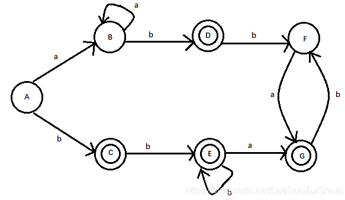
	- 根据终态和非终态划分为两个子集：Π1={A，B，F}，Π2={C，D，E，G}。
	- 对Π1，输入b，状态A、B经过b可到达终态，而F经过b不能到达终态。因此Π1划分为两个子集Π11={A，B}和Π12={F}。
	- 对Π11，输入bb，A经过bb可到达终态，而B不能，所以A和B是可区别的两个状态。
	- 故Π1划分为{A}、{B}、{F}三个子集。
	- 对Π2，输入b，划分成两个子集Π21={C，E}和Π¬22={D，G}。
	- 对Π21，输入a，划分成两个子集{C}和{E}。
	- 故Π2划分成{C}、{E}、{D，G}。
	- 最终状态集合划分成：{A}、{B}、{F}、{C}、{E}、{D，G}。
	- 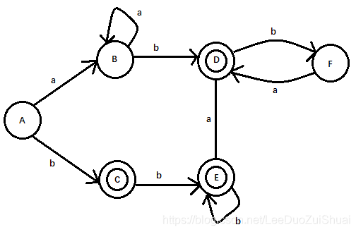
- ### 3.3 自顶向下的语法分析
- #### 3.3.1 语法分析器的功能
- 功能：以词法分析器生成的单词符号序列作为输入，在分析过程中验证这个单词符号序列是否是该程序设计语言的文法的一个句子。
- 语法分析方法的种类：自顶向下和自底向上。
- 自顶向下的语法分析
	- 1）定义：从顶部(树根)建立语法分析树，构造一个最左推导，面对当前输入的单词符号和当前被替换的非终结符，选择这个非终结符的某个产生式规则进行替换。
	- 2）分类：递归下降的预测分析法(递归下降预测法)、非递归的预测分析法(非递归预测法)(LL(1)分析法)。
	- 3）说明：若文法是二义的，则递归下降法和非递归预测法通常均可回溯。
- #### 3.3.2 不确定的自顶向下的分析方法
- 基本思想：对给定的单词符号串w，从文法的开始符号出发，试图构造一个最左推导，或自顶向下的为w建立一棵语法分析树。若成功的为w构造一个相应的推到序列或一棵语法分析树，则w为相应文法的合法句子，否则w不是文法句子。
- 本质：穷举试探，反复使用不同规则，寻求匹配输入串的过程。
- 具体过程：在每一步推导中，面对替换的非终结符A和从左到右读输入串读到的单词符号a，若A的产生式规则(除了A→ε)A→||…中，只有(1≤i≤n)能推导出的第一个终结符号是a，则可选择A→αi构造最左推导。若A的产生式规则(除了A→ε)中，推导的首个符号集合不含a，则选择A→ε进行推导。其中，a称为向前看符号。
- 特点：效率低，回溯代价高，实际过程通常不用。
- #### 3.3.3 LL(1)分析方法
- 回溯的判别条件与LL(1)文法
	- First集：设G[Z]=(，，P，Z)，α∈(∪)*，符号串α的首符号集合的定义为：
		- First(α)={a|α ⇒* a…且a∈}
		- 若α ⇒* ε，则规定ε∈First(α)。
	- Follow集：设G[Z]=(，，P，Z)，A∈VN，非终结符号A的后继符号集合的定义为：
		- Follow(A)={a|Z ⇒* …Aa…z且a∈}
		- 若Z ⇒* …A，则规定#∈First(A)。#为结束符。
	- 回溯的判断：对一个上下文无关文法G[Z]=(，，P，Z)，对某个产生式规则A→||…，若存在a∈，使得a∈First()∩First()(1≤i,j≤n且i≠j)或a∈First()∩Follow(A)(1≤i≤n，A ⇒* ε)或αi ⇒* ε且αj ⇒* ε(1≤i,j≤n且i≠j)，则对应于文法G的自顶向下分析需要回溯。
	- LL(1)文法定义
		- 1）文法不含左递归。
		- 2）对某个非终结符A，若其对应的产生式规则为A→||…，则First()∩First()=Ø(1≤i,j≤n且i≠j)。
		- 3）对文法中的每个非终结符A，若A ⇒* ε，则First()∩Follow(A)=Ø(1≤i≤n)。
- 左递归文法的改造
	- 左递归缺点：容易产生死循环
	- 消除直接左递归
		- 若某个文法中非终结符A的产生式规则是直接左递归规则：A→Aα|β，其中α,β∈(∪)*。若β不以A打头，则将A的产生式规则改写为：A→βA’，A’→αA’|ε。A’是新增加的非中介符号。
		- 推广：若A的全部产生式规则为：A→A|A|…|A|||…|，其中(1≤i≤n)不以A开头，且(1≤i≤m)不等于ε，则A的产生式规则改写为：A→A’|A’|…|A’， A’→A’|A’|…A’|ε。
		- eg：设有文法G[Z]：
			- E→E+T|E-T|T
			- T→T*F|T/F|F
			- F→(E)|i
			- 消除非终结符E,T的直接左递归后，文法G[Z’]改写为：
			- E→TE’
			- E’→+TE’|-TE’|ε
			- T→FT’
			- T’→*FT’|/FT’|ε
			- F→(E)|i
- 消除间接左递归
	- 1）对文法G的非终结符号按任一种顺序排列成A1，A2，…，An。
	- 2）依次对各非终结符号对应的产生式进行左递归的消除：
	  
	  ```
	  for(j=1;j<=n;j++)
	       for(k=1;k<=j-1;k++){
	            i.把每个形如Aj→Akα的规则改写为Aj→δ1α|δ2α|…|δmα。其中Ak→δ1|δ2|…|δm是关于当前Ak的产生式规则；
	            ii.消除关于产生式规则Aj的直接左递归；
	       }
	  ```
	- 3）进一步化简消除左递归之后的新文法，删去多余的产生式规则。
	- eg：设有文法G[S]：
		- S→Sa|Tbc|Td
		- T→Se|gh
		- 将非终结符号排成顺序为S，T
		- 消除产生式S左递归：
		- S→(Tbc|Td)
		- →a|ε
		- 对T→Se|gh，将S代入展开得：
		- T→T(bc|d)e|gh
		- 消除产生式T左递归：
		- T→gh
		- →(bc|d)e|ε
- 回溯的消除
	- 1）提取左因子。
		- 若有A→α|α|…|α|γ，其中γ不是以α开头的候选式，则A的产生式规则可替换为A→αA'|γ，A'→||…|。A'是一个新的非终结符号。
	- 2）消除左递归。
- #### 3.3.4 构造递归下降分析程序
- 定义：由一组递归函数或过程组成，每个函数或过程对应文法的一个非终结符的程序，称为递归下降分析器。
- 基本思路：
	- 1）当遇到终结符a时，编写语句：if(当前读来的输入符号==’a’) 读入下一个输入符号；
	- 2）当遇到非终结符A时，则编写语句调用A()。
	- 3）当遇到A→ε产生式规则时，则编写语句：if(当前读来的输入符号∉Follow(A)) error();
	- 4）当某个非终结符有多个候选产生式规则时，分两种情况处理：
		- i）if(当前读来的输入符号∈First()) 按照规则A→αi进行推导；
		- ii）if(当前读来的输入符号∈Follow(A)且 ⇒* ε) 按照规则A→进行推导；
- #### 3.3.5 非递归的预测分析法
- 预测分析程序的工作原理
	- 预测分析器的组成：一张预测分析表M(LL(1)分析表)、一个栈、一个预测分析控制程序、一个输入缓冲区、一个输出流。
	-  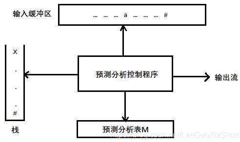
		- 1）输入缓冲区：存放待分析的输入符号串，其后以符号#作为结束符。
		- 2）栈：存放替换当前非终结符的某个产生式规则的右部符号串，栈底的符号为#。
		- 3）预测分析表：一张二维表，行为非终结符号，列为终结符号，其元素形式为M[S,a]，表中元素M[S,a]存放一条产生式规则或相应的出错处理程序的入口地址(分析出错时)。其中，M[S,a]表示当前栈顶S面对当前向前看符号a应采取的动作。
	- 预测分析器的工作原理：#和文法开始符号进栈，从输入缓冲区读进输入符号a，弹出栈顶元素给X：
		- 1）若X=a=’#’，则分析器工作结束，分析成功。
		- 2）若X=a≠‘#’，则分析器把X从栈顶弹出，让输入指针指向下一个输入符号。
		- 3）若X是一个非终结符号，则查阅预测分析表M。若在M[X,a]中存放着关于X的一个产生式规则，则先把X弹出，再把产生式规则右部符号串按逆序一一压入栈中。若M[X,a]={X→ε}，则预测分析器把在栈顶的X弹出。若M[X,a]=error，则调用出错处理程序。
- 构造预测分析表
	- 构造方法
	- 1）计算文法G的每个非终结符的First集和Follow集。
	- 对每一个文法符号X∈(∪)*，如下计算First(X)：
		- i）若X∈，则First(X)={X}。
		- ii）若X∈，且有产生式规则X→a…，a∈，则a∈First(X)。
		- iii）若X∈，且有产生式规则X→ε，则ε∈First(X)。
		- iv）若有产生式规则X→…，对于任意的j(1≤j≤n)，当…都是非终结符，且… ⇒* ε时，则将First(**)中的非ε元素加到First(X)中。特别地，若**…** ⇒* ε，则ε∈First(X)。
		- v）反复执行i）到iv），直到First集不再变化为止。
	- 对文法中的每一个A属于，如下计算Follow(A)：
		- i）若A是文法的开始符号，则将'#'加入到Follow(A)中。
		- ii）若A→αBβ是一条产生式规则，则把First(β)中的非ε元素加到Follow(B)中。
		- iii）若A→αB或A→αBβ是一条产生式规则，且β ⇒* ε，则把Follow(A)加到Follow(B)中。
		- iv）反复执行i）到iii），直到每个非终结符的Follow集不再发生变化为止。
	- 2）对文法中的每个产生式规则A→α，若a∈First(α)，则令M[A,a]=A→α。
	- 3）若ε∈First(α)，对任何b∈Follow(A)，则令M[A,b]=A→α。
	- 4）把预测分析表中无定义的空白元素标上出错标志error。
		- eg：设有文法G[E]：
			- E→TE1
			- E1→ATE1|ε
			- T→FT1
			- T1→MFT1|ε
			- F→(E)|i
			- A→+|-
			- M→*|/
		- 试构造该文法得预测分析表M。
		- 文法G的每个非终结符的First集和Follow集
		- 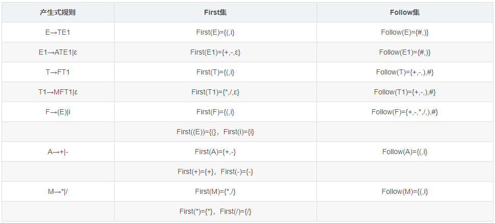
		- 预测分析表
		- 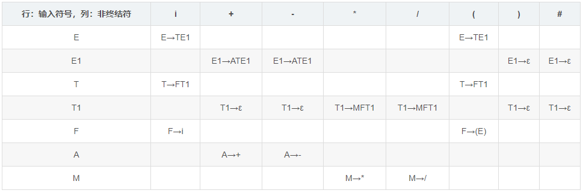
- 预测分析的出错处理
	- 出错情况
		- 1）栈顶上的终结符号与下一个输入符号不匹配。
		- 2）栈顶上是非终结符号A，下一个输入符号是a，但分析表M[A,a]为空。
	- 解决思路：跳过输入串中的一些符号，直到遇到“同步符号“为止。
	- 同步符号集的选择
		- 1）把Follow(A)中的所有符号放入非终结符A的同步符号集。若跳读一些符号直到出现Follow(A)中的符号，把A从栈中弹出，这样就可能使分析继续下去。
		- 2）对于非终结符A，只用Follow(A)作为它的同步符号集是不够的。
			- eg：若分号作为语句的结束符，则语句开头的关键字可能不在产生表达式的非终结符的Follow集中。一个赋值语句后少一个分号可能导致下一语句开头的关键字被跳过。
		- 3）若把First(A)中的符号加入到非终结符A的同步符号集，则当First(A)中的一个符号在输入中出现时，可以根据A恢复语法分析。
		- 4）若一个非终结符产生空串，则推导ε的产生式可以作为默认的情况，这样做可以推迟某些错误检查，但不能导致放弃一个错误。
		- 5）若不能匹配栈顶的终结符号，一个简单的想法是弹出栈顶的这个终结符号，并发出一条信息，说明已经插入了这个终结符，继续进行语法分析。
- ### 3.4 自底向上的语法分析
- #### 3.4.1 算符优先分析技术
- ##### 3.4.1.1 算符优先关系的定义
- 算符文法：若文法G中不存在规则：A→UV…，其中A，U，V均为非终结符，则称该文法是算符文法。通常，算符文法也不包含A→ε。
- 算符相邻：若有ab或aWb，其中a,b∈，W∈，则称运算符a与b相邻。
	- 1）注意：a与b相邻要求a在左边b在右边。a与b相邻不一定有b与a相邻。
- 算符优先级
	- 设文法G是一个算符文法，对文法G中任何一对终结符a和b，定义：
		- 1）a =· b：当且仅当文法G中存在规则A→…ab…或A→…aRb…，其中a,b∈，R∈。
		- 2）a ＜· b：当且仅当文法G中存在规则A→…aR…且R ⇒+ b…或R ⇒+ Qb…，其中a,b∈，Q,R∈。
		- 3）a ·＞ b：当且仅当文法G中存在规则A→…Rb…且R ⇒+ …a或R ⇒+ …aQ，其中a,b∈，Q,R∈。
		- 注意：a,b之间可能不存在优先关系，可能存在=·、＜·、·＞中的一种或多种关系。
- 算符优先文法：若一个算符文法G中任何一对终结符号a与b之间最多存在=·、＜·、·＞中的一种，则称文法G是一个算符优先文法。
	- 1）约定：# ＜· 任何终结符号。任何终结符号 ·＞ #。#和#之间不存在优先关系。
- 可归约子串的结构特征
	- 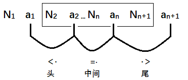
	- 1）头部(左边)：＜·
	- 2）中间：=·
	- 3）尾部(右边)：·＞
- 素短语(质短语)：算符文法的句型中具有可归约子串的结构特征且至少含有一个终结符的子串，称为该句型的一个素短语。
	- 1）注意：一个素短语中不可能再包含其它素短语。
- 最左素短语：算符优先文法的一个句型中最左边的素短语。
- ##### 3.4.1.2 算符优先关系表的生成
- FirstVT集与LastVT集的概念
- 对文法中的每一个非终结符P，定义：
	- 1）FirstVT§={a|P ⇒+ a…或P ⇒+ Qa…，a∈，Q∈}
	- 2）LastVT§= {a|P ⇒+ …a或P ⇒+ …aQ，a∈，Q∈}
- 算符优先级
  设文法G是一个算符文法，对文法G中任何一对终结符a和b，定义：
	- 1）a =· b：当且仅当文法G中存在规则A→…ab…或A→…aRb…，其中a,b∈，R∈。
	- 2）a ＜· b：当且仅当文法G中存在规则A→…aR…且b∈FirstVT®，其中a,b∈，Q,R∈。
	- 3）a ·＞ b：当且仅当文法G中存在规则A→…Rb…且a∈LastVT®，其中a,b∈，Q,R∈。
- 算符优先关系表：一张二维表，行中的终结符出现在左边，列中的终结符出现在右边，表格中填写终结符的优先级。
- 求FirstVT§的算法
	- 1）若有规则P→a…或P→Qa…，则a∈FirstVT§。
	- 2）若有规则P→Q…，则FirstVT(Q)全部加入FirstVT§。
	- 3）反复运用1）、2）规则，直到所有的非终结符的FirstVT集不再增大为止。
- 求LastVT§的算法
	- 1）若有规则P→…a或P→…aQ，则a∈LastVT§。
	- 2）若有规则P→…Q，则LastVT(Q)全部加入LastVT§中。
	- 3）反复运用1）、2）规则，直到所有的非终结符的LastVT集不再增大为止。
- ##### 3.4.1.3 算符优先分析总控程序
- 移进-归约的过程
	- 1）当栈顶运算符优先关系a ＜· b或a =· b时，将b移进栈。
	- 2）当栈顶运算符优先关系a ·＞ b时，此时b不能移进栈，表示已找到最左素短语的尾部，然后在栈内由栈顶向栈底搜索第一个出现 ＜· 的运算符，即最左素短语的头部，头尾之间的子串即是最左素短语，然后进行归约。
- ##### 3.4.1.4 优先函数及其生成
- 目的：减小优先关系表的大小
- 基本思想：每一个运算符配上两个数。当终结符在左边出现时，配的数是f(a)；当a在右边出现时，配的数是g(a)，若每一个终结符都能如愿配上两个数，则优先关系表的大小就从n×n减小到2n。
- 优先函数：算符优先文法G中每一个终结符a对应两个数f(a)和g(a)，满足：
	- 1）若a＜· b，则f(a)<g(b)。
	- 2）若a =· b，则f(a)<g(b)。
	- 3）若a >· b，则f(a)<g(b)。
	- 则称f和g为算符优先文法G的优先函数。
- Bell有向图法
	- 1）对每一个终结符，，…，(包含#)，画上n个结点，标记是f()，f()，…，f()；下排画n个结点，标记是g()，g()，…，g()。
	- 2）画有向边。
		- 若 >· ，则从f()画一条有向边指向g()。
		- 若＜· ，则从g()画一条有向边指向f()。
		- 若 =· ，则从f()画一条有向边指向g()，并且从g()画一条有向边指向f()。
	- 3）配数。
		- 每一个结点都配上一个数x，它等于从该节点出发沿有向边所能到达的结点总数，结点自身也算在内。
	- 4）检验。
		- 检验这样构造出来的优先函数是否与优先关系表一致。若一致，则即为所求，否则该优先关系表不存在优先函数。
- Floyd法(逐次加一法)
	- 1）初始时所有的终结符f(a)=g(a)=1。
	- 2）对优先关系表中每一对终结符(a,b)：
		- i）若a＜· b但f(a)≥g(b)，则令g(b)=f(a)+1。
		- ii）若a ·> b但f(a)≤g(b)，则令f(a)=g(b)+1。
		- iii）若a =· b但f(a)≠g(b)，则令f(a)=g(b)={f(a)与g(b)中值大的那一个}。
	- 3）反复做2），直到所有的f(a)和g(a)的值不再更新为止。或者f和g的每一个值都大于2n(n是终结符的个数)，此时表明不存在优先函数。
- Martin算法
	- 1）对每一个终结符，，…，(包含#)，画上n个结点，标记是f()，f()，…，f()；下排画n个结点，标记是g()，g()，…，g()。
	- 2）对所有的＜·和·>画有向边。
		- 若 >· ，则从f()画一条有向边指向g()。
		- 若＜· ，则从g()画一条有向边指向f()。
	- 3）对=·反复画有向边。
		- 若 =· ，则从f()向g()的一切直接后继节点画有向边，同时从g()向f()的一切直接后继节点画有向边。若没有直接后继节点，则不用画有向边。
		- 反复做3），直到再没有新的有向边添加到有向图中。
		- 直接后继节点：若x指向y，y指向z，则y是x的直接后继节点，而z不是x的直接后继结点。
	- 4）配数。
		- 若该有向图有环路，则不存在优先函数。否则，每一个节点都配上一个数x，它等于从该节点出发沿有向边所能到达的结点的总数。
- 优先函数的优点和缺点
	- 1）优点：存储空间从n×n减小到2n。
	- 2）缺点：原本在优先关系表中不存在优先关系的终结符对产生了优先级关系，使原本能立即发现的错误向后推迟一段时间才被发现。
- #### 3.4.2 LR分析技术
- ##### 3.4.2.1 LR分析技术概述
- LR(k)分析技术
	- 1）L代表从左向右分析，R代表最右推导，k代表向前查看k个字符。
	- 2）LR分析法实际上是最右推导的逆过程——最右归约。
	- 3）LR(k)分析技术利用已经移进栈中的和归约后进入栈中的一切文法符号，并向前查看最多k个符号，从而确定句柄是否已经在栈顶形成，一旦句柄出现在栈顶，立即进行归约。
- LR(k)技术的分类：LR(0)分析法、SLR(1)分析法、LR(1)分析法、LALR(1)分析法。
- LR分析器组成：一个输入串、一个分析栈、一张LR分析表、LR分析器总控程序。
- 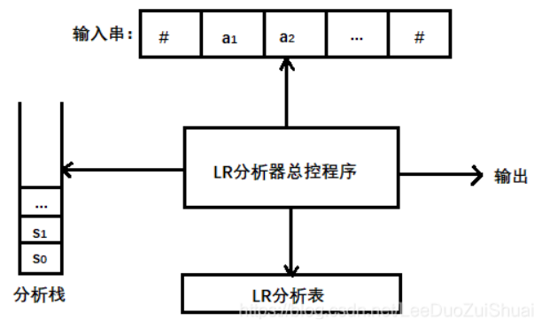
- ##### 3.4.2.2 LR(0)分析法
- 活前缀：将每一条规则编上序号①、②、③…，附加在规则的右边，并在推导的过程中将序号带入句型中。句型中形如βω℗的前部称为活前缀。
- LR(0)项目：文法G中每一条产生式规则的右部添加一个圆点，称为LR(0)项目。
	- eg：A→cAd可以产生四个LR(0)项目：A→·cAd，A→c·Ad，A→cA·d，A→cAd·。
	- 1）若是空规则A→ε，则只对应一个LR(0)项目A→·。
	- 2）含义 ：
		- i）A→·cAd表示期望下一个符号是终结符c。
		- ii）A→c·Ad表示目前输入串中已经有部分符号已正确分析成功，期望剩下的输入串能与圆点右部的部分分析成功。
		- iii）A→cAd·表示输入串已全部正确解析成功，可以归约到非终结符A。
- 初始项目：S→·α，S是文法的开始符号，称该项目为初始项目。
- 移进项目：A→α·aβ，其中a∈，称该项目为移进项目。
- 待约项目：A→α·Bβ，其中B∈，称该项目为待约项目。
- 归约项目和接收项目：A→α·，其中A∈，若A不是文法G的开始符号，则称为归约项目，否则称为接收项目。
- 后继项目：设有两个项目A→α·aβ和A→αa·β，两者同属于一条规则，只是圆点位置相差一个终结符，则称A→αa·β是A→α·aβ的后继项目。
- 文法G的拓广
	- 1）原因：为了保证文法G只有一个接收项目，一旦达到接收项目就完成整个语法分析。当一个文法G的开始符号不是只出现在一条规则的左边，则这个文法G需要拓广。
	- 2）定义：设文法G的开始符号是S，现引入一个新的开始符号S‘，并加入一条新规则：S’→S。产生新文法G’[S’]，称G’是文法G的拓广。
- LR(0)项目集：由LR(0)项目构成的集合。
- LR(0)项目集闭包
- 已知项目集I，求I的闭包CLOSURE(I)的算法：
	- 1）项目集I中所有的项目加入到CLOSURE(I)集合中。
	- 2）若待约项目A→α·Bβ属于CLOSURE(I)，则对于每一个关于B的产生式规则B→γ，将项目B→·γ加入到CLOSURE(I)中。
	- 3）反复执行2），直到CLOSURE(I)中不再有新的项目加入为止。
- LR(0)的GO函数：项目集I经过符号X的状态转换函数GO(I，X)=CLOSURE(I的后继项目集)。
- LR(0)项目集规范族：把识别文法G的所有活前缀的LR(0)项目集闭包组成的DFA称为项目集的规范族。
	- eg：设有文法G[S]：
	- S→cAd①
	- A→a②
	- A→Aa③
	- 求该文法G的LR(0)项目集规范族。
	- 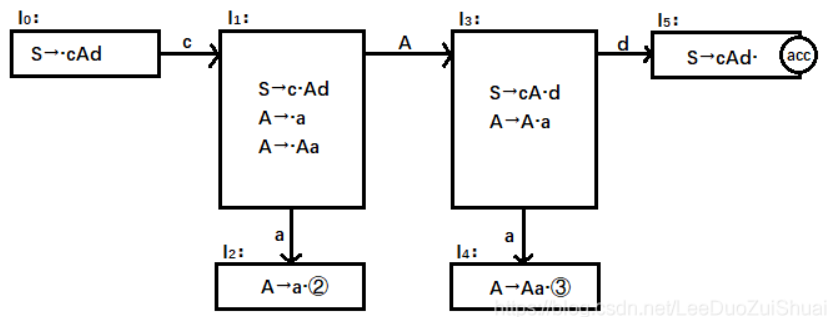
- LR(0)分析表组成：ACTION子表和GOTO子表。
	- 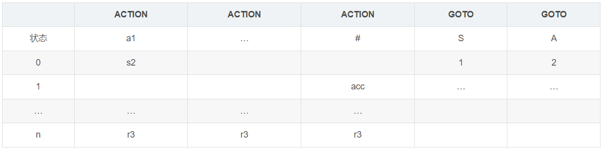
	- 其中，ai是终结符号，S和A是非终结符。
		- 1）LR(0)分析表的第一列是状态列，登记DFA中的状态编号。
		- 2）ACTION子表中的列全是终结符(包含#)，填写动作，动作分为四种：
			- i）移进动作：用s表示。如状态0所在行与ACTION子表中的a1列交叉处填写的是s2，表示a1进栈，当前状态从状态0变成状态2。
			- ii）归约动作：用r表示。如状态n所在行与ACTION子表中的a1列交叉处填写的是r3，表示用第三条规则进行归约。
			- iii）接受动作：用acc表示。如状态1所在行与ACTION子表中的#列交叉处填写的是acc，表示成功接收，已正确识别出句子。
			- iv）报错：ACTION子表中的空白处，表示出错。
		- 3）GOTO子表的列全是非终结符，表示状态转移。如状态0所在行与GOTO子表中第A列交叉处填写的是2，表示当前状态0下若识别出非终结符A，状态将变迁到状态2。
- LR(0)分析表的构造步骤：
	- 1）若移进项目A→α·aβ属于Ik且GO(Ik，a)=Ij，其中a是终结符，则令ACTION[k][a]=sj。表示将a移进栈，且状态变迁到j。
	- 2）若归约项目A→β·，并设A→β的规则编号为p，则将ACTION子表中状态k所在的行与每一个终结符(包括#)所在列的交叉处填写上rp。表示无论下一个字符是什么，只要当前状态是k，就立即使用第p条规则A→β进行归约。
	- 3）若接收项目S‘→S·属于Ik，则令ACTION[k][#]=acc。就是将ACTION子表中状态k所在的行与符号#所在列的交叉处填写acc，表示成功接收。
	- 4）若GO(Ik，A)=Ip，其中A是非终结符，则令GOTO[k][A]=p，表示状态k下若识别出非终结符A，状态将变为p。
	- 5）分析表中不能用以上规则填写的交叉处，全部填写报错标记。
- LR(0)文法：若一个文法G的LR(0)项目集规范族中所有的LR(0)项目集均不含有冲突项目，则该文法是LR(0)文法。
- LR(0)项目集中的冲突
	- 1）移进-归约冲突
		- 面临一个终结符，同时出现了移进和归约两种动作。
	- 2）归约-归约冲突
		- 一个项目集中出现两个归约动作
- LR分析器总控程序的工作步骤
	- 1）将(状态0，#)入栈.
	- 2）将下一个输入符号读入变量a中。
	- 3）由栈顶当前状态和变量a，查找ACTION子表：
		- i）对sj型动作，二元组(状态j，a)入栈，且下一个输入符号读入变量a中；
		- ii）对rj型动作，用第j条规则进行归约；
			- 若是rj型动作，用第j条规则进行归约时，设j条规则是A→β，且规则右部β的长度为n，则首先从栈中弹出n个符号，设此时栈顶的状态为s‘，然后由当前栈顶状态s‘及第j条规则A→β的左部符号A查GOTO子表，即GOTO[状态s’][A]，得到新状态w，最后将二元组(状态w，A)入栈。
		- iii）acc则成功，结束；
		- iv）报错，调用出错处理子程序。
	- 4）跳到3）。
- ##### 3.4.2.3 SLR(1)分析技术
- 含义：简化了的LR(1)分析技术。
- SLR(1)的移进-归约方式：
	- 1）若下一个符号x是b，则使用A→α·bβ项目将b移进。
	- 2）若下一个符号x∈FOLLOW(B)，则使用B→γ·项目进行归约。
	- 3）若下一个符号x∈FOLLOW©，则使用C→ξ·项目进行归约。
- 与LR(0)的区别：ACTION子表中r型动作填写规则不同。
  对于项目集Ik={B→γ·℗}：
	- 1）LR(0)分析表：状态k所在的行全部填写上rp。
	- 2）SLR(1)分析表：只有当终结符号x∈FOLLOW(B)时，才在状态所在的行与符号x所在的列的交叉处填写上rp，其余部分和LR(0)相同。
- SLR(1)型文法：若文法G的SLR(1)分析表中没有多重定义项，则该文法是SLR(1)文法。
- ##### 3.4.2.4 LR(1)分析技术
- SLR(1)的缺点：对每一个项目，仅依靠FOLLOW集，没有精确指明面临哪些符号时才能归约。
- LR(1)项目
	- 1）定义：形如[A→α·β，x]称为LR(1)项目。A→α·β是LR(0)项目，x是终结符。终结符x称为该LR(1)项目的搜索符。
	- 2）含义：表示当A→α·β到达归约项目A→αβ·时，只有面临的下一个符号是x时才能进行归约。
	- 3）若一个项目集中有LR(1)项目：[A→α·β，a]，[A→α·β，b]，[A→α·β，c]，则可合并写成[A→α·β，a/b/c]。
	- 4）LR(1)的开始项目：[S’→·S，#]
- LR(1)项目对活前缀有效：若存在推导S ⇒* δAη ⇒ δαβη，其中ω=δα，x是η的第一个符号，或者η为ε时，x为#，则称LR(1)项目[A→α·β，x]对活前缀ω有效。
- LR(1)项目闭包集
	- 设有LR(1)项目集I，计算CLOSURE(I)的步骤：
		- 1）将I中的任何项目全加入到CLOSURE(I)中。
		- 2）若项目[A→α·Bβ，x]∈CLOSURE(I)，则对任何规则B→ξ，将项目[B→·ξ，First(βx)]加入到CLOSURE(I)中。
		- 3）反复做2），直到CLOSURE(I)中不再加入新的项目为止。
- LR(1)的GO函数：状态集I与符号X的状态变迁函数GO(I，X)=CLOSURE(J)。其中J是I经过X的后继项目集，即J={[A→αX·β，a]|[A→α·Xβ，a]∈I}。
- LR(1)分析表的构造步骤：
	- 1）若移进项目[A→α·aβ，x]∈Ik且GO(Ik，a)=Ij，其中a是终结符，则令ACTION[k][a]=sj。表示将a移进栈，当前状态变迁到状态j。
	- 2）若归约项目[A→β·，a]∈Ik，并设A→β的规则编号为p，则将ACTION[k][a]rp。
	- 3）若接收项目[S‘→S·，#]∈Ik，则令ACTION[k][#]=accj。表示成功接收。
	- 4）若GO(Ik，A)=Ip，其中A是非终结符，则令GOTO[k][A]=p。表示状态k下若识别出非终结符A，则将状态变为p。
	- 5）分析表中不能用以上规则进行填写的交叉处，全部填写报错标记。
- LR(1)文法：若LR(1)分析表中没有多重定义项，则该文法是LR(1)的文法。
- ##### 3.4.2.5 LALR(1)分析技术
- 概述
	- 1）LALR(1)分析表的结构和大小与SLR(1)相同，比LR(1)的分析表小。
	- 2）LALR(1)的分析能力比SLR(1)强，比LR(1)稍弱。
- 基本思想
- 将LR(1)项目集规范族中的所有同心项状态集合并。合并时，对应项目的搜索符也合并。原先各自接收有向边，都改为由合并后的项目集接收。原先各自发出的有向边都改为由合并后的项目集发出。
	- 1）合并后的项目集可能出现归-约归冲突。
- LALR(1)分析表的构造步骤：
	- 1）构造文法G的LR(1)项目集规范族。设项目集族为{I0，I1，…，In}。
	- 2）合并所有同心项集。设新的项目集族为{ I0’，I1’，…，Ij’ }。
	- 3）若移进项目[A→α·aβ，x]∈Ik’且GO(Ik’，a)=Ij’，其中a是终结符，则令ACTION[k][a]=sj。表示将a移进栈，且状态变迁到状态j。
	- 4）若归约项目[A→β·，a]∈Ik’，并设A→β的规则编号是p，则令ACTION[k][a]=rp。
	- 5）若接收项目[S‘→S·，#]∈Ik’，则令ACTION[k][#]=acc，表示成功接收。
	- 6）构造合并后的GOTO表。
- 设Ik’是由It1，It2，…，Itp合并得到的，由于It1，It2，…，Itp是同心项目集，所以GO(It1，X)，GO(It2，X) ，…，GO(Itn，X)也是同心项目集且它们合并后的项目集为Im’。
  若GO(Ik’，X)=Im’，其中X是非终结符，则令GOTO[k][X]=m，表示状态k下若识别处非终结符X，状态将变为m。
	- 7）分析表中不能用以上规则填写的交叉处，全部填写上报错标记。
- LALR(1)文法：若LALR(1)分析表中没有多重定义项，则该文法是LALR(1)文法。
- ## 4. 属性文法
- ### 4.1 属性文法
- #### 4.1.1 属性文法的定义
- 属性：对文法中的每一个符号(终结符或非终结符)指派若干表达语义的值，这些值称为属性。
- 语义规则：同一条产生式规则中，符号的属性之间的计算法则称为语义规则。
	- 1）语义规则表达了符号属性之间的一种计算或约束关系，并不总能用一个数学式子表达。
- 属性文法：在上下文无关文法中配置上语义规则，这样的文法称为属性文法。
- 综合属性和继承属性：设有一条产生式规则A→…，相应的语义规则为b=f(，，…，)：
	- 1）若b是A的一个属性，则称b是A的一个综合属性。
	- 2）若b是右部某一个的属性，则称b是的继承属性。
	- 3）通常认为，终结符号只有综合属性。非终结符号既有综合属性，也有继承属性。开始符号S没有继承属性，开始符号S的综合属性是最终语义的处理目标。
- 属性文法的作用：为文法配置上语义规则，当发生语法分析时：
	- 1）若是自底向上的语法分析，则当发生归约时，自动调用该规则所配置的语义规则。
	- 2）若是自顶向下的语法分析，则当发生向下推导时，将语义规则代入栈中处理。
- 语义处理：语义处理的时机、调用何种语义规则，都是由当时进行语法分析的归约时刻决定。这种工作方式称为语法制导的语义翻译(语义处理)。
- #### 4.1.2 综合属性
- 使用场景：一个结点的综合属性值由其子结点的属性值确定
- 注释分析树：在语法分析树中标记各个结点的属性值，这种语法分析树称为注释分析树。
	- eg：#1+2*3#的注释分析树
	- 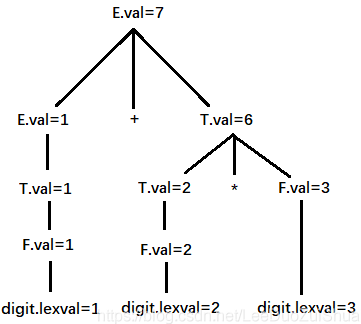
- #### 4.1.3 继承属性
- 使用场景：一个结点的继承属性值由其父结点的属性值或兄弟结点的属性值来确定。用于表达上下文的依赖性。
- #### 4.1.4 依赖图
- 依赖关系：若有A.b=f(X.x，Y.y)，则称属性A.b依赖于属性X.x和Y.y。
- 依赖图：把每一属性都看成是有向图的一个结点，若属性A.b依赖于属性X.x和Y.y，则从结点X.x和Y.y各自发出一条有向边指向结点A.b。对于一棵语法分析树，这种属性之间的依赖关系构成了一个有向图，这个有向图称为依赖图。
	- 1）若依赖图中有环路，则无法对属性求值。
	- 2）若一个依赖图有n个结点，计算全部属性值的时间复杂度最好为O(n)，最坏为O(n2)。
- #### 4.1.5 属性文法的计算顺序
- 计算顺序：对输入串进行语法分析，构造语法分析树，遍历语法树并对树中各结点进行语义规则处理。
- S-属性定义：若属性文法中所有的属性均为综合属性，则称为S-属性定义(S-属性文法)。
- L-属性定义：若文法G的每一条产生式规则A→…所配置的语义规则中的每一个属性或者都是综合属性，或者是的一个继承属性，且该继承属性仅依赖于A的继承属性及左部的，，…，的任何属性，则称该属性文法为L-属性定义(L-属性文法)。
- ### 4.2 S-属性定义及其自底向上的计算
- S-属性定义在SLR(1)分析器中的应用
	- 1）设SLR(1)分析器中，状态栈为state[]，存放分析表中状态i所在行的索引；属性栈为val，存放文法符号的属性值；top是栈顶指针。
	- 2）若state[i]对应状态为i，隐含的文法符号为A，则val[i]为A的属性值。
	- 3）设有产生式规则A→，，…，，所配置的语义规则是A.b=f(.v，.v，…，.v)，并
	  约定：最每次归约之前。先调用语义规则进行计算，再进行归约。
	- 4）SLR(1)中实现的规则
	- 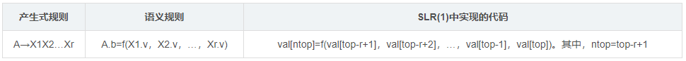
- ### 4.3 L-属性定义及其自顶向下的计算
- 语义动作：语义规则的某种实现代码。
- 翻译方案：将语义动作放在{}内，并插在文法规则右部的任何合适的位置，这样的文法称为翻译方案。
	- 1）插入的位置决定了语义动作计算的先后次序
	- eg：翻译方案：
		- E→TR
		- R→opT{print(op.lexval)}R1
		- R→ε
		- T→num{print(num.lexval)}
		- op为+或-运算符，求#1-2+3#的语法分析树。
	- 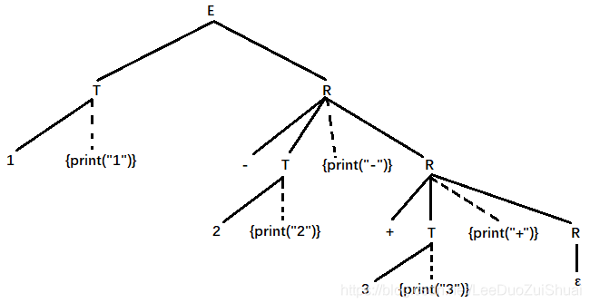
	- 选择插入位置的原则
		- 产生式规则右部符号的继承属性必须在这个符号之前的语义动作中计算出来。
		- 一个动作不能引用这个动作右部符号的综合属性。
		- 规则左部符号的综合属性只有在它所引用到的所有属性都计算出来之后才能计算。
	- 消除左递归并构造新的翻译方案的基本变换性质
		- 设带左递归的翻译方案是：
		- A→A1Y{A.a=g(A1.a，Y.y)}
		- A→X{A.a=f(X.x)}
		- 则消除左递归后新的翻译方案：引入继承属性R.i
		- A→X{R.i=f(X.x)}R{A.a=R.s}
		- R→Y{R1.i=g(R.i，Y.y)}R1{R.s=R1.s}
		- R→ε{R.s=R.i}
- ### 4.4 自底向上计算继承属性
- #### 4.4.1 删除翻译方案中嵌入的动作
- 基本思想：通过引入新的非终结符并改变文法，可将嵌入在规则内部的语义动作全部移到规则右部的末尾。
	- 1）在自底向上的语法分析中，只有当发生归约时，才有机会进行语义动作的计算。
- #### 4.4.2 分析栈中的继承属性
- 复写规则：设Y.y是继承属性，X.s是综合属性，且有Y.y=X.s，则称Y.y=X.s为复写规则。
- 基本思想：在引用继承属性时，引用其指向的综合属性。
- #### 4.4.3 模拟继承属性的计算
- 基本思想：某些情况下，综合属性位置不固定、继承属性不是复写规则型，导致不能使用复写规则。此时，可以改造翻译方案，使继承属性变成复写规则型。或彻底改造文法，用综合属性替代继承属性。
- ## 5. 语义分析于语法制导的翻译
- ### 5.1 语义分析的主要任务
- 主要任务：分析源程序的含义并做出相应的语义处理。
	- 1）语义处理：静态语义检查、语义翻译。
- 静态语义检查
	- 1）类型检查。eg：赋值运算两边类型是否相容。
	- 2）控制流检查。eg：for循环的嵌套关系是否正确。
	- 3）唯一性检查。eg：switch中case标号是否重复定义。
	- 4）其它相关的语义检查。eg：局部内部类不能访问非final型的局部变量。
- 语义翻译：生成与硬件机器相对独立的中间语言代码。
	- 1）优点
		- i）可以进行与具体机器特性无关的反应代码本身特性的代码优化。
		- ii）当要将编译程序移植到新的目标机器时，前端几乎不变，只需修改后端即可。
- ### 5.2 中间语言
- #### 5.2.1 图表示
- 形式：将表达式的运算符作为一个结点，操作数作为这个结点的子结点。当重复引用一个子表达式时，可直接重复使用这个子表达式所对应的结点。这样树形结构变成了有向无环图，简称DAG。
	- eg：a+a*(b-c)+(b-c)*d的DAG
	- 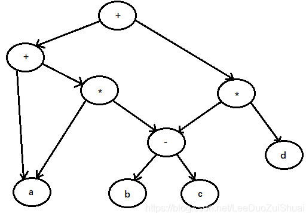
- 特点：DAG能标识出公共子表达式，有利于进行中间代码的公共子表达式优化。
- #### 5.2.2 抽象语法树
- 形式：将运算符、关键字作为树的内部结点，运算对象作为树的叶子结点，这样构成了一棵抽象语法树。
	- eg：if (b) s1 else s2;语句的抽象语法树。
	- 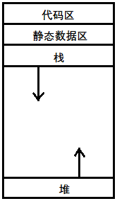
- #### 5.2.3 三地址代码
- 形式：三地址代码的形式为x:=y op z。其中，y、z可以是名字、常数、临时变量等。X可以是名字或临时变量。op代表运算符。
- 特点：式子右部只能有一个运算符。
- 种类
	- 1）x:=y op z 双目运算。
	- 2）x:=op y 单目运算。
	- 3）x:=y 复写语句，直接赋值。
	- 4）goto Label 无条件转移到标号Label处。
	- 5）if x relop y goto Label 其中relop为关系运算符(＜，＞，＝，…) 若x relop y为真，则转移到标号Label处，否则执行紧跟在本语句之后的下一条三地址语句。
	- 6）param x 实在参数x进栈。
	- 7）call p, n 调用过程或函数p，共有n个实参。
	- 8）return y 函数返回并带回值y，y可选。
	- 9）x:=y[i] 将数组下标i处的数组值赋值给x。
	- 10）y[i]:=x 将x值赋值给数组下标i处的数组元素。
	- 11）x:=&y 将y的地址赋值给x。
	- 12）x:=*y 将地址为y的存储单元中的内容赋给x。
	- 13）*x:=y 将y值放到地址为x的存储单元中。
	- eg：将调用函数f(a，b，c)翻译成相应的三地址代码：
		- param a
		- param b
		- param c
		- call f, 3
	- eg：将赋值语句x=12+a*(b-10)/c;翻译成三地址代码：
		- T1:=b-10
		- T2:=a*T1
		- T3:=T2/c
		- T4:=12+T3
		- x:=T4
- #### 5.2.4 四元式
- 形式：四元式的形式是(op，arg1，arg2，result)。其中，op是运算符，arg1和arg2是操作对象，result存放最终结果。若op是单目运算符，则arg2可以省略。
	- eg：将赋值语句x=12+a*(b-10)/c;翻译成四元式代码：
		- (100)(-,b,10,T1)
		- (101)(*,a,T1,T2)
		- (102)(/,T2,c,Tc)
		- (103)(+,12,T3,T4)
		- (104)(:=,T4,x)
- #### 5.2.5 三元式
- 形式：三元式的形式是( p )(op，arg1，org2)。其中op是运算符，arg1和arg2是操作对象。运算的结果由该三元式的位置( p )来引用。
- #### 5.2.6 逆波兰式
- 定义
- 一个表达式E的逆波兰式表示定义为：
	- 1）若E是常量或变量，则E的逆波兰式表示就是E。
	- 2）若E由E1 op E2组合，则E的逆波兰式表示是E1’E2’op。其中E1’E2’分别是E1’、E2’的逆波兰式的表示。
	- 3）若E是(E1)形式，则E的逆波兰式表示是E1的逆波兰式表示。
- 特点：操作数的先后次序不变，而运算符的先后次序是真正运算的先后次序。
	- eg：将a*(b+c)翻译成逆波兰式代码：abc+*
- ## 6. 运行时的环境
- ### 6.1 概述
- 运行时环境的组成：运行时刻存储空间的管理策略、符号表的管理、垃圾回收策略、运行支持库等。
- ### 6.2 C语言中的存储分配策略
- #### 6.2.1 静态存储分配策略
- 适用：对所有的static型局部变量和所有的全局变量采用静态存储分配策略。
- 原因：全局变量及static型局部变量的大小在编译时就可以知道，而且无论程序中嵌套调用多少次，其变量永远只有一份。
- #### 6.2.2 栈式存储分配策略
- 适用：对函数内部的非static型局部变量采用栈式存储分配策略。
- 原因：函数可以直接或间接的递归调用。函数中的局部变量，可能出现多个实例。每递归调用一次，都会创建一个局部变量的实例。
- #### 6.2.3 堆式存储分配策略
- 适用：对于指针类变量所指的空间采用堆式存储分配策略
- 原因：指针变量所指的空间的大小和位置，有时只有在程序运行时才能知道。
	- 1）在运行环境中有一片内存区域，称为堆。当程序用malloc()函数申请空间时，就从堆中分配一片空间给申请者。当程序用free()函数释放空间时，申请者将空间归还给堆。
	- 2）堆式存储分配策略需要运行库支持。
- ### 6.3 C语言中存储空间的划分
- #### 6.3.1 运行时内存空间的划分
- 原因：静态存储区在编译时大小已知。而栈式存储区和堆式存储区的空间大小是动态可变的。栈向下生长，堆向上生长，充分利用内存空间。
- 
-