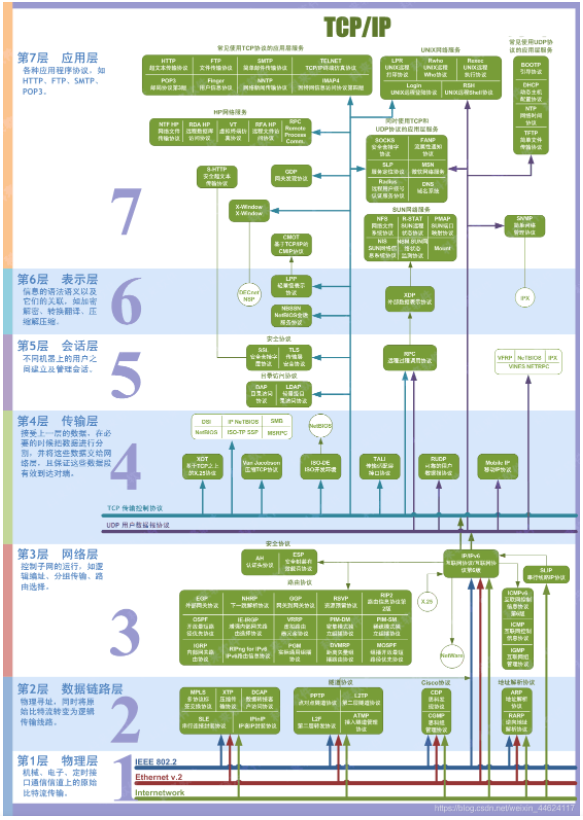
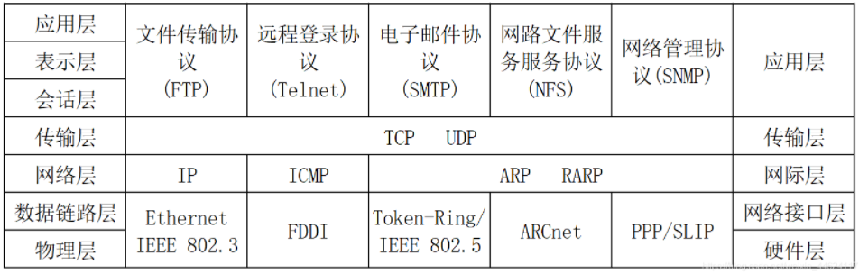
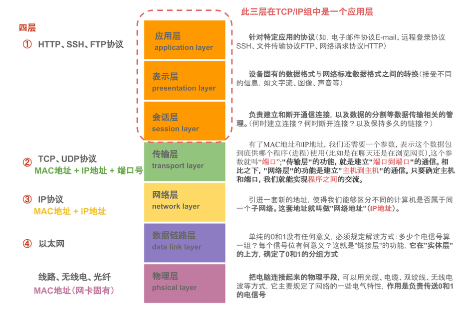
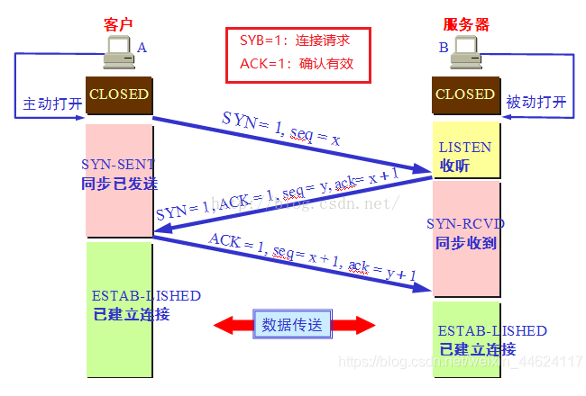
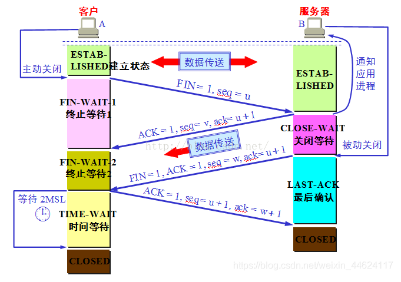
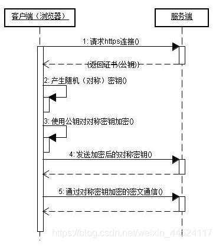

## 计算机网络七层架构
- **物理层**：主要定义物理设备标准，如网线的接口类型、光纤的接口类型、各种传输介质的传输速率等。它的主要作用是传输比特流（就是由 1、0 转化为电流强弱来进行传输,到达目的地后在转化为1、0，也就是我们常说的模数转换与数模转换）。这一层的数据叫做比特。
- **数据链路层**：主要将从物理层接收的数据进行 MAC 地址（网卡的地址）的封装与解封装。常把这一层的数据叫做帧。在这一层工作的设备是交换机，数据通过交换机来传输。
- **网络层**：主要将从下层接收到的数据进行 IP 地址（例 192.168.0.1)的封装与解封装。在这一层工作的设备是路由器，常把这一层的数据叫做数据包。
- **传输层**：定义了一些传输数据的协议和端口号（WWW 端口 80 等），如：TCP（传输控制协议，传输效率低，可靠性强，用于传输可靠性要求高，数据量大的数据），UDP（用户数据报协议，与 TCP 特性恰恰相反，用于传输可靠性要求不高，数据量小的数据，如 QQ 聊天数据就是通过这种方式传输的）。 主要是将从下层接收的数据进行分段进行传输，到达目的地址后在进行重组。常常把这一层数据叫做段。
- **会话层**：通过传输层（端口号：传输端口与接收端口）建立数据传输的通路。主要在你的系统之间发起会话或或者接受会话请求（设备之间需要互相认识可以是 IP 也可以是 MAC 或者是主机名）
- **表示层**：主要是进行对接收的数据进行解释、加密与解密、压缩与解压缩等（也就是把计算机能够识别的东西转换成人能够能识别的东西（如图片、声音等））
- **应用层**：主要是一些终端的应用，比如说FTP（各种文件下载），WEB（IE浏览），QQ之类的（你就把它理解成我们在电脑屏幕上可以看到的东西．就 是终端应用）。
  
  
- ## TCP/IP协议
- ### 原理
- TCP/IP 协议不是 TCP 和 IP 这两个协议的合称，而是指因特网整个 TCP/IP 协议族。从协议分层[模型](https://so.csdn.net/so/search?q=%E6%A8%A1%E5%9E%8B&spm=1001.2101.3001.7020)方面来讲，TCP/IP 由四个层次组成：网络接口层、网络层、传输层、应用层。
  
  
- 1、应用层(Application Layer)
	- 应用层(Application Layer)包含所有的高层协议，包括：虚拟终端协议(TELNET，TELecommunications NETwork)、文件传输协议(FTP，File Transfer Protocol)、电子邮件传输协议(SMTP，Simple Mail Transfer Protocol)、域名服务(DNS，Domain Name Service)、网上新闻传输协议(NNTP，Net News Transfer Protocol)和超文本传送协议(HTTP，HyperText Transfer Protocol)等。
- 2、传输层(Tramsport Layer-TCP/UDP)
	- 传输层(Tramsport Layer)使源端和目的端机器上的对等实体可以进行会话。在这一层定义了两个端到端的协议：传输控制协议(TCP，Transmission Control Protocol)和用户数据报协议(UDP，User Datagram Protocol)。TCP 是面向连接的协议，它提供可靠的报文传输和对上层应用的连接服务。为此，除了基本的数据传输外，它还有可靠性保证、流量控制、多路复用、优先权和安全性控制等功能。UDP 是面向无连接的不可靠传输的协议，主要用于不需要 TCP 的排序和流量控制等功能的应用程序。
- 3、网络层(Internet Layer)
	- 网络层(Internet Layer)是整个体系结构的关键部分，其功能是使主机可以把分组发往任何网络，并使分组独立地传向目标。这些分组可能经由不同的网络，到达的顺序和发送的顺序也可能不同。高层如果需要顺序收发，那么就必须自行处理对分组的排序。互联网层使用因特网协议(IP，Internet Protocol)。
- 4、网络访问层(Network Access Layer)
	- 网络访问层(Network Access Layer)在 TCP/IP ：是TCP/IP协议栈的最底层，它提供物理网络的接口，实现对复杂数据的发送和接收。网络访问层协议为网络接口、数据传输提供了对应的技术规范。网络访问层对应 OSI 七层网络模型的物理层和数据链路层。
- 四层协议与七层协议标准的对应：
  
  
- ## 三次握手四次挥手
- 三次握手
	- 第一次握手： 主机 A 发送位码为 syn＝1,随机产生 seq number=1234567 的数据包到服务器主机 B，由 SYN=1 知道，A 要求建立联机；
	- 第二次握手： 主机 B 收到请求后要确认联机信息，向 A 发 送 ack number=( 主 机 A 的seq+1),syn=1,ack=1,随机产生 seq=7654321 的包
	- 第三次握手： 主机 A 收到后检查 ack number 是否正确，即第一次发送的 seq number+1,以及位码ack 是否为 1，若正确，主机 A 会再发送 ack number=(主机 B 的 seq+1),ack=1，主机 B 收到后确认。
	  
	  
- 四次挥手
	- TCP 建立连接要进行三次握手，而断开连接要进行四次。这是由于 TCP 的半关闭造成的。因为 TCP 连接是全双工的(即数据可在两个方向上同时传递)，所以进行关闭时每个方向上都要单独进行关闭。这个单方向的关闭就叫半关闭。当一方完成它的数据发送任务，就发送一个 FIN 来向另一方通告将要终止这个方向的连接。
	- 关闭客户端到服务器的连接：首先客户端 A 发送一个 FIN，用来关闭客户到服务器的数据传送，然后等待服务器的确认。其中终止标志位 FIN=1，序列号 seq=u
	- 服务器收到这个 FIN，它发回一个 ACK，确认号 ack 为收到的序号加 1。
	- 关闭服务器到客户端的连接：也是发送一个 FIN 给客户端。
	- 客户端收到 FIN 后，并发回一个 ACK 报文确认，并将确认序号 seq 设置为收到序号加 1。首先进行关闭的一方将执行主动关闭，而另一方执行被动关闭。
	  
	  
- **为什么会有TIME_WAIT状态**：
	- 确保有足够的时间让对方收到ACK包
	- 避免新旧连接混淆
- **TCP/IP状态**
	- 1、LISTENING（listening)
		- FTP服务启动后首先处于侦听（LISTENING）状态。
	- 2、ESTABLISHED（established）
		- 建立连接。表示两台机器正在通信。
	- 3、CLOSE_WAIT
		- 对方主动关闭连接或者网络异常导致连接中断，这时我方的状态会变成CLOSE_WAIT，此时我方要调用close()来使得连接正确关闭。
	- 4、TIME_WAIT
		- 我方主动调用close()断开连接，收到对方确认后状态变为TIME_WAIT。
	- 5、SYN_SENT
		- SYN_SENT状态表示请求连接，当你要访问其它的计算机的服务时首先要发个同步信号给该端口，此时状态为SYN_SENT，如果连接成功了就变为 ESTABLISHED。
- ## 长链接与短链接
- 长短链接使用原因
	- 当网络通信时采用TCP协议时，在真正的读写操作之前，server与client之间必须建立一个连接，当读写操作完成后，双方不再需要这个连接时它们可以释放这个连接，连接的建立是需要三次握手的，而释放则需要4次挥手，所以说每个连接的建立都是需要资源消耗和时间消耗的。
- HTTP的长短链接
	- HTTP的长连接和短连接本质上是TCP长连接和短连接。
	- 在HTTP/1.0中默认使用短连接。也就是说，客户端和服务器每进行一次HTTP操作，就建立一次连接，任务结束就中断连接。当客户端浏览器访问的某个HTML或其他类型的Web页中包含有其他的Web资源（如JavaScript文件、图像文件、CSS文件等），每遇到这样一个Web资源，浏览器就会重新建立一个HTTP会话。
	- 而从HTTP/1.1起，默认使用长连接，用以保持连接特性。使用长连接的HTTP协议，会在响应头加入这行代码：
	- Connection:keep-alive
	- 在使用长连接的情况下，当一个网页打开完成后，客户端和服务器之间用于传输HTTP数据的TCP连接不会关闭，客户端再次访问这个服务器时，会继续使用这一条已经建立的连接。Keep-Alive不会永久保持连接，它有一个保持时间，可以在不同的服务器软件（如Apache）中设定这个时间。实现长连接需要客户端和服务端都支持长连接。
- TCP——长链接
	- 所谓长连接，指在一个TCP连接上可以连续发送多个数据包，在TCP连接保持期间，如果没有数据包发送，需要双方发检测包以维持此连接，一般需要自己做在线维持（不发生RST包和四次挥手）。
		- 连接→数据传输→保持连接(心跳)→数据传输→保持连接(心跳)→……→关闭连接（一个TCP连接通道多个读写通信）；
		- 这就要求长连接在没有数据通信时，定时发送数据包(心跳)，以维持连接状态；
	- TCP保活功能，保活功能主要为服务器应用提供，服务器应用希望知道客户主机是否崩溃，从而可以代表客户使用资源。如果客户已经消失，使得服务器上保留一个半开放的连接，而服务器又在等待来自客户端的数据，则服务器将应远等待客户端的数据，保活功能就是试图在服务器端检测到这种半开放的连接。
- TCP——短连接
	- 短连接是指通信双方有数据交互时，就建立一个TCP连接，数据发送完成后，则断开此TCP连接（管理起来比较简单，存在的连接都是有用的连接，不需要额外的控制手段）；
	- 连接→数据传输→关闭连接；
- 应用场景
	- 长连接： 多用于操作频繁（读写），点对点的通讯，而且连接数不能太多情况，。每个TCP连接都需要三步握手，这需要时间，如果每个操作都是先连接，再操作的话那么处理速度会降低很多，所以每个操作完后都不断开，次处理时直接发送数据包就OK了，不用建立TCP连接。
		- 例如：数据库的连接用长连接， 如果用短连接频繁的通信会造成socket错误，而且频繁的socket 创建也是对资源的浪费。
	- 短连接： 像WEB网站的http服务一般都用短链接（http1.0只支持短连接，1.1keep alive 带时间，操作次数限制的长连接），因为长连接对于服务端来说会耗费一定的资源，而像WEB网站这么频繁的成千上万甚至上亿客户端的连接用短连接会更省一些资源，如果用长连接，而且同时有成千上万的用户，如果每个用户都占用一个连接的话，那可想而知吧。所以并发量大，但每个用户无需频繁操作情况下需用短连好；
- ## HTTP原理
- HTTP 是一个无状态的协议。无状态是指客户机（Web 浏览器）和服务器之间不需要建立持久的连接，这意味着当一个客户端向服务器端发出请求，然后服务器返回响应(response)，连接就被关闭了，在服务器端不保留连接的有关信息.HTTP 遵循请求(Request)/应答(Response)模型。客户机（浏览器）向服务器发送请求，服务器处理请求并返回适当的应答。所有 HTTP 连接都被构造成一套请求和应答。
- 地址解析
	- 如用客户端浏览器请求这个页面：[http://www.lydms.com:8080/index.htm](http://www.lydms.com:8080/index.htm) 从中分解出协议名、主机名、端口、对象路径等部分，对于我们的这个地址，解析得到的结果如下：
		- 协议名： http
		- 主机名： www.lydms.com
		- 端口： 8080
		- 对象路径： /index.htm
		- 在这一步，需要域名系统 DNS 解析域名 localhost.com,得主机的 IP 地址。
- 封装HTTP数据请求包
	- 把以上部分结合本机自己的信息，封装成一个 HTTP 请求数据包
- 封装成TCP包并建立连接
	- 封装成 TCP 包，建立 TCP 连接（TCP 的三次握手）
- 客户机发送请求命令
	- 客户机发送请求命令：建立连接后，客户机发送一个请求给服务器，请求方式的格式为：统一资源标识符（URL）、协议版本号，后边是 MIME 信息包括请求修饰符、客户机信息和可内容。
- 服务器响应
	- 服务器接到请求后，给予相应的响应信息，其格式为一个状态行，包括信息的协议版本号、一个成功或错误的代码，后边是 MIME 信息包括服务器信息、实体信息和可能的内容。
- 服务器关闭TCP连接
	- 一般情况下，一旦 Web 服务器向浏览器发送了请求数据，它就要关闭 TCP 连接，然后如果浏览器或者服务器在其头信息加入了这行代码 Connection:keep-alive，TCP 连接在发送后将仍然保持打开状态，于是，浏览器可以继续通过相同的连接发送请求。保持连接节省了为每个请求建立新连接所需的时间，还节约了网络带宽。
- ## HTTPS
- HTTPS（全称：Hypertext Transfer Protocol over Secure Socket Layer），是以安全为目标的HTTP 通道，简单讲是 HTTP 的安全版。即 HTTP 下加入 SSL 层，HTTPS 的安全基础是 SSL。其所用的端口号是 443。 过程大致如下：
- #### SSL/TLS之间的关系
- SSL 是英文“Secure Sockets Layer”的缩写，中文叫做“安全套接层”。它是在上世纪90年代中期，由网景公司设计的。
- 为啥要发明 SSL 这个协议呢？因为原先互联网上使用的 HTTP 协议是明文的，存在很多缺点——比如传输内容会被偷窥（嗅探）和篡改。发明 SSL 协议，就是为了解决这些问题。
- 到了1999年，SSL 因为应用广泛，已经成为互联网上的事实标准。IETF 就在那年把 SSL 标准化。标准化之后的名称改为 TLS（是“Transport Layer Security”的缩写），中文叫做“传输层安全协议”。
- 很多人都把这两者并列称呼（SSL/TLS），因为这两者可以视作同一个东西的不同阶段。
- #### 建立连接获取证书
- SSL 客户端通过 TCP 和服务器建立连接之后（443 端口），并且在一般的 tcp 连接协商（握手）过程中请求证书。即客户端发出一个消息给服务器，这个消息里面包含了自己可实现的算法列表和其它一些需要的消息，SSL 的服务器端会回应一个数据包，这里面确定了这次通信所需要的算法，然后服务器向客户端返回证书。（证书里面包含了服务器信息：域名。申请证书的公司，公共秘钥）。
- #### 证书验证
- Client 在收到服务器返回的证书后，判断签发这个证书的公共签发机构，并使用这个机构的公共秘钥确认签名是否有效，客户端还会确保证书中列出的域名就是它正在连接的域名。
- #### 数据加密和传输
- 如果确认证书有效，那么生成对称秘钥并使用服务器的公共秘钥进行加密。然后发送给服务器，服务器使用它的私钥对它进行解密，这样两台计算机可以开始进行对称加密进行通信。
  
  
- ## CDN原理
- CND 一般包含分发服务系统、负载均衡系统和管理系统。
- ### 分发服务系统
- 其基本的工作单元就是各个 Cache 服务器。负责直接响应用户请求，将内容快速分发到用户；同时还负责内容更新，保证和源站内容的同步。根据内容类型和服务种类的不同，分发服务系统分为多个子服务系统，如：网页加速服务、流媒体加速服务、应用加速服务等。每个子服务系统都是一个分布式的服务集群，由功能类似、地域接近的分布部署的 Cache 集群组成。在承担内容同步、更新和响应用户请求之外，分发服务系统还需要向上层的管理调度系统反馈各个Cache 设备的健康状况、响应情况、内容缓存状况等，以便管理调度系统能够根据设定的策略决定由哪个 Cache 设备来响应用户的请求。
- ### 负载均衡系统
- 负载均衡系统是整个 CDN 系统的中枢。负责对所有的用户请求进行调度，确定提供给用户的最终访问地址。使用分级实现。最基本的两极调度体系包括全局负载均衡（GSLB）和本地负载均衡（SLB）。GSLB 根据用户地址和用户请求的内容，主要根据就近性原则，确定向用户服务的节点。一般通过 DNS解析或者应用层重定向（Http 3XX 重定向）的方式实现。SLB 主要负责节点内部的负载均衡。当用户请求从 GSLB 调度到 SLB 时，SLB 会根据节点内各个Cache 设备的工作状况和内容分布情况等对用户请求重定向。SLB 的实现有四层调度（LVS）、七层调度（Nginx）和链路负载调度等。
- ### 管理系统
- 分为运营管理和网络管理子系统。网络管理系统实现对 CDN 系统的设备管理、拓扑管理、链路监控和故障管理，为管理员提供对全网资源的可视化的集中管理，通常用 web 方式实现。运营管理是对 CDN 系统的业务管理，负责处理业务层面的与外界系统交互所必须的一些收集、整理、交付工作。
- ## TCP/IP族
- **TCP/IP只提供无连接、不可靠的服务。**
- 传输之前需要进行三次握手。
- IP的主要功能包括将上层数据(如TCP、UDP数据)或者同层的其它数据(如ICMP数据)封装到IP数据报中，将IP数据报传送到最终目的地；为了使数据能够在链路层上进行传输，对数据进行分段，确定数据报到达其它网络中的目的地的路径。
- #### 应用层协议—文件传输服务(FTP)
- 用来在计算机之间传输文件。
- 实际Internet的FTP服务是一种匿名(anonymous)FTP服务，设置一个特殊的用户名-anonymous，供公众使用。
- 匿名登录到FTP服务器后，其工作方式与常规FTP相同。通常处于安全目的，大多数匿名FTP服务器只允许下载，不允许上传文件。
- FTP在客户端到服务器建立2条TCP连接，一条是控制连接，主要用于传输命令和参数(端口21)；另一条是数据连接，主要用于传输文件(端口号20)。
- #### 应用层协议—远程登录协议(Telnet)
- 远程登录服务实在Telnet协议的支持下，将用户计算机和远程主机连接起来，在远程计算机上运行程序，用户输入的信息通过Telnet协议发送给远程主机，主机在TCP端口监听用户请求，并处理后，将结果通过Telnet协议返回给客户。客户再经过适当的转换显示在计算机屏幕上。因为使用Telnet命令进行远程登录，所有称为Telnet远程登录。
- 由客户端软件、服务器软件以及Telnet通用协议三部分组成。
- #### 应用层协议—电子邮件协议（SMTP)
- 电子邮件(E-mail)利用计算机进行信息交换的电子媒体信件。
- 基于客户端/服务器模式，有E-mail客户端软件、E-mail服务器、通信协议三部分组成。发送邮件，首先到达自己注册的邮件服务器主机，再在网络传输中经过多个计算机和路由中转到达目的地的邮件服务器主机，进入收件人的电子邮箱，最后邮件的接收者上网并启动电子邮件管理程序，会自动下载到自己计算机，完成接受邮件。
	- SMTP：简单邮件传输协议
	- MIME：Internet邮件扩充协议
	- PEM：增强私密邮件保护协议
	- POP：来保管用户未能及时取走的邮件，简单的纯文本协议，每次传输以正规E-mail为单位，不提供部分传输。
- #### 传输层协议—TCP
- 在IP提供的不可靠数据服务的基础上为应用程序提供一个可靠的、面向连接的、全双工的数据传输服务。TCP在源主机和目的之间建立和关闭连接操作是，均需要通过三次握手来确认建立和关闭是否成功。TCP虽然提供了一个可靠的数据传输服务，但是以牺牲通信量来实现的。
- TCP采用了重发技术： 发送数据时，启动定时器，在规定时间内没有收到确认信息，就重新发送数据包。
- #### 传输层协议—UDP
- 用户数据报协议是一种不可靠、无连接的协议，与同层面向连接的TCP相比，UDP是一种无连接的协议(无错误检测功能)。TCP有助于提供可靠的连接，UDP有助于提高传输的高速率性。不负责重新发送丢失的包，不对接收的数据进行排序，不消除重复的IP数据报，不负责建立和终止连接。(都是UDP应用程序负责的)
	- TCP：交互式会话应用程序(FTP等)。
	- UDP：自己进行错误检测、不需要检测错误(DNS、SNMP)。
- #### 网际层协议—IP
- IP只提供无连接、不可靠的服务，把差错检测和流量控制之类的服务授权给了其他层的协议。
- IP的主要功能：
	- 将上层数据(TCP、UDP数据)或同层其他数据(ICMP数据)封装到IP数据报中；
	- 将IP数据报传送到最终目的地；
	- 为了使数据能够在链路层上进行传输，对数据进行分段；
	- 确定数据报到达其它网络中的目的地的路径。
- #### 网际层协议—ICMP
- Internet控制信息协议，用于发送查错报文的协议。ICMP让IP更加稳固。也是利用IP来传送报文的。ping工具就是利用ICMP报文进行目标是否可达测试。
	- 5种差错报文：(源抑制、超时、目的不可达、重定向和要求分段)
	- 4种信息报文：回应请求、回应应答、地址屏蔽码请求和地址屏蔽码应答。
- #### 网际层协议—ARP和RARP
- 地址解析协议(ARP)和反地址解析协议(RARP)
- ARP的作用是将IP地址转为物理地址，RARP的作用是将物理地址转为IP地址。每台设备都有唯一的物理地址(通过网卡给出)，为了屏蔽底层协议及物理地址上的差异，IP协议又使用了IP地址。因此，在传输过程中，必须对IP地址和物理地址进行相互转换。
- #### 网络接口层协议—以太网(Ethernet IEEE 802.3
- Ethernet IEEE 802.3：标准局域网，速度10Mps，传输介质为铜缆。
- Ethernet IEEE 802.3u：快速以太网，速度100Mps，传输介质为双绞线。
- Ethernet IEEE 802.3z：千兆以太网，速度1000Mps，传输介质为光纤或双绞线。
- #### 网络接口层协议—光纤分布式数据接口(FDDI)
- 以光纤为传输介质。
- 采用双环体系结构，两环上的信息反方向流动。双环中一环称为主环，另一个环称为次环。正常情况下，主环传输数据，次环处于空闲状态。
- 双环设计的目的是提供高可靠性和稳定性。FDDI定义的传输介质有单模光纤和多模光纤两种。
- #### 网络接口层协议—点对点协议(PPP)
- 主要用于”拨号上网“这种广域连接模式。优点简单、具备用户验证功能、可以解决IP分配等。为各种主机、网桥和路由器之间简单连接的一种通用解决方案。
- 利用以太网(Ethernet)资源在以太网上运行PPP来进行用户认证接入的方式成为PPPoE。是目前ADSL接入方式中最广泛的技术标准。
- ATM网络撒花姑娘运行PPP来管理用户再认证的方式成为PPPoA。
- PPPoA和PPPoE运行原理相同，不同的是运行环境的不同。
- #### 其他—ADSL(非对称用户数据线)
- ADSL Modem上网拨号方式有3中，即专线方式(静态IP)、PPPoA和PPPoE。
- ADSL独享带宽，安全可靠。费用低廉,使用过去的电话线路，可以分离电话机和ADSL Modem(上网)。
- #### 其他—IPv4和IPv6
- IPv4：32位二进制，能表示IP地址个数：2^32=40亿
- IPv6:128位二级制，能表示IP地址个数：2128=3.4*1038。
  
  
-