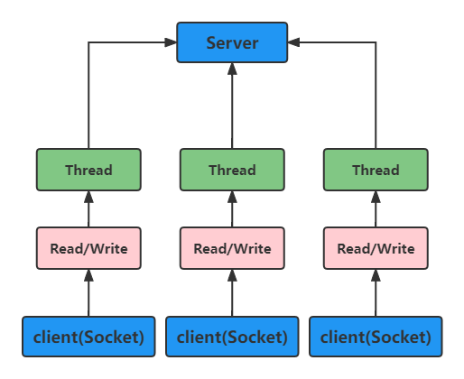
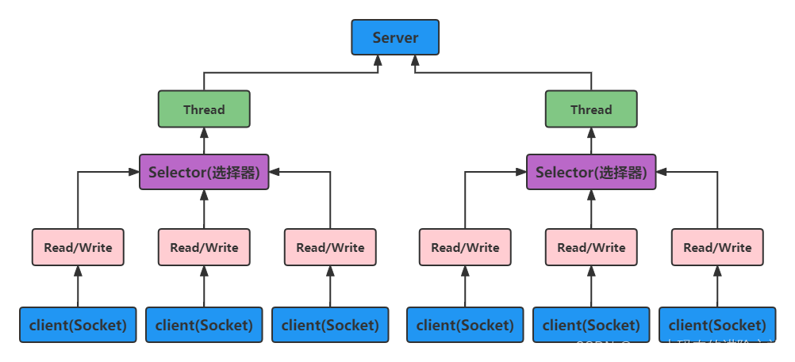
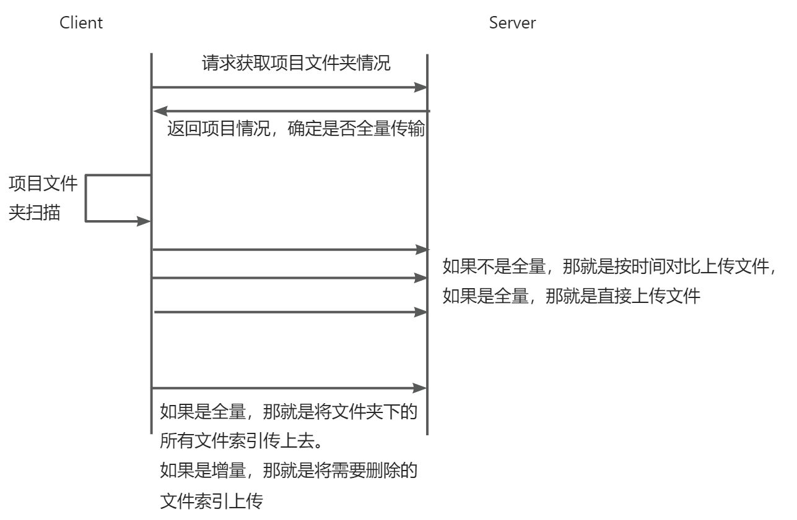

# 1.  前言
- 高并发、高性能、高可用作为架构界的三高，是各个架构师毕生所追求。
- 在我看来，高并发、高性能、高可用是需要紧密贴合业务逻辑，利用好网络协议的特性、数据库的特性、操作系统的特性来实现的。
- # 2.  基本框架 & 基本概念
- ## 2.1.  Java中的I/O模型
- I/O 模型简单的理解：就是 用什么样的通道进行数据的发送和接收，很大程度上决定了程序通信的性能。
- Java共支持3种网络编程模型/IO模式：BIO、NIO、AIO。
- Java BIO：同步并阻塞(传统阻塞型)，服务器实现模式为 一个连接对应一个线程，即客户端有连接请求时服务器端就需要启动一个线程进行处理，如果这个连接不做任何事情会造成不必要的线程开销。
  
  
- Java NIO： 同步非阻塞，服务器实现模式为 一个线程处理多个请求(连接)，即客户端发送的连接请求都会注册到多路复用器上，多路复用器轮询到连接有I/O请求就进行处理。
  
  
- Java AIO(NIO.2)：异步非阻塞，AIO 引入 异步通道 的概念，采用了 Proactor 模式，简化了程序编写，有效的请求才启动线程，它的特点是：先由操作系统完成后才通知服务端程序启动线程去处理，一般适用于连接数较多且连接时间较长的应用。
- 小结
	- BIO方式适用于 连接数目比较小且固定的架构，这种方式对服务器资源要求比较高，并发局限于应用中，JDK1.4以前的唯一选择，但程序简单易理解。
	- NIO方式适用于 连接数目多且连接比较短（轻操作）的架构，比如聊天服务器，弹幕系统，服务器间通讯等。编程比较复杂，JDK1.4 开始支持。
	- AIO方式适用于 连接数目多且连接比较长（重操作）的架构，比如相册服务器，充分调用OS参与并发操作，编程比较复杂，JDK7 开始支持。
- ## 2.2.  RPC通信协议
- 在java中比较常见的rpc框架有dubbo。
  
  [RPC通信协议](https://www.yuque.com/lijinhao-tk9dv/rhf8aa/hn79vg71r7w1nwi8)
- # 3.  实践案例
- ## 3.1.  项目文件夹实时同步
- ### 3.1.1.  项目背景
- 本地和远程服务器需要同步文件。有一定的实时性要求，并且对于项目同步的速度和精确度也有要求。
- 原先使用的是客户端nodejs+fastapi结构。fastapi使用的是默认的结构，将配置打到了32线程*128。但是在实践的过程中仍然出现了线程耗尽导致的请求直接中断的情况。
- ### 3.1.2.  过程设计
  
- 实时同步的过程主要分为两个部分：文件夹监听、文件上传同步
- 文件夹监听：
	- 1. 启动文件监听，使用chokidar框架就可以。
	- 2. 在第一次文件上传同步没有完成之前，监听的内容都是作为一个操作记录存放在数组中。
	- 3. 完成之后，监听到的内容就直接作为改动上传上去。
- 文件同步的流程，就如上面那样。
- 服务端的主要问题：
	- 高并发情况下的请求处理。所以采用了netty框架，没有使用传统的tomcat或者jetty web服务器。
	- 项目文件的每一次操作，都需要记录操作时间和操作记录。以方便后续形成文件索引和最新改动的时间。
- ### 3.1.3.  技术方案
- 服务端：Springboot + netty + druid
- 数据库：pgsql + redis
- 客户端：nodejs + async + chokidar
- ### 3.1.4.  具体内容
- springboot是作为整个服务端应用的ioc容器框架，netty则作为高并发的网络框架。
- springboot使用的是springboot3。springboot3和之前的springboot2有比较大的区别。有好一堆的框架版本需要修改。
- pom.xml依赖
  
  ```
  <dependencies>
  <dependency>
  	<groupId>org.springframework.boot</groupId>
  	<artifactId>spring-boot-starter</artifactId>
  </dependency>
  
  <!--文件依赖-->
  <dependency>
  	<groupId>commons-io</groupId>
  	<artifactId>commons-io</artifactId>
  	<version>2.11.0</version>
  </dependency>
  
  <!-- druid数据库连接池 -->
  <dependency>
  	<groupId>com.alibaba</groupId>
  	<artifactId>druid-spring-boot-3-starter</artifactId>
  	<version>1.2.20</version>
  </dependency>
  
  <!-- 数据库链接 -->
  <dependency>
  	<groupId>org.postgresql</groupId>
  	<artifactId>postgresql</artifactId>
  	<version>42.3.10</version>
  </dependency>
  
  <!-- Mybatis ORM框架 -->
  <dependency>
  	<groupId>com.baomidou</groupId>
  	<artifactId>mybatis-plus-boot-starter</artifactId>
  	<version>3.5.5</version>
  </dependency>
  
  <dependency>
  	<groupId>org.mybatis</groupId>
  	<artifactId>mybatis-spring</artifactId>
  	<version>3.0.3</version>
  </dependency>
  
  <!-- Netty -->
  <dependency>
  	<groupId>io.netty</groupId>
  	<artifactId>netty-all</artifactId>
  </dependency>
  
  <!-- JSON -->
  <dependency>
  	<groupId>org.json</groupId>
  	<artifactId>json</artifactId>
  	<version>20231013</version>
  </dependency>
  
  <!-- redis -->
  <dependency>
  	<groupId>org.springframework.boot</groupId>
  	<artifactId>spring-boot-starter-data-redis</artifactId>
  </dependency>
  
  <dependency>
  	<groupId>org.projectlombok</groupId>
  	<artifactId>lombok</artifactId>
  </dependency>
  
  <!--测试框架-->
  <dependency>
  	<groupId>org.springframework.boot</groupId>
  	<artifactId>spring-boot-starter-test</artifactId>
  	<scope>test</scope>
  </dependency>
  
  <dependency>
  	<groupId>org.mybatis.spring.boot</groupId>
  	<artifactId>mybatis-spring-boot-starter</artifactId>
  	<version>3.0.3</version>
  </dependency>
  
  <!-- RestTemplate -->
  <dependency>
  	<groupId>org.springframework.boot</groupId>
  	<artifactId>spring-boot-starter-web</artifactId>
  </dependency>
  
  <dependency>
  	<groupId>com.fasterxml.jackson.datatype</groupId>
  	<artifactId>jackson-datatype-jsr310</artifactId>
  </dependency>
  </dependencies>
  ```
- ### 3.1.5.  服务端开发
- springboot容器启动
  
  ```
  @SpringBootApplication
  @MapperScan("com.npc.sync.mapper")
  public class SyncServiceApplication {
  
  public static void main(String[] args) {
  SpringApplication.run(SyncServiceApplication.class, args);
  }
  
  @PostConstruct
  public void LogFolderInit() {
  File logDir = new File("logs");
  if (!logDir.exists()) {
  	logDir.mkdirs();
  	System.out.println("Logs directory created: " + logDir.getAbsolutePath());
  } else {
  	System.out.println("Logs directory already exists: " + logDir.getAbsolutePath());
  }
  }
  
  @Bean
  public RestTemplate restTemplate() {
  return new RestTemplate();
  }
  
  }
  ```
- 日志模块
	- 日志框架使用的slf4j。主要就通过在resources文件夹下面写一个log-back.xml就可以了。
	  
	  ```
	  <?xml version="1.0" encoding="UTF-8"?>
	  <configuration>
	  <!-- 定义业务日志文件 -->
	  <property name="APPLICATION_LOG_FILE" value="logs/application.log"/>
	  
	  <!-- 业务日志Appender -->
	  <appender name="APPLICATION_LOG" class="ch.qos.logback.core.rolling.RollingFileAppender">
	   <file>${APPLICATION_LOG_FILE}</file>
	   <rollingPolicy class="ch.qos.logback.core.rolling.TimeBasedRollingPolicy">
	     <fileNamePattern>${APPLICATION_LOG_FILE}.%d{yyyy-MM-dd}.log</fileNamePattern>
	     <maxHistory>30</maxHistory>
	   </rollingPolicy>
	   <encoder>
	     <pattern>%d{yyyy-MM-dd HH:mm:ss} %-5level %logger{36} - %msg%n</pattern>
	   </encoder>
	  </appender>
	  
	  <!-- 控制台Appender -->
	  <appender name="CONSOLE" class="ch.qos.logback.core.ConsoleAppender">
	   <encoder>
	     <pattern>%d{yyyy-MM-dd HH:mm:ss} %-5level %logger{36} - %msg%n</pattern>
	   </encoder>
	  </appender>
	  
	  <!-- 定义业务日志记录器 -->
	  <logger name="com.npc.sync.app" level="DEBUG" additivity="false">
	   <appender-ref ref="APPLICATION_LOG" />
	   <appender-ref ref="CONSOLE" />
	  </logger>
	  
	  <!-- 定义根日志记录器 -->
	  <root level="INFO">
	   <appender-ref ref="CONSOLE"/>
	   <appender-ref ref="APPLICATION_LOG"/>
	  </root>
	  </configuration>
	  ```
- netty服务器
	- nettyServer
	  
	  ```
	  @Component
	  public class NettyServer {
	   private static final Logger log = LoggerFactory.getLogger(NettyServer.class);
	  
	   // Boss事件轮询线程组
	   private EventLoopGroup boss = new NioEventLoopGroup(1);
	   // Worker事件轮询线程组
	   private EventLoopGroup worker = new NioEventLoopGroup();
	  
	   private Channel channel;
	  
	   @Autowired
	   ServerChannelInitializer serverChannelInitializer;
	  
	   @Value("${netty.port}")
	   private Integer port;
	  
	   @PostConstruct
	   public ChannelFuture start() {
	       ServerBootstrap serverBootstrap = new ServerBootstrap();
	       serverBootstrap.group(boss, worker)
	       //表示系统用于临时存放已完成三次握手的请求的队列的最大长度,如果连接建立频繁，服务器处理创建新连接较慢，可以适当调大这个参数
	       .option(ChannelOption.SO_BACKLOG, 128)
	       .channel(NioServerSocketChannel.class)
	       .childHandler(serverChannelInitializer);
	  
	       // 绑定端口并接受连接
	       ChannelFuture channelFuture = serverBootstrap.bind(port).syncUninterruptibly();
	  
	       // 获取Channel
	       channel = channelFuture.channel();
	  
	       if(channelFuture.isSuccess() && channelFuture!=null) {
	           log.info("Netty server 服务启动成功, 端口port = {}", port);
	       }else{
	           log.info("Netty server 服务启动失败");
	       }
	  
	       return channelFuture;
	   }
	  
	   @PreDestroy
	   public void destroy(){
	       if(channel != null){
	           channel.close();
	       }
	  
	       worker.shutdownGracefully();
	       boss.shutdownGracefully();
	       log.info("Netty server 服务关闭成功");
	   }
	  }
	  ```
	- ServerChannelHandler
	  
	  ```
	  @Component
	  @ChannelHandler.Sharable
	  public class ServerChannelHandler extends SimpleChannelInboundHandler<FullHttpRequest> {
	  
	   private static final Logger log = LoggerFactory.getLogger(ServerChannelHandler.class);
	  
	   private static final AsciiString CONNECTION = AsciiString.cached("Connection");
	   private static final AsciiString KEEP_ALIVE = AsciiString.cached("keep-alive");
	   private static final AsciiString CONTENT_TYPE = AsciiString.cached("Content-Type");
	   private static final AsciiString CONTENT_LENGTH = AsciiString.cached("Content-Length");
	  
	   @Value("${sync.config.prefix-uri}")
	   private String prefixUri;
	  
	   @Autowired
	   private GlobalExceptionHandler globalExceptionHandler;
	  
	   @Override
	   protected void channelRead0(ChannelHandlerContext ctx, FullHttpRequest fullHttpRequest) throws Exception {
	       log.info("开始处理 HTTP 请求: {}", fullHttpRequest);
	  
	       FullHttpResponse response;
	       try {
	           if (fullHttpRequest.method().name().equals("GET")) {
	               log.error("收到GET请求");
	               throw new IllegalArgumentException("不支持GET请求");
	           }
	  
	           String requestUri = fullHttpRequest.uri();
	           log.info("收到POST请求: {}", requestUri);
	           if (!requestUri.startsWith(prefixUri)) {
	               throw new IllegalArgumentException("无效的uri请求:" + requestUri);
	           }
	  
	           String endpoint = requestUri.substring(prefixUri.length());
	           RequestStrategy requestStrategy = RequestStrategyFactory.getStrategy(endpoint);
	           Object result = requestStrategy.handle(fullHttpRequest);
	           byte[] responseBytes = result.toString().getBytes(StandardCharsets.UTF_8);
	           response = new DefaultFullHttpResponse(HttpVersion.HTTP_1_1, HttpResponseStatus.OK,
	                   Unpooled.wrappedBuffer(responseBytes));
	           response.headers().set(CONTENT_TYPE, "text/plain; charset=utf-8");
	           response.headers().setInt(CONTENT_LENGTH, response.content().readableBytes());
	       } catch (Exception e) {
	           response = globalExceptionHandler.handleAllExceptions(e);
	       }
	  
	       boolean keepAlive = HttpUtil.isKeepAlive(fullHttpRequest);
	       if (!keepAlive) {
	           ctx.write(response).addListener(ChannelFutureListener.CLOSE);
	       } else {
	           response.headers().set(CONNECTION, KEEP_ALIVE);
	           ctx.write(response);
	       }
	  
	   }
	  
	   @Override
	   public void exceptionCaught(ChannelHandlerContext ctx, Throwable cause) {
	       log.error("通道处理异常", cause);
	       ctx.close();
	   }
	  
	   @Override
	   public void channelReadComplete(ChannelHandlerContext ctx) {
	       ctx.flush();
	   }
	  
	  }
	  ```
	- ServerChannelInitializer
	  
	  ```
	  @Component
	  public class ServerChannelInitializer extends ChannelInitializer<SocketChannel> {
	  
	   @Autowired
	   ServerChannelHandler serverChannelHandler;
	  
	   @Override
	   protected void initChannel(SocketChannel ch) throws Exception {
	       // 编码解码
	       ch.pipeline().addLast("decoder", new HttpRequestDecoder())
	           .addLast("encoder",new HttpResponseEncoder())
	           .addLast("aggregator",new HttpObjectAggregator(100*1024*1024)) // 100MB max
	           .addLast("handler",serverChannelHandler);
	   }
	  
	  }
	  ```
- application.yml文件中的关键配置：
  
  ```
  spring:
    datasource:
        druid:
            driver-class-name: org.postgresql.Driver
            url: jdbc:postgresql://192.168.23.112:5432/postgres?useSSL=false
            username: postgres
            password: 123456
            # 初始化连接数量
            initial-size: 5
            # 最小线连接数量
            min-idle: 5
            # 最大连接数量
            max-active: 20
            # 获取连接时最大等待时间，单位毫秒
            max-wait: 60000
            #销毁线程时检测当前连接的最后活动时间和当前时间差大于该值时，关闭当前连接
            min-evictable-idle-time-millis: 30000
            #用来检测连接是否有效的sql 必须是一个查询语句
            #mysql中为 select 'x'
            #oracle中为 select 1 from dual
            validation-query: select 'x'
            #申请连接时会执行validationQuery检测连接是否有效,开启会降低性能,默认为true
            test-on-borrow: false
            #归还连接时会执行validationQuery检测连接是否有效,开启会降低性能,默认为tru
            test-on-return: false
            #配置过滤器，过滤掉静态文件
            web-stat-filter:
                enabled: true
                url-pattern: /*
                exclusions: /druid/*,*.js,*.css,*.gif,*.jpg,*.bmp,*.png,*.ico
            # 配置后台监控
            stat-view-servlet:
              # 可以访问界面
              url-pattern: /druid/*
              # 允许访问的地址，这里因为时本地所以配置当前机器
              allow: 127.0.0.1
              # 是否开启访问
              enabled: true
              # 是否能够重置数据
              reset-enable: false
              # 管理页面登陆的用户名
              login-username: admin
              # 管理页面登陆的密码
              login-password: admin
  mybatis-plus:
    mapper-locations: classpath*:mapper/*.xml
    configuration:
        map-underscore-to-camel-case: true
        log-impl: org.apache.ibatis.logging.stdout.StdOutImpl
        use-generated-keys: true
    global-config:
        db-config:
            id-type: auto
    type-aliases-package: com.npc.sync.entity
  ```
- ### 3.1.6.  客户端开发
- 客户端需要向服务端发送请求，而且需要跟本地操作系统有关系，因此在本地也需要加一个线程池搂着点，不然会把本地的cache缓存给撑爆。
- 客户端可以使用nodejs的aysnc框架实现一个线程池。然后将发送文件控制在个位数。
-